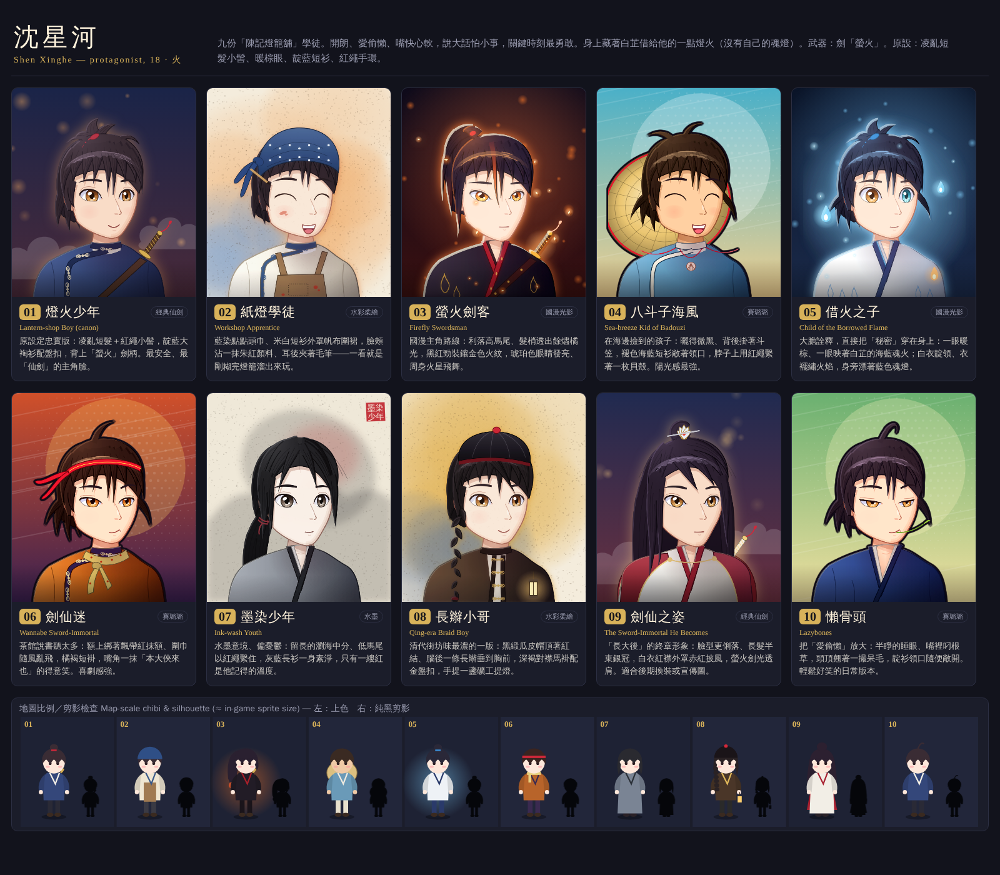
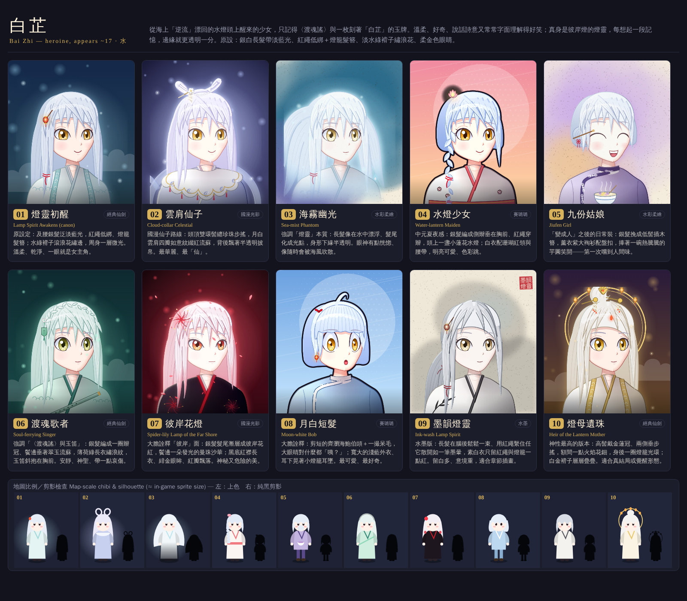
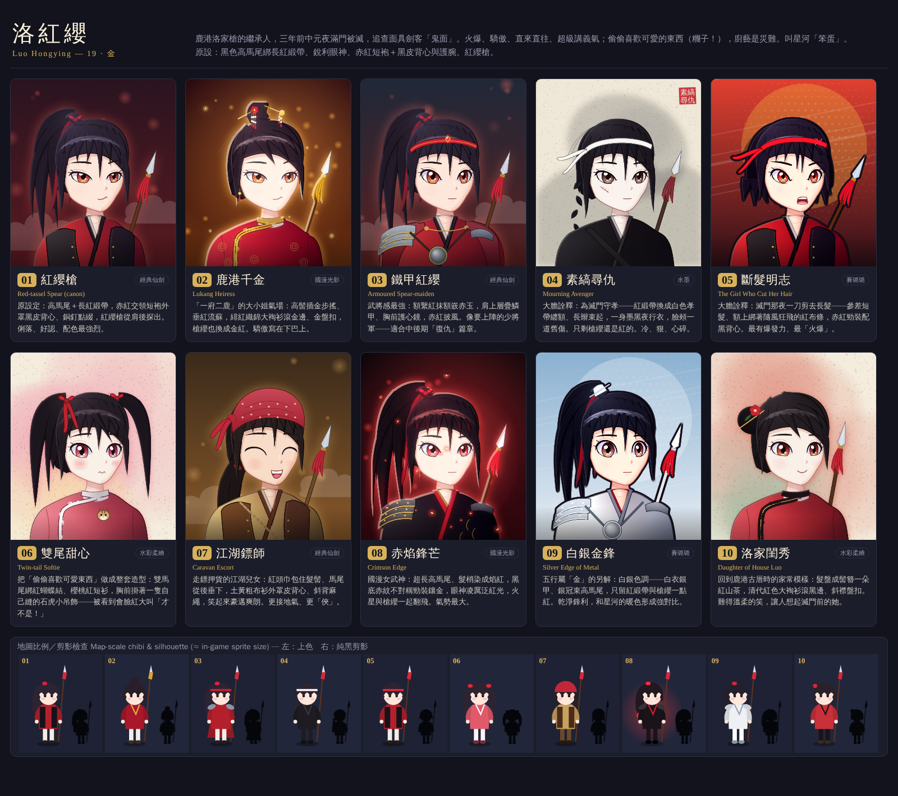
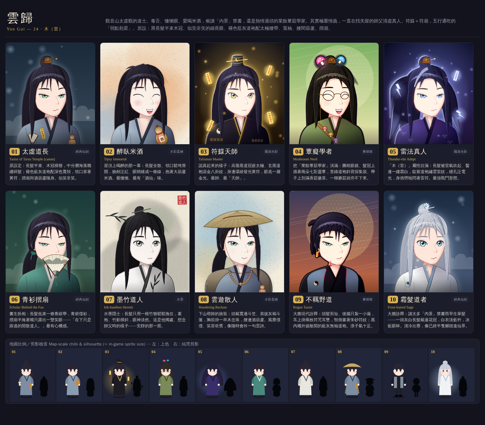
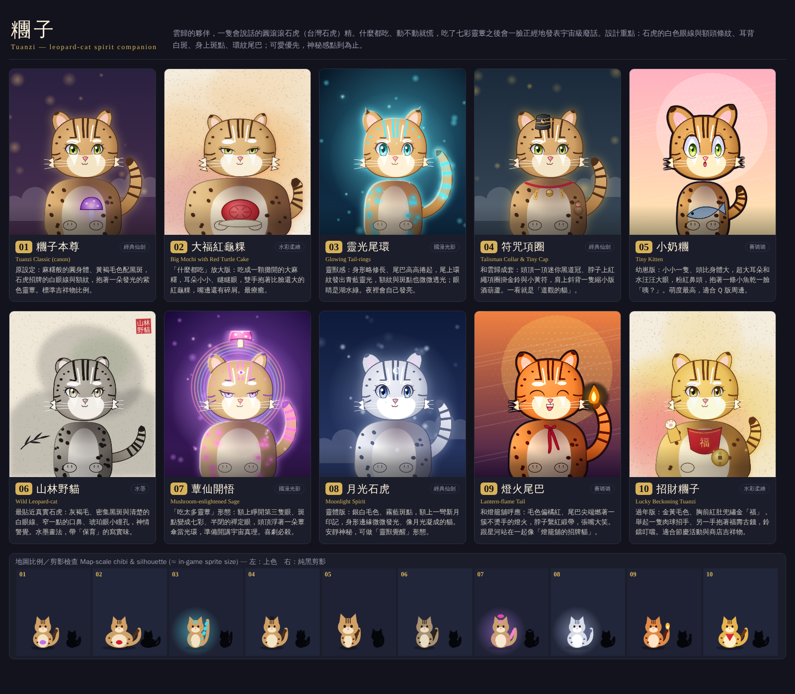

# 《彼岸燈》主要角色造型提案 — Character Design Options

> 給選角用的造型方案總表：五位主角（沈星河、白芷、洛紅纓、雲歸、糰子）各 10 款，彼此在**髮型／剪影、配色、服裝剪裁與層次、配件、年齡感與表情、畫風**上都刻意拉開差距；每位角色的第 1 款是忠於 Story Bible 的「原設定」，其餘為延伸與大膽詮釋。
> *A pick-list of 10 look options for each of the five leads. Option 1 is always the bible-faithful "canon" look; the rest are variations and a few bolder reinterpretations.*

## 怎麼看 / How to view

- 圖檔：`docs/design/options_<角色>.png`（每張一位角色，1600 px 寬）。每張卡片 = 編號、方案名、畫風標籤、一行說明；卡片下方另有**地圖比例 Q 版＋純黑剪影**，用來檢查角色在遊戲地圖上是否一眼可辨。
- 互動版：用瀏覽器開 `tools/design/character_options.html`（加 `?char=xinghe|baizhi|hongying|yungui|tuanzi` 只看單一角色；滑鼠停在卡片上會顯示英文說明）。重新產生圖檔與本文件：`node tools/design/build_sheets.js`。
- 方案可以**混搭**：例如「A 方案的髮型 + B 方案的配色」，或把造型與畫風分開挑（畫風標籤代表的是整體美術方向，不綁定造型）。
- *Images are in `docs/design/`; the live page is `tools/design/character_options.html`. Options can be mixed and matched (hair from one, palette from another); the art-direction tag is independent of the costume design.*

**畫風標籤 Art-direction tags**：`經典仙劍 classic xianxia`、`國漫光影 donghua glow`、`水彩柔繪 soft watercolour`、`賽璐璐 sharp cel-shade`、`水墨 ink-wash`

## 沈星河 — Shen Xinghe — protagonist, 18 · 火

九份「陳記燈籠舖」學徒。開朗、愛偷懶、嘴快心軟，說大話怕小事，關鍵時刻最勇敢。身上藏著白芷借給他的一點燈火（沒有自己的魂燈）。武器：劍「螢火」。原設：凌亂短髮小髻、暖棕眼、靛藍短衫、紅繩手環。

| # | 方案 Option | 畫風 / 表情 | 說明（English gloss） |
|---|---|---|---|
| 01 | **燈火少年** *Lantern-shop Boy (canon)* | 經典仙劍 classic xianxia 微笑 | 原設定忠實版：凌亂短髮＋紅繩小髻，靛藍大裪衫配盤扣，背上「螢火」劍柄。最安全、最「仙劍」的主角臉。 *Faithful to the bible: messy hair with a red-cord topknot, indigo side-fastened jacket with frog buttons, sword hilt over the shoulder.* |
| 02 | **紙燈學徒** *Workshop Apprentice* | 水彩柔繪 soft watercolour 大笑 | 藍染點點頭巾、米白短衫外罩帆布圍裙，臉頰沾一抹朱紅顏料、耳後夾著毛筆——一看就是剛糊完燈籠溜出來玩。 *Indigo polka-dot headscarf, cream shirt under a canvas apron, a vermilion paint smudge and a brush behind the ear.* |
| 03 | **螢火劍客** *Firefly Swordsman* | 國漫光影 donghua glow 認真 | 國漫主角路線：利落高馬尾、髮梢透出餘燼橘光，黑紅勁裝鑲金色火紋，琥珀色眼睛發亮、周身火星飛舞。 *Donghua hero: sleek high ponytail with ember tips, black-and-crimson outfit with gold flame embroidery, glowing amber eyes, sparks.* |
| 04 | **八斗子海風** *Sea-breeze Kid of Badouzi* | 賽璐璐 sharp cel-shade 大笑 | 在海邊撿到的孩子：曬得微黑、背後掛著斗笠，褪色海藍短衫敞著領口，脖子上用紅繩繫著一枚貝殼。陽光感最強。 *Sun-tanned shore kid: straw hat slung on his back, faded sea-blue jacket, a seashell on a red cord.* |
| 05 | **借火之子** *Child of the Borrowed Flame* | 國漫光影 donghua glow 平靜 | 大膽詮釋，直接把「秘密」穿在身上：一眼暖棕、一眼映著白芷的海藍魂火；白衣靛領、衣襬繡火焰，身旁漂著藍色魂燈。 *Bold: wears his secret - one warm brown eye, one sea-blue eye lit by her flame; white robe, flame hem, drifting soul-lights.* |
| 06 | **劍仙迷** *Wannabe Sword-Immortal* | 賽璐璐 sharp cel-shade 得意 | 茶館說書聽太多：額上綁著飄帶紅抹額、圍巾隨風亂飛，橘褐短褂，嘴角一抹「本大俠來也」的得意笑。喜劇感強。 *Storyteller fanboy: flying red hero headband, scarf, rust-orange jacket, cocky grin.* |
| 07 | **墨染少年** *Ink-wash Youth* | 水墨 ink-wash 平靜 | 水墨意境、偏憂鬱：留長的瀏海中分、低馬尾以紅繩繫住，灰藍長衫一身素淨，只有一縷紅是他記得的溫度。 *Ink-wash and melancholy: longer centre-parted fringe, low ponytail tied with red string, grey-blue robe.* |
| 08 | **長辮小哥** *Qing-era Braid Boy* | 水彩柔繪 soft watercolour 微笑 | 清代街坊味最濃的一版：黑緞瓜皮帽頂著紅結、腦後一條長辮垂到胸前，深褐對襟馬褂配金盤扣，手提一盞礦工提燈。 *Most Qing-era: black skull-cap with red knot, long queue braid over the shoulder, brown mandarin jacket, miner's lamp.* |
| 09 | **劍仙之姿** *The Sword-Immortal He Becomes* | 經典仙劍 classic xianxia 認真 | 「長大後」的終章形象：臉型更俐落、長髮半束銀冠，白衣紅襟外罩赤紅披風，螢火劍光透肩。適合後期換裝或宣傳圖。 *Endgame form: older face, half-up hair with silver crown, white robe, crimson cape, glowing sword.* |
| 10 | **懶骨頭** *Lazybones* | 賽璐璐 sharp cel-shade 得意 | 把「愛偷懶」放大：半睜的睡眼、嘴裡叼根草，頭頂翹著一撮呆毛，靛衫領口隨便敞開。輕鬆好笑的日常版本。 *Lazy-day version: sleepy half-lidded eyes, grass stalk in mouth, ahoge, collar hanging open.* |

## 白芷 — Bai Zhi — heroine, appears ~17 · 水

從海上「逆流」漂回的水燈頭上醒來的少女，只記得〈渡魂謠〉與一枚刻著「白芷」的玉牌。溫柔、好奇、說話詩意又常常字面理解得好笑；真身是彼岸燈的燈靈，每想起一段記憶，邊緣就更透明一分。原設：銀白長髮帶淡藍光、紅繩低綁＋燈籠髮簪、淡水綠褙子繡浪花、柔金色眼睛。

| # | 方案 Option | 畫風 / 表情 | 說明（English gloss） |
|---|---|---|---|
| 01 | **燈靈初醒** *Lamp Spirit Awakens (canon)* | 經典仙劍 classic xianxia 微笑 | 原設定：及腰銀髮泛淡藍光，紅繩低綁、燈籠髮簪；水綠褙子滾浪花繡邊，周身一層微光。溫柔、乾淨、一眼就是女主角。 *Canon: waist-long silver hair tied low with red string, lantern hairpin, aqua beizi with sea-foam embroidery, soft glow.* |
| 02 | **雲肩仙子** *Cloud-collar Celestial* | 國漫光影 donghua glow 微笑 | 國漫仙子路線：頭頂雙環髻纏珍珠步搖，月白雲肩四瓣如意紋綴紅流蘇，背後飄著半透明披帛。最華麗、最「仙」。 *Celestial: twin hair loops with pearls and a buyao pin, four-lobed cloud collar with red tassels, floating shawl.* |
| 03 | **海霧幽光** *Sea-mist Phantom* | 水彩柔繪 soft watercolour 平靜 | 強調「燈靈」本質：長髮像在水中漂浮、髮尾化成光點，身形下緣半透明。眼神有點恍惚、像隨時會被海風吹散。 *Ghostly lamp spirit: hair drifting as if underwater and dissolving into light, translucent lower edge, dreamy eyes.* |
| 04 | **水燈少女** *Water-lantern Maiden* | 賽璐璐 sharp cel-shade 微笑 | 中元夏夜感：銀髮編成側辮垂在胸前、紅繩穿辮，頭上一盞小蓮花水燈；白衣配珊瑚紅領與腰帶，明亮可愛、色彩跳。 *Summer festival: side braid threaded with red string, lotus water-lantern ornament, white dress with coral collar and sash.* |
| 05 | **九份姑娘** *Jiufen Girl* | 水彩柔繪 soft watercolour 大笑 | 「變成人」之後的日常裝：銀髮挽成低髻插木簪，薰衣紫大裪衫配盤扣，捧著一碗熱騰騰的芋圓笑開——第一次嚐到人間味。 *Becoming human: low bun with wooden pin, lavender side-fastened jacket, laughing over a steaming bowl of taro balls.* |
| 06 | **渡魂歌者** *Soul-ferrying Singer* | 經典仙劍 classic xianxia 平靜 | 強調「〈渡魂謠〉與玉笛」：銀髮編成一圈辮冠、鬢邊垂著翠玉流蘇，薄荷綠長衣繡浪紋，玉笛斜抱在胸前。安靜、神聖、帶一點哀傷。 *The singer: braided crown, jade tassel, mint robe with wave embroidery, jade flute across the chest.* |
| 07 | **彼岸花燈** *Spider-lily Lamp of the Far Shore* | 國漫光影 donghua glow 認真 | 大膽詮釋「彼岸」面：銀髮髮尾漸層成彼岸花紅，鬢邊一朵發光的曼珠沙華；黑底紅襟長衣、緋金眼眸、紅瓣飄落。神秘又危險的美。 *Bold Far-Shore aspect: silver hair fading to spider-lily red, glowing lily, black robe with crimson collar, falling petals.* |
| 08 | **月白短髮** *Moon-white Bob* | 賽璐璐 sharp cel-shade 驚訝 | 大膽詮釋：剪短的齊瀏海鮑伯頭＋一撮呆毛，大眼睛對什麼都「咦？」；寬大的淺藍外衣、耳下晃著小燈籠耳墜。最可愛、最好奇。 *Bold: blunt-fringe bob with ahoge, huge curious eyes, oversized pale-blue jacket, little lantern earring.* |
| 09 | **墨韻燈靈** *Ink-wash Lamp Spirit* | 水墨 ink-wash 平靜 | 水墨版：長髮在腦後鬆鬆一束、用紅繩繫住任它散開如一筆墨暈，素白衣只留紅繩與燈籠一點紅。留白多、意境重，適合章節插畫。 *Ink-wash: hair gathered loosely at the nape with red string, plain white robe, only red accents.* |
| 10 | **燈母遺珠** *Heir of the Lantern Mother* | 經典仙劍 classic xianxia 平靜 | 神性最高的版本：高髻戴金蓮冠、兩側垂步搖，額間一點火焰花鈿，身後一圈燈籠光環；白金褙子層層疊疊。適合真結局或覺醒形態。 *Divine / true-ending form: high bun with golden lotus crown and buyao, flame forehead mark, lantern halo, white-and-gold layers.* |

## 洛紅纓 — Luo Hongying — 19 · 金

鹿港洛家槍的繼承人，三年前中元夜滿門被滅，追查面具劍客「鬼面」。火爆、驕傲、直來直往、超級講義氣；偷偷喜歡可愛的東西（糰子！），廚藝是災難。叫星河「笨蛋」。原設：黑色高馬尾綁長紅緞帶、銳利眼神、赤紅短袍＋黑皮背心與護腕、紅纓槍。

| # | 方案 Option | 畫風 / 表情 | 說明（English gloss） |
|---|---|---|---|
| 01 | **紅纓槍** *Red-tassel Spear (canon)* | 經典仙劍 classic xianxia 得意 | 原設定：高馬尾＋長紅緞帶，赤紅交領短袍外罩黑皮背心、銅釘點綴，紅纓槍從肩後探出。俐落、好認、配色最強烈。 *Canon: high ponytail with long red ribbon, crimson robe, black studded leather vest, red-tassel spear.* |
| 02 | **鹿港千金** *Lukang Heiress* | 國漫光影 donghua glow 得意 | 「一府二鹿」的大小姐氣場：高髻插金步搖、垂紅流蘇，緋紅織錦大裪衫滾金邊、金盤扣，槍纓也換成金紅。驕傲寫在下巴上。 *Lukang heiress: high bun with gold buyao and red tassels, crimson brocade jacket with gold trim, gold-tassel spear.* |
| 03 | **鐵甲紅纓** *Armoured Spear-maiden* | 經典仙劍 classic xianxia 認真 | 武將感最強：額繫紅抹額嵌赤玉，肩上層疊鱗甲、胸前護心鏡，赤紅披風。像要上陣的少將軍——適合中後期「復仇」篇章。 *Armoured: red headband with a jewel, lamellar pauldron, chest mirror, crimson cape.* |
| 04 | **素縞尋仇** *Mourning Avenger* | 水墨 ink-wash 認真 | 大膽詮釋：為滅門守孝——紅緞帶換成白色孝帶纏額、長辮束起，一身墨黑夜行衣，臉頰一道舊傷。只剩槍纓還是紅的。冷、狠、心碎。 *Bold mourning version: white mourning headband, tight braid, black night-raid clothes, cheek scar; only the tassel stays red.* |
| 05 | **斷髮明志** *The Girl Who Cut Her Hair* | 賽璐璐 sharp cel-shade 生氣 | 大膽詮釋：滅門那夜一刀剪去長髮——參差短髮、額上綁著隨風狂飛的紅布條，赤紅勁裝配黑背心。最有爆發力、最「火爆」。 *Bold: hair hacked short the night of the massacre, wild red headband tails, crimson and black - maximum fire.* |
| 06 | **雙尾甜心** *Twin-tail Softie* | 水彩柔繪 soft watercolour 害羞 | 把「偷偷喜歡可愛東西」做成整套造型：雙馬尾綁紅蝴蝶結、櫻桃紅短衫，胸前掛著一隻自己縫的石虎小吊飾——被看到會臉紅大叫「才不是！」 *Her secret soft side: twin tails with red bows, cherry-red jacket, a handmade leopard-cat charm, blushing.* |
| 07 | **江湖鏢師** *Caravan Escort* | 經典仙劍 classic xianxia 大笑 | 走鏢押貨的江湖兒女：紅頭巾包住髮髻、馬尾從後垂下，土黃粗布衫外罩皮背心、斜背麻繩，笑起來豪邁爽朗。更接地氣、更「俠」。 *Caravan escort: red headscarf, low ponytail, ochre robe, leather vest, rope over the shoulder, hearty laugh.* |
| 08 | **赤焰鋒芒** *Crimson Edge* | 國漫光影 donghua glow 認真 | 國漫女武神：超長高馬尾、髮梢染成焰紅，黑底赤紋不對稱勁裝鑲金，眼神凌厲泛紅光，火星與槍纓一起翻飛。氣勢最大。 *Donghua warrior: extra-long ponytail with flame-red tips, black-and-crimson with gold, glowing red eyes, embers.* |
| 09 | **白銀金鋒** *Silver Edge of Metal* | 賽璐璐 sharp cel-shade 平靜 | 五行屬「金」的另解：白銀色調——白衣銀甲、銀冠束高馬尾，只留紅緞帶與槍纓一點紅。乾淨鋒利，和星河的暖色形成強對比。 *'Metal' element reread: white robe, silver armour and crown, only ribbon and tassel red - a cool contrast to Xinghe.* |
| 10 | **洛家閨秀** *Daughter of House Luo* | 水彩柔繪 soft watercolour 微笑 | 回到鹿港古厝時的家常模樣：髮盤成髻簪一朵紅山茶，清代紅色大裪衫滾黑邊、斜襟盤扣。難得溫柔的笑，讓人想起滅門前的她。 *At home in Lukang: bun with a red camellia, Qing-era red jacket with black piping, a rare gentle smile.* |

## 雲歸 — Yun Gui — 24 · 木（雷）

觀音山太虛觀的道士。毒舌、慵懶眼、愛喝米酒，偷讀「內景」禁書，還是熱情過頭的業餘蕈菇學家。其實極重情義，一直在找失蹤的師父清虛真人。符籙＋符扇，五行通吃的「弱點剋星」。原設：黑長髮半束木冠、似笑非笑的細長眼、褪色藍灰道袍配太極腰帶、寬袖、腰間葫蘆、摺扇。

| # | 方案 Option | 畫風 / 表情 | 說明（English gloss） |
|---|---|---|---|
| 01 | **太虛道長** *Taoist of Taixu Temple (canon)* | 經典仙劍 classic xianxia 得意 | 原設定：長髮半束、木冠橫簪，中分瀏海落幾縷碎髮；褪色藍灰道袍配深色寬領，領口塞著黃符，摺扇與酒葫蘆隨身。似笑非笑。 *Canon: half-up hair with wooden crown and pin, centre part with stray strands, faded blue-grey robe, talisman, fan and gourd.* |
| 02 | **醉臥米酒** *Tipsy Immortal* | 水彩柔繪 soft watercolour 大笑 | 屋頂上喝醉的那一幕：長髮全散、領口鬆垮滑開，臉頰泛紅、眼睛瞇成一條線，抱著大葫蘆米酒。最慵懶、最有「酒仙」味。 *Drunk on the temple roof: hair all loose, collar slipping, flushed cheeks, hugging a big rice-wine gourd.* |
| 03 | **符籙天師** *Talisman Master* | 國漫光影 donghua glow 認真 | 認真起來的樣子：高聳黑道冠嵌太極、玄黑道袍滾金八卦紋，身邊環繞發光黃符，眼底一層金光。最帥、最「天師」。 *Serious mode: tall black Taoist cap with taiji, black robe with gold trigrams, ring of glowing talismans, golden eyes.* |
| 04 | **蕈癡學者** *Mushroom Nerd* | 賽璐璐 sharp cel-shade 大笑 | 把「業餘蕈菇學家」演滿：圓框眼鏡、髮冠上插著兩朵七彩靈蕈，苔綠道袍斜背採集袋、帶子上別滿香菇徽章。一聊蘑菇就停不下來。 *Mushroom nerd: round glasses on a chain, spirit mushrooms in his crown, moss-green robe, strap pinned with mushrooms.* |
| 05 | **雷法真人** *Thunder-rite Adept* | 國漫光影 donghua glow 得意 | 「木（雷）」屬性拉滿：長髮被雷氣吹起、鬢邊一縷霜白，靛紫道袍繡雲雷紋，瞳孔泛電光，身側劈啪閃著雷符。最強戰鬥形態。 *Thunder form: hair lifted by static, one frost-white streak, indigo-violet robe with cloud-thunder pattern, lightning talismans.* |
| 06 | **青衫摺扇** *Scholar Behind the Fan* | 經典仙劍 classic xianxia 得意 | 書生扮相：長髮低束一條青緞帶，青碧儒衫，摺扇半掩著嘴只露出一雙笑眼——「在下只是路過的閒散道人。」最有心機感。 *Scholar: low ponytail with teal ribbon, teal scholar's robe, folding fan hiding a sly smile.* |
| 07 | **墨竹道人** *Ink-bamboo Hermit* | 水墨 ink-wash 平靜 | 水墨隱士：長髮只用一根竹簪鬆鬆挽住，素袍、竹影橫斜，眼神淡然。這是他獨處、想念師父時的樣子——安靜的那一面。 *Ink-wash hermit: hair loosely pinned with bamboo, plain robe, bamboo shadows - the quiet side that misses his master.* |
| 08 | **雲遊散人** *Wandering Recluse* | 水彩柔繪 soft watercolour 微笑 | 下山尋師的旅裝：頭戴寬邊斗笠、肩披灰褐斗篷，胸前掛一串木念珠，腰邊酒葫蘆。風塵僕僕、笑容依舊，像隨時會吟一句歪詩。 *On the road to find his master: wide straw hat, travel cloak, wooden prayer beads, gourd.* |
| 09 | **不羈野道** *Rogue Taoist* | 賽璐璐 sharp cel-shade 得意 | 大膽現代詮釋：頭髮剪短、後腦只紮一小撮，耳上掛兩枚符咒耳墜，頸側畫著朱砂符紋；黑內襯外披敞開的藍灰無袖道袍。浪子氣十足。 *Bold modern take: short hair with a tiny tail, talisman earrings, vermilion sigils on the neck, open sleeveless robe.* |
| 10 | **霜髮道者** *Frost-haired Sage* | 經典仙劍 classic xianxia 平靜 | 大膽詮釋：讀太多「內景」禁書而早生華髮——一頭灰白長髮戴蓮花冠，白衣淡藍衿，冰藍眼眸。清冷出塵，像已經半隻腳踏進仙界。 *Bold: hair gone prematurely grey from forbidden texts, lotus crown, white robe with pale-blue collar, ice-blue eyes.* |

## 糰子 — Tuanzi — leopard-cat spirit companion

雲歸的夥伴，一隻會說話的圓滾滾石虎（台灣石虎）精。什麼都吃、動不動就慌，吃了七彩靈蕈之後會一臉正經地發表宇宙級廢話。設計重點：石虎的白色眼線與額頭條紋、耳背白斑、身上斑點、環紋尾巴；可愛優先，神秘感點到為止。

| # | 方案 Option | 畫風 / 表情 | 說明（English gloss） |
|---|---|---|---|
| 01 | **糰子本尊** *Tuanzi Classic (canon)* | 經典仙劍 classic xianxia 微笑 | 原設定：麻糬般的圓身體、黃褐毛色配黑斑，石虎招牌的白眼線與額紋，抱著一朵發光的紫色靈蕈。標準吉祥物比例。 *Canon: mochi-round body, tawny fur with black spots, white eye-lines and forehead stripes, hugging a glowing mushroom.* |
| 02 | **大福紅龜粿** *Big Mochi with Red Turtle Cake* | 水彩柔繪 soft watercolour 微笑 | 「什麼都吃」放大版：吃成一顆攤開的大麻糬，耳朵小小、瞇瞇眼，雙手抱著比臉還大的紅龜粿，嘴邊還有碎屑。最療癒。 *Ate too much: flattened loaf body, tiny ears, sleepy eyes, holding a red turtle cake bigger than its face.* |
| 03 | **靈光尾環** *Glowing Tail-rings* | 國漫光影 donghua glow 平靜 | 靈獸感：身形略修長、尾巴高高捲起，尾上環紋發出青藍靈光，額紋與斑點也微微透光；眼睛是湖水綠。夜裡會自己發亮。 *Spirit beast: sleeker body, tufted ears, tail rings and forehead stripes glowing cyan, aqua eyes.* |
| 04 | **符咒項圈** *Talisman Collar & Tiny Cap* | 經典仙劍 classic xianxia 微笑 | 和雲歸成套：頭頂一頂迷你黑道冠、脖子上紅繩項圈掛金鈴與小黃符，肩上斜背一隻縮小版酒葫蘆。一看就是「道觀的貓」。 *Matches Yun Gui: tiny black Taoist cap, red collar with a gold bell and talisman tags, mini gourd.* |
| 05 | **小奶糰** *Tiny Kitten* | 賽璐璐 sharp cel-shade 驚訝 | 幼崽版：小小一隻、頭比身體大，超大耳朵和水汪汪大眼，粉紅鼻頭，抱著一條小魚乾一臉「咦？」。萌度最高，適合 Q 版周邊。 *Kitten: tiny body, oversized head and ears, huge glossy eyes, pink nose, holding a dried fish.* |
| 06 | **山林野貓** *Wild Leopard-cat* | 水墨 ink-wash 認真 | 最貼近真實石虎：灰褐毛、密集黑斑與清楚的白眼線、窄一點的口鼻、琥珀眼小瞳孔，神情警覺。水墨畫法，帶「保育」的寫實味。 *Most realistic leopard cat: grey-brown fur, dense spots, alert amber eyes; ink-painting treatment.* |
| 07 | **蕈仙開悟** *Mushroom-enlightened Sage* | 國漫光影 donghua glow 得意 | 「吃太多靈蕈」形態：額上睜開第三隻眼、斑點變成七彩、半閉的禪定眼，頭頂浮著一朵蕈傘當光環，準備開講宇宙真理。喜劇必殺。 *Mushroom-enlightened: third eye, rainbow spots, half-closed zen eyes, mushroom-cap halo - ready to lecture on the cosmos.* |
| 08 | **月光石虎** *Moonlight Spirit* | 經典仙劍 classic xianxia 平靜 | 靈體版：銀白毛色、霧藍斑點，額上一彎新月印記，身形邊緣微微發光、像月光凝成的貓。安靜神秘，可做「靈獸覺醒」形態。 *Moonlight spirit: silver-white fur, misty blue spots, crescent forehead mark, soft glow.* |
| 09 | **燈火尾巴** *Lantern-flame Tail* | 賽璐璐 sharp cel-shade 大笑 | 和燈籠舖呼應：毛色偏橘紅、尾巴尖端燃著一簇不燙手的燈火，脖子繫紅緞帶，張嘴大笑。跟星河站在一起像「燈籠舖的招牌貓」。 *Lantern-shop cat: orange fur, a harmless flame at the tail tip, red ribbon, big laugh.* |
| 10 | **招財糰子** *Lucky Beckoning Tuanzi* | 水彩柔繪 soft watercolour 微笑 | 過年版：金黃毛色、胸前紅肚兜繡金「福」，舉起一隻肉球招手、另一手抱著福壽古錢，鈴鐺叮噹。適合節慶活動與商店吉祥物。 *New-year mascot: golden fur, red bib embroidered with 福, one paw beckoning, lucky coin.* |

---

*Generated by `tools/design/build_sheets.js` from the option data in `tools/design/options*.js` and `tools/design/tuanzi.js`.*
