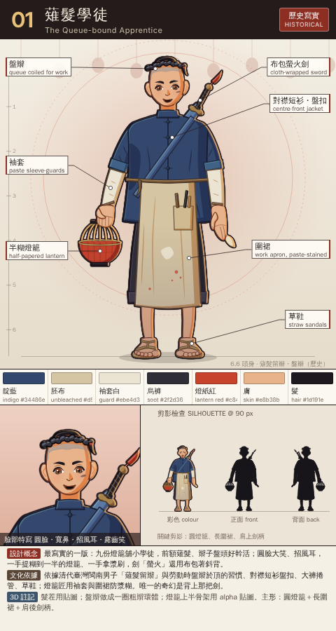
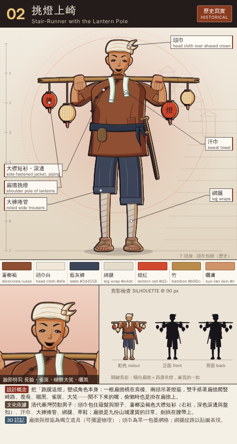
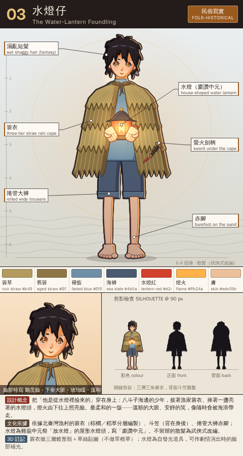
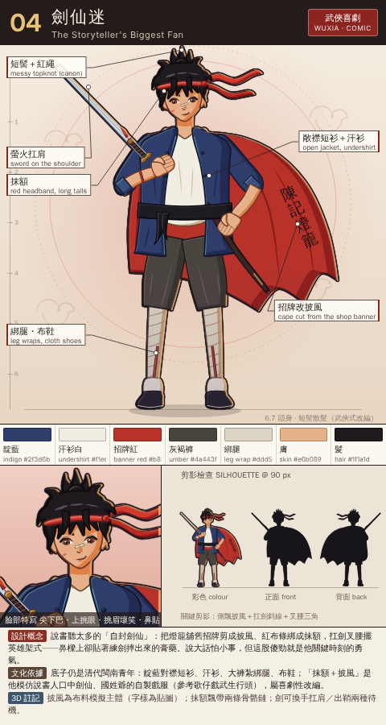
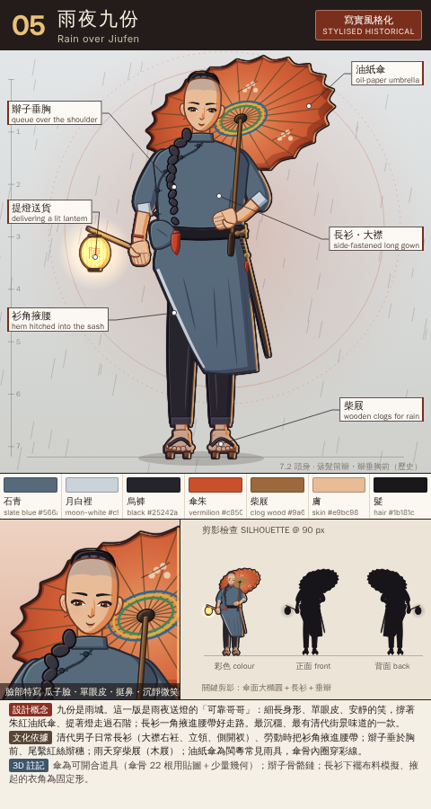
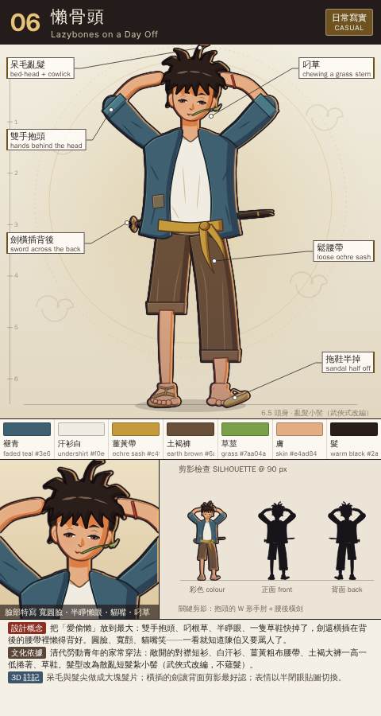
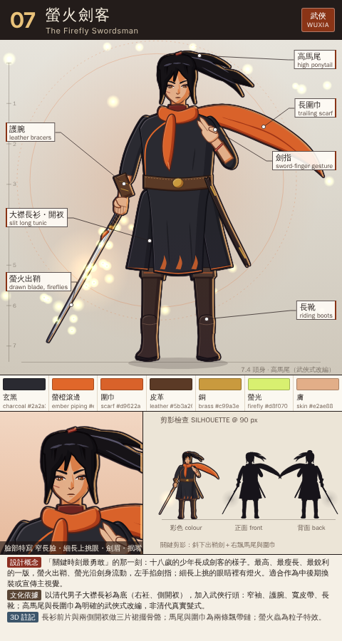
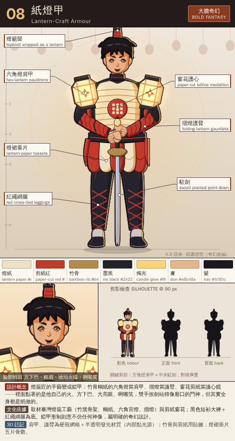
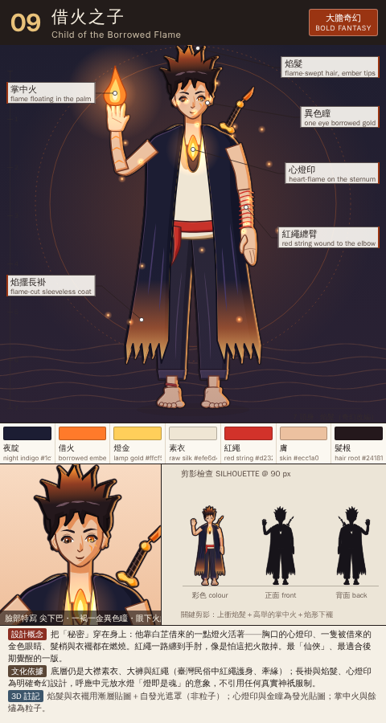
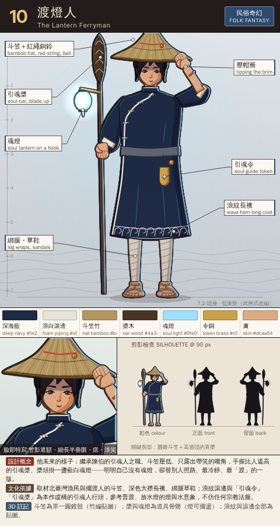

# 沈星河 Shen Xinghe — 角色設計 v2（10 款提案）

> 依 `docs/design/DESIGN_BRIEF_V2.md`（具約束力）與 `docs/STORY_BIBLE.md` 製作。v1 的問題（共用臉模、軟爛剪影、籠統「中式」服裝、無設計說明）在本輪逐條處理：
> 每款都有自己的臉型結構、頭身比與剪影；服裝以清代臺灣閩南勞動男子的實際衣著為底再風格化；每張卡都附剪影檢查（彩色／正面／背面 @ 90 px）與 3D 建模註記。

## 檔案

- 總表：`docs/design/v2/xinghe_sheet.png`（10 張卡 5×2，最上方為 10 款正面剪影排列）
- 單張卡：`docs/design/v2/xinghe/opt01.png` … `opt10.png`（480×900）
- 原始碼：`tools/design2/xinghe.html`（`?opt=03` 只看單張、`&dpr=2` 高解析）、`xinghe_lib.js`（繪圖工具：貝茲輪廓、賽璐璐陰影、手腳臉部件）、`xinghe_designs_a/a2/a3/b/c.js`（各款）、`xinghe_card.js`（卡片版型＋外輪廓／邊緣光後製）。重新產生：`node tools/design2/xinghe_build.js`

## 卡片怎麼讀

- 左側尺標＝頭身（每格一個頭高）；全身圖 420 px 高（1x）。主光左上、邊緣光自右側；外輪廓線較內線粗，模擬卡通渲染的描邊。
- 「剪影檢查」＝地圖精靈比例（90 px）：彩色、正面純黑、背面純黑。背面剪影＝正面剪影鏡射＋只在背面看得到的部件（辮子、背劍、斗笠、披風等）。
- 髮型標註「歷史」者採清代男子薙髮留辮；標註「武俠式／奇幻改編」者為刻意的非史實選擇。
- 3D 方向（主管備註）：所有款式以大塊面主形為主，細紋（滾邊、草絲、竹骨、剪紙、刺繡）一律放在貼圖，不做細碎幾何。

## 總覽

| # | 名稱 | 方向 | 頭身 | 髮型 | 剪影關鍵 |
|---|---|---|---|---|---|
| 01 | 薙髮學徒 The Queue-bound Apprentice | 歷史寫實 HISTORICAL | 6.6 | 薙髮留辮・盤辮（歷史） | 圓燈籠、長圍裙、肩上劍柄 |
| 02 | 挑燈上崎 Stair-Runner with the Lantern Pole | 歷史寫實 HISTORICAL | 7 | 頭巾包辮（歷史） | 橫向扁擔＋四盞吊燈，最寬的一款 |
| 03 | 水燈仔 The Water-Lantern Foundling | 民俗寫實 FOLK-HISTORICAL | 6.4 | 散髮（武俠式改編） | 三層三角簑衣，背面斗笠圓盤 |
| 04 | 劍仙迷 The Storyteller's Biggest Fan | 武俠喜劇 WUXIA · COMIC | 6.7 | 短髻散髮（武俠式改編） | 側飄披風＋扛劍斜線＋叉腰三角 |
| 05 | 雨夜九份 Rain over Jiufen | 寫實風格化 STYLISED HISTORICAL | 7.2 | 薙髮留辮・辮垂胸前（歷史） | 傘面大橢圓＋長衫＋垂辮 |
| 06 | 懶骨頭 Lazybones on a Day Off | 日常寫實 CASUAL | 6.5 | 亂髮小髻（武俠式改編） | 抱頭的 W 形手肘＋腰後橫劍 |
| 07 | 螢火劍客 The Firefly Swordsman | 武俠 WUXIA | 7.4 | 高馬尾（武俠式改編） | 斜下出鞘劍＋右飄馬尾與圍巾 |
| 08 | 紙燈甲 Lantern-Craft Armour | 大膽奇幻 BOLD FANTASY | 6.8 | 紙裹燈髻（奇幻改編） | 方塊燈肩甲＋中央駐劍，對稱厚重 |
| 09 | 借火之子 Child of the Borrowed Flame | 大膽奇幻 BOLD FANTASY | 7 | 焰髮（奇幻改編） | 上衝焰髮＋高舉的掌中火＋焰形下襬 |
| 10 | 渡燈人 The Lantern Ferryman | 民俗奇幻 FOLK FANTASY | 7.2 | 低束髮（武俠式改編） | 圓錐斗笠＋高過頭的直槳 |

## 01 薙髮學徒 — The Queue-bound Apprentice

**方向**：歷史寫實（HISTORICAL）· 6.6 頭身 · 薙髮留辮・盤辮（歷史）

**設計概念**：最寫實的一版：九份燈籠舖小學徒，前額薙髮、辮子盤頭好幹活；圓臉大笑、招風耳，一手提糊到一半的燈籠、一手拿漿刷，劍「螢火」還用布包著斜背。

**臉部**：圓臉・寬鼻・招風耳・露齒笑　**剪影**：圓燈籠、長圍裙、肩上劍柄

**配色**：

| 名稱 | Hex |
|---|---|
| 靛藍 indigo | `#34486e` |
| 胚布 unbleached | `#d5c5a3` |
| 袖套白 guard | `#ebe4d3` |
| 烏褲 soot | `#2f2d36` |
| 燈紙紅 lantern red | `#c8432b` |
| 膚 skin | `#e8b38b` |
| 髮 hair | `#1d191e` |

**服裝拆解**：

- 盤辮（薙髮留辮，辮子繞頭一圈、尾端紅繩塞好）
- 靛藍對襟短衫，立領、五顆同色布盤扣，袖子捲到肘
- 白布袖套（燈籠匠防漿糊）
- 胚布圍裙，漿糊與紅顏料污漬，口袋插竹刀、毛筆
- 烏色大褲捲到小腿肚；草鞋
- 布包「螢火」劍斜背、布帶斜跨胸前；左腕紅繩

**文化依據**：依據清代臺灣閩南男子「薙髮留辮」與勞動時盤辮於頂的習慣、對襟短衫盤扣、大褲捲管、草鞋；燈籠匠用袖套與圍裙防漿糊。唯一的奇幻是背上那把劍。

**3D 建模註記**：髮茬用貼圖；盤辮做成一圈粗辮環體；燈籠上半骨架用 alpha 貼圖。主形：圓燈籠＋長圍裙＋肩後劍柄。

**影響的遊戲系統**：頭像：光額＋盤辮讓頭部輪廓最圓、表情最好讀。地圖精靈：圓燈籠是辨識點（可做走路搖擺動畫）。戰鬥精靈：拔劍時布包甩開成為起手動作。

## 02 挑燈上崎 — Stair-Runner with the Lantern Pole

**方向**：歷史寫實（HISTORICAL）· 7 頭身 · 頭巾包辮（歷史）

**設計概念**：把「跑腿送燈」變成角色本身：一根扁擔橫在肩後、兩頭吊著燈籠，雙手搭著扁擔爬豎崎路。瘦長、曬黑、雀斑、大笑——閒不下來的嘴，偷懶時也是掛在扁擔上。

**臉部**：長臉・雀斑・瞇眼大笑・曬黑　**剪影**：橫向扁擔＋四盞吊燈，最寬的一款

**配色**：

| 名稱 | Hex |
|---|---|
| 薯榔褐 dioscorea russet | `#8e4f32` |
| 頭巾白 head cloth | `#efe8d8` |
| 藍灰褲 slate | `#3d4558` |
| 綁腿 leg wrap | `#e4dccb` |
| 燈紅 lantern red | `#d24a2e` |
| 竹 bamboo | `#b98c4c` |
| 曬膚 sun-tan skin | `#cf9468` |

**服裝拆解**：

- 白棉頭巾包頭（薙髮與辮子收在裡面，背面辮尾垂出）
- 薯榔染褐色大襟短衫，右衽、深褐滾邊、五顆盤扣、手肘處補丁
- 汗巾掛頸
- 深藍腰帶＋小錢袋，螢火劍插在左腰
- 藍灰大褲兩腳捲不一樣高，白綁腿，草鞋
- 竹扁擔吊四盞燈籠（陳記）

**文化依據**：清代臺灣勞動男子：頭巾包住薙髮與辮子、薯榔染褐色大襟短衫（右衽，深色滾邊與盤扣）、汗巾、大褲捲管、綁腿、草鞋；扁擔是九份山城運貨的日常。劍插在腰帶上。

**3D 建模註記**：扁擔與燈籠為獨立道具（可擺盪物理）；頭巾為單一包覆網格；綁腿紋路以貼圖表現。

**影響的遊戲系統**：頭像：頭巾結＋雀斑笑臉。地圖精靈：橫向扁擔讓他在階梯地圖上最易辨認，燈籠可做擺動。戰鬥精靈：放下扁擔拔劍為開場動作；扁擔也可當普攻道具的彩蛋。

## 03 水燈仔 — The Water-Lantern Foundling

**方向**：民俗寫實（FOLK-HISTORICAL）· 6.4 頭身 · 散髮（武俠式改編）

**設計概念**：把「他是從水燈裡撿來的」穿在身上：八斗子海邊的少年，披著漁家簑衣、捧著一盞亮著的水燈頭，燈火由下往上照亮臉。最柔和的一版——溫順的大眼、安靜的笑，像隨時會被海浪帶走。

**臉部**：鵝蛋臉・下垂大眼・琥珀瞳・溫和微笑　**剪影**：三層三角簑衣，背面斗笠圓盤

**配色**：

| 名稱 | Hex |
|---|---|
| 簑草 coir straw | `#b49a5e` |
| 舊簑 aged straw | `#8f7646` |
| 褪藍 faded blue | `#6f8fa6` |
| 海褲 sea slate | `#4b5a70` |
| 水燈紅 lantern red | `#d2412c` |
| 燈火 flame | `#ffb24a` |
| 膚 skin | `#edc09c` |

**服裝拆解**：

- 濕亂及頸短髮，瀏海遮眉（不留辮，武俠改編）
- 三層簑衣（棕草），胸前繩結
- 褪色藍大襟內衫
- 海藍灰大褲捲到膝下，赤腳
- 捧屋形水燈頭（紅紙壁、黑瓦頂、木筏底座、內燃燭）
- 斗笠背在身後；螢火劍斜插腰間，劍柄從簑衣下露出；右腕紅繩

**文化依據**：依據北臺灣漁村的簑衣（棕櫚／稻草分層編製）、斗笠（背在身後）、捲管大褲赤腳；水燈為雞籠中元祭「放水燈」的屋形水燈頭，寫「慶讚中元」。不留辮的散髮為武俠式改編。

**3D 建模註記**：簑衣做三層錐形殼＋草絲貼圖（不做單根草）；水燈為自發光道具，可作劇情演出時的臉部補光。

**影響的遊戲系統**：頭像：燈火打底光的臉是最強的劇情頭像（序章／水燈頭回流場景）。地圖精靈：三角簑衣＋手中光源，夜晚地圖自帶光暈。戰鬥精靈：甩開簑衣拔劍；火系技能從水燈燭火延伸。

## 04 劍仙迷 — The Storyteller's Biggest Fan

**方向**：武俠喜劇（WUXIA · COMIC）· 6.7 頭身 · 短髻散髮（武俠式改編）

**設計概念**：說書聽太多的「自封劍仙」：把燈籠舖舊招牌剪成披風、紅布條綁成抹額，扛劍叉腰擺英雄架式——鼻樑上卻貼著練劍摔出來的膏藥。說大話怕小事，但這股傻勁就是他關鍵時刻的勇氣。

**臉部**：尖下巴・上挑眼・挑眉壞笑・鼻貼　**剪影**：側飄披風＋扛劍斜線＋叉腰三角

**配色**：

| 名稱 | Hex |
|---|---|
| 靛藍 indigo | `#2f3d6b` |
| 汗衫白 undershirt | `#f1ede2` |
| 招牌紅 banner red | `#b8322a` |
| 灰褐褲 umber | `#4a443f` |
| 綁腿 leg wrap | `#ddd5c4` |
| 膚 skin | `#e6b089` |
| 髮 hair | `#1f1a1d` |

**服裝拆解**：

- 亂短髮紮小髻（紅繩），原設定髮型的延伸
- 紅布抹額，兩條長飄帶
- 燈籠舖舊招牌（陳記燈籠）改成的紅披風，頸前打結
- 靛藍對襟短衫敞開、白汗衫、黑腰帶插空劍鞘
- 灰褐大褲紮進白綁腿（紅綁帶）、黑布鞋
- 螢火出鞘扛在右肩；右腕紅繩

**文化依據**：底子仍是清代閩南青年：靛藍對襟短衫、汗衫、大褲紮綁腿、布鞋；「抹額＋披風」是他模仿說書人口中劍仙、國姓爺的自製戲服（參考歌仔戲武生行頭），屬喜劇性改編。

**3D 建模註記**：披風為布料模擬主體（字樣為貼圖）；抹額飄帶兩條骨骼鏈；劍可換手扛肩／出鞘兩種待機。

**影響的遊戲系統**：頭像：挑眉壞笑＋鼻貼，喜劇表情差分最多。地圖精靈：披風飄動與扛劍讓主角在人群中最醒目。戰鬥精靈：英雄式開場（甩披風）、受擊時狼狽差分，與「說大話怕小事」的個性連動。

## 05 雨夜九份 — Rain over Jiufen

**方向**：寫實風格化（STYLISED HISTORICAL）· 7.2 頭身 · 薙髮留辮・辮垂胸前（歷史）

**設計概念**：九份是雨城。這一版是雨夜送燈的「可靠哥哥」：細長身形、單眼皮、安靜的笑，撐著朱紅油紙傘、提著燈走過石階；長衫一角掖進腰帶好走路。最沉穩、最有清代街景味道的一款。

**臉部**：瓜子臉・單眼皮・挺鼻・沉靜微笑　**剪影**：傘面大橢圓＋長衫＋垂辮

**配色**：

| 名稱 | Hex |
|---|---|
| 石青 slate blue | `#566a7c` |
| 月白裡 moon-white | `#c9d3d9` |
| 烏褲 black | `#25242a` |
| 傘朱 vermilion | `#c8502c` |
| 柴屐 clog wood | `#9a6a3c` |
| 膚 skin | `#e9bc98` |
| 髮 hair | `#1b181c` |

**服裝拆解**：

- 薙髮留辮，辮子從右肩垂到胸前，紅絲辮穗
- 石青色長衫（大襟右衽、立領、側開衩、月白內裡），右前襟掖進腰帶
- 黑腰帶、烏褲紮腳口
- 柴屐（兩齒木屐）
- 朱紅油紙傘（梅花紋、彩線穿骨）
- 竹竿提燈（陳記）；螢火劍掛在左腰後

**文化依據**：清代男子日常長衫（大襟右衽、立領、側開衩）、勞動時把衫角掖進腰帶；辮子垂於胸前、尾繫紅絲辮穗；雨天穿柴屐（木屐）；油紙傘為閩粵常見雨具，傘骨內圈穿彩線。

**3D 建模註記**：傘為可開合道具（傘骨 22 根用貼圖＋少量幾何）；辮子骨骼鏈；長衫下襬布料模擬、掖起的衣角為固定形。

**影響的遊戲系統**：頭像：單眼皮與垂辮，最成熟的一張臉。地圖精靈：傘可作為雨天地圖的專屬外觀（九份多雨）。戰鬥精靈：收傘→拔劍；傘也可設計成格擋動作。

## 06 懶骨頭 — Lazybones on a Day Off

**方向**：日常寫實（CASUAL）· 6.5 頭身 · 亂髮小髻（武俠式改編）

**設計概念**：把「愛偷懶」放到最大：雙手抱頭、叼根草、半睜眼、一隻草鞋快掉了，劍還橫插在背後的腰帶裡懶得背好。圓臉、寬顴、貓嘴笑——一看就知道陳伯又要罵人了。

**臉部**：寬圓臉・半睜懶眼・貓嘴・叼草　**剪影**：抱頭的 W 形手肘＋腰後橫劍

**配色**：

| 名稱 | Hex |
|---|---|
| 褪青 faded teal | `#3e6070` |
| 汗衫白 undershirt | `#f0ece1` |
| 薑黃帶 ochre sash | `#c49a3a` |
| 土褐褲 earth brown | `#6a5038` |
| 草莖 grass | `#7aa04a` |
| 膚 skin | `#e4ad84` |
| 髮 warm black | `#2a1e1a` |

**服裝拆解**：

- 亂翹短髮、頭頂呆毛、腦後小髻綁紅繩（武俠改編）
- 褪青色對襟短衫敞開，袖子滑到上臂；肘邊補丁
- 白汗衫
- 薑黃粗布腰帶鬆鬆打結，長帶尾
- 土褐大褲一腳捲到膝、一腳到腳踝；草鞋一隻半掉
- 螢火劍橫插背後腰帶；左腕紅繩

**文化依據**：清代勞動青年的家常穿法：敞開的對襟短衫、白汗衫、薑黃粗布腰帶、土褐大褲一高一低捲著、草鞋。髮型改為散亂短髮紮小髻（武俠式改編，不薙髮）。

**3D 建模註記**：呆毛與髮尖做成大塊髮片；橫插的劍讓背面剪影最好認；表情以半閉眼貼圖切換。

**影響的遊戲系統**：頭像：半睜眼＋叼草是招牌「懶」表情（日常對話）。地圖精靈：抱頭手肘＋橫劍在 90 px 也一眼可辨。戰鬥精靈：待機時打哈欠，拔劍時從腰後抽出（帥氣反差）。

## 07 螢火劍客 — The Firefly Swordsman

**方向**：武俠（WUXIA）· 7.4 頭身 · 高馬尾（武俠式改編）

**設計概念**：「關鍵時刻最勇敢」的那一刻：十八歲的少年長成劍客的樣子。最高、最瘦長、最銳利的一版，螢火出鞘、螢光沿劍身流動，左手掐劍指；細長上挑的眼睛裡有燈火。適合作為中後期換裝或宣傳主視覺。

**臉部**：窄長臉・細長上挑眼・劍眉・抿嘴　**剪影**：斜下出鞘劍＋右飄馬尾與圍巾

**配色**：

| 名稱 | Hex |
|---|---|
| 玄黑 charcoal | `#2a2a31` |
| 螢橙滾邊 ember piping | `#e0672a` |
| 圍巾 scarf | `#d9622a` |
| 皮革 leather | `#5b3a26` |
| 銅 brass | `#c99a3e` |
| 螢光 firefly | `#d8f070` |
| 膚 skin | `#e2ae88` |

**服裝拆解**：

- 高馬尾紅繩束髮、中分瀏海與長鬢髮（武俠改編）
- 玄黑大襟長衫至膝，兩側開衩，螢橙滾邊與下襬火紋刺繡
- 螢橙長圍巾（一端在胸前、一端隨風）
- 寬皮帶＋銅扣，皮護腕
- 黑褲紮進長靴
- 螢火出鞘（劍身沿刃流光）、劍鞘斜掛左腰

**文化依據**：以清代男子大襟長衫為底（右衽、側開衩），加入武俠行頭：窄袖、護腕、寬皮帶、長靴；高馬尾與長圍巾為明確的武俠式改編，非清代真實髮式。

**3D 建模註記**：長衫前片與兩側開衩做三片裙擺骨骼；馬尾與圍巾為兩條飄帶鏈；螢火蟲為粒子特效。

**影響的遊戲系統**：頭像：銳利眼神＋眼中火光，適合戰鬥中的切入頭像。地圖精靈：馬尾與圍巾的飄動讓角色顯得最「主角」。戰鬥精靈：最直接對應「平衡型劍士」，螢火蟲作為火屬性技能的視覺母題。

## 08 紙燈甲 — Lantern-Craft Armour

**方向**：大膽奇幻（BOLD FANTASY）· 6.8 頭身 · 紙裹燈髻（奇幻改編）

**設計概念**：燈籠匠的手藝變成鎧甲：竹骨糊紙的六角燈當肩甲、摺燈當護臂、窗花剪紙當護心鏡——裡面點著的是他自己的火。方下巴、大亮眼、咧嘴笑，雙手按劍站得像廟口的門神，但其實全身都是紙做的。

**臉部**：方下巴・粗眉・琥珀火瞳・咧嘴笑　**剪影**：方塊燈肩甲＋中央駐劍，對稱厚重

**配色**：

| 名稱 | Hex |
|---|---|
| 燈紙 lantern paper | `#efe2c4` |
| 剪紙紅 paper-cut red | `#c33a2a` |
| 竹骨 bamboo rib | `#b48a4a` |
| 墨黑 ink black | `#24232a` |
| 燭光 candle glow | `#ffd27a` |
| 膚 skin | `#e8b48a` |
| 髮 hair | `#1c181c` |

**服裝拆解**：

- 短刺髮，頭頂髻子裹紅燈紙如小燈籠（奇幻改編）
- 六角燈籠肩甲（竹骨、糊紙、剪紙火花、紅流蘇），內透燭光
- 燈紙背心：竹篾橫骨＋紅色窗花護心
- 紅色摺燈護臂（黑環分節）
- 黑腰帶＋紅白燈紙垂片、紅流蘇
- 黑大褲紅繩交叉綁腿、黑布鞋；螢火劍柄頭做成小燈籠

**文化依據**：取材臺灣燈籠工藝（竹篾骨架、糊紙、六角宮燈、摺燈）與剪紙窗花；黑色短衫大褲＋紅繩綁腿為底。鎧甲形制刻意不仿任何神像，屬明確的奇幻設計。

**3D 建模註記**：肩甲、護臂為硬殼網格＋半透明發光材質（內部點光源）；竹骨與剪紙用貼圖；燈裙垂片五片骨骼。

**影響的遊戲系統**：頭像：發光肩甲在頭像框兩側形成暖光。地圖精靈：方肩剪影最「重裝」，夜間地圖自帶光源。戰鬥精靈：肩甲燈光隨 HP 變暗（呼應他的火在減弱），火系大招時全身紙甲透亮。

## 09 借火之子 — Child of the Borrowed Flame

**方向**：大膽奇幻（BOLD FANTASY）· 7 頭身 · 焰髮（奇幻改編）

**設計概念**：把「秘密」穿在身上：他靠白芷借來的一點燈火活著——胸口的心燈印、一隻被借來的金色眼睛、髮梢與衣襬都在燃燒。紅繩一路纏到手肘，像是怕這把火散掉。最「仙俠」、最適合後期覺醒的一版。

**臉部**：尖下巴・一褐一金異色瞳・眼下火紋　**剪影**：上衝焰髮＋高舉的掌中火＋焰形下襬

**配色**：

| 名稱 | Hex |
|---|---|
| 夜靛 night indigo | `#1c1d33` |
| 借火 borrowed ember | `#ff7a2a` |
| 燈金 lamp gold | `#ffcf5a` |
| 素衣 raw silk | `#efe6d4` |
| 紅繩 red string | `#d2322a` |
| 膚 skin | `#ecc1a0` |
| 髮根 hair root | `#24181c` |

**服裝拆解**：

- 上衝焰髮，髮根深褐、髮梢燃成橘金（奇幻改編）
- 夜靛無袖長褂，燈金滾邊，下襬剪成火舌並向下燃亮
- 素色無袖大襟內衣，胸口敞開露出心燈印
- 紅腰帶；夜色大褲；赤腳紅繩腳環
- 左臂紅繩纏到手肘；右掌托火
- 螢火劍斜背，劍穗如火

**文化依據**：底層仍是大襟素衣、大褲與紅繩（臺灣民俗中紅繩護身、牽緣）；長褂與焰髮、心燈印為明確奇幻設計，呼應中元放水燈「燈即是魂」的意象，不引用任何真實神祇服制。

**3D 建模註記**：焰髮與衣襬用漸層貼圖＋自發光遮罩（非粒子）；心燈印與金瞳為發光貼圖；掌中火與餘燼為粒子。

**影響的遊戲系統**：頭像：異色瞳＋火紋，劇情揭露「借火」秘密後的頭像。地圖精靈：自帶火光，適合靈境／一息界等暗場景。戰鬥精靈：覺醒形態（第 7 章「心火」之後），火系技能與 HP 低落時焰髮變暗的狀態表現。

## 10 渡燈人 — The Lantern Ferryman

**方向**：民俗奇幻（FOLK FANTASY）· 7.2 頭身 · 低束髮（武俠式改編）

**設計概念**：他未來的樣子：繼承陳伯的引魂人之職。斗笠壓低、只露出帶笑的嘴角，手握比人還高的引魂槳、槳頭掛一盞藍白魂燈——明明自己沒有魂燈，卻替別人照路。最冷靜、最「渡」的一版。

**臉部**：笠影遮額・細長半垂眼・痣・淡笑　**剪影**：圓錐斗笠＋高過頭的直槳

**配色**：

| 名稱 | Hex |
|---|---|
| 深海藍 deep navy | `#1e2a44` |
| 浪白滾邊 foam piping | `#e8e4da` |
| 斗笠竹 hat bamboo | `#b49660` |
| 槳木 oar wood | `#4a3424` |
| 魂燈 soul light | `#9fe0ff` |
| 令銅 token brass | `#c9a24a` |
| 膚 skin | `#dcaa84` |

**服裝拆解**：

- 斗笠（紅繩繞頂、小銅鈴、下巴繫繩），黑髮低束（武俠改編）
- 深海藍大襟長襖至膝，浪白滾邊、盤扣，下襬浪紋刺繡
- 灰腰帶掛「引魂令」銅牌與鈴
- 灰大褲、白綁腿、草鞋
- 引魂槳（槳頭朝上，浪紋）掛藍白魂燈
- 螢火劍收在長襖下（戰鬥時由槳柄抽出，作為設定提案）；右腕紅繩

**文化依據**：取材北臺灣漁民與擺渡人的斗笠、深色大襟長襖、綁腿草鞋；浪紋滾邊與「引魂令」「引魂槳」為本作虛構的引魂人行頭，參考普渡、放水燈的燈與水意象，不仿任何宗教法服。

**3D 建模註記**：斗笠為單一圓錐殼（竹編貼圖）；槳與魂燈為道具骨骼（燈可擺盪）；浪紋與滾邊全部為貼圖。

**影響的遊戲系統**：頭像：笠影下的臉最有神秘感，適合結局／後日談。地圖精靈：斗笠＋直槳的長條剪影在海岸、王船場景非常清楚。戰鬥精靈：槳作為長柄普攻、劍為技能，引魂人一脈的演出（第 11 章渡黑水溝）。

## 共通事項

- 故事必要元素全部保留：火屬性（暖色邊緣光／燈火）、劍「螢火」（陳伯所贈，每款都有：布包、插腰、扛肩、出鞘、駐地、背負等不同佩法）、做燈工具或燈籠、紅繩手環（每款都可在手腕／手臂／腳踝找到）。
- 未描繪任何真實神祇或宗教法服；不使用原住民族服飾；無 20 世紀旗袍或日治時期服裝。
- 選定方向後建議：以選定款畫正式三視圖（正／側／背）與表情差分表，再拆出地圖精靈（4 方向 × 走路）與戰鬥精靈（待機、攻擊、技能、受擊、倒地）。可混搭（例：02 的頭巾＋07 的長衫），但請以單一款的剪影為主。
