<!-- 本檔由 tools/guide/build_guide.js 產生，請勿直接修改：文字請改 docs/guide/parts/*.md 與 docs/guide/chapters/*.md，再重新執行 node tools/guide/build_guide.js -->

# 彼岸燈 完全攻略

> 資料版本：2026-10-27。圖表只收錄在 HTML 版（guide_zh.html）；本檔保留所有文字與表格。

# 本書使用說明

《彼岸燈》是一款以清代台灣為舞台的仙俠 RPG。故事從九份的中元夜開始，一行人用一年的時間大致順時針繞行福爾摩沙，最後橫渡黑水溝，抵達彼岸。本書收錄完整的系統說明、角色資料、全十二章（序章到第十一章）的流程攻略、雙結局條件，以及道具、裝備、仙術、敵人、商店的資料庫。

> **提示**　本書的表格與圖表都由遊戲資料自動產生，包括能力值、價格、HP、等級、心燈數，以及推薦等級曲線（取自開發組的平衡模擬 docs/BALANCE.md）。改版後重新產生一次，數字就會跟著遊戲更新。

**閱讀方式**

- 第一次玩：先讀〈入門〉，再照〈流程攻略〉一章一章對照。各章開頭有本章的路線圖、推薦等級和心燈清單。
- 想拿真結局：〈雙結局條件〉列出全部心燈的取得方法，可以當成檢查表使用。
- 卡關或想查數字：直接翻〈資料庫〉和〈圖表〉。

**劇透標示**

會洩漏劇情轉折的段落，都收在標有「劇透警告」的摺疊框裡，預設是收起來的，點一下才會展開。沒有收起來的劇情提要只寫到該章的開場，可以放心閱讀。

**本書用語**

| 用語 | 意思 |
|---|---|
| 生命／真氣 | HP／MP。戰鬥畫面上的綠條和藍條 |
| 武力、防禦、法力、身法、運氣 | 攻擊、防禦、術法攻防、速度、幸運（影響暴擊） |
| 仙術 | 消耗真氣的技能 |
| 劍意 | 戰鬥畫面上的金色量表。滿 100 可以使出「絕技」 |
| 合擊 | 兩人以上一起發動的技能 |
| 心燈 | 真心幫助別人、讓靈魂了卻心願時得到的光。數量決定結局 |
| 靈視 | 吃下七彩靈蕈後，看得見隱藏道路、魂魄和寶箱的狀態 |
| 文 | 遊戲中的貨幣 |
| (x, y) | 地圖座標。左上角是 (0, 0)，向右 x 增加，向下 y 增加 |
| 寶箱編號 | 地圖圖片上紅色圓圈內的數字，對應各章寶箱表的「#」欄；紫色圓圈表示要開靈視才看得見 |

數值以「普通」難度為準。劇情難度和困難難度的差異，請見〈入門〉的「難度」一節。

# 入門

## 開始遊戲

- **Mac**：解壓縮後雙擊 `Play Shorelight.command`。遊戲會以 Chrome、Edge、Brave 的 App 模式開啟；第一次開啟若被系統阻擋，請按右鍵選「打開」（詳見隨附的 PLAYING.md）。
- **任何系統**：用 Chrome 開啟資料夾裡的 `index.html` 也能玩。完全離線，不需要網路。
- **語言**：標題畫面或「設定 → 語言 Language」可以切換繁體中文和英文。
- **3D／2D 畫面**：「設定 → 3D 畫面」可以開關，重新啟動後生效。電腦比較舊的話，建議關掉 3D，或在網址後面加上 `?r3lite` 使用輕量 3D。

## 操作

| 動作 | 鍵盤 | 手把 |
|---|---|---|
| 移動 | 方向鍵／WASD | 十字鍵／左搖桿 |
| 決定・對話・調查 | <kbd>Z</kbd>／空白鍵／<kbd>Enter</kbd>（或滑鼠左鍵） | A |
| 取消 | <kbd>X</kbd>／<kbd>Esc</kbd>／Backspace（或滑鼠右鍵） | B |
| 開啟選單（地圖上） | <kbd>X</kbd>／<kbd>Esc</kbd>／<kbd>C</kbd>／<kbd>M</kbd>／<kbd>Tab</kbd> | Y／Start |
| 奔跑 | 按住 <kbd>Shift</kbd>（設定中可改成預設奔跑） | X／RB |
| 先制攻擊 | 面對野外妖怪按 <kbd>Z</kbd> | A |
| 自動戰鬥／對話自動播放 | <kbd>F</kbd> | Back／Select |
| 戰鬥速度（戰鬥中） | <kbd>E</kbd>（×1 → ×1.5 → ×2 → ×3） | — |
| 旋轉鏡頭（3D 地圖） | <kbd>Q</kbd>／<kbd>E</kbd> | LB／RB |
| 對話紀錄 | <kbd>L</kbd> | — |
| 快進對話 | 按住 <kbd>Ctrl</kbd> 或 <kbd>⌘</kbd> | — |
| 全螢幕 | ⌘F（Mac）／F11／Alt+Enter | — |

## 選單

在地圖上打開選單，可以看到下面這些項目。

| 項目 | 用途 |
|---|---|
| 物品 | 分成「消耗」「裝備品」「貴重」三頁。回復類道具和七彩靈蕈可以在地圖上直接使用 |
| 仙術 | 查看技能說明。治療、復活、解除類的仙術可以在地圖上施放 |
| 裝備 | 五個欄位：武器、衣裝、頭飾、鞋履、佩飾。挑選時會顯示能力的升降 |
| 狀態 | 每個人的能力值、經驗與目前裝備 |
| 隊伍 | 調整出場順序。最前面的四個人上場戰鬥，排第一的人走在地圖最前面 |
| 任務 | 任務日誌。金色是主線，打勾是已完成 |
| 心燈 | 已經得到的心燈清單 |
| 地圖 | 福爾摩沙全圖，標出走過的地點與路線 |
| 圖鑑 | 打倒過的妖怪和擊敗次數 |
| 遊玩統計 | 實際遊玩時間、各章與各頭目戰的紀錄（見本章最後一節） |
| 存檔／讀檔 | 8 個存檔欄位＋1 個自動存檔欄位。夢境或祭典等特殊場景中無法存檔 |
| 設定 | 語言、音量、文字速度、戰鬥速度、難度、預設奔跑、自動存檔、對話自動播放、迷幻視覺強度（光敏保護）、畫質、3D 畫面、鏡頭旋轉、全螢幕 |

> **提示**　「迷幻視覺強度」可以在完整、柔和、最低之間切換。對閃爍、旋轉的畫面比較敏感的玩家，建議調成「柔和」或「最低」。靈視、靈境、一息界這幾段的效果會跟著變弱，遊戲內容完全不受影響。

## 探索

- **對話與調查**：面向人物或發光的物件，按 <kbd>Z</kbd>。頭上出現提示的物件通常可以調查。
- **時段**：許多城鎮會隨劇情換時段（清晨、正午、黃昏、夜晚……）。NPC 的位置、商店是否開門、能接的支線，都跟著時段變化。某個時段找不到人，等劇情往前推進後再回來看看。
- **目標**：打開選單時，右上角會顯示目前的主線目標。
- **寶箱**：調查就能打開。有些寶箱要開靈視才看得見；有些要到特定劇情才會出現。各章攻略都附有完整寶箱表與座標。
- **記錄點**：發著微光的石燈籠。面向它按 <kbd>Z</kbd> 就能存檔。
- **自動存檔**：每次穿過地圖出入口都會自動記錄一次（設定中可以關閉）。
- **旅行**：章與章之間、城鎮與城鎮之間的移動，會在福爾摩沙地圖上播放旅程動畫。

### 野外的妖怪

地圖上看得到的妖怪就是敵人，碰到就會開戰，不會有暗中遇敵（少數場景另有規則，各章會註明）。

- **先制攻擊**：妖怪在你面前一格時按 <kbd>Z</kbd> 砍下去，就能以「先制攻擊」開戰，敵人第一輪會晚很多才行動。
- **遭到偷襲**：妖怪正在移動時，從側面或背後撞上你，就會變成「遭到偷襲」，我方第一輪會晚出手。
- **追擊範圍**：妖怪發現你就會追過來。隊伍最前面那個人的等級比妖怪高 10 級以上時，牠們就不會再追，會自己避開。
- **重生**：大部分野外妖怪在你離開地圖、再走進來之後會重新出現。想練功，就在城鎮附近來回進出。

## 戰鬥

### 行動順序（CTB）

畫面上方的「行動順序」列出接下來八次行動的順序，藍色是我方，紅色是敵人。順序由身法決定：每次行動之後，要等 `100 × 40 ÷（身法＋40）` 的時間才會再輪到你。

- 身法 40 的人每次等 50，身法 80 的人只要等 33，出手次數大約多了一半。
- 選「防禦」的話，下一次會提早 25% 輪到你。
- 少數招式寫著「行動延遲」，用完之後要等比較久（×1.1～×1.2）才會再輪到。
- 開戰時每個人的等待時間都會隨機打亂。

### 指令

| 指令 | 說明 |
|---|---|
| 絕技・○○ | 劍意滿 100 時才會出現在最上面。消耗全部劍意，不花真氣 |
| 攻擊 | 普通攻擊。帶有角色本身的屬性（星河是火、紅纓是金……），裝備有屬性的武器時改用武器的屬性 |
| 仙術 | 消耗真氣。被「封印」時不能用 |
| 合擊 | 有合擊可用時才會出現 |
| 道具 | 戰鬥用的道具 |
| 防禦 | 到下一次行動之前，受到的傷害減半；劍意 +10，下一次提早輪到 |
| 逃跑 | 頭目戰和劇情戰無法逃跑 |

### 傷害、命中與暴擊

- **物理傷害**：`威力 × 武力 × 2 × 50 ÷（50＋對方防禦）`。
- **術法傷害**：`威力 × 法力 × 2 × 50 ÷（50＋對方防禦×0.3＋對方法力×0.7）`。對方的法力越高，術法越打不動。
- 兩種傷害最後都會乘上 0.9～1.1 的亂數，再乘上屬性倍率。
- **治療量**：`威力 × 法力 × 1.2＋威力 × 10`。
- **命中**：只有物理攻擊會被閃避。基本命中 95%，對方每比你快 4 點身法，命中率就降 1%（最低 60%，最高 99%）。術法一定命中。
- **暴擊**：只有物理攻擊會暴擊，傷害 ×1.5。機率是 5%＋運氣÷5（%）；「幻境」狀態再加 30%。

### 五行相剋

> 圖表：五行相剋圖——金克木、木克土、土克水、水克火、火克金。打在被克的一方 ×1.5，反過來打 ×0.7；敵人另有「弱點／抗性」時以弱點 ×1.5、抗性 ×0.5 為準。遊戲只用相剋，不用相生。（圖表只在 HTML 版顯示；數據如下）

| 屬性 | 克（攻擊對方時傷害） | 被克（攻擊對方時傷害） | 隊員 |
| --- | --- | --- | --- |
| 金 | 木（×1.5） | 火（×0.7） | 紅纓 |
| 木 | 土（×1.5） | 金（×0.7） | 雲歸 |
| 水 | 火（×1.5） | 土（×0.7） | 白芷 |
| 火 | 金（×1.5） | 水（×0.7） | 星河 |
| 土 | 水（×1.5） | 木（×0.7） | — |

| 屬性 | 克（攻擊對方時傷害） | 被克（攻擊對方時傷害） | 隊員 |
| --- | --- | --- | --- |
| 金 | 木（×1.5） | 火（×0.7） | 紅纓 |
| 木 | 土（×1.5） | 金（×0.7） | 雲歸 |
| 水 | 火（×1.5） | 土（×0.7） | 白芷 |
| 火 | 金（×1.5） | 水（×0.7） | 星河 |
| 土 | 水（×1.5） | 木（×0.7） | — |

- 敵人資料若另外寫了「弱點」或「抗性」，就以那個為準：打弱點 ×1.5，打抗性 ×0.5。本書敵人表的「弱點」欄已經把相剋算進去了。
- **我方也有屬性**：敵人用剋你的屬性打你，你一樣會吃 ×1.5。例如水屬性的招式打火屬性的星河特別痛，打金屬性的紅纓反而只剩 ×0.7。有些防具帶有「抗○」，被該屬性打到時傷害 ×0.6。
- 雲歸一開始就會金、木、水、火四種符，Lv4 再學會土符，五行全部到齊，是全隊打弱點最靈活的人。第七章以後他學會被動技「慢看」，戰鬥中會直接在敵人頭上標出弱點屬性。

### 劍意與絕技

每個人的狀態欄下方有一條金色的劍意量表。

| 劍意的來源 | 增加量 |
|---|---|
| 每次行動 | ＋8 |
| 選擇防禦 | 再＋10（合計＋18） |
| 每打中敵人一下 | ＋2（多段攻擊每段都算） |
| 受到傷害 | ＋（傷害 ÷ 最大生命 × 80）。被打掉一半生命，就是＋40 |
| 特定道具 | 依道具說明 |

- 劍意滿 100 時，指令最上面會出現「絕技・○○」。絕技消耗全部劍意，不花真氣。
- **劍意會留到下一場戰鬥**，只有倒下時才歸零。所以打雜兵時累積滿劍意，一路帶到頭目戰再用，是最基本的技巧。
- 部分裝備帶有「劍意累積 ×1.5」，行動和受傷累積的劍意都會變多。
- 紅纓在第八章學會的「洛家劍譜・青鋒」也是絕技，劍意滿時可以從兩招絕技中選一招。

### 合擊

特定的隊員都在場、都能行動（沒有倒下、沒有沉睡或定身）、每個人的真氣也都夠時，指令中會出現「合擊」。

- 合擊由發動的人選擇，參加的**每個人都要付出同樣的真氣**，其他參加者的下一次行動也會延後一輪。
- 傷害以參加者的平均武力或平均法力計算。
- 部分合擊要求參加者達到一定等級。

| 合擊 | 成員 | 真氣 | 需要等級 | 效果 | 說明 |
| --- | --- | --- | --- | --- | --- |
| 星河渡燈 | 星河＋白芷 | 10（每人） | Lv 3 | 術法，敵全體，威力 3 | 【合擊・星河＋白芷】劍火點燈，笛聲送行，一河燈火渡盡陰霾。全體術法大傷害。 |
| 火樹銀花 | 星河＋紅纓 | 12（每人） | Lv 8 | 物理，火屬性，敵全體，威力 1 ×3 段 | 【合擊・星河＋紅纓】火劍銀槍交錯，如元宵煙火綻放。全體三連擊。 |
| 雷霆槍陣 | 紅纓＋雲歸 | 14（每人） | Lv 12 | 物理，木屬性，敵單體，威力 5.5，定身 50% 1 回合 | 【合擊・紅纓＋雲歸】雷符附槍，一槍引落九天之雷。木屬性單體極大傷害，可能暈眩。 |
| 雲水禪心 | 白芷＋雲歸 | 14（每人） | Lv 12 | 治療，水屬性，我方全體，威力 2.4，再生 4 回合 | 【合擊・白芷＋雲歸】笛聲與符光相和。我方全體大幅回復並持續回復。 |
| 符火燎原 | 星河＋雲歸 | 14（每人） | Lv 12 | 術法，火屬性，敵全體，威力 3.4 | 【合擊・星河＋雲歸】劍引符火，燒遍山野。火屬性全體術法。 |
| 月下紅纓 | 白芷＋紅纓 | 12（每人） | Lv 8 | 物理，水屬性，敵單體，威力 4，防禦↓ 3 回合 | 【合擊・白芷＋紅纓】月光凝在槍尖。水屬性單體重擊並降低敵人防禦。 |
| 千燈 | 星河＋白芷＋紅纓＋雲歸 | 30（每人） | Lv 20 | 術法，敵全體，威力 7 | 【合擊・四人】「妳不是一個人在發光。」一路上被渡過的每一盞心燈一同亮起。全體極大傷害。 |

### 異常狀態

| 狀態 | 效果 |
| --- | --- |
| 中毒 | 每回合開始時損失最大生命的 6%。 |
| 再生 | 每回合開始時回復最大生命的 8%。 |
| 沉睡 | 無法行動；受到任何傷害就會醒來。 |
| 定身 | 無法行動，直到回合數用完。 |
| 封印 | 無法使用仙術（敵人只剩物理招式）。 |
| 幻境 | 法力 ×1.25、暴擊率 +30%；但出手時有 15% 機率打錯對象。 |
| 武力／防禦／法力／身法 ↑↓ | 該能力 ×1.3（↑）或 ×0.7（↓）。相反的效果互相抵銷。 |
| 護盾 | 吸收一定量的傷害，最多 4 回合。 |
| 防禦 | 選「防禦」後到自己下一次行動前，受到的傷害減半；下一次輪到你也會提早 25%。 |

- 狀態的回合數，是從中狀態的人自己的回合開始時往下扣。
- **頭目比較難中異常**：成功率只有原本的 35%，而且大多數頭目完全免疫沉睡、定身、幻境。對付頭目，用降低能力類的仙術（例如雲歸的「迷魂扇」「天罡破法」、紅纓的「破甲」）比較可靠。

### 頭目戰

- 頭目戰無法逃跑，畫面上方會顯示頭目的名字和生命條。
- 許多頭目在生命降到某個比例時會**換階段**：回血、變身、換招、召喚手下。各章的頭目表都列出了每個階段的觸發比例。
- 部分劇情戰打到一定程度就會由劇情接手，輸了也能繼續往下走。本書頭目表的「類型」欄會標出這種戰鬥。
- 全滅時可以選擇「**重新挑戰**」，從這場戰鬥開始前的狀態再打一次；也可以讀取進度或回到標題。

### 勝利與成長

- 打贏後，全隊平分所有敵人的經驗與錢財，再依掉落率取得戰利品。
- 戰鬥中倒下的人，勝利後會以 1 點生命站起來，**一樣拿得到經驗**。
- 升到下一級需要的經驗是 `20 × 等級^1.8＋30`（四捨五入），等級上限 50。
- 升級時自動學會該等級的仙術。有些仙術要靠劇情學會，詳見〈角色〉。

| 等級 | 升下一級所需經驗 | 從 Lv1 累計 |
| --- | ---: | ---: |
| Lv 5 | 392 | 597 |
| Lv 10 | 1,292 | 4,164 |
| Lv 15 | 2,648 | 13,162 |
| Lv 20 | 4,424 | 29,793 |
| Lv 25 | 6,596 | 56,104 |
| Lv 30 | 9,147 | 94,038 |
| Lv 35 | 12,062 | 145,460 |
| Lv 40 | 15,332 | 212,170 |
| Lv 45 | 18,945 | 295,919 |
| Lv 50 | （上限） | 398,412 |

### 自動戰鬥

按 <kbd>F</kbd> 開關自動戰鬥。自動戰鬥會用絕技、補血、打弱點，但**不會防禦、不會用道具，補血也偏慢**。開發組的平衡測試指出，自動戰鬥贏不了普通難度的頭目，頭目戰請自己下指令。

## 難度

可以在「設定 → 難度」隨時切換。

| 項目 | 劇情 | 普通 | 困難 |
| --- | ---: | ---: | ---: |
| 敵人生命 | ×0.8 | ×1 | ×1.3 |
| 敵人造成的傷害 | ×0.6 | ×1 | ×1.25 |
| 戰鬥經驗 | ×1.2 | ×1 | ×0.9 |

## 裝備

- 每個人有五個裝備欄位：武器、衣裝、頭飾、鞋履、佩飾。武器只能給對應的人用（劍、笛、槍、符扇），防具和佩飾大多數人人能用，少數寫明「○○專用」。
- **武器的屬性**：有屬性的武器會把角色的屬性換成武器的屬性，攻擊和被剋的關係都跟著變。
- **特殊效果**：部分裝備附帶下面這些效果（裝備表會註明）。

| 效果 | 說明 |
|---|---|
| 戰鬥開始時先行動 | 開場的等待時間只剩三成 |
| 劍意累積 ×1.5 | 行動和受傷累積的劍意變多 |
| 暴擊率 +12% | 只對物理攻擊有效 |
| 治療量 ×1.25 | 裝備者施放的治療仙術 |
| 每回合回復 5% 生命／3% 真氣 | 在自己的回合開始時回復 |
| 經驗 ×1.2／錢財 ×1.3 | 只要裝備者活著打完戰鬥，全隊的收入都會提高 |
| 免疫○○ | 不會中該狀態 |
| 抗○ | 被該屬性攻擊時傷害 ×0.6 |

- **同隊加成**：有幾件飾品寫著「與○○同隊」，兩個人都在上場的四人之中時，就會有額外加成，有些是兩人都有。
- 各章該買什麼，請見〈角色〉的「各章最佳裝備」和各章的商店表。

## 商店、客棧與存檔

- **商店**：「購買」時左右鍵調整數量，同一種道具最多帶 99 個。「販賣」的價格是原價的一半；貴重物品不能賣。賣錢用的「素材」類物品，賣價列在〈資料庫〉。
- **客棧**：付錢住一晚，全員生命、真氣完全回復。目前看到的客棧價格在 50～120 文之間，也有免費休息的地方（例如第一章燈籠舖閣樓的床），各章攻略會註明。
- **存檔**：除了石燈籠記錄點，平常也可以從選單存檔。重要頭目戰之前多存一個欄位，比較安心。

## 靈視

吃下 **七彩靈蕈** 就會進入「靈視」：畫面四周開始呼吸般地流動，平常看不見的東西都會現形。

- **持續時間**：約 75 秒（300 步）。畫面左下角會顯示剩下的秒數。
- **看得見**：隱藏的道路、只在靈視中出現的寶箱、迷路的魂魄，以及魔神仔幻術的真面目。反過來，有些只是幻覺的牆和障礙物會消失。
- **在戰鬥中使用**：讓一名同伴進入「幻境」4 回合，法力 ×1.25、暴擊率 +30%，但有 15% 機率打錯對象。
- 七彩靈蕈第三章起可以在艋舺等地的雜貨店、藥鋪買到，價格和販賣地點見〈資料庫〉的道具表。劇情中也有幾段會自動進入靈視。
- 靈視結束時，如果人站在幻覺地形裡，會被推回最近的空地。

## 小遊戲

遊戲中的小遊戲有四種基本形式，各章另外有專屬的謎題，解法寫在各章攻略裡。

| 小遊戲 | 玩法 |
|---|---|
| 時機 | 燈火在橫條上來回移動，進入金色區域時按 <kbd>Z</kbd>。每一輪金色區域會縮小 12%，燈火速度增加 25% |
| 連打 | 開始倒數後連按 <kbd>Z</kbd>，比對手先到頂端就贏。手一停就會慢慢滑下來（搶孤爬油桿就是這種） |
| 山歌對唱 | 先聽對方唱一句，再用方向鍵唱回去。每個方向是一個音：↑ 最高、→ 次高、← 次低、↓ 最低。每過一輪，句子多一個音 |
| 擲筊 | 按 <kbd>Z</kbd> 擲出兩片筊杯：一正一反是「聖筊」、兩面平面朝上是「笑筊」、兩面凸面朝上是「陰筊」。一般來說是正常機率，劇情需要時結果會固定 |

## 心燈

當你真心幫助了一個人，或讓一個靈魂了卻心願，就會誕生一盞小小的「心燈」。得到心燈時畫面上會有提燈的特寫，選單的「心燈」頁可以查看。

- 全遊戲共 28 盞心燈，分布在第一章到第十一章。有些來自主線劇情，大部分來自支線。
- **心燈的數量決定結局**，也會影響最後幾場戰鬥的演出。門檻與完整的取得方法，請見〈雙結局條件〉（含劇透）。
- 有些心燈要靠對話選擇，有些有時間限制（例如要趕在漲潮前救人）。錯過了就拿不回來，所以各章攻略都會特別標註「錯過就沒有」的時機。

## 貓咪助陣

九份茶樓的兩隻貓——**芋圓**（圓滾滾的藍灰虎斑，認定星河是「他的人」）和 **麻糬**（長毛淡色三花，第一章就認定了白芷）——從第一章起就跟在隊伍後面。牠們從不說話，只會用表情和動作回應。

**戰鬥：白芷的「貓咪助陣」**　白芷 Lv10 學會。消耗 6 點真氣，來的是哪一隻、做什麼，完全隨機：

| 出場 | 招式 | 機率 | 效果 | 戰鬥訊息 |
| --- | --- | ---: | --- | --- |
| 芋圓 | 芋圓亂抓 | 19% | 物理，敵隨機，威力 0.9 ×3 段 | 芋圓炸毛撲上去一陣亂抓！ |
| 芋圓 | 十二斤壓制 | 14.3% | 術法，土屬性，敵單體，威力 2.2 | 芋圓整隻坐了上去——十二斤的壓制力！ |
| 芋圓 | 石獅擋招 | 9.5% | 增益，土屬性，我方全體，防禦↑ 3 回合 | 芋圓擋在最虛弱的同伴前面，一臉「你敢？」。 |
| 麻糬 | 療癒呼嚕 | 14.3% | 治療，水屬性，我方全體，威力 1.1，再生 3 回合 | 麻糬閉上眼呼嚕，水色漣漪漾開——同伴的傷口慢慢合起來。 |
| 麻糬 | 水燈照妖 | 9.5% | 術法，水屬性，敵全體，威力 1.5 | 麻糬身邊浮起一盞小水燈，燈光照得妖怪睜不開眼。 |
| 芋圓 | 翻肚賣萌 | 9.5% | 減益，敵全體，武力↓ 3 回合 | 芋圓翻肚賣萌。敵人戰意全消，紅纓也差點放下槍。 |
| 麻糬 | 慢眨眼 | 9.5% | 減益，敵全體，沉睡 50% 2 回合 | 麻糬盯著敵人，慢慢眨了一次眼。敵人不知為何心生慚愧。 |
| 芋圓 | 原地睡著 | 9.5% | 特殊，自身 | 芋圓打了個哈欠，原地睡著了。 |
| 芋圓＋麻糬 | 水燈石獅 | 4.8% | 術法，水屬性，敵全體，威力 4 | 芋圓與麻糬同時抬頭——水燈與石獅齊現！ |

- 「芋圓擋招」和「療癒呼嚕」是對全隊的增益與回復；「水燈照妖」「水燈石獅」是水屬性全體術法。最差的情況是芋圓原地睡著，白白浪費一回合。
- 這招是白芷的仙術，所以第七章到第十一章白芷不在隊上的期間無法使用。
- 第十一章集滿七種七仙蕈後，雲歸會學會「萬色符」（16 真氣）。它的發動演出同樣由兩隻貓帶出來，效果是隨機一種屬性的全體術法或全體回復：

| 出場 | 招式 | 機率 | 效果 | 戰鬥訊息 |
| --- | --- | ---: | --- | --- |
| 芋圓 | 金之符 | 16.7% | 術法，金屬性，敵全體，威力 2.3 | 雲歸的瞳孔變成六角形的漩渦——金色的雨落下來了！ |
| 麻糬 | 木之符 | 16.7% | 術法，木屬性，敵全體，威力 2.3 | 雲歸打了一個噴嚏，青色的雷從天而降！ |
| 麻糬 | 水之符 | 16.7% | 術法，水屬性，敵全體，威力 2.3 | 雲歸說：「海，是一碗很大很大的湯。」湯從天上倒下來了！ |
| 芋圓 | 火之符 | 16.7% | 術法，火屬性，敵全體，威力 2.3 | 芋圓想起了烤魚乾。整片天空都燒紅了！ |
| 芋圓 | 土之符 | 16.7% | 術法，土屬性，敵全體，威力 2.3 | 芋圓跳起來，又落下來。地動了！ |
| 麻糬 | 七彩呼嚕 | 16.7% | 治療，我方全體，威力 2.4 | 麻糬打起七彩的呼嚕。大家覺得肚子飽飽的。 |

**地圖上**　兩隻貓也會在劇情裡幫忙，例如麻糬特別會找七仙蕈，芋圓在第六章潛入長明宮時可以替大家引開守衛。詳細時機寫在各章攻略裡。

## 遊玩統計

選單的「遊玩統計」記錄你實際玩了多久。

- **總遊玩時間**只計算真正在玩的時間：切換視窗、暫停，或超過三分鐘沒有按鍵的時間都不算進去。
- **活動分佈**：對話・劇情、戰鬥、探索、選單・商店、小遊戲各佔多少時間。
- **各章節**：每章的用時、戰鬥次數和全滅次數。
- **頭目戰**：每個頭目的挑戰次數、擊敗與否和花費時間。
- 「複製報告」會把整份紀錄複製到剪貼簿（不能用剪貼簿時改存成文字檔），方便和朋友比較，或回報給開發組。

# 角色

一行人最多四個人同時上場。下表是各章的隊伍與「區域等級」，也就是該章野外妖怪的等級範圍。

| 章 | 標題 | 區域等級 | 隊伍 | 頭目設計等級 |
| --- | --- | --- | --- | --- |
| 序章 | 夢 | 1 | 星河 | — |
| 第一章 | 九份燈火 | 1–5 | 星河、白芷 | 3–4 |
| 第二章 | 霧林天燈 | 5–9 | 星河、白芷、紅纓 | 6–8 |
| 第三章 | 觀音艋舺 | 9–13 | 星河、白芷、紅纓、雲歸 | 10–13 |
| 第四章 | 竹塹風起 | 13–16 | 星河、白芷、紅纓、雲歸 | 16 |
| 第五章 | 鹿港舊夢 | 16–19 | 星河、白芷、紅纓、雲歸 | 19 |
| 第六章 | 府城長明 | 19–23 | 星河、白芷、紅纓、雲歸 | 21–23 |
| 第七章 | 雲山入夢 | 23–27 | 星河、紅纓、雲歸 | 24–27 |
| 第八章 | 逆潮 | 27–30 | 星河、紅纓、雲歸 | 28–29 |
| 第九章 | 王船南行 | 30–34 | 星河、紅纓、雲歸 | 31–34 |
| 第十章 | 後山巡境 | 34–38 | 星河、紅纓、雲歸 | 35–38 |
| 第十一章 | 黑水溝・彼岸 | 38–44 | 星河、紅纓、雲歸 | 39–44 |

> **提示**　「頭目設計等級」是開發組平衡頭目時假設的玩家等級。照著主線走、路上的妖怪都打的話，大約就在這個等級上下一級之內。完整曲線請見〈圖表〉的推薦等級曲線。

> 圖表：角色能力成長——不含裝備的基礎能力：Lv1 基礎值＋每級成長 ×（Lv−1），四捨五入。等級上限 50。線尾數字是 Lv50 的值。（圖表只在 HTML 版顯示；數據如下）

| 角色 | Lv | 生命 | 真氣 | 武力 | 防禦 | 法力 | 身法 |
| --- | ---: | ---: | ---: | ---: | ---: | ---: | ---: |
| 星河 | 1 | 112 | 20 | 15 | 10 | 11 | 12 |
| 星河 | 10 | 265 | 43 | 37 | 24 | 28 | 20 |
| 星河 | 20 | 435 | 68 | 61 | 40 | 47 | 28 |
| 星河 | 30 | 605 | 93 | 85 | 56 | 66 | 37 |
| 星河 | 40 | 775 | 118 | 109 | 72 | 85 | 45 |
| 星河 | 50 | 945 | 143 | 133 | 88 | 104 | 54 |
| 白芷 | 1 | 94 | 30 | 9 | 8 | 15 | 13 |
| 白芷 | 10 | 216 | 61 | 22 | 21 | 38 | 21 |
| 白芷 | 20 | 351 | 95 | 36 | 35 | 64 | 30 |
| 白芷 | 30 | 486 | 129 | 50 | 49 | 90 | 39 |
| 白芷 | 40 | 621 | 163 | 64 | 63 | 116 | 48 |
| 白芷 | 50 | 756 | 197 | 78 | 77 | 142 | 57 |
| 紅纓 | 1 | 120 | 12 | 18 | 10 | 6 | 16 |
| 紅纓 | 10 | 287 | 27 | 44 | 25 | 15 | 26 |
| 紅纓 | 20 | 472 | 44 | 73 | 42 | 25 | 37 |
| 紅纓 | 30 | 657 | 61 | 102 | 59 | 35 | 48 |
| 紅纓 | 40 | 842 | 78 | 131 | 76 | 45 | 59 |
| 紅纓 | 50 | 1027 | 95 | 160 | 93 | 55 | 70 |
| 雲歸 | 1 | 96 | 28 | 10 | 8 | 17 | 12 |
| 雲歸 | 10 | 222 | 60 | 24 | 21 | 43 | 20 |
| 雲歸 | 20 | 362 | 96 | 40 | 35 | 72 | 29 |
| 雲歸 | 30 | 502 | 132 | 56 | 49 | 101 | 38 |
| 雲歸 | 40 | 642 | 168 | 72 | 63 | 130 | 47 |
| 雲歸 | 50 | 782 | 204 | 88 | 77 | 159 | 56 |

## 沈星河

**沈星河**　燈籠舖學徒　屬性：火　武器：劍

九份陳記燈籠舖的學徒。嘴上逞強、遇事先慌，關鍵時刻卻比誰都勇敢。劍法均衡，攻守皆宜。

| 能力 | Lv1 | 每級成長 | Lv20 | Lv44 |
| --- | ---: | ---: | ---: | ---: |
| 生命 | 112 | 17 | 435 | 843 |
| 真氣 | 20 | 2.5 | 68 | 128 |
| 武力 | 15 | 2.4 | 61 | 118 |
| 防禦 | 10 | 1.6 | 40 | 79 |
| 法力 | 11 | 1.9 | 47 | 93 |
| 身法 | 12 | 0.85 | 28 | 49 |
| 運氣 | 8 | 0.5 | 18 | 30 |

初始裝備：武器：竹劍、衣裝：粗布短衫、鞋履：草鞋、佩飾：紅線手環

**定位：攻守均衡的火屬性劍士，後期兼任補血與復活。**

星河的武力僅次於紅纓，法力又比紅纓高得多，所以物理劍招（螢火斬、星墜劍）和火屬性術法（燎原、照魂、赤焰龍吟）都能用。他也是唯一從序章一路在隊上的人：第一章的舊金礦坑和工頭魂都要靠他一個人撐過去。

- **前期（第一～三章）**：主力是螢火斬（4 真氣，威力 1.5）。Lv3 的「護燈訣」能讓一名同伴防禦提升 4 回合，頭目準備放大招時先替最脆弱的人套上。
- **中期（第四～六章）**：Lv12「劍氣縱橫」和 Lv22「焚天劍氣」是清雜兵用的全體招；Lv15「星墜劍」是單體重擊，用完之後行動會慢一點。Lv18 的「九份燈火」是全體回復，白芷忙不過來時可以幫忙補。
- **第七章以後**：白芷離隊，星河在靈境覺醒「**心火**」，一次學會三招：「心火・燃燈」（全體回復＋再生）、「心火・照夜」（火屬性全體強力術法）、「心火・不滅」（復活並回復七成生命）。從這時起到白芷歸隊前，星河就是隊上的第二治療者兼復活要員。覺醒心火之後，星河的火屬性傷害也會提升一成。
- **絕技「萬燈・螢火燎天」**：火屬性全體大傷害（威力 3.2）。打雜兵或對付怕火的金屬性敵人時特別好用。

> **注意**　火屬性被水屬性剋。面對水鬼、溺魂、海裡的妖怪時，星河吃到的水屬性傷害會變成 1.5 倍，記得多注意他的生命。

| 習得 | 仙術 | 真氣 | 效果 | 說明 |
| --- | --- | ---: | --- | --- |
| Lv 1 | 螢火斬 | 4 | 物理，火屬性，敵單體，威力 1.5 | 劍走螢光，一斬帶火。火屬性單體攻擊。 |
| Lv 3 | 護燈訣 | 5 | 增益，我方單體，防禦↑ 4 回合 | 像護著風中燈火一樣護住同伴。我方一人防禦提升。 |
| Lv 6 | 流螢亂舞 | 8 | 物理，火屬性，敵隨機，威力 0.6 ×4 段 | 劍光如夏夜流螢四散，隨機連擊四次。 |
| Lv 9 | 燎原 | 10 | 術法，火屬性，敵全體，威力 1.3 | 星火燎原，以劍引火掃過敵陣。火屬性全體術法。 |
| Lv 12 | 劍氣縱橫 | 12 | 物理，敵全體，威力 0.95 | 劍氣橫掃全場。全體物理攻擊。 |
| Lv 15 | 星墜劍 | 14 | 物理，火屬性，敵單體，威力 2.4，行動延遲 ×1.15 | 躍起如流星墜地，一劍貫入。火屬性單體重擊。 |
| Lv 18 | 九份燈火 | 16 | 治療，我方全體，威力 0.8 | 想起山城的萬家燈火，暖意流遍全隊。我方全體回復。 |
| Lv 22 | 焚天劍氣 | 20 | 物理，火屬性，敵全體，威力 1.35 | 劍氣化為烈焰捲向天際。火屬性全體物理攻擊。 |
| Lv 26 | 照魂 | 18 | 術法，火屬性，敵單體，威力 3.2，封印 40% 3 回合 | 以心中之火照見妖邪本相。火屬性單體術法，可能封住敵人術法。 |
| Lv 31 | 星河倒懸 | 28 | 物理，敵全體，威力 0.7 ×3 段 | 劍光倒捲如天上銀河傾瀉。全體三連擊。 |
| Lv 36 | 赤焰龍吟 | 34 | 術法，火屬性，敵全體，威力 3 | 火龍隨劍長吟而出。火屬性全體強力術法。 |
| Lv 42 | 劍落千星 | 40 | 物理，火屬性，敵隨機，威力 0.85 ×8 段，行動延遲 ×1.2 | 漫天星光化劍而落。隨機八連擊。 |
| 劇情（第七章） | 心火・燃燈 | 30 | 治療，火屬性，我方全體，威力 1.5，再生 4 回合 | 燃起自己的心火，分給每一個人。我方全體回復並持續回復。 |
| 劇情（第七章） | 心火・照夜 | 36 | 術法，火屬性，敵全體，威力 3.4 | 一盞心燈照亮長夜。火屬性全體強力攻擊。 |
| 劇情（第七章） | 心火・不滅 | 32 | 復活，火屬性，倒下的同伴，復活（70% 生命） | 只要燈還亮著，就不讓任何人倒下。復活同伴並回復大半氣血。 |
| 劍意 100 | 絕技・萬燈・螢火燎天 | — | 物理，火屬性，敵全體，威力 3.2 | 【奧義】劍意化作萬點螢火，燎盡眼前一切陰霾。火屬性全體大傷害。 |

**星河專屬裝備**

| 章 | 裝備 | 欄位 | 能力 | 價格 | 取得 |
| --- | --- | --- | --- | ---: | --- |
| 序章 | 紅線手環 | 佩飾 | 運+3 命+10 | — | 初始裝備 |
| 序章 | 竹劍 | 武器 | 武+5 | 20 | 初始裝備 |
| 第一章 | 螢火 | 武器 | 武+12 運+2；武器屬性：火 | — | 劇情／事件 |
| 第二章 | 青銅古劍 | 武器 | 武+18 | 180 | 第二章・阿貴商號・武具 |
| 第三章 | 觀音山石劍 | 武器 | 武+22 防+2；武器屬性：土 | — | 第三章・觀音山道寶箱 |
| 第三章 | 艋舺精鋼劍 | 武器 | 武+25 | 330 | 第三章・陳師傅兵器鋪 |
| 第四章 | 九降風劍 | 武器 | 武+32 速+3 | 520 | 第四章・打鐵舖 |
| 第五章 | 少年劍 | 武器 | 武+42；武器屬性：金 | — | 第五章・洛家古厝寶箱 |
| 第五章 | 百煉鋼劍 | 武器 | 武+40 | 730 | 第五章・施家鐵舖 |
| 第六章 | 月老紅線 | 佩飾 | 運+20；與白芷同隊：速+5（雙方） | — | 劇情／事件 |
| 第六章 | 海潮劍 | 武器 | 武+52；武器屬性：水 | — | 第六章・林投林寶箱 |
| 第六章 | 七星劍 | 武器 | 武+48 法+6 | 970 | 第六章・武館兵器鋪 |
| 第七章 | 黑鵯紅羽 | 佩飾 | 法+10；抗水 | — | 劇情／事件 |
| 第七章 | 藤心結 | 佩飾 | — | — | 劇情／事件 |
| 第七章 | 赤銅劍 | 武器 | 武+60 | 1,350 | 第七章・山腳交易寮 |
| 第七章 | 赤霞劍 | 武器 | 武+64 法+4；武器屬性：火 | 1,600 | 第七章・湖畔雜貨船；第七章・玉山山徑寶箱 |
| 第八章 | 流光劍 | 武器 | 武+62 運+2；武器屬性：火 | 1,500 | 第八章・北港打鐵店 |
| 第九章 | 巡海劍 | 武器 | 武+78 運+3；武器屬性：火 | — | 第九章・王船廠寶箱 |
| 第九章 | 鐵骨劍 | 武器 | 武+70 | 1,700 | 第九章・阿鐵打鐵店 |
| 第十章 | 黑潮劍 | 武器 | 武+87 速+3 | — | 劇情／事件 |
| 第十章 | 依旺的織帶 | 佩飾 | 命+70 防+6；免疫封印；劍意累積 ×1.5 | — | 劇情／事件 |
| 第十章 | 蘭陽劍 | 武器 | 武+84 運+3 | 1,900 | 第十章・頭城武具 |
| 第十章 | 潮聲劍 | 武器 | 武+76 | 2,000 | 第十章・寶桑武具 |
| 第十一章 | 螢火・明 | 武器 | 武+98 法+22 運+6；武器屬性：火；劍意累積 ×1.5 | — | 劇情／事件 |
| 第十一章 | 玄武劍 | 武器 | 武+86；武器屬性：土 | 2,600 | 第十一章・阿榮師鐵舖 |

**各章最佳裝備（商店）**

| 章 | 武器 | 衣裝 | 頭飾 | 鞋履 | 佩飾 |
| --- | --- | --- | --- | --- | --- |
| 第一章 | — | 夾棉短襖（防+6，50） | 斗笠（防+3，30） | 布鞋（防+2 速+2，40） | 香火袋（法+2，90） |
| 第二章 | 青銅古劍（武+18，180） | 菁染長衫（防+10 法+3，260） | 菁布頭巾（防+6 法+1，180） | 布鞋（防+2 速+2，40） | 雄黃香囊（防+2，150） |
| 第三章 | 艋舺精鋼劍（武+25，330） | 艋舺短打（防+14，380） | 菁布頭巾（防+6 法+1，180） | 木屐（防+5 速+3，160） | 雄黃香囊（防+2，150） |
| 第四章 | 九降風劍（武+32 速+3，520） | 藍衫（防+17 命+20，400） | 花布頭巾（防+9，260） | 木屐（防+5 速+3，160） | 八卦鏡墜（防+4，600） |
| 第五章 | 百煉鋼劍（武+40，730） | 鹿港錦袍（防+21 法+4，560） | 暖帽（防+10，300） | 鹿皮靴（防+8 速+4，330） | 小燈籠（運+5 防+3 氣+10，450） |
| 第六章 | 七星劍（武+48 法+6，970） | 錦袍（防+27 法+3，820） | 玉冠（防+13 法+4，480） | 官靴（防+9 速+5，440） | 夜明珠（法+12 氣+20，1,100） |
| 第七章 | 赤霞劍（武+64 法+4，1,600） | 苔衣（防+32 法+8，1,200） | 玉冠（防+13 法+4，480） | 山行草鞋（防+10 速+6，600） | 夜明珠（法+12 氣+20，1,100） |
| 第八章 | 赤霞劍（武+64 法+4，1,600） | 海風披風（防+37 速+4，1,300） | 進香斗笠（防+16 速+4，700） | 綁紅線的草鞋（防+12 速+7 運+4，700） | 劍獅護符（防+10 武+4，1,500） |
| 第九章 | 鐵骨劍（武+70，1,700） | 海風披風（防+37 速+4，1,300） | 進香斗笠（防+16 速+4，700） | 綁紅線的草鞋（防+12 速+7 運+4，700） | 劍獅護符（防+10 武+4，1,500） |
| 第十章 | 蘭陽劍（武+84 運+3，1,900） | 蕉絲衫（防+45，1,600） | 蕉絲頭巾（防+22 法+6，850） | 蕉絲綁腿（防+16 速+7，750） | 劍獅護符（防+10 武+4，1,500） |
| 第十一章 | 玄武劍（武+86，2,600） | 咾咕石甲（防+46 命+40，2,200） | 蕉絲頭巾（防+22 法+6，850） | 澎湖布鞋（防+15 速+10，1,000） | 劍獅護符（防+10 武+4，1,500） |

## 白芷

**白芷**　海上來的少女　屬性：水　武器：笛

乘著水燈頭從海上漂來的少女。只記得一首「渡魂謠」，和一塊刻著名字的玉牌。以笛聲療傷、安魂。

| 能力 | Lv1 | 每級成長 | Lv20 | Lv44 |
| --- | ---: | ---: | ---: | ---: |
| 生命 | 94 | 13.5 | 351 | 675 |
| 真氣 | 30 | 3.4 | 95 | 176 |
| 武力 | 9 | 1.4 | 36 | 69 |
| 防禦 | 8 | 1.4 | 35 | 68 |
| 法力 | 15 | 2.6 | 64 | 127 |
| 身法 | 13 | 0.9 | 30 | 52 |
| 運氣 | 10 | 0.6 | 21 | 36 |

初始裝備：武器：玉笛、衣裝：海沫褙子、頭飾：燈籠髮簪、鞋履：布鞋

**定位：治療與輔助，水屬性術法。**

白芷是前六章唯一的專職治療者。她的生命最低，但法力成長很高，真氣也多。第一章夜裡加入隊伍，第六章結束時離隊，第十一章在彼岸燈塔頂端歸隊，參加最後的決戰。

- **一定要學會的幾招**：Lv1「清心曲」（單體回復）、Lv8「潮生曲」（全體回復）、Lv11「回魂」（復活，四成生命）、Lv14「月霧護身曲」（全體防禦提升 4 回合）。Lv23「甘霖」給全隊 5 回合再生，頭目戰一開場就放，很划算。
- **渡魂謠**（Lv3）：讓敵方全體可能入睡 3 回合，對雜兵很有效。它在劇情裡還有特別的用途：好幾場戰鬥會提示「唱渡魂謠」，照做就對了，各章攻略會註明。
- **貓咪助陣**（Lv10）：隨機召喚芋圓或麻糬，效果見〈入門〉。真氣只要 6 點，白芷沒事做時可以碰碰運氣。
- **絕技「彼岸・渡魂」**：我方全體大幅回復，解除所有異常與能力下降，並**復活倒下的同伴**。最後的保命手段，劍意滿了先留著。

> **提示**　白芷身子單薄，又是水屬性，被土屬性招式打到會變成 1.5 倍傷害。「隊伍」選單裡把她排在後面不會減少被打的機率：大多數敵人隨機選目標，少數狡猾的敵人更會專挑生命最低的人下手。請靠防具和月霧護身曲保護她。

| 習得 | 仙術 | 真氣 | 效果 | 說明 |
| --- | --- | ---: | --- | --- |
| Lv 1 | 清心曲 | 5 | 治療，水屬性，我方單體，威力 1.6 | 一段清亮的笛音撫平傷痛。我方一人回復。 |
| Lv 1 | 水月 | 4 | 術法，水屬性，敵單體，威力 1.8 | 月影落水，化作冷冽水刃。水屬性單體術法。 |
| Lv 3 | 渡魂謠 | 8 | 減益，敵全體，沉睡 55% 3 回合 | 那首只有她記得的歌。使敵方全體可能入睡。 |
| Lv 5 | 解厄 | 4 | 解除，我方單體，解除中毒・封印・沉睡・定身・幻境・武力↓・防禦↓・法力↓・身法↓ | 笛聲如清泉，洗去身上的厄運。解除我方一人的異常狀態。 |
| Lv 8 | 潮生曲 | 12 | 治療，水屬性，我方全體，威力 1 | 如潮水漫過沙灘，溫柔地回復我方全體。 |
| Lv 10 | 貓咪助陣 | 6 | 特殊，自身 | 「芋圓、麻糬——拜託了！」至於來的是哪一隻、會做什麼，只有貓知道。 |
| Lv 11 | 回魂 | 18 | 復活，倒下的同伴，復活（40% 生命） | 在魂燈將熄之前，把它輕輕喚回。復活同伴並回復四成氣血。 |
| Lv 14 | 月霧護身曲 | 14 | 增益，我方全體，防禦↑ 4 回合 | 月下輕霧籠罩同伴。我方全體防禦提升。 |
| Lv 17 | 海潮 | 16 | 術法，水屬性，敵全體，威力 1.6 | 喚來八斗子的夜潮。水屬性全體術法。 |
| Lv 20 | 流風曲 | 16 | 增益，我方全體，身法↑ 4 回合 | 輕快如山風的曲子。我方全體速度提升。 |
| Lv 23 | 甘霖 | 20 | 增益，水屬性，我方全體，再生 5 回合 | 久旱逢甘霖。我方全體持續回復。 |
| Lv 27 | 映月 | 18 | 治療，水屬性，我方單體，威力 3.4，解除中毒・封印・沉睡・定身 | 把月光盛進傷口裡。我方一人大幅回復並解除異常。 |
| Lv 32 | 鎮魂曲 | 24 | 減益，敵全體，封印 60% 3 回合，法力↓ 3 回合 | 安撫躁動的魂靈。敵方全體可能被封印，術法下降。 |
| Lv 37 | 燈海 | 36 | 治療，水屬性，我方全體，威力 2.2，解除中毒・封印・沉睡・定身 | 千萬水燈在曲聲中亮起。我方全體大幅回復並解除異常。 |
| Lv 42 | 歸潮 | 40 | 術法，水屬性，敵全體，威力 3.4 | 讓迷途的潮水回到大海。水屬性全體強力術法。 |
| 劍意 100 | 絕技・彼岸・渡魂 | — | 治療，水屬性，我方全體，威力 4.5，可復活，解除中毒・封印・沉睡・定身・武力↓・防禦↓・法力↓・身法↓ | 【奧義】她唱出完整的渡魂謠。我方全體大幅回復、解除異常，並復活倒下的同伴。 |

**白芷專屬裝備**

| 章 | 裝備 | 欄位 | 能力 | 價格 | 取得 |
| --- | --- | --- | --- | ---: | --- |
| 序章 | 玉笛 | 武器 | 武+2 法+6 | — | 初始裝備 |
| 序章 | 海沫褙子 | 衣裝 | 防+4 法+2；抗水 | — | 初始裝備 |
| 序章 | 燈籠髮簪 | 頭飾 | 防+2 法+3 | — | 初始裝備 |
| 第一章 | 九份竹笛 | 武器 | 武+3 法+11 | 60 | 第一章・阿財商行（限時） |
| 第二章 | 青嵐笛 | 武器 | 武+4 法+17 | 180 | 第二章・阿貴商號・武具 |
| 第三章 | 水紋紗衣 | 衣裝 | 防+12 法+4；抗水 | — | 第三章・舊渡頭寶箱 |
| 第三章 | 紫竹簫 | 武器 | 武+5 法+24 氣+6 | 330 | 第三章・陳師傅兵器鋪 |
| 第四章 | 山歌竹笛 | 武器 | 武+6 法+31 氣+10 | 520 | 劇情／事件 |
| 第五章 | 鹿港雕花笛 | 武器 | 武+7 法+39 氣+12 | 730 | 第五章・施家鐵舖 |
| 第六章 | 白玉簫 | 武器 | 武+8 法+47 氣+15 | 970 | 第六章・武館兵器鋪 |
| 第七章 | 燈母織衣 | 衣裝 | 防+40 法+18；抗水 | — | 第七章・燈母祠・上殿寶箱 |
| 第十一章 | 憶燈 | 佩飾 | 法+25 氣+30；每回合回復 5% 生命 | — | 劇情／事件 |
| 第十一章 | 燈心玉笛 | 武器 | 武+12 法+100 氣+32；武器屬性：水；治療量 ×1.25 | — | 劇情／事件 |
| 第十一章 | 海月笛 | 武器 | 武+12 法+84 氣+26；武器屬性：水 | 2,600 | 第十一章・阿榮師鐵舖 |

**各章最佳裝備（商店）**

| 章 | 武器 | 衣裝 | 頭飾 | 鞋履 | 佩飾 |
| --- | --- | --- | --- | --- | --- |
| 第一章 | 九份竹笛（武+3 法+11，60） | 夾棉短襖（防+6，50） | 斗笠（防+3，30） | 布鞋（防+2 速+2，40） | 香火袋（法+2，90） |
| 第二章 | 青嵐笛（武+4 法+17，180） | 菁染長衫（防+10 法+3，260） | 菁布頭巾（防+6 法+1，180） | 布鞋（防+2 速+2，40） | 天燈吊飾（法+3 運+2，80） |
| 第三章 | 紫竹簫（武+5 法+24 氣+6，330） | 繡花褙子（防+13 法+3，400） | 菁布頭巾（防+6 法+1，180） | 木屐（防+5 速+3，160） | 天燈吊飾（法+3 運+2，80） |
| 第四章 | 紫竹簫（武+5 法+24 氣+6，330） | 藍衫（防+17 命+20，400） | 花布頭巾（防+9，260） | 木屐（防+5 速+3，160） | 八卦鏡墜（防+4，600） |
| 第五章 | 鹿港雕花笛（武+7 法+39 氣+12，730） | 鹿港錦袍（防+21 法+4，560） | 暖帽（防+10，300） | 鹿皮靴（防+8 速+4，330） | 小燈籠（運+5 防+3 氣+10，450） |
| 第六章 | 白玉簫（武+8 法+47 氣+15，970） | 錦褙子（防+25 法+8，860） | 玉冠（防+13 法+4，480） | 官靴（防+9 速+5，440） | 夜明珠（法+12 氣+20，1,100） |

## 洛紅纓

**洛紅纓**　鹿港洛家槍　屬性：金　武器：槍

鹿港洛家的繼承人，追查滅門仇人「鬼面」。嘴硬心軟，偷偷喜歡可愛的東西，廚藝是場災難。槍快力沉，不擅術法。

| 能力 | Lv1 | 每級成長 | Lv20 | Lv44 |
| --- | ---: | ---: | ---: | ---: |
| 生命 | 120 | 18.5 | 472 | 916 |
| 真氣 | 12 | 1.7 | 44 | 85 |
| 武力 | 18 | 2.9 | 73 | 143 |
| 防禦 | 10 | 1.7 | 42 | 83 |
| 法力 | 6 | 1 | 25 | 49 |
| 身法 | 16 | 1.1 | 37 | 63 |
| 運氣 | 10 | 0.6 | 21 | 36 |

初始裝備：武器：紅纓槍、衣裝：赤羅短袍、頭飾：紅緞髮帶、鞋履：皮靴、佩飾：黑皮護臂

**定位：物理輸出主力，金屬性長槍。**

紅纓的生命、武力、防禦、身法的成長都是全隊最高，只是真氣少、法力低。她在第二章的決鬥之後加入，之後一直都在。

- **開場先「蓄勢」**（Lv5，4 真氣）：自身武力提升 4 回合，接著用「連環槍」「回馬槍」打單體，效率最好。
- **破甲**（Lv11）：打一下，同時讓對方防禦下降 4 回合。頭目的防禦降下來，全隊的物理傷害都會變高。
- **換屬性**：紅纓本身是金屬性，但 Lv22「怒焰紅纓」是火屬性、Lv26「鹿港怒潮」是水屬性，遇到不怕金的敵人時記得換招。
- **第七章**的試煉後學會被動技「放手」：生命降到三成以下時，防禦自動提升（每場戰鬥一次）。
- **第八章**學會第二招絕技「洛家劍譜・青鋒」：單體九連擊，總威力比全體絕技「紅纓破陣」高很多，專門打頭目。

> **提示**　紅纓真氣少，長時間的頭目戰很容易乾掉。準備幾個回真氣的道具給她。

| 習得 | 仙術 | 真氣 | 效果 | 說明 |
| --- | --- | ---: | --- | --- |
| Lv 1 | 紅纓點 | 3 | 物理，金屬性，敵單體，威力 1.6 | 槍尖一點，紅纓翻飛。金屬性單體攻擊。 |
| Lv 1 | 橫掃千軍 | 6 | 物理，敵全體，威力 0.9 | 長槍橫掃。全體物理攻擊。 |
| Lv 5 | 蓄勢 | 4 | 增益，自身，武力↑ 4 回合 | 「笨蛋，退後。」凝神蓄勢，自身攻擊大幅提升。 |
| Lv 8 | 連環槍 | 8 | 物理，金屬性，敵單體，威力 0.75 ×3 段 | 三槍連環，一氣呵成。單體三連擊。 |
| Lv 11 | 破甲 | 9 | 物理，金屬性，敵單體，威力 1.3，防禦↓ 4 回合 | 專挑甲冑縫隙下手。單體攻擊並降低防禦。 |
| Lv 14 | 梨花槍 | 12 | 物理，金屬性，敵隨機，威力 0.7 ×5 段 | 槍影如梨花紛落。隨機五連擊。 |
| Lv 18 | 回馬槍 | 14 | 物理，金屬性，敵單體，威力 2.6 | 佯退回身，一槍穿心。金屬性單體重擊。 |
| Lv 22 | 怒焰紅纓 | 18 | 物理，火屬性，敵全體，威力 1.4 | 紅纓燃起怒火。火屬性全體物理攻擊。 |
| Lv 26 | 鹿港怒潮 | 22 | 物理，水屬性，敵全體，威力 0.9 ×2 段 | 如鹿港港口的大潮拍岸。水屬性全體兩連擊。 |
| Lv 31 | 鐵騎破陣 | 26 | 物理，金屬性，敵單體，威力 3.6，定身 40% 1 回合，行動延遲 ×1.15 | 一人一槍，如千騎破陣。單體重擊，可能使敵暈眩。 |
| Lv 36 | 亂紅飛渡 | 32 | 物理，金屬性，敵隨機，威力 0.9 ×7 段 | 紅纓亂舞如落花飛渡。隨機七連擊。 |
| Lv 42 | 千軍辟易 | 40 | 物理，金屬性，敵全體，威力 2.6，行動延遲 ×1.1 | 一槍之威，千軍退避。金屬性全體強力攻擊。 |
| 劇情（第八章） | 洛家劍譜・青鋒 | 0 | 物理，金屬性，敵單體，威力 0.9 ×9 段 | 【奧義】以槍代劍，使出哥哥留下的洛家劍法。單體九連擊。 |
| 劇情（第七章） | 放手 | 0 | 被動，自身 | 【被動】握太緊，鳥會死。氣血低於三成時，防禦提升。 |
| 劍意 100 | 絕技・紅纓破陣 | — | 物理，金屬性，敵全體，威力 3.3 | 【奧義】洛家槍法終式，槍影如紅浪席捲敵陣。全體大傷害。 |

**紅纓專屬裝備**

| 章 | 裝備 | 欄位 | 能力 | 價格 | 取得 |
| --- | --- | --- | --- | ---: | --- |
| 第二章 | 紅纓槍 | 武器 | 武+16 | — | 初始裝備 |
| 第二章 | 赤羅短袍 | 衣裝 | 防+10 速+2 | — | 初始裝備 |
| 第二章 | 紅緞髮帶 | 頭飾 | 防+4 速+1 | — | 初始裝備 |
| 第二章 | 皮靴 | 鞋履 | 防+4 速+2 | — | 初始裝備 |
| 第二章 | 黑皮護臂 | 佩飾 | 武+3 防+3 | — | 初始裝備 |
| 第三章 | 鑌鐵槍 | 武器 | 武+24 | 330 | 第三章・陳師傅兵器鋪 |
| 第四章 | 硬頸頭帕 | 頭飾 | 防+10 武+4；免疫定身 | — | 劇情／事件 |
| 第四章 | 竹節鋼槍 | 武器 | 武+31 速+2 | 520 | 第四章・打鐵舖 |
| 第五章 | 洛家虎頭槍 | 武器 | 武+41 防+3 | — | 第五章・洛家古厝寶箱 |
| 第五章 | 毛線石虎 | 佩飾 | 防+8 運+6 | — | 劇情／事件 |
| 第五章 | 父親的槍纓 | 佩飾 | 武+12 速+2；暴擊率 +12% | — | 第五章・洛家古厝寶箱 |
| 第五章 | 紅纓的舊髮簪 | 頭飾 | 防+11 速+5 | — | 第五章・洛家古厝寶箱 |
| 第五章 | 精鋼長槍 | 武器 | 武+39 速+1 | 760 | 第五章・施家鐵舖 |
| 第六章 | 麒麟槍 | 武器 | 武+48 | 970 | 第六章・武館兵器鋪 |
| 第七章 | 寒玉槍 | 武器 | 武+56 速+3 | 1,220 | 第七章・山腳交易寮 |
| 第八章 | 鎮潮槍 | 武器 | 武+64 | 1,500 | 第七章・湖畔雜貨船 |
| 第八章 | 驚濤槍 | 武器 | 武+66 速+2 | 1,600 | 第八章・北港打鐵店；第八章・北港溪口寶箱 |
| 第九章 | 旗後鯊牙槍 | 武器 | 武+72 運+4 | 1,800 | 劇情／事件 |
| 第九章 | 月牙槍 | 武器 | 武+79 速+3 | 2,300 | 第九章・恆春武具（限時） |
| 第十章 | 斷崖槍 | 武器 | 武+88 運+4 | — | 劇情／事件 |
| 第十章 | 洄浪槍 | 武器 | 武+78 | 2,000 | 第十章・寶桑武具 |
| 第十章 | 破浪槍 | 武器 | 武+80 速+4 | 2,150 | 第九章・阿鐵打鐵店 |
| 第十章 | 洄瀾槍 | 武器 | 武+83 速+2 | 2,400 | 第十章・洄瀾武具 |
| 第十一章 | 赤霄槍 | 武器 | 武+96 速+5；武器屬性：金；暴擊率 +12% | — | 第十一章・燈塔一樓・紅之層寶箱 |
| 第十一章 | 鯨骨槍 | 武器 | 武+88 速+4 | 2,650 | 第十一章・阿榮師鐵舖 |

**各章最佳裝備（商店）**

| 章 | 武器 | 衣裝 | 頭飾 | 鞋履 | 佩飾 |
| --- | --- | --- | --- | --- | --- |
| 第二章 | — | 菁染長衫（防+10 法+3，260） | 菁布頭巾（防+6 法+1，180） | 布鞋（防+2 速+2，40） | 雄黃香囊（防+2，150） |
| 第三章 | 鑌鐵槍（武+24，330） | 繡花褙子（防+13 法+3，400） | 菁布頭巾（防+6 法+1，180） | 木屐（防+5 速+3，160） | 雄黃香囊（防+2，150） |
| 第四章 | 竹節鋼槍（武+31 速+2，520） | 藍衫（防+17 命+20，400） | 花布頭巾（防+9，260） | 木屐（防+5 速+3，160） | 八卦鏡墜（防+4，600） |
| 第五章 | 精鋼長槍（武+39 速+1，760） | 鹿港錦袍（防+21 法+4，560） | 暖帽（防+10，300） | 鹿皮靴（防+8 速+4，330） | 小燈籠（運+5 防+3 氣+10，450） |
| 第六章 | 麒麟槍（武+48，970） | 鎖子甲（防+26，730） | 玉冠（防+13 法+4，480） | 官靴（防+9 速+5，440） | 小燈籠（運+5 防+3 氣+10，450） |
| 第七章 | 鎮潮槍（武+64，1,500） | 苔衣（防+32 法+8，1,200） | 玉冠（防+13 法+4，480） | 山行草鞋（防+10 速+6，600） | 小燈籠（運+5 防+3 氣+10，450） |
| 第八章 | 驚濤槍（武+66 速+2，1,600） | 海風披風（防+37 速+4，1,300） | 進香斗笠（防+16 速+4，700） | 綁紅線的草鞋（防+12 速+7 運+4，700） | 劍獅護符（防+10 武+4，1,500） |
| 第九章 | 破浪槍（武+80 速+4，2,150） | 海風披風（防+37 速+4，1,300） | 進香斗笠（防+16 速+4，700） | 綁紅線的草鞋（防+12 速+7 運+4，700） | 劍獅護符（防+10 武+4，1,500） |
| 第十章 | 洄瀾槍（武+83 速+2，2,400） | 蕉絲衫（防+45，1,600） | 蕉絲頭巾（防+22 法+6，850） | 蕉絲綁腿（防+16 速+7，750） | 劍獅護符（防+10 武+4，1,500） |
| 第十一章 | 鯨骨槍（武+88 速+4，2,650） | 蕉絲衫（防+45，1,600） | 蕉絲頭巾（防+22 法+6，850） | 澎湖布鞋（防+15 速+10，1,000） | 劍獅護符（防+10 武+4，1,500） |

## 雲歸

**雲歸**　太虛觀道士　屬性：木　武器：符扇

觀音山太虛觀的道士，愛喝米酒、愛讀禁書、更愛研究蘑菇。符籙五行俱全，專攻弱點。

| 能力 | Lv1 | 每級成長 | Lv20 | Lv44 |
| --- | ---: | ---: | ---: | ---: |
| 生命 | 96 | 14 | 362 | 698 |
| 真氣 | 28 | 3.6 | 96 | 183 |
| 武力 | 10 | 1.6 | 40 | 79 |
| 防禦 | 8 | 1.4 | 35 | 68 |
| 法力 | 17 | 2.9 | 72 | 142 |
| 身法 | 12 | 0.9 | 29 | 51 |
| 運氣 | 12 | 0.7 | 25 | 42 |

初始裝備：武器：太虛符扇、衣裝：太虛道袍、頭飾：木冠、鞋履：雲履、佩飾：酒葫蘆

**定位：五行符法、削弱敵人，白芷不在時的副治療。**

雲歸在第三章的鬼面夜襲之後加入。他的法力和真氣成長都是全隊最高，而且一開始就有金、木、水、火四種符，Lv4 再補上土符，任何敵人都找得到弱點打。

- **打弱點**：先看本書的敵人表或頭目表的「弱點」欄，換上對應的符。第七章以後他學會被動技「慢看」，戰鬥中敵人頭上會直接標出弱點屬性。
- **削弱**：Lv12「迷魂扇」讓敵方全體武力下降，Lv29「天罡破法」讓敵方全體防禦和法力一起下降。這些能力下降對頭目也照樣有效，是頭目戰的開場首選。
- **控制**：「定身符」「封印符」對雜兵很好用；頭目大多免疫定身，其他異常的成功率也只剩原本的 35%（封印符從 80% 掉到約 28%），不要太依賴。
- **補血**：Lv16「回春符」是單體回復＋再生。第七章到第十一章白芷不在時，雲歸和星河要一起分擔補血。
- **劇情仙術**：第七章「太虛神雷」（木屬性全體，可能使敵暈眩）、第十章「普渡咒」、第十一章集滿七仙蕈後的「萬色符」。
- **絕技「太極・萬符朝宗」**：無屬性全體大傷害，同時降低敵方防禦。

| 習得 | 仙術 | 真氣 | 效果 | 說明 |
| --- | --- | ---: | --- | --- |
| Lv 1 | 雷符 | 4 | 術法，木屬性，敵單體，威力 1.8 | 「急急如律令。」木屬性（雷）單體術法。 |
| Lv 1 | 火符 | 4 | 術法，火屬性，敵單體，威力 1.8 | 符紙自燃，化為火鴉。火屬性單體術法。 |
| Lv 1 | 水符 | 4 | 術法，水屬性，敵單體，威力 1.8 | 扇一揮，憑空起浪。水屬性單體術法。 |
| Lv 1 | 金符 | 4 | 術法，金屬性，敵單體，威力 1.8 | 符化飛劍。金屬性單體術法。 |
| Lv 4 | 土符 | 4 | 術法，土屬性，敵單體，威力 1.8 | 地裂石起。土屬性單體術法。 |
| Lv 7 | 定身符 | 6 | 減益，敵單體，定身 65% 1 回合 | 貼上就不能動——理論上。可能使敵人暈眩。 |
| Lv 12 | 迷魂扇 | 10 | 減益，敵全體，武力↓ 4 回合 | 扇面一開，香氣迷人。敵方全體攻擊下降。 |
| Lv 14 | 五雷正法 | 14 | 術法，木屬性，敵全體，威力 1.6 | 太虛觀正傳雷法。木屬性全體術法。 |
| Lv 16 | 回春符 | 10 | 治療，木屬性，我方單體，威力 1.4，再生 4 回合 | 「我只是剛好會，不是想當大夫。」我方一人回復並持續回復。 |
| Lv 19 | 封印符 | 8 | 減益，敵單體，封印 80% 3 回合 | 封住敵人的術法。 |
| Lv 22 | 毒蕈粉 | 14 | 減益，木屬性，敵全體，中毒 75% 4 回合 | 「這是學術研究用的。」撒出蕈粉，敵方全體可能中毒。 |
| Lv 25 | 五行大陣 | 26 | 術法，敵全體，威力 2.3 | 五色符籙布陣，相生相剋。無屬性全體術法。 |
| Lv 29 | 天罡破法 | 22 | 減益，敵全體，防禦↓ 4 回合・法力↓ 4 回合 | 破盡護身之法。敵方全體防禦、術法下降。 |
| Lv 33 | 三昧真火符 | 32 | 術法，火屬性，敵全體，威力 3 | 燒不盡的真火。火屬性全體強力術法。 |
| Lv 38 | 九天雷罡 | 40 | 術法，木屬性，敵全體，威力 3.6 | 九天雷罡應召而下。木屬性全體強力術法。 |
| Lv 43 | 萬法歸宗 | 48 | 術法，敵單體，威力 6.5，行動延遲 ×1.2 | 所有符籙化為一道光。無屬性單體極大傷害。 |
| 劇情（第七章） | 太虛神雷 | 45 | 術法，木屬性，敵全體，威力 4，定身 30% 1 回合 | 師父最後的傳授。雷落太虛，木屬性全體極大傷害，可能使敵暈眩。 |
| 劇情（第七章） | 慢看 | 0 | 被動，自身 | 【被動】別人走過去看不見的東西，他會蹲下來看。戰鬥中看穿敵人的弱點屬性。 |
| 劇情（第十章） | 普渡咒 | 60 | 術法，敵全體，威力 1.2 | 搖響法鈴，唸起普渡科儀。請無主的孤魂先吃飽再上路。對敵全體術法傷害。 |
| 劇情（第十一章） | 萬色符 | 16 | 特殊，自身 | 「貧道，看見了。世上所有的顏色。」七色的符從天而降——至於降下什麼，連雲歸自己也不知道。 |
| 劍意 100 | 絕技・太極・萬符朝宗 | — | 術法，敵全體，威力 4.8，防禦↓ 3 回合 | 【奧義】千張符籙如雪紛飛，五行輪轉。無屬性全體大傷害，並降低敵方防禦。 |

**雲歸專屬裝備**

| 章 | 裝備 | 欄位 | 能力 | 價格 | 取得 |
| --- | --- | --- | --- | ---: | --- |
| 第三章 | 太虛符扇 | 武器 | 武+4 法+26 | — | 初始裝備 |
| 第三章 | 太虛道袍 | 衣裝 | 防+12 法+4 | — | 初始裝備 |
| 第三章 | 木冠 | 頭飾 | 防+6 法+3 | — | 初始裝備 |
| 第三章 | 雲履 | 鞋履 | 防+4 速+3 | — | 初始裝備 |
| 第三章 | 酒葫蘆 | 佩飾 | 氣+10；每回合回復 3% 真氣 | — | 初始裝備 |
| 第三章 | 雷擊木符扇 | 武器 | 武+4 法+29；武器屬性：木 | — | 第三章・太虛觀・雲歸的房間寶箱 |
| 第三章 | 桃木符扇 | 武器 | 武+5 法+30 | 450 | 第三章・陳師傅兵器鋪 |
| 第四章 | 竹骨符扇 | 武器 | 武+5 法+34 氣+8 | 520 | 第四章・打鐵舖 |
| 第五章 | 鎮屍銅錢劍 | 武器 | 武+8 法+45 氣+10 | — | 第五章・鹿港舊港寶箱 |
| 第五章 | 硃砂符冊 | 武器 | 武+6 法+43 氣+12 | 730 | 第五章・施家鐵舖 |
| 第六章 | 燈謎紙扇 | 武器 | 武+8 法+56 氣+15 | — | 劇情／事件 |
| 第六章 | 清虛的舊葫蘆 | 佩飾 | 氣+60 法+4；每回合回復 3% 真氣 | — | 第六章・長明宮・經閣寶箱 |
| 第六章 | 七星符扇 | 武器 | 武+7 法+52 氣+15 | 970 | 第六章・武館兵器鋪 |
| 第七章 | 清虛古符 | 武器 | 武+9 法+74 氣+22；武器屬性：木 | — | 劇情／事件 |
| 第七章 | 雲海扇 | 武器 | 武+8 法+61 氣+18 | 1,220 | 第七章・山腳交易寮 |
| 第七章 | 青嵐扇 | 武器 | 武+8 法+66 氣+18；武器屬性：木 | 1,600 | 第七章・湖畔雜貨船；第七章・雲霧林寶箱 |
| 第八章 | 雷音扇 | 武器 | 武+9 法+72 氣+20；武器屬性：木 | 1,600 | 第八章・北港打鐵店；第八章・熱蘭遮舊城寶箱 |
| 第九章 | 潮音符 | 武器 | 武+10 法+84 氣+24；武器屬性：水 | — | 第九章・龍坑寶箱 |
| 第九章 | 海風符扇 | 武器 | 武+10 法+79 氣+24 | 1,800 | 第九章・恆春武具 |
| 第十章 | 鯨歌符扇 | 武器 | 武+10 法+82 氣+24 | — | 第十章・台東海岸寶箱 |
| 第十章 | 雲澗符扇 | 武器 | 武+11 法+90 氣+28 | — | 劇情／事件 |
| 第十章 | 海神符扇 | 武器 | 武+11 法+92 氣+26 | 2,000 | 第十章・頭城武具 |
| 第十一章 | 太虛雷扇 | 武器 | 武+12 法+98 氣+30；武器屬性：木；每回合回復 3% 真氣 | — | 第十一章・燈塔二樓・雲之層寶箱 |
| 第十一章 | 七色蕈鈴 | 佩飾 | 法+14 運+14；每回合回復 3% 真氣 | — | 劇情／事件 |
| 第十一章 | 雷霆符扇 | 武器 | 武+12 法+92 氣+28；武器屬性：木 | 2,650 | 第十一章・阿榮師鐵舖 |

**各章最佳裝備（商店）**

| 章 | 武器 | 衣裝 | 頭飾 | 鞋履 | 佩飾 |
| --- | --- | --- | --- | --- | --- |
| 第三章 | 桃木符扇（武+5 法+30，450） | 艋舺短打（防+14，380） | 菁布頭巾（防+6 法+1，180） | 木屐（防+5 速+3，160） | 天燈吊飾（法+3 運+2，80） |
| 第四章 | 竹骨符扇（武+5 法+34 氣+8，520） | 藍衫（防+17 命+20，400） | 花布頭巾（防+9，260） | 木屐（防+5 速+3，160） | 八卦鏡墜（防+4，600） |
| 第五章 | 硃砂符冊（武+6 法+43 氣+12，730） | 鹿港錦袍（防+21 法+4，560） | 暖帽（防+10，300） | 鹿皮靴（防+8 速+4，330） | 小燈籠（運+5 防+3 氣+10，450） |
| 第六章 | 七星符扇（武+7 法+52 氣+15，970） | 錦袍（防+27 法+3，820） | 玉冠（防+13 法+4，480） | 官靴（防+9 速+5，440） | 夜明珠（法+12 氣+20，1,100） |
| 第七章 | 青嵐扇（武+8 法+66 氣+18，1,600） | 苔衣（防+32 法+8，1,200） | 玉冠（防+13 法+4，480） | 山行草鞋（防+10 速+6，600） | 夜明珠（法+12 氣+20，1,100） |
| 第八章 | 雷音扇（武+9 法+72 氣+20，1,600） | 苔衣（防+32 法+8，1,200） | 進香斗笠（防+16 速+4，700） | 綁紅線的草鞋（防+12 速+7 運+4，700） | 夜明珠（法+12 氣+20，1,100） |
| 第九章 | 海風符扇（武+10 法+79 氣+24，1,800） | 苔衣（防+32 法+8，1,200） | 進香斗笠（防+16 速+4，700） | 綁紅線的草鞋（防+12 速+7 運+4，700） | 夜明珠（法+12 氣+20，1,100） |
| 第十章 | 海神符扇（武+11 法+92 氣+26，2,000） | 蕉絲衫（防+45，1,600） | 蕉絲頭巾（防+22 法+6，850） | 蕉絲綁腿（防+16 速+7，750） | 夜明珠（法+12 氣+20，1,100） |
| 第十一章 | 雷霆符扇（武+12 法+92 氣+28，2,650） | 咾咕石甲（防+46 命+40，2,200） | 蕉絲頭巾（防+22 法+6，850） | 澎湖布鞋（防+15 速+10，1,000） | 夜明珠（法+12 氣+20，1,100） |

> **提示**　「各章最佳裝備」只從**當章為止買得到的商店商品**裡，依能力值估算挑出最好的一件，沒有算進寶箱、任務獎勵和掉落物。專屬裝備表裡的寶箱和劇情裝備，有時比商店貨更好。

## 客人與夥伴

**陳伯（陳渡）**　九份陳記燈籠舖的老師傅，星河的養父。第一章對水鬼王時以「客人」身分參戰，由電腦自動行動，使用引魂槳的「槳掃」（全體）和「引魂・渡」（對靈體的單體重擊）。第九章以後他在王船上掌舵，不參加戰鬥。

**芋圓與麻糬**　九份茶樓的兩隻貓，第一章起就跟著隊伍，戰鬥中透過白芷的「貓咪助陣」幫忙。牠們在地圖上的小小貢獻，請見〈入門〉的「貓咪助陣」。

## 劇情仙術一覽

有些仙術不是升級學會，而是在劇情中領悟的。

| 章 | 角色 | 仙術 | 真氣 | 效果 |
| --- | --- | --- | --- | --- |
| 第七章 | 紅纓 | 放手 | 0 | 被動，自身 |
| 第七章 | 雲歸 | 慢看 | 0 | 被動，自身 |
| 第七章 | 星河 | 心火・燃燈 | 30 | 治療，火屬性，我方全體，威力 1.5，再生 4 回合 |
| 第七章 | 雲歸 | 太虛神雷 | 45 | 術法，木屬性，敵全體，威力 4，定身 30% 1 回合 |
| 第七章 | 星河 | 心火・照夜 | 36 | 術法，火屬性，敵全體，威力 3.4 |
| 第七章 | 星河 | 心火・不滅 | 32 | 復活，火屬性，倒下的同伴，復活（70% 生命） |
| 第八章 | 紅纓 | 洛家劍譜・青鋒 | 0 | 物理，金屬性，敵單體，威力 0.9 ×9 段 |
| 第十一章 | 雲歸 | 萬色符 | 16 | 特殊，自身 |
| 第十章 | 雲歸 | 普渡咒 | 60 | 術法，敵全體，威力 1.2 |

## 合擊一覽

| 合擊 | 成員 | 真氣 | 需要等級 | 效果 | 說明 |
| --- | --- | --- | --- | --- | --- |
| 星河渡燈 | 星河＋白芷 | 10（每人） | Lv 3 | 術法，敵全體，威力 3 | 【合擊・星河＋白芷】劍火點燈，笛聲送行，一河燈火渡盡陰霾。全體術法大傷害。 |
| 火樹銀花 | 星河＋紅纓 | 12（每人） | Lv 8 | 物理，火屬性，敵全體，威力 1 ×3 段 | 【合擊・星河＋紅纓】火劍銀槍交錯，如元宵煙火綻放。全體三連擊。 |
| 雷霆槍陣 | 紅纓＋雲歸 | 14（每人） | Lv 12 | 物理，木屬性，敵單體，威力 5.5，定身 50% 1 回合 | 【合擊・紅纓＋雲歸】雷符附槍，一槍引落九天之雷。木屬性單體極大傷害，可能暈眩。 |
| 雲水禪心 | 白芷＋雲歸 | 14（每人） | Lv 12 | 治療，水屬性，我方全體，威力 2.4，再生 4 回合 | 【合擊・白芷＋雲歸】笛聲與符光相和。我方全體大幅回復並持續回復。 |
| 符火燎原 | 星河＋雲歸 | 14（每人） | Lv 12 | 術法，火屬性，敵全體，威力 3.4 | 【合擊・星河＋雲歸】劍引符火，燒遍山野。火屬性全體術法。 |
| 月下紅纓 | 白芷＋紅纓 | 12（每人） | Lv 8 | 物理，水屬性，敵單體，威力 4，防禦↓ 3 回合 | 【合擊・白芷＋紅纓】月光凝在槍尖。水屬性單體重擊並降低敵人防禦。 |
| 千燈 | 星河＋白芷＋紅纓＋雲歸 | 30（每人） | Lv 20 | 術法，敵全體，威力 7 | 【合擊・四人】「妳不是一個人在發光。」一路上被渡過的每一盞心燈一同亮起。全體極大傷害。 |

劇透警告：四人合擊「千燈」

表中的四人合擊「千燈」，平常不會出現在指令裡。它只在最終決戰的最後一個階段解鎖，而且**威力會隨你收集的心燈數量增加**（3.0＋0.15 × 心燈數）。詳見〈雙結局條件〉。

# 流程攻略

每章依序整理：劇情提要（輕度）、地圖路線、心燈與支線、寶箱與祕密、商店、謎題解法、推薦等級，以及每一場頭目戰。標有「劇透警告」的段落預設收起。

## 序章　夢

> 圖表：序章　夢・路線——本章走過的地點：夢境。（圖表只在 HTML 版顯示）

### 概要

黑色大海上漂著一座燈籠搭成的橋。九份燈籠舖學徒沈星河在夢中醒來，沿著燈橋一路點燈、擊退海霧魂，走向橋盡頭那位白衣少女。

| 項目 | 內容 |
|---|---|
| 推薦等級 | Lv1（本章結束時約 Lv2） |
| 隊伍 | 沈星河（單人） |
| 地圖 | 夢境・燈橋 |
| 寶箱／商店 | 無 |

序章是操作教學關。夢境中有三條特殊規則，先記在心裡：

- **不能存檔、不能開選單**：按選單鍵只會出現「……夢裡好像打不開行囊。」，所以也沒有道具可用。
- **不會 Game Over**：全滅後星河會在原地完全回復，說一句「……還不能在這裡倒下。」，然後重新開打。
- **不能逃跑**：夢中所有戰鬥都無法逃走。

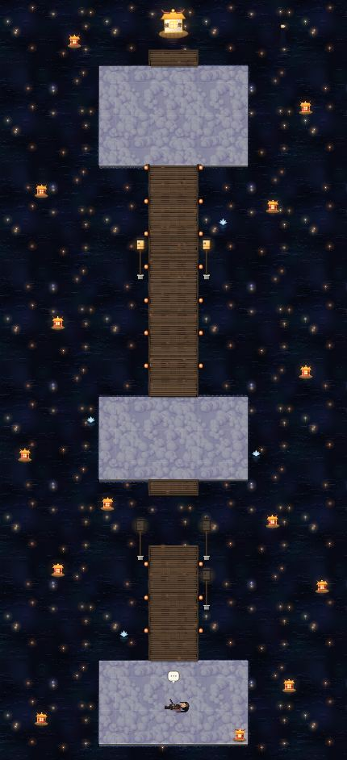

### 流程

燈橋是一條由南往北的直線，沿途有三座雲台，依序是起點、中段、北端。

1. **起點雲台（甦醒）**：開場旁白結束後，鏡頭從遠方的白光一路拉回星河。星河醒來後會跳出「移動」教學。
2. **漂流的魂（可略過）**：起點雲台北側有第一個漂流的魂。靠近任何可互動的東西時，會跳出「對話／調查」教學。
3. **第一根燈柱 L1**：燈柱位於起點北方的橋上，在橋的右側。調查後選「點亮它」，星河會用指尖點燃燭芯。
   - 選「不管它」也沒關係。L1 沒點亮之前，想往北走會被星河自己擋回來（「沒點的燈，看了就渾身不對勁。」）。
   - 點燈後海霧湧起，觸發**第一場戰鬥：海霧魂 ×1**，並跳出戰鬥基本教學。用「攻擊」打兩三下就能解決。
4. **斷橋**：繼續往北，會發現前方的橋斷了，橋身沉在黑海裡。斷口兩側各有一根燈柱。
   - **左燈柱 L2**：調查即點亮，海面會浮起一塊發光的橋板，但這時還不能走。
   - **右燈柱 L3**：伸手點燈時又會冒出兩隻海霧魂，觸發**第二場戰鬥：海霧魂 ×2**，並跳出「選擇目標」教學。打贏後燈自動點亮。
   - L2、L3 的點燈順序隨意。三盞燈都亮起後，海裡的魂燈會把三排橋板托出海面，斷橋就此接上。這時星河的 HP／MP **全滿**（「燈火的暖意流遍全身。」）。
5. **中段雲台**：這裡有兩個漂流的魂（左、右各一），可以順路聊聊。
6. **藍色燈火（0-6）**：往北走到兩根已點亮的燈柱之間，燈火會轉成冰冷的藍色，觸發**第三場戰鬥：大海霧魂＋海霧魂 ×2**，並跳出「仙術／防禦」教學。打法見〈頭目戰〉。
7. **北端雲台（白衣少女）**：一路往北，進入劇情。少女哼著渡魂謠，燈橋在星河身後一節節沉入海中。
8. 劇情結束後星河墜入深海，然後在燈籠舖的床邊摔醒，直接進入第一章。

劇透警告：橋盡頭的少女說了什麼

少女始終沒有回頭。她說：「你又來了。」「每一次，你都走這座橋。每一次，橋都會斷。」遠方的大燈閃爍欲熄，她說自己「要回去了」。星河手腕上的紅線和少女髮間的紅線同時亮了一下，她才微微側過臉：

「星河……這一次，別再來找我了。」

這首歌的歌詞（「燈一盞，渡一人……」）會記為第一段歌詞殘片。

### 心燈與支線

序章沒有心燈，也沒有支線。夢中四個「漂流的燈」可以和它們對話，各有初次與再次的台詞，不影響結局，但很有味道：

| 位置 | 魂 | 內容 |
|---|---|---|
| 起點北側橋上（左邊） | 渡海的阿伯 | 「六死三留一回頭……少年仔，你講，我是哪一個？」 |
| 中段雲台・左 | 溫柔的婦人 | 發現星河「身上沒有燈」。 |
| 中段雲台・右 | 小孩子 | **對話兩次**，第二次他會問「我可以跟著你一下嗎？」，之後就一路跟在星河身後。到了藍色燈火那裡，他會被嚇得飄走。 |
| 北段橋上（右邊） | 老漁夫 | 再對話一次，會提到「那個白衫的姑娘，在前頭站好久了」。 |

劇透警告：婦人的那句話

「每個人都有一盞的……你的，在哪裡呢？」這是全作最早的伏筆之一。

### 寶箱與秘密

序章沒有寶箱，也沒有七仙蕈。

- 北段橋上那兩根一開始就亮著的燈柱（L2、L3 再往北）可以調查：「已經點亮的燈柱。是誰點的呢……」。觸發藍色燈火之後再調查，台詞會改變。
- 在夢中按選單鍵或取消鍵，會出現專屬吐槽。

### 商店

無。

### 謎題與小遊戲

**斷橋三燈**：L1 已經點亮的前提下，再把斷口左右的 L2、L3 也點亮，橋就會接起來。L3 一定會先觸發一場戰鬥，打贏後才會點亮。三盞燈全亮的瞬間全員回滿。

### 頭目戰

| 敵人 | Lv | HP | 屬性 | 弱點 ×1.5 | 抗性 ×0.5 | 經驗 | 錢 | 掉落 |
| --- | ---: | ---: | :---: | --- | --- | ---: | ---: | --- |
| 海霧魂 | 1 | 38 | 水 | 火・土 | — | 2 | 5 | 芋圓湯 20% |

#### 大海霧魂（0-6，附帶海霧魂 ×2）

| 項目 | 數值 |
|---|---|
| 等級／HP | Lv2／84（海霧魂：Lv1／38） |
| 屬性 | 水 |
| 弱點 | 火（星河的「螢火斬」傷害 ×1.5） |
| 招式 | 陰寒之觸（單體水屬性術法）；**聚霧**（頭上出現紅色「！」，下一回合放出**霧湧**：我方全體水屬性術法，威力 1.3） |
| 推薦 | Lv1 即可。裝備就是初始的竹劍、粗布短衫、草鞋、紅線手環 |

**機制**：大海霧魂在**第 2 次行動時一定會「聚霧」**，下一次行動就放出霧湧。之後每次行動也有 40% 機率再聚霧。第一次聚霧時，遊戲會跳出提示，教你選「防禦」。防禦能讓本回合受到的傷害減半，還能累積一點劍意。

**打法**：

1. 第 1 回合：先用「攻擊」收掉一隻海霧魂（HP 38）。小怪會用「海霧」降低你的能力，越早清掉越好。
2. 大海霧魂頭上一出現「！」：**下一個行動選防禦**，硬吃霧湧的傷害會減半。
3. 霧湧放完後：對大海霧魂用**螢火斬**（MP4，火屬性打中弱點）。星河 MP 20，可以連放四到五次。
4. 再看到「！」就再防禦一次，其餘回合照樣螢火斬或普攻，剩下那隻海霧魂最後收掉。

就算輸了也只會原地重打，HP 全滿。這一戰給 46 點經驗，打完星河就會升上 **Lv2**。

### 小技巧

- **小孩子的魂要對話兩次**才會跟著你走。第一次對話只會說「前面好暗喔」。
- 三盞燈全點亮時會全員回滿，所以第二場戰鬥打完不必擔心血量。
- 第三場戰鬥前沒有回復點，但輸了會自動回滿重來，可以放心練習「看到『！』就防禦」的節奏。這招在第一章的工頭魂和之後所有頭目戰都非常重要。
- 序章不能存檔，但時間很短，約 10 分鐘。第一章開頭就能存檔了。

## 第一章　九份燈火

> 圖表：第一章　九份燈火・路線——本章走過的地點：九份 → 八斗子。（圖表只在 HTML 版顯示）

### 概要

七月十四，九份。燈籠舖學徒星河跑完早上的差事，又鑽進舊礦坑救狗，傍晚跟著陳伯下山到雞籠看放水燈。誰知道水燈全部倒漂回岸，一盞古老的白色水燈頭上，躺著一位陌生的少女。

| 項目 | 內容 |
|---|---|
| 推薦等級 | Lv2～5（工頭魂 Lv3、墨鴉／水鬼王 Lv4 以上） |
| 隊伍 | 沈星河（礦坑一路單人）→ 1-15 起 白芷 加入；水鬼王戰 陳伯 以「客人」身分參戰 |
| 主要地圖 | 九份、舊金礦坑（上層／下層）、雞籠街・主普壇、八斗子海岸・望海巷 |
| 心燈 | ① 阿土伯的懷錶　② 阿黃回家 |

**九份的時段**：本章的九份會隨劇情推進換時段，NPC 的位置、台詞和能接的支線也跟著變。

| 時段 | 何時開始 |
|---|---|
| 清晨 | 開場 |
| 正午 | 阿黃跑進礦坑後 |
| 午後 | 從礦坑出來後 |
| 黃昏 | 出發去雞籠 |
| 子夜 | 水鬼夜襲 |
| 翌晨（七月十五） | 夜襲結束後的早上 |

**重要**：午後找陳伯選「真的要出發了」之後，九份的支線會暫停到翌晨才恢復。兩盞心燈在午後和翌晨都能完成，不必急。

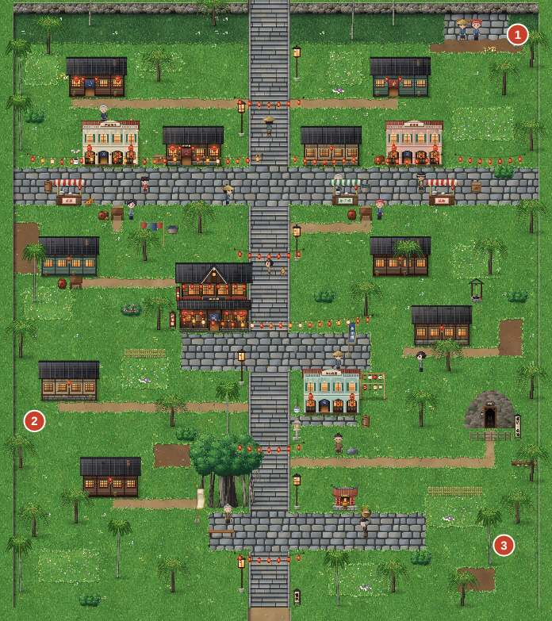

### 流程

#### 1-1～1-3　清晨：陳伯的三件差事

1. **閣樓**：星河摔下床後，房間右側有一個寶箱（草仔粿 ×2）。床可以「睡一下」完全回復，之後也能回來用。
2. **一樓店面**：陳伯交代三件差事，並給你 **100 文**、「茶樓的燈籠」和「供品籃」。三件差事順序隨意：
   - **茶樓聽雨樓**（鎮中央，豎崎路西側）：一進門就會自動交貨，鄭頭家給跑腿錢 **30 文**。
   - **雜貨店阿財商行**（北邊暗街仔西側）：找阿財買燈油。他算你 **38 文**，同時跳出商店教學。
   - **福德祠**（鎮的南端，大榕樹旁）：調查福德祠，和添丁伯一起拜土地公。香煙會詭異地飄向海邊。結束後獲得 **平安符**，並跳出選單教學。
3. 燈籠舖門口有**石燈籠記錄點**，之後還有很多個。穿過地圖出入口時，遊戲也會自動存檔。
4. 三件做完後回店裡找陳伯報告。劇情跳到**正午**，小金衝進來說阿黃跑進了舊礦坑。陳伯丟給你一盞**提燈**，有了它，礦坑裡的視野會變大。

#### 1-5～1-8　舊金礦坑

5. 到鎮東的**舊坑口**，封坑的木板已被撞破，觸發劇情後進入礦坑。
6. **礦坑上層**：入口大廳有記錄點（燈龕）。地圖上看得到的蝙蝠、礦工魂就是敵人，從背後或側面先按確認鍵，可以「先制攻擊」。
7. 中段的鐵軌區是**礦車謎題**，詳見〈謎題與小遊戲〉。主線只需要：
   - 把左邊轉轍器 A 扳到「東」，右邊轉轍器 B 扳到「北（大坑）」。
   - 推西邊的礦車，撞開北邊的坍方石堆。
8. 北上找到梯子，下到**礦坑下層**。東側斜坡有記錄點，建議在這裡存檔，因為往下走進**金脈大廳**就會觸發頭目戰「**工頭魂・金貴仔**」。
9. 戰後，老礦工阿土伯的魂會拜託你一件事（心燈①），阿黃也會開始跟著你。走到大廳東南角的**吊籠**，選「坐上去」，直接回到坑口。
10. 回到地面，阿黃撲進小金懷裡，時間變成**午後**。這時可以接兩盞心燈，詳見〈心燈與支線〉。

#### 1-9～1-12　黃昏：雞籠中元祭

11. 準備好之後回店裡找陳伯，選「出發去雞籠」→「真的要出發了」。
    - **出發前一定要做好夜戰準備**。今晚會連打三場戰鬥，中途不能休息，回到九份時多數店也關門了。準備清單見〈商店〉。
12. **雞籠街・主普壇**：自由逛街。這裡有三個雞籠限定攤位，見〈商店〉。
    - 東側的**長明宮布施攤**，可以和墨鴉對話。他會問你要不要長明燈符：

      | 選擇 | 結果 |
      |---|---|
      | 收下 | 1-22 時陳伯會叫你把符丟進火裡，有一段專屬劇情 |
      | 不用了 | 陳伯會稱讚你「總算有聽話」 |

      這個選擇不影響戰鬥和結局。
    - 港邊的小女孩小雨會問你要在燈上寫誰的名字，兩個選項都只影響台詞。
    - 主普壇前有記錄點。
13. 逛夠了就到港邊大路找陳伯，選「可以出發了」，跟著水燈頭隊伍來到**八斗子**。
14. **八斗子**：找海邊的陳伯放水燈，要在燈上寫字，三個選項只影響對話：
    - 「爸爸媽媽」
    - 「沈」
    - 「陳伯長命百歲」

劇透警告：水燈倒漂之後

所有水燈突然轉成藍色，往岸邊漂回來。一座古老的白色水燈頭逆流而來，卡在礁岩盡頭，燈上躺著一位少女。

15. 往東邊的**礁岩小徑**走（原本被擋住，現在可以過去了）。小徑旁有兩隻**沙蟹精**在晃（水屬性、防禦高，打倒後不會重生），不想打可以繞開。
16. 走上礁岩時會被**遲疑的水鬼**抓住腳踝，觸發一場戰鬥。它前兩回合什麼都不做，很好打。
17. 走到礁岩盡頭，抱回少女。她手裡的玉牌上刻著「白芷」兩個字。

#### 1-14～1-21　子夜：水鬼夜襲

18. 回到燈籠舖，林大夫來看診，陳伯揹著兩個布包出門。子夜時白芷醒來，接著小金被「海」叫走了。**白芷加入隊伍**，加入時的等級與星河相同。
19. **夜襲中的九份**：
    - 民宅與商店全部閂門，雜貨店、醫館都進不去。
    - 豎崎路上有 5 組水鬼／鬼燈籠在巡邏，打倒後不會重生。
    - **燈籠舖後房陳伯的床可以「躺一下」完全回復**，是夜戰唯一的回復點。
20. 沿豎崎路往北（下山）走，依序觸發：

    | 位置 | 劇情 | 戰鬥 |
    |---|---|---|
    | 茶樓前 | 屋簷下的燈籠變成鬼燈籠 | 鬼燈籠 ×3，火屬性，用白芷的「水月」 |
    | 暗街仔 | 阿財從窗口丟下**鹽米 ×5** | 水鬼 ×2＋鬼燈籠 ×1 |
    | 石階盡頭（最北） | **連續三戰，中途完全不能補給** | 水鬼 ×3 → 頭目「墨鴉」 → 頭目「水鬼王」（陳伯參戰） |

    走到石階盡頭之前，**先回陳伯的床躺一下，把 HP／MP 補滿再上去**。
21. 戰鬥中陳伯會把寶劍「**螢火**」交給星河並自動裝備（攻擊 +12、火屬性）。星河的竹劍則在墨鴉戰後被打斷，變成重要物品「斷掉的竹劍」。

劇透警告：陳伯的真實身分

陳伯用刻滿符文的木槳擋下水鬼王的手，自稱「引魂人陳渡」。戰後，墨鴉的黑羽射向白芷，陳伯撲上去替她擋下，身受重傷。

#### 1-22～1-24　翌晨：出發

22. 陳伯在後房向星河說明「引魂人」與「彼岸燈」的事，交給你重要物品**引魂令**，並指示你經霧林、平溪前往觀音山太虛觀，找清虛真人。最後的選項（「我去。」／「我……我怕。」）只影響台詞。
23. 七月十五清晨。依目標去**阿柑芋圓**，白芷第一次吃到芋圓，阿柑姨送你**芋圓湯 ×3**。
24. 接著去**聽雨樓**，茶樓裡的兩隻貓會選中白芷和星河，**麻糬和芋圓**從此跟著你。沒去茶樓的話，南邊的出口會被擋住。
25. 翌晨的九份有不少道別禮物，見〈小技巧〉。
26. 一切就緒後，走到鎮南端的上平台，陳伯在老榕樹下送行，給你盤纏 **300 文**。第一章結束。

### 心燈與支線

#### 心燈①　阿土伯的懷錶

- **接取**：打倒工頭魂後，阿土伯的魂會拜託你。也可以在打工頭魂之前就先找到懷錶，阿土伯看到時台詞會不一樣。
- **步驟**：
  1. 在礦坑上層把轉轍器扳成 **A＝東、B＝東**，推礦車撞開東邊的石堆。詳見〈謎題與小遊戲〉。
  2. 進入東側小房間，從梯子下到礦坑下層的**西側坑道**。
  3. 往南是一條強風坑道，直接走會被風吹回來。先依「正」字的筆順**點亮三盞壁燈**，風就會停。順序見〈謎題與小遊戲〉。
  4. 坑道盡頭是坍方小房間。調查壓扁的便當盒（只有台詞），再調查石縫，取得**阿土伯的懷錶**。
  5. 午後或翌晨，把錶交給**阿土嬸**。午後她在自己家裡（九份西北角），翌晨在家門口。
- **報酬**：心燈「阿土伯的懷錶」、麥芽糖 ×5。

#### 心燈②　阿黃回家

- **接取**：從礦坑出來後（午後），和小金家門口（九份東北）的**小金**對話。
- **步驟**：
  1. 和旁邊的**阿旺**對話，選「阿黃是阿土伯的狗！」。他要有人作證。
  2. 去阿土嬸家找**阿土嬸**，她答應出面作證。
  3. 回到**小金家門口**，自動觸發劇情。阿土伯的魂會在坑口和阿黃道別。
- **報酬**：心燈「阿黃回家」、小金的金仔石（飾品，運 +5）。
- 兩盞心燈的完成順序會讓阿土伯的告別台詞略有不同。兩盞都完成後，阿土伯就能安心離開。

#### 支線　醒木失竊記（不算心燈）

- **接取**：交完茶樓的燈籠之後，**再進一次聽雨樓**，黑貓「黑糖」會叼走阿炳伯的醒木。清晨、正午、午後都可以觸發。
- **步驟**：
  1. 黑糖先停在雜貨店那一帶（九份西北）。對話選「抓住牠！」，牠會逃走。
  2. 牠跑到暗街仔的晾衣竿旁。再追一次，星河頭上會被罩一件內衫。
  3. 牠最後在**福德祠台階**睡午覺。硬搶沒用，要用**小魚乾**換。小魚乾可以在阿財商行買（10 文）；清晨、正午時豎崎路上的漁夫**阿水**也會免費送你一條。
  4. 把醒木還給聽雨樓的**阿炳伯**。
- **報酬**：說書折扇（飾品，法 +2、運 +3）、烏龍茶 ×2。之後阿炳伯的「聽故事」清單會多一段〈國姓爺與鶯歌石〉。

### 寶箱與秘密

| 地圖 | # | 座標 (x, y) | 內容 | 備註 |
| --- | ---: | --- | --- | --- |
| 陳記燈籠舖・閣樓 | 1 | (10, 4) | 草仔粿 ×2 |  |
| 九份 | 1 | (37, 2) | 番薯 ×3 |  |
| 九份 | 2 | (2, 30) | 鹽米 ×2 |  |
| 九份 | 3 | (36, 39) | 烏龍茶 |  |
| 舊金礦坑・上層 | 1 | (4, 3) | 金創藥 ×2 |  |
| 舊金礦坑・上層 | 2 | (37, 19) | 礦工頭巾 | 開啟時有事件 |
| 舊金礦坑・上層 | 3 | (36, 31) | 金砂 ×2 |  |
| 舊金礦坑・上層 | 4 | (23, 37) | 草仔粿 |  |
| 舊金礦坑・下層 | 1 | (6, 4) | 鹽米 ×3 |  |
| 舊金礦坑・下層 | 2 | (10, 26) | 烏龍茶 ×2 |  |
| 舊金礦坑・下層 | 3 | (24, 10) | 金創藥 |  |

座標以地圖左上角為 (0, 0)，向右為 x、向下為 y；「#」對應地圖圖片上的寶箱編號。

- **礦工頭巾**（礦坑上層東側小房間）：要先用礦車撞開東邊石堆才拿得到。打開時會跳出裝備教學。它是本章前期最好的頭部裝備（防 +4、運 +2），比斗笠還好。
- **藏私房錢的甕**：九份暗街仔南側的一個甕，調查可得 **20 文**。不算寶箱，很容易漏掉。
- **金砂**：礦坑上層寶箱 2 份＋工頭魂戰後 3 份，共 5 份。每份可賣 50 文，是第一章的重要財源。
- 本章沒有七仙蕈。

### 商店

**聽雨樓**

| 商品 | 類別 | 價格（文） | 效果／能力 |
| --- | --- | ---: | --- |
| 烏龍茶 | 道具 | 45 | 我方單體：真氣 +40 |
| 茶葉蛋 | 道具 | 15 | 我方單體：生命 +60 |

**阿柑芋圓**

| 商品 | 類別 | 價格（文） | 效果／能力 |
| --- | --- | ---: | --- |
| 芋圓湯 | 道具 | 20 | 我方單體：生命 +80，真氣 +10 |
| 芋圓冰 | 道具 | 35 | 我方單體：生命 +40，真氣 +25 |

**阿財商行**

| 商品 | 類別 | 價格（文） | 效果／能力 |
| --- | --- | ---: | --- |
| 草仔粿 | 道具 | 40 | 我方單體：生命 +150 |
| 金創藥 | 道具 | 30 | 我方單體：生命 +120 |
| 解毒草 | 道具 | 12 | 我方單體：解除中毒 |
| 鞭炮 | 道具 | 25 | 敵全體：火屬性傷害 40 |
| 鹽米 | 道具 | 18（特價，原價 20） | 敵單體：土屬性傷害 70 |
| 番薯 | 道具 | 8 | 我方單體：生命 +40 |
| 小魚乾 | 道具 | 10 | 我方單體：生命 +20 |
| 烏龍茶 | 道具 | 45 | 我方單體：真氣 +40 |
| 夾棉短襖 | 衣裝 | 50 | 防+6 |
| 斗笠 | 頭飾 | 30 | 防+3 |
| 布鞋 | 鞋履 | 40 | 防+2 速+2 |
| 九份竹笛＊ | 武器 | 60 | 武+3 法+11（白芷） |

＊ 只在特定時段或劇情進度後上架。

**回春堂**

| 商品 | 類別 | 價格（文） | 效果／能力 |
| --- | --- | ---: | --- |
| 金創藥 | 道具 | 30 | 我方單體：生命 +120 |
| 解毒草 | 道具 | 12 | 我方單體：解除中毒 |
| 香包 | 道具 | 40 | 我方單體：解除沉睡・封印・定身・幻境 |
| 還魂香＊ | 道具 | 150 | 倒下的同伴：復活（30% 生命） |

＊ 只在特定時段或劇情進度後上架。

**鼎邊趖**

| 商品 | 類別 | 價格（文） | 效果／能力 |
| --- | --- | ---: | --- |
| 鼎邊趖 | 道具 | 45 | 我方單體：生命 +160 |

**天婦羅**

| 商品 | 類別 | 價格（文） | 效果／能力 |
| --- | --- | ---: | --- |
| 天婦羅 | 道具 | 30 | 我方單體：生命 +80，真氣 +10 |

**吊飾攤**

| 商品 | 類別 | 價格（文） | 效果／能力 |
| --- | --- | ---: | --- |
| 水燈吊飾 | 佩飾 | 60 | 運+3 防+1 |
| 香火袋 | 佩飾 | 90 | 法+2；免疫封印 |
| 平安符 | 道具 | 80 | 我方單體：解除中毒・沉睡・封印・定身，護盾 3 回合 |

**粿婆的攤子**

| 商品 | 類別 | 價格（文） | 效果／能力 |
| --- | --- | ---: | --- |
| 草仔粿 | 道具 | 36（特價，原價 40） | 我方單體：生命 +150 |
| 紅龜粿 | 道具 | 30 | 我方單體：生命 +120 |

| 商店 | 位置 | 主要商品 |
|---|---|---|
| 阿財商行 | 九份北側暗街仔西 | 消耗品、鹽米、防具。翌晨鹽米降為 18 文，並寄賣白芷的**九份竹笛** |
| 回春堂 | 九份北側暗街仔東 | 藥品。午後與翌晨才賣**還魂香** |
| 聽雨樓 | 九份中央 | 烏龍茶、茶葉蛋 |
| 阿柑芋圓 | 九份北側 | 芋圓湯、芋圓冰 |
| 粿婆的攤子 | 暗街仔中央 | 草仔粿（**36 文**，比雜貨店便宜）、紅龜粿 |
| 雞籠夜市 | 雞籠街 | 鼎邊趖、天婦羅、吊飾攤（水燈吊飾、**香火袋**、平安符） |

**採購建議**（依 docs/BALANCE.md 的設定）：

- **進礦坑前**：星河換上**夾棉短襖**（50 文）、**斗笠**（30 文）、**布鞋**（40 文），再帶草仔粿和金創藥各 3 個。錢不夠就先買短襖。草仔粿去粿婆那裡買比較便宜。
- **去雞籠前**：
  - 再買一雙**布鞋**給白芷。她加入時店都關門了，鞋子要事先買好。
  - 賣掉金砂（5 份 250 文），換成 2 個**香火袋**（雞籠吊飾攤，90 文）。墨鴉的「長明咒印」會封印對手，而且專挑白芷。香火袋能讓人免疫封印，是本章最關鍵的飾品。
- **夜戰補給**：在雞籠買 3～4 碗**鼎邊趖**（回復 160，雞籠限定）；再帶 2 杯**烏龍茶**給白芷回真氣。阿財丟給你的鹽米也留著打水鬼王。
- **翌晨**：九份竹笛（60 文，法 +11）比白芷的玉笛強很多，出發前一定要買。

### 謎題與小遊戲

#### 礦車與轉轍器（礦坑上層）

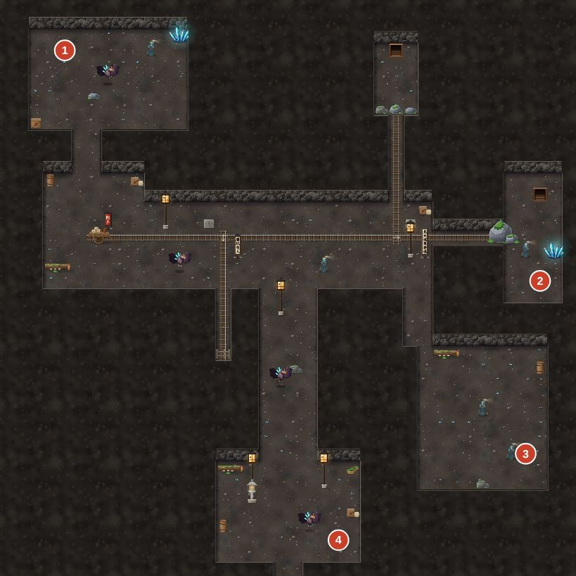

鐵軌從西邊的礦車出發往東，中間有兩個轉轍器。轉轍器 A 在第一個岔口，B 在第二個岔口，地上的粉筆箭頭會顯示目前方向。

| 轉轍器 A | 轉轍器 B | 礦車撞到 | 結果 |
|---|---|---|---|
| 南（初始） | 不論 | 南邊廢坑的擋車木 | 彈回原處，什麼也沒發生 |
| 東 | 北 | 北邊坍方石堆 | **主線**：打通往大坑的通道，梯子在最北端 |
| 東 | 東（初始） | 東邊大石頭 | **支線**：打通東側小房間（礦工頭巾＋往下層西側坑道的梯子） |

最有效率的順序：

1. A 扳到「東」，B 保持「東」，推車 → 打通東邊。
2. 再把 B 扳到「北」，推車 → 打通北邊。

礦車撞完會自己溜回原位，可以重複推。兩邊都打通後再推，只會看到「礦車的輪子歪了」。

#### 風洞壁燈（礦坑下層西側）

坑道東側牆上有三盞熄滅的壁燈，旁邊各有粉筆記號：

| 位置 | 記號 |
|---|---|
| 北 | 「下」 |
| 中 | 「一」 |
| 南 | 「丅」 |

阿土伯做記號用「正」字的筆順。正確順序是：

**「一」（中）→「丅」（南）→「下」（北）**

順序錯了，一陣冷風會把三盞燈全部吹熄，要從頭再點。錯兩次後，星河會自己想起這條提示。三盞全亮後風就停了，可以往南走。

### 頭目戰

| 頭目 | Lv | HP | 屬性 | 弱點 ×1.5 | 抗性 ×0.5 | 招式 | 階段 | 同場敵人 | 經驗 / 錢 | 類型 |
| --- | ---: | ---: | :---: | --- | --- | --- | --- | --- | ---: | --- |
| 工頭魂・金貴仔 | 3 | 457 | 金 | 火 | — | 十字鎬（土）、金砂迷眼、鶴嘴鋤重擊（金） | 50% 回復15% | — | 68 / 120 | 頭目 |
| 墨鴉 | 5 | 953 | 金 | 火 | — | 鴉羽紛飛、長明咒印、黑羽旋風、斬擊、本使者不陪你玩了 | 50%、25%；剩 2% 時劇情結束 | — | 127 / 155 | 頭目 |
| 水鬼王 | 5 | 858 | 水 | 火・土 | — | 抓交替（水）、黑水倒灌（水）、利爪、再生之手、百面哀嚎 | 50% 變身；剩 2% 時劇情結束 | 水鬼之手×2 | 109 / 104 | 頭目 |

> 圖表：第一章　九份燈火・頭目 HP——普通難度的最大生命（劇情難度 ×0.8、困難 ×1.3）。深淺交替區分章節；同場的小怪與召喚物不計。（圖表只在 HTML 版顯示；數據如下）

| 章 | 頭目 | Lv | HP |
| --- | --- | ---: | ---: |
| 第一章 | 工頭魂・金貴仔 | 3 | 457 |
| 第一章 | 墨鴉 | 5 | 953 |
| 第一章 | 水鬼王 | 5 | 858 |

#### 工頭魂・金貴仔（1-7）

| 項目 | 內容 |
|---|---|
| 等級／HP | Lv3／457 |
| 屬性 | 金（**火剋金，螢火斬 ×1.5**；木屬性攻擊只剩 0.7 倍） |
| 免疫 | 睡眠、暈眩、幻境 |
| 推薦 | Lv3 以上（星河單人）。夾棉短襖、斗笠、布鞋、紅線手環；草仔粿 ×3、金創藥 ×3 |

| 招式 | 效果 |
|---|---|
| 十字鎬 | 單體土屬性物理攻擊，威力 1.35，最常用 |
| 金砂迷眼 | 我方全體，50% 機率速度下降 2 回合 |
| 高舉鶴嘴鋤 → 鶴嘴鋤重擊 | **第 2 次行動必定高舉**（頭上出現「！」），下一次行動打出單體金屬性重擊，威力 1.7。第 4 次行動起，每次有 30% 機率再高舉 |
| 剩一半 HP 時 | 大喊「攏是我的！」，回復 15% HP，攻擊 +30%，持續 3 回合 |

**打法**：

1. 開場阿土伯會提示「金驚火」。之後基本上就是**螢火斬連發**：星河 MP 25，可以放 6 次。
2. 工頭魂頭上一出現紅色「！」，**下一個行動就選防禦**，鶴嘴鋤重擊的傷害會減半。序章大海霧魂的節奏在這裡完全通用。
3. 星河 Lv3 學會的「護燈訣」可以提升自身防禦。它進入狂暴（攻擊 +30%）的那 3 回合，先放一次護燈訣，或乾脆多防禦一回合。
4. HP 低於一半就吃草仔粿（回復 150）。MP 用完就普攻。
5. 劍意滿 100 時會跳出教學，記得用絕技「萬燈・螢火燎天」補一大刀。

#### 遲疑的水鬼（1-13）

HP 91，水屬性，弱火、土。前兩回合只會「遲疑」，用螢火斬兩三下就打完了。

#### 連戰：水鬼 ×3 → 墨鴉 → 水鬼王（1-18～1-20）

三場戰鬥之間 **HP／MP 不會回復**，開打前先到陳伯的床補滿。第一場水鬼 ×3（各 HP 107，水屬性，弱火、土），用螢火斬和鹽米快速收掉，盡量不要用掉白芷的 MP。

#### 墨鴉（1-19）

| 項目 | 內容 |
|---|---|
| 等級／HP | Lv5／953（HP 剩 2% 時戰鬥結束，劇情勝利） |
| 屬性 | 金（弱火） |
| 免疫 | 睡眠、暈眩、幻境 |
| 推薦 | Lv4～5。星河：夾棉短襖、斗笠、布鞋、**香火袋**。白芷：初始裝備＋布鞋、**香火袋** |

| 招式 | 效果 |
|---|---|
| 鴉羽紛飛 | 隨機目標物理攻擊 4 段，每段威力 0.6 |
| 長明咒印 | 單體術法，威力 1.5，35% 機率**封印 2 回合**。75% 機率瞄準**白芷** |
| 黑羽旋風 | 全體術法，威力 1.0 |
| 斬擊 | 單體物理 |
| 本使者不陪你玩了 | HP 低於一半後才會用。自身速度、防禦 +30%，持續 3 回合 |

**打法**：

- 墨鴉最危險的是**封印白芷**。白芷被封住就不能補血，所以讓她戴上**香火袋**（免疫封印）。沒有香火袋的話，也可以用香包或平安符解除。
- 輸出交給星河的螢火斬（火剋金）。兩人都 Lv3 以上時，可以用**合擊「星河渡燈」**（兩人各耗 10 MP，全體術法，威力 3.0）。
- 白芷主力放清心曲補血，有空檔才用水月。注意：水剋火，但對金屬性的墨鴉沒有加成。
- 他用「本使者不陪你玩了」強化防禦的那 3 回合，傷害打不太進去，改成補血或防禦，等效果結束再進攻。
- **保留白芷至少 20 MP 進下一場**，下一場的渡魂謠非常重要。

#### 水鬼王＋水鬼之手 ×2（1-20，陳伯參戰）

| 項目 | 內容 |
|---|---|
| 水鬼王 | Lv5／HP 858，水屬性，**弱火、土**，免疫睡眠、暈眩、幻境。HP 剩 2% 時戰鬥結束 |
| 水鬼之手 | Lv4／HP 102，水屬性，弱火、土 |
| 推薦 | 同墨鴉。陳伯以客人身分自動戰鬥，**HP 不會歸零** |

| 招式 | 使用者 | 效果 |
|---|---|---|
| 抓 | 水鬼之手 | 60% 機率**定身 2 回合**。被抓住期間，每回合流失最大 HP 的 6%，直到那隻手被打倒 |
| 抓交替 | 水鬼王 | 單體水屬性物理，威力 1.4，15% 機率定身 |
| 黑水倒灌 | 水鬼王 | 全體水屬性術法，威力 1.1 |
| 再生之手 | 水鬼王 | 有手被打倒時，大約每 2 次行動長出一隻新的手 |
| 百面哀嚎 | 水鬼王（剩一半 HP 後） | 我方全體攻擊 -30%，持續 2 回合 |

**特殊機制**：

- **渡魂謠能削弱水鬼王**：白芷每唱一次渡魂謠（MP8），水鬼王的攻擊力就永久下降 15%，最多 3 次（共 -45%），畫面會出現「怨氣消散」。
- **螢火**：第 2 回合起，陳伯把螢火交給星河，自動裝備。星河的攻擊力和火屬性普攻立刻變強。
- **陳伯的行動**：通常用「槳掃」（全體物理）；每第 3 次行動對水鬼王用「引魂・渡」（威力 2.5 的重擊）；有隊友被手抓住時，會優先打那隻手來救人；劍意滿了會放絕技「引魂・渡海」。

**打法**：

1. 開場**白芷連唱 2～3 次渡魂謠**，先把水鬼王的攻擊力壓下來。
2. 星河集中打**水鬼王本體**。手會一直長回來，清不完，而陳伯的槳掃會順便削手。只有在有人被抓住時，才優先打掉抓人的那隻手。
3. **鹽米**對水鬼王是土剋水，一包約 105 點，MP 不夠時就丟鹽米。
4. 水鬼王剩一半 HP 後會用百面哀嚎（我方攻擊 -30%）。這 2 回合改用**合擊「星河渡燈」**（術法類，不受攻擊下降影響）或丟鹽米，不然就趁機補血。
5. 白芷的 HP 偏低，一被抓住就馬上補血。

### 小技巧

- **夜襲中的回復點**：燈籠舖後房陳伯的床。一般時段只能看，子夜時可以躺下完全回復。閣樓星河的床在白天可以睡覺回復。
- **白芷的初始裝備**已經有水屬性抗性（海沫褙子）。她加入後記得打開選單換上預先買好的布鞋。
- **翌晨的道別禮物**（白芷在隊伍中才會觸發一部分）：
  - **添丁伯**（福德祠）送白芷**香火袋**。
  - **阿旺**送**金創藥 ×2**。
  - **粿婆**送白芷**草仔粿 ×1**。
- **阿炳伯的故事**：「聽故事」可以聽〈九份的由來〉、〈劍仙與劍意〉。午後會多一段〈雞籠中元祭〉，完成醒木支線後再多一段〈國姓爺與鶯歌石〉。
- 雞籠的小雨、林伯和黃伯、老水手等人都有不錯的民俗小知識，值得一聊。
- **鐵口仙**（福德祠前的算命仙）：翌晨時讓白芷在隊伍中和他說話，有一段專屬劇情。
- **第二章開頭會清掉沒完成的第一章支線**（阿土伯的懷錶、阿黃回家、醒木失竊記），兩盞心燈請在出發前完成。

## 第二章　霧林天燈

> 圖表：第二章　霧林天燈・路線——本章走過的地點：平溪。（圖表只在 HTML 版顯示）

### 概要

星河與白芷離開九份，穿過魔神仔出沒的霧林前往平溪。在七彩靈蕈林第一次得到「靈視」，遇見鹿港洛家的紅纓，最後在平溪的竹林裡救出被虎姑婆擄走的孩子。

| 項目 | 內容 |
|---|---|
| 推薦等級 | Lv5～9（魔神仔頭、紅纓 Lv6；虎姑婆 Lv8～9） |
| 隊伍 | 沈星河、白芷 → 2-9 起 洛紅纓 加入（加入時至少 Lv5） |
| 主要地圖 | 霧林・北、魔神仔的迷陣、七彩靈蕈林、霧林・南、平溪（含客棧、天燈舖、周家、阿貴商號）、虎姑婆的竹林、山中老厝、虎姑婆的洞窟、十分瀑布 |
| 心燈 | ③ 山中的呼喚（樵夫阿山）　④ 寄到了的信（周家的阿興） |
| 新系統 | **靈視**（七彩靈蕈）、銅鑼、地圖上的幻象 |

**平溪的時段**：

| 時段 | 何時開始 | 狀態 |
|---|---|---|
| 抵達之夜 | 剛到平溪 | 往竹林的路不通 |
| 七月十六白天 | 住過客棧後 | 支線大多在這段 |
| 天燈之夜 | 打倒虎姑婆後 | 劇情自動進行 |
| 七月十七清晨 | 天燈之夜後 | 劇情自動進行 |
| 八月初五 | 風颱過後 | 可以道別、交付支線 |

**溪蝦只能在七月十六白天抓**，所以「紅纓的廚房」一定要在打虎姑婆之前完成。

### 流程

#### 2-1～2-2　霧林・北

1. 一進霧林就有人學陳伯的聲音叫星河。白芷回頭，星河及時把她拉回來（純劇情）。山路口有土地公廟和**記錄點**。
2. 往南走，空地中央的少年**阿竹**在敲鑼找父親。對話時兩個選項都會接下心燈③：
   - 「我們幫你找。」
   - 「我們趕路……」：白芷會說服星河。

   阿竹會把**銅鑼**交給你。
3. 霧林・北有一些**靈視寶箱**和**老獵人的魂**，現在還看不到，之後拿到靈視再回來。見〈寶箱與秘密〉。
4. 從南端出口進入「魔神仔的迷陣」。

#### 2-3～2-5　魔神仔的迷陣 → 七彩靈蕈林

5. 迷陣是一塊空地，中央有一棵綁著紅布的老樟樹，東、南、西、北各有一個出口。
   - **北邊出口永遠通回霧林・北。**
   - 往東、南、西任一個方向走，都會繞回這塊空地。
6. 繞滿三次後，白芷會發現**西南角的蕨叢後面**有七色的光在「唱歌」。蕨叢打開，進入**七彩靈蕈林**。
7. 七彩靈蕈林會自動上演第一次靈視的長劇情。結束後獲得 **七彩靈蕈 ×3**，靈視持續約 2 分鐘，同時跳出靈視教學。

劇透警告：靈視中看見的東西

靈視裡，白芷的身體中燃著一團安靜的白色火焰，像一盞燈。白芷則看見星河胸口也有一盞小小的燈，顏色和她的一樣。兩盞燈之間連著一條細細的紅線。

8. 從東邊出口回到迷陣，**趁靈視還沒消退**跟著地上的銀色腳印走。解法見〈謎題與小遊戲〉。

#### 2-6～2-9　霧林・南：阿山、紅纓

9. 走出迷陣，來到霧林・南。入口旁有**記錄點**。
10. **救阿山（心燈③）**：從入口往南沒多遠，山徑東側有幾棵影子方向不對的樟樹，那是幻象。**開著靈視**走過去，樹會消失，後面就是阿山被魔神仔圍住的小空地。詳見〈心燈與支線〉。
11. 繼續往南，走到中段的林間空地，觸發**洛紅纓決鬥**。紅纓把鬼火繞身的白芷當成養魔神仔的妖女。打完會接著遭遇十幾隻魔神仔，**紅纓加入隊伍**，並跳出新夥伴教學。三場戰鬥打輸了都不會 Game Over，見〈頭目戰〉。
12. 往南出口前往平溪。決鬥前，這個出口會被擋住。

#### 2-10～2-11　平溪

13. 抵達平溪的夜晚。如果阿山跟在隊伍裡，會先演出和阿竹重逢的劇情。之後李庄頭會說明虎姑婆擄走四個孩子的事。
14. 夜裡上山的路（東北竹林）被搜山的人擋著。先到**十分客棧**休息，可以看到白芷和紅纓的房間對話。第一晚免費，休息後全員完全回復，時間來到**七月十六白天**。
15. 早上紅纓會在客棧接下支線「紅纓的廚房」。白天可以逛平溪、買裝備、做支線，見〈商店〉與〈心燈與支線〉。
16. 準備好了，就從平溪東側的出口進入**虎姑婆的竹林**。

#### 2-12～2-15　虎姑婆的竹林與洞窟

17. **竹林**入口有記錄點。沿著地上的老虎腳印往北走，大樟樹上躲著女孩**阿蘭**，她會出三道題考你，答案見〈謎題與小遊戲〉。
18. 竹林最北邊的**山中老厝**：屋裡的「老婦人」請你吃「花生」。三個選項都會讓她露出尾巴：
    - 「阿婆，妳的手好多毛。」
    - 「阿婆，妳的眼睛好大。」
    - 「阿婆，妳裙子下面……有尾巴。」（開著靈視才會出現）

    她撞破後門逃走後，老厝北邊的竹子被撞開，露出**洞窟**入口。
19. **洞窟**：入口通道有記錄點。要打開兩個竹籠，頭目間前的竹柵門才會開，見〈謎題與小遊戲〉。
20. 頭目間：**虎姑婆**。打倒後救出最後一個孩子，回到平溪。

#### 2-16～2-19　平安燈、風颱、十分瀑布

21. **天燈之夜**：吳阿公講天燈（平安燈）的由來，全庄一起放天燈。
    - 如果你在洞窟裡撿到了阿興的家書，周家兩老會在這一幕請你念信，並完成心燈④。
    - 這一幕結束時全員完全回復。

劇透警告：三人寫在天燈上的願望

- **紅纓**：「爹、娘、哥哥……」「找到鬼面」，還有偷偷寫的「想養一隻胖胖的貓」。
- **白芷**：「我想知道我是誰。」
- **星河**：偷偷寫下「希望她不要想起來就離開。」，寫完自己都愣住了。

22. **七月十七清晨**：李庄頭送上賞金 **400 文**。接著風颱來襲，基隆河漲水，一行人在平溪住了半個月。
23. **八月初五**：河水退了。這時可以向全庄道別，順便領幾份禮物、交付支線。然後從平溪東南的出口前往**十分瀑布**。
24. 瀑布邊會演出一段對話。之後到碼頭找**船伕阿河**，選「出發」，就會順著基隆河前往淡水，第二章結束。

### 心燈與支線

#### 心燈③　山中的呼喚（樵夫阿山）

- **接取**：霧林・北的阿竹（自動）。
- **步驟**：
  1. 在霧林・南，從入口往南走一小段，山徑東側有一排樟樹的影子方向不對，那是魔神仔的幻象。
  2. **吃七彩靈蕈打開靈視**，幻象樹會消失，阿山和三隻魔神仔也只有在靈視中才看得見。沒開靈視時，對樹叢按「擠過去」也能穿過去，但看不到人。
  3. 走進空地，星河敲銅鑼喊「阿山」，觸發與**魔神仔頭**的戰鬥。打輸也會繼續劇情。
  4. 戰後阿山會跟著隊伍走。帶他到平溪：抵達平溪時就會重逢；如果是之後才救出他，就在平溪他家門口（村子東側）重逢。
- **報酬**：心燈「山中的呼喚」、山蘇 ×2、金創藥 ×2。阿竹還會讓你留著那面銅鑼。

#### 心燈④　寄到了的信（周家的阿興）

- **接取**：七月十六白天，進平溪西側的**周家**，和周老伯或周老嬸說話。他們的兒子阿興上個月的信沒有寄到。不先接也沒關係，之後撿到信就會自動推進。
- **步驟**：
  1. 和廟埕北邊的挑夫**阿全**聊天，他會提到夥伴阿福把擔子丟在山裡。這一步只是提示，可以略過。
  2. 在**虎姑婆的洞窟**西北角的小房間，調查挑夫的擔子，獲得**兒子的家書**和**挑夫的擔子**。
  3. 打倒虎姑婆後，天燈之夜周家兩老會在場，請你念信，周家的天燈升空時完成心燈。
     - 如果天燈之夜時信不在身上，可以等八月初五再去周家念信，會在清晨補演放燈的劇情。
- **報酬**：心燈「寄到了的信」。
- **挑夫的擔子**：八月初五交給阿全，可得**挑夫草鞋**（防 +3、速 +3）和 **150 文**。之後月娘和阿貴也會收到阿全送來的信，各有一句台詞。

#### 支線　紅纓的廚房（不算心燈）

- **接取**：七月十六早上，紅纓在隊伍中時，進十分客棧會自動接取。
- **材料**（一樣一份）：

  | 材料 | 取得方式 |
  |---|---|
  | **竹筍** | 平溪東北竹林小徑盡頭的筍尖，或虎姑婆竹林東南角的筍尖 |
  | **溪蝦** | 先和河邊的孩子**阿溪**說話，再調查他旁邊的「翻石頭」。三顆石頭隨機一顆有蝦，翻三次都沒中，阿溪也會分你一隻。**只有七月十六白天才能抓。** |
  | **山蘇** | 霧林・南西南角的一叢山蘇，或救回阿山時拿到的山蘇 |

- **交付**：材料湊齊後找客棧的**月娘**。
- **報酬**：
  - **紅纓特製山產炒（焦）×3**：戰鬥中丟出去，造成 120 點火屬性傷害，對虎姑婆特別好用。
  - **竹筍溪蝦湯 ×2**：回復 HP 200、MP 25。

#### 小活動　紮天燈（吳家天燈舖）

七月十六白天找**吳阿公**，他會考你紮天燈的三個步驟，答案見〈謎題與小遊戲〉。報酬是**天燈吊飾**（飾品，法 +3、運 +2）。

#### 八月初五的道別禮物

| NPC | 禮物 |
|---|---|
| 阿石伯（平溪東側） | 金創藥 ×3 |
| 小春的阿嬤（廟埕） | 紅龜粿 ×3（回復 160） |
| 阿全（廟埕北） | 交還擔子時：挑夫草鞋＋150 文 |

另外，李庄頭在七月十七清晨會自動給賞金 400 文。

### 寶箱與秘密

| 地圖 | # | 座標 (x, y) | 內容 | 備註 |
| --- | ---: | --- | --- | --- |
| 霧林・北 | 1 | (34, 9) | 金創藥 ×2 |  |
| 霧林・北 | 2 | (5, 7) | 七彩靈蕈 | 靈視才看得見、開啟時有事件 |
| 霧林・北 | 3 | (37, 32) | 獵人的護符 | 靈視才看得見、依劇情出現 |
| 霧林・南 | 1 | (9, 12) | 解毒草 ×3＋200 文 |  |
| 霧林・南 | 2 | (26, 40) | 雄黃香囊 |  |
| 霧林・南 | 3 | (35, 38) | 還魂香 | 靈視才看得見 |
| 平溪 | 1 | (46, 2) | 龍眼乾 ×3 |  |
| 虎姑婆的竹林 | 1 | (33, 33) | 香包 ×2 |  |
| 虎姑婆的竹林 | 2 | (4, 37) | 300 文 |  |
| 虎姑婆的洞窟 | 1 | (6, 4) | 金創藥 ×2 |  |
| 虎姑婆的洞窟 | 2 | (28, 21) | 牛皮甲 | 開啟時有事件 |

座標以地圖左上角為 (0, 0)，向右為 x、向下為 y；「#」對應地圖圖片上的寶箱編號。

**靈視寶箱**：標記為「靈視」的寶箱平時看不見，要在靈視狀態下才會出現。七彩靈蕈在野外吃一朵，靈視可以維持約 75 秒。

| 寶箱 | 內容 | 條件 |
|---|---|---|
| 霧林・北，西北角 | 七彩靈蕈＋龍眼乾 ×2 | 靈視 |
| 霧林・北，東南的倒木下 | 獵人的護符（飾品，速 +3、運 +3） | 要先在靈視中和附近的**老獵人的魂**說話 |
| 霧林・南，東南角 | 還魂香 | 靈視 |
| 洞窟東側小房間 | 牛皮甲（額外附贈還魂香 ×1） | 要先用靈視穿過「會呼吸的岩壁」 |
| 霧林・南，西北的路邊 | 解毒草 ×3＋**200 文** | 普通寶箱，很容易錯過 |

- **七彩靈蕈可以無限採**：靈蕈林裡有三叢可採的發光蕈，每叢一次一朵。離開再進來就會長回來，所以每來一次可以多拿 3 朵。七彩靈蕈的另一個用法是戰鬥中讓同伴進入「幻境」，提升暴擊與術法威力。
- **老獵人的魂**在霧林・北東南的空地，靈視中才看得見。他會說海那邊的光變弱了，並把倒木下的寶物送你。
- 本章沒有七仙蕈，那是第三章起的跨章節收集。

### 商店

**阿藍姐染坊**

| 商品 | 類別 | 價格（文） | 效果／能力 |
| --- | --- | ---: | --- |
| 菁布頭巾 | 頭飾 | 180 | 防+6 法+1 |
| 菁染長衫 | 衣裝 | 260 | 防+10 法+3 |

**吳家天燈舖**

| 商品 | 類別 | 價格（文） | 效果／能力 |
| --- | --- | ---: | --- |
| 天燈吊飾 | 佩飾 | 80 | 法+3 運+2 |

**十分客棧**

| 商品 | 類別 | 價格（文） | 效果／能力 |
| --- | --- | ---: | --- |
| 山產便當 | 道具 | 50 | 我方單體：生命 +200 |
| 雞湯 | 道具 | 70 | 我方單體：生命 +150，真氣 +20 |
| 金創藥 | 道具 | 30 | 我方單體：生命 +120 |
| 草仔粿 | 道具 | 40 | 我方單體：生命 +150 |

**阿貴商號・雜貨**

| 商品 | 類別 | 價格（文） | 效果／能力 |
| --- | --- | ---: | --- |
| 草仔粿 | 道具 | 40 | 我方單體：生命 +150 |
| 金創藥 | 道具 | 30 | 我方單體：生命 +120 |
| 解毒草 | 道具 | 12 | 我方單體：解除中毒 |
| 香包 | 道具 | 40 | 我方單體：解除沉睡・封印・定身・幻境 |
| 還魂香 | 道具 | 150 | 倒下的同伴：復活（30% 生命） |
| 鞭炮 | 道具 | 25 | 敵全體：火屬性傷害 40 |
| 鹽米 | 道具 | 20 | 敵單體：土屬性傷害 70 |
| 龍眼乾 | 道具 | 15 | 我方單體：真氣 +20 |

**阿貴商號・武具**

| 商品 | 類別 | 價格（文） | 效果／能力 |
| --- | --- | ---: | --- |
| 青銅古劍 | 武器 | 180 | 武+18（星河） |
| 青嵐笛 | 武器 | 180 | 武+4 法+17（白芷） |
| 牛皮甲 | 衣裝 | 140 | 防+9 |
| 布頭巾 | 頭飾 | 90 | 防+5 |
| 斗笠 | 頭飾 | 30 | 防+3 |
| 雄黃香囊 | 佩飾 | 150 | 防+2；免疫中毒 |

| 商店 | 位置 | 主要商品 |
|---|---|---|
| 阿貴商號・雜貨 | 平溪 | 草仔粿、金創藥、解毒草、香包、**還魂香**、鞭炮、鹽米、龍眼乾 |
| 阿貴商號・武具 | 平溪 | **青銅古劍**（星河）、**青嵐笛**（白芷）、牛皮甲、布頭巾、斗笠、**雄黃香囊** |
| 阿藍姐染坊 | 平溪西側染坊前，七月十六白天、八月初五 | **菁布頭巾**、**菁染長衫** |
| 十分客棧 | 平溪 | 山產便當（回復 200）、雞湯、金創藥、草仔粿；住宿 30 文（完全回復） |
| 吳家天燈舖 | 平溪 | 八月初五才賣天燈吊飾 |

**採購建議**（依 docs/BALANCE.md 打虎姑婆時的設定）：

| 角色 | 武器 | 防具 | 頭部 | 飾品 |
|---|---|---|---|---|
| 星河 | 青銅古劍（攻 +18）※ | 菁染長衫（防 +10、法 +3） | 菁布頭巾（防 +6、法 +1） | 雄黃香囊 |
| 白芷 | 青嵐笛（法 +17） | 菁染長衫 | 菁布頭巾 | 雄黃香囊 |
| 紅纓 | 初始裝備 | 初始裝備 | 菁布頭巾 | 初始裝備 |

- ※ **青銅古劍沒有屬性**。打木屬性的山精時，螢火（攻 +12、火屬性）反而更好用；打虎姑婆（金屬性）也要靠螢火剋金。建議兩把都帶著，打虎姑婆前換回螢火。
- 回復品帶**山產便當 ×5**、鼎邊趖 ×3（第一章剩下的）、烏龍茶 ×3，再加**還魂香 ×2**。
- 雄黃香囊能讓人免疫中毒，霧林的「請吃大餐」和青竹絲都會下毒。
- 錢不夠的話，優先順序是**菁染長衫 → 青嵐笛 → 菁布頭巾**。洞窟裡還能撿到牛皮甲。

### 謎題與小遊戲

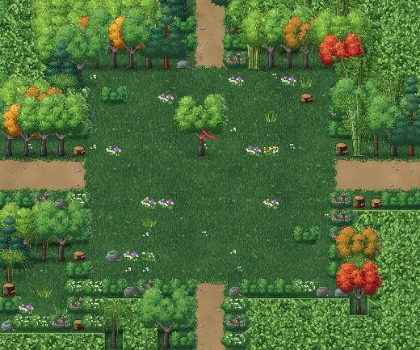

#### 魔神仔的迷陣

**靈視中的正確路線：東 → 南 → 南 → 西**

- 有靈視時，地上會浮現銀色的小孩腳印，指向下一個正確出口。腳印會隨你走到第幾步而改變。
- 從東邊出去，會從西邊回到空地；從南邊出去，會從北邊回到空地。每走對一步會響一聲鈴，靈視中樟樹上的「紅舌頭」也會縮短一節。
- **走錯一步就要從頭開始**，星河會說「腳印不是往這邊」。北邊出口隨時都能退回霧林・北，同樣會重置進度。
- **不開靈視也能過**：記住「東、南、南、西」直接走就行。
- 解開後南邊出口直通霧林・南，其他方向只會繞回空地，迷陣不會再困住你。

#### 阿蘭的三道題（虎姑婆的竹林）

| 題目 | 正確答案 |
|---|---|
| 伸手出來 | 星河、紅纓、白芷，誰伸手都可以，台詞不同 |
| 姊姊最後怎麼打敗虎姑婆？ | **用熱油**（白芷的「用芋圓」也算過關） |
| 你們要帶我去哪裡？ | **回家** |

答錯會被毬果打頭，扣 1 點 HP，不會打死人。

#### 洞窟的兩個竹籠

1. **西側小房間**：打開竹籠，救出小春。
2. **東側小房間**：通往這裡的通道被一面「**會呼吸的岩壁**」擋住。**開靈視**後岩壁就會消失。打開竹籠救出石頭，房間裡還有寶箱（牛皮甲）。
3. 兩個籠子都打開後，北邊頭目間前的竹柵門才會開。
   - 靈視中途結束、而你正好站在幻象裡時，會被自動擠回路上，不會卡住。

#### 紮天燈（吳阿公）

| 問題 | 正確答案 |
|---|---|
| 先做什麼？ | 竹篾紮成圓口 |
| 然後？ | 糊上棉紙，做成燈身 |
| 燈底下放什麼當燃料？ | 沾了油的金紙 |

答錯會被吐槽，但可以一直重答。

#### 銅鑼

在霧林、虎姑婆的竹林和洞窟等山林地圖中，從物品選單使用，**魔神仔類**的地圖敵人會摀著耳朵逃開 30 秒。不想戰鬥時很好用。在平溪敲的話，只會被路人看。

### 頭目戰

| 頭目 | Lv | HP | 屬性 | 弱點 ×1.5 | 抗性 ×0.5 | 招式 | 階段 | 同場敵人 | 經驗 / 錢 | 類型 |
| --- | ---: | ---: | :---: | --- | --- | --- | --- | --- | ---: | --- |
| 魔神仔頭 | 6 | 560 | 木 | 金 | — | 牽路、請吃大餐（土）、利爪、分身 | — | 魔神仔（幻影）×2 | 200 / 250 | 劇情（輸了也能繼續） |
| 洛紅纓 | 4 | 1,232 | 金 | 火 | — | 紅纓點（金）、橫掃、斬擊、「就這點本事？」 | —；剩 35% 時劇情結束 | — | 76 / 1 | 劇情（輸了也能繼續） |
| 虎姑婆 | 9 | 3,407 | 金 | 火 | — | 虎爪（金）、猛虎撲（金）、阿婆唱歌給你聽、嚼花生、乖孫，來、伏身、虎嘯、山君之怒 | 60% 變身、20% 變身 | — | 313 / 599 | 頭目 |

> 圖表：第二章　霧林天燈・頭目 HP——普通難度的最大生命（劇情難度 ×0.8、困難 ×1.3）。深淺交替區分章節；同場的小怪與召喚物不計。（圖表只在 HTML 版顯示；數據如下）

| 章 | 頭目 | Lv | HP |
| --- | --- | ---: | ---: |
| 第二章 | 虎姑婆 | 9 | 3,407 |

本章前三場（魔神仔頭、紅纓決鬥、魔神仔包圍）**就算輸了也不會 Game Over**：全員至少剩 25% HP，劇情照常進行。

#### 魔神仔頭（2-7）

| 項目 | 內容 |
|---|---|
| 等級／HP | Lv6／560。幻影 HP 1，打一下就散 |
| 屬性 | 木（金剋木。火對木沒有加成） |
| 免疫 | 睡眠、暈眩、幻境 |
| 掉落 | 七彩靈蕈（必掉）、霧林小蕈 |
| 推薦 | Lv6。星河：螢火、菁染長衫、菁布頭巾、布鞋、香火袋。白芷：九份竹笛＋同款防具 |

| 招式 | 效果 |
|---|---|
| 牽路 | 單體，40% 機率陷入**幻境 2 回合** |
| 請吃大餐 | 單體土屬性物理，40% 機率**中毒 3 回合** |
| 利爪 | 單體物理 |
| 分身 | 有幻影被打散時，召喚兩隻新幻影 |

**打法**：

- **開著靈視進場，就只有魔神仔頭一隻**，不會有幻影。救阿山本來就需要靈視，記得在走進空地前吃一朵。
- 有幻影的版本不要去打幻影：打散一隻，它就會再分身兩隻。直接集中打本體。
- 星河用螢火斬或普攻，白芷補血和解厄（解除幻境、中毒）。

#### 洛紅纓（2-8 決鬥）

| 項目 | 內容 |
|---|---|
| 等級／HP | Lv4／1232（**HP 剩 35% 時結束**，實際只要打掉約 800） |
| 屬性 | 金（火剋金，螢火斬有效） |
| 免疫 | 睡眠、暈眩、幻境 |
| 推薦 | Lv6，同上 |

| 招式 | 效果 |
|---|---|
| 紅纓點 | 單體金屬性物理，威力 1.3 |
| 橫掃 | 全體物理，威力 0.7 |
| 斬擊 | 單體物理 |
| 「就這點本事？」 | HP 一半以下才會用。攻擊 +30%，持續 2 回合 |

**打法**：螢火斬為主，白芷負責補血。星河防禦時紅纓會有專屬台詞。輸了會進入另一個版本的劇情（白芷張開雙手擋在星河前面），之後的發展相同。

#### 魔神仔包圍（2-9）

魔神仔 ×4（各 Lv6／HP 168，木屬性）。紅纓剛加入，用**橫掃千軍**（全體）配星河的普攻很快就能清完。紅纓的金屬性招式剋木。

#### 虎姑婆（2-15）

| 項目 | 內容 |
|---|---|
| 等級／HP | Lv9／3407 |
| 屬性 | 金（**火剋金**：螢火斬、山產炒（焦）都打得到弱點） |
| 免疫 | 睡眠、暈眩、幻境 |
| 掉落 | 虎爪項鍊（飾品，攻 +5、暴擊率提升，必定取得） |
| 推薦 | Lv8～9。星河：螢火、菁染長衫、菁布頭巾、布鞋、雄黃香囊。白芷：青嵐笛＋同款防具。紅纓：初始裝備＋菁布頭巾。山產便當 ×5、鼎邊趖 ×3、烏龍茶 ×3、還魂香 ×2 |

| 階段 | 招式 | 效果 |
|---|---|---|
| 第一階段：老婦人 | 虎爪 | 單體金屬性物理，威力 1.4 |
| | 猛虎撲 | 全體金屬性物理，威力 0.9 |
| | 阿婆唱歌給你聽 | 全體，35% 機率**睡眠 2 回合** |
| | 乖孫，來 | 單體，50% 機率**暈眩 1 回合** |
| | 嚼花生 | HP 一半以下才會用。回復一大截 HP |
| 第二階段：老虎精（HP 60% 以下） | 虎爪、猛虎撲 | 同上 |
| | 虎嘯 | 我方全體攻擊 -30%（2 回合），20% 機率暈眩 |
| | 伏身 | 預告下一擊很危險 |
| | 嚼花生 | HP 一半以下才會用 |
| 第三階段：山君之怒（HP 20% 以下） | | 攻擊 +30%，持續 3 回合。改以猛虎撲、虎爪為主，還會再用一次「山君之怒」（攻擊再 +30%） |

**阿蘭的熱油**：虎姑婆 HP 掉到 45% 以下時，阿蘭會衝進來丟一整鍋熱油。效果是：

- 造成最大 HP 9% 的火屬性傷害；
- 虎姑婆**防禦下降 3 回合**、**暈眩 1 回合**。

**打法**：

1. **第一階段**：星河用螢火斬、紅纓用紅纓點，打出穩定傷害。白芷用清心曲補血。有人睡著或暈眩，就用香包解除，或不理它等它醒。
2. **第二階段**：虎嘯會降攻擊，這 2 回合讓紅纓改用**蓄勢**（自身攻擊大幅提升），把傷害補回來。看到「伏身」就讓 HP 最低的人防禦。HP 低於一半後她會嚼花生回血，要保持輸出壓力。
3. **熱油登場**後，虎姑婆防禦下降 3 回合，這時是最大的輸出機會。可以用：
   - 星河＋紅纓 Lv8 的合擊「**火樹銀花**」（全體三連擊，火屬性，兩人各耗 12 MP）；
   - **丟山產炒（焦）**（120 點火屬性，打中弱點）；
   - 各人的絕技。
4. **第三階段**攻擊力一路疊高，先把全員補到安全線，再一口氣收尾。猛虎撲是全體攻擊，白芷 Lv8 的「**潮生曲**」（全體回復）在這時最好用。

BALANCE 模擬的勝率是 100%（約 7 回合），但有約 15% 的機率會有人倒下，記得帶還魂香。

### 小技巧

- **平溪的客棧**：住一晚 30 文，完全回復。打虎姑婆前先住一晚。
- **靈視的時間**：剛吃完靈蕈林的那段約 2 分鐘，野外吃一朵約 75 秒。進迷陣前若靈視快結束，可以先回靈蕈林再採幾朵。
- **溪蝦只能在七月十六白天抓**，紅纓的廚房要在打虎姑婆前完成，否則材料湊不齊。第三章開頭也會把沒完成的「紅纓的廚房」、兩盞心燈支線從清單移除。
- **第二章開頭會清掉第一章沒完成的支線**，阿土伯的懷錶等任務不會出現在這裡。
- 霧林各處綁在樹上的紅布可以調查。靈視中的迷陣樟樹會變成一條紅舌頭。
- 平溪的四個孩子在八月初五會出現在廟埕，各有一句可愛的台詞。小春說籠子裡有「藍色的小火」陪她，和白芷有關。
- **星河 Lv6** 學會流螢亂舞（隨機四連擊），**白芷 Lv5** 學會解厄、**Lv8** 學會潮生曲，**紅纓 Lv5** 學會蓄勢、**Lv8** 學會連環槍。星河與紅纓都到 Lv8 時，會跳出合擊教學。

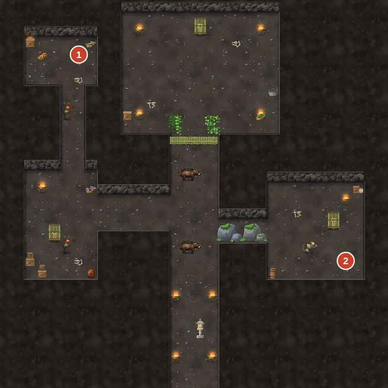

## 第三章　觀音艋舺

> 圖表：第三章　觀音艋舺・路線——本章走過的地點：淡水 → 觀音山 → 艋舺。（圖表只在 HTML 版顯示）

### 概要

八月，一行人順著基隆河來到淡水，渡河登上觀音山太虛觀，結識愛喝酒、愛吃蕈的道士雲歸。之後轉往「一府二鹿三艋舺」的艋舺，在中秋夜的戲棚與滿城冷藍的長明燈之間，追尋清虛真人的下落。

| 項目 | 內容 |
|---|---|
| 推薦等級 | Lv9～13（石猴王、鬼面 Lv10；戲棚 Lv12；河伯怨靈 Lv13） |
| 隊伍 | 星河、白芷、紅纓 → 3-9 起 **雲歸** 加入（加入時至少 Lv11） |
| 主要地圖 | 淡水、淡水客棧、紅毛城、觀音山道、太虛觀、艋舺（龍山寺、戲棚後台、剝皮寮、舊渡頭等） |
| 心燈 | ⑤ 紅毛城的異鄉兵　⑥ 阿蓮與阿德　⑦ 小梅與母親　⑧ 椅仔姑與花旦（有條件）　⑨ 頂下郊的兩個老人 |
| 七仙蕈 | 第一種「杉皮蕈」（剝皮寮） |

**艋舺的日子**：

| 日子 | 何時開始 | 夜間支線 |
|---|---|---|
| 八月十四・黃昏到夜 | 抵達艋舺 | 可以做 |
| 八月十五・白天 | 打完戲棚紙人後，在客棧住一晚 | 不能做 |
| 八月十五・中秋夜 | 白天找洪班主選「等到天暗」 | 可以做 |

阿蓮、小梅、頂下郊老鬼這三件夜間支線，**八月十四夜**或**中秋夜**都能做。從艋舺南門出發後，所有艋舺支線都會關閉。

### 流程

#### 3-1～3-3　淡水

1. 黃昏抵達淡水。渡船頭的阿海伯說天黑不開船，要先到**淡水客棧**（主街北側）過夜。第一晚的住宿費 30 文。
2. **客棧夜話**：紅纓做了三顆硬得像石頭的**紅纓的飯糰**（回復 30）。這時遠處傳來鼓聲，有兩個選項：

   | 選擇 | 結果 |
   |---|---|
   | **去紅毛城看看** | 入夜，可以接心燈⑤ |
   | 先睡覺 | 直接到早上，心燈⑤會**永遠接不到** |

   想拿全心燈，**一定要選「去紅毛城看看」**。詳見〈心燈與支線〉。
3. 早上到渡船頭找阿海伯，搭船橫過淡水河口到**八里渡口**（觀音山腳）。

#### 3-4　觀音山道

4. **山腳的土地公廟**：供桌上的紅龜粿被人偷咬了一口。兩個選項：
   - **放一顆紅纓的飯糰上去**：迷霧步道入口會飄出一縷香煙，指出第一個岔路的正確方向。
   - 雙手合十，說聲歹勢就走：只有台詞。
5. 往北穿過**採石場**。採石場北側會觸發頭目戰「**石猴王**」，戰後獲得**猴兒石符**（飾品，防 +8，減輕土屬性傷害）。打完後回頭找採石工阿石，可以拿到**磨刀石**（可賣 50 文）。
6. 進入**迷霧步道**時，白芷會分給你**七彩靈蕈 ×2**，並自動開啟約 45 秒的靈視。步道有 5 個三岔路口，解法見〈謎題與小遊戲〉。
7. 霧散後沿石階到山頂的**太虛觀**。

#### 3-5～3-9　太虛觀

8. 屋脊上醉臥著一位道士。芋圓爬上去偷吃他的紅龜粿，掉下來壓在星河臉上。道士**雲歸**帶大家去正殿看「照魂鏡」。

劇透警告：照魂鏡照出了什麼

- **紅纓**：一盞燈罩上有焦痕的紅燈籠。
- **星河**：沒有燈，只有胸口一點像借來的螢火。
- **白芷**：鏡中出現一座高塔，塔頂一盞巨大的燈，燈火是一個長髮少女的形狀，無數光點在黑海上往她漂去。白芷唱出一句新的歌詞後昏倒，鏡面裂了一道細紋。

之後雲歸在房間裡讀禁書《內景圖說》，講到「燈靈」：每隔幾代，彼岸燈會暗下來，燈裡的靈被拋上岸變成人。

9. 入夜後到中庭找雲歸，兩人在屋頂聊天，接著**鬼面夜襲**：
   - 先打陰兵 ×3，緊接著打頭目「**鬼面**」，中間不能休息。
   - 兩場雲歸都以客人身分參戰，可以由你直接操作。
10. 戰後**雲歸正式加入**，並給你**太虛觀鑰匙**和**雲歸蕈譜**。

劇透警告：鬼面的劍法

鬼面用劍使出了洛家槍的「回馬槍」，還對紅纓說「槍，握得太緊了」，那是她哥哥說過的話。紅纓認定是鬼面殺了哥哥後偷學的。

11. 離開前可以順手拿幾樣東西：
    - 雲歸房間的上鎖寶箱，現在可以開了。
    - 鐘樓下有一片**鬼面碎片**（重要物品）。
    - 後院的「靈視寶箱」，見〈寶箱與秘密〉。
12. 從山門往下走時，雲歸會問要不要走近路，選「走近路下山」可以直達八里渡口。找阿海伯搭船，選「**艋舺**」。之後渡船可以在淡水、八里、艋舺三地之間往返。

#### 3-10～3-12　艋舺

13. 抵達艋舺。碼頭、主街到處掛著冷藍色的長明燈，白芷聽見燈裡有聲音。
14. 進**龍山寺**，會自動和吳廟公對話。他說清虛真人的信要等中秋戲演完才給。可以選擇讓雲歸**擲筊**問師父的安危，只是劇情，結果固定。
    - 吳廟公也會順便提到艋舺的三件怪事：阿蓮、廟裡的哭聲、八甲庄的老鬼。
15. 到廟埕東側的**戲棚後台**找洪班主。當家花旦秀蘭被「椅仔姑」附身，是本章的重要選擇，見〈謎題與小遊戲〉。之後角落的紙紮人會動起來，觸發戰鬥。

#### 3-13～3-15　中秋夜

16. 去**艋舺客棧**（主街北側）住一晚，40 文，時間來到八月十五白天。
17. 白天找戲棚後台的洪班主，選「**等到天暗**」，進入**中秋夜**。廟埕自動開演《山伯英台》：
    - 戲中可以玩「**戲棚燈**」小遊戲；
    - 如果之前選了讓椅仔姑唱戲，這裡會完成心燈⑧。
18. 散戲後，吳廟公送上**清虛真人的信**：師父沿海路南下，先往竹塹。
19. 到龍山寺正殿前選「**賞月**」，觀看星河與白芷在屋脊上的劇情。不看的話，出發時也會自動播放。
20. 支線都處理完後，從艋舺最南端的**南門**出發，選「出發，往竹塹」，第三章結束。

### 心燈與支線

#### 心燈⑤　紅毛城的異鄉兵（淡水）

> **錯過就沒有了**：只有在第一晚的客棧夜話選「**去紅毛城看看**」，才會觸發。

1. 夜裡沿淡水中央的石階往上，到**紅毛城**。兩個吵了兩百年的鬼魂現身：西班牙士兵迪亞哥和荷蘭鼓手彼得，只有白芷聽得懂他們說話。
2. 要找兩件信物：
   - **扇貝殼**：紅毛城西北角的草叢（墓碑旁）。**要開靈視**才看得見。有七彩靈蕈的話，調查時會直接問要不要吃。
   - **小風車**：被淡水碼頭西側的小孩**阿狗仔**撿走了。他要你做一盞會亮的燈籠來換。先在主街東側的**林記雜貨**買紅紙、竹篾、蠟燭（共 10 文），再和他交易。做燈籠是三段小遊戲，見〈謎題與小遊戲〉。
3. 兩件都到手後，找碼頭西側的漁夫**阿財**，選「問問阿財：外國人的海在哪裡？」，獲得**水燈座 ×2**。
4. 回客棧找阿玉，選「等到夜裡」。夜裡再上紅毛城和鬼魂說話，劇情轉到黃昏的河口放水燈。
- **報酬**：心燈「紅毛城的異鄉兵」、**異鄉的銅釦**（飾品：速 +5、運 +5、**免疫幻境**）。

#### 心燈⑥　阿蓮與阿德（艋舺）

1. 和北渡頭賣碗粿的**阿蓮**說話。她向長明宮買了一盞長明燈，掛在亡夫阿德出事的舊渡頭，此後夜夜夢到他喊冷。
2. 夜裡從艋舺最北端的小路走到**舊渡頭**。棧橋盡頭，阿德被長明燈的藍色光鏈拴住，卻仍在替人擋水鬼。走近會觸發頭目戰「**河伯怨靈**」。
3. 回去找阿蓮，第一個選項才是正解：

   | 選擇 | 結果 |
   |---|---|
   | **「他一直在河邊救人。他想走，是想好好地去等妳。」** | 阿蓮願意去見阿德 |
   | 「燈裡有鎖魂符，妳不熄，我們幫妳熄。」 | 阿蓮生氣不理人，紅纓會敲星河的頭；之後可以重來 |

4. 夜裡陪阿蓮到舊渡頭。如果當時是白天，她會在北邊路口等你到天黑。她親手吹熄長明燈，阿德化成光漂向海口。
- **報酬**：心燈「阿蓮與阿德」、**阿德的斗笠**（頭部，防 +9，減輕水屬性傷害）、**阿蓮碗粿（少鹽）×5**（回復 180）。之後阿蓮的攤子改賣少鹽碗粿。
- 舊渡頭有兩個寶箱，見〈寶箱與秘密〉。

#### 心燈⑦　小梅與母親（艋舺）

1. **夜裡**到龍山寺中庭，龍柱旁有個小女孩的鬼魂**小梅**。四十年前頂下郊拚那一夜，她在廟裡等去買麥芽糖的母親，一直等到現在。她說母親頭插玉蘭花，會唱「嬰仔嬰嬰睏」。
2. 到艋舺最東邊的**剝皮寮**，找賣玉蘭花的**春婆**，選「請春婆一起去龍山寺」。白天的話，她會等到天暗才去。
3. 夜裡在龍山寺自動觸發重逢劇情：春婆唱起搖囝仔歌，觀音前的油燈忽然亮了一倍。
- **報酬**：心燈「小梅與母親」、**玉蘭香囊**（飾品：法 +6，**戰鬥中持續回復 HP**）。

#### 心燈⑧　椅仔姑與花旦（艋舺，有條件）

在戲棚後台選「**問問秀蘭姑娘自己怎麼想**」，中秋夜的戲演完時才會得到這盞心燈。選雲歸貼符的話，就拿不到。詳見〈謎題與小遊戲〉。

#### 心燈⑨　頂下郊的兩個老人（艋舺）

1. **夜裡**到艋舺東南的**八甲庄廢墟**，兩個老鬼阿水伯（頂郊）和阿旺伯（下郊）扭打了四十年，都在爭「誰先放的火」。
2. 打聽當年的事，下面四個人都要問到（順序：阿興要在秀琴之前）：

   | 人物 | 位置 |
   |---|---|
   | 吳廟公 | 龍山寺 |
   | 老茶店頭家 | 剝皮寮 |
   | 小孩**阿興** | 艋舺東北角的土地公廟前 |
   | 阿興的母親**秀琴** | 阿興家（土地公廟旁的屋子） |

3. 回到廢墟和老鬼說話，帶他們去**阿興家**。神桌上並排著「黃」「林」兩塊神主牌，接著出現三個選項：

   | 選擇 | 結果 |
   |---|---|
   | **「你們吵了四十年，他只用一炷香，就把你們放在一起。」** | 直接和解 |
   | 「到底是誰先放的火？今天說清楚！」 | 先打一場 3 回合的戰鬥（打不倒他們，撐過 3 回合就結束），之後再選第一個選項 |
   | 「算了，讓他們吵吧。」 | 老鬼回到廢墟，可以下次再來 |

- **報酬**：心燈「頂下郊的兩個老人」、**同船米酒**（戰鬥中使用：全體回復 40% HP，攻擊 +30%，持續 2 回合）。

#### 支線　雲歸的蕈譜（七仙蕈，跨章節）

- 雲歸入隊後，在艋舺青草巷找**青草阿伯**說話，接下「雲歸的蕈譜」。
- 第一種「**杉皮蕈**」長在**剝皮寮**最東邊杉木堆的老樹皮上。要在**夜裡**開**靈視**才看得到，有七彩靈蕈的話，調查時會問要不要吃。雲歸會當場「親身試驗」。
- 同一個杉木堆附近，還有一個寶箱（杉木護腕）。
- 這個任務會延續到第十一章，全收集是七種。從第四章起，不再需要先拿到杉皮蕈。

### 寶箱與秘密

| 地圖 | # | 座標 (x, y) | 內容 | 備註 |
| --- | ---: | --- | --- | --- |
| 淡水 | 1 | (12, 16) | 金創藥 ×2 |  |
| 紅毛城・堡內 | 1 | (10, 3) | 舊鐵盔＋120 文 |  |
| 觀音山道 | 1 | (4, 47) | 清心露 ×2 |  |
| 觀音山道 | 2 | (34, 38) | 觀音山石劍 |  |
| 觀音山道 | 3 | (4, 32) | 還魂丹 |  |
| 觀音山道 | 4 | (30, 19) | 七彩靈蕈 |  |
| 太虛觀 | 1 | (3, 3) | 雲紋道靴 | 靈視才看得見 |
| 太虛觀・雲歸的房間 | 1 | (10, 7) | 雷擊木符扇＋300 文 | 依劇情出現 |
| 艋舺 | 1 | (7, 33) | 解毒草 ×3 |  |
| 戲棚後台 | 1 | (16, 4) | 胭脂 | 依劇情出現 |
| 剝皮寮 | 1 | (38, 4) | 杉木護腕 |  |
| 舊渡頭 | 1 | (16, 11) | 水紋紗衣 |  |
| 舊渡頭 | 2 | (30, 10) | 金創藥 ×3＋250 文 |  |

座標以地圖左上角為 (0, 0)，向右為 x、向下為 y；「#」對應地圖圖片上的寶箱編號。

| 地點 | 內容 | 備註 |
|---|---|---|
| 紅毛城・堡內 | 舊鐵盔＋120 文 | 紅毛城正門進去 |
| 觀音山道・採石場東側 | **觀音山石劍**（星河，攻 +22，**土屬性**） | 打河伯怨靈時的弱點武器 |
| 觀音山道・採石場西側崖下 | **還魂丹** | 要繞路，從採石場西北角下去 |
| 迷霧步道第三個岔路 | 七彩靈蕈 | 往右邊的死路走到底 |
| 太虛觀後院 | **雲紋道靴**（防 +5、速 +3） | 靈視寶箱。偷吃後院蕈床的蕈（扣 10 HP），會自動開啟靈視 |
| 太虛觀・雲歸的房間 | **雷擊木符扇**（雲歸，法 +29，**木屬性**）＋300 文 | 鬼面夜襲後，用太虛觀鑰匙開 |
| 舊渡頭 | 水紋紗衣（白芷，防 +12、法 +4，減輕水屬性傷害） | 翻覆的小船旁 |
| 舊渡頭 | 金創藥 ×3＋250 文 | |
| 剝皮寮東端 | 杉木護腕（防 +4、HP +40） | |
| 戲棚後台 | 胭脂（白芷／紅纓，運 +10） | 戲棚紙人戰後 |

- **鬼面碎片**：鬼面夜襲後，太虛觀鐘樓下會閃光，調查即可取得（重要物品）。
- **七仙蕈**：杉皮蕈，見上方支線。

### 商店

**阿珠姨魚丸**

| 商品 | 類別 | 價格（文） | 效果／能力 |
| --- | --- | ---: | --- |
| 魚丸湯 | 道具 | 5 | 我方單體：生命 +120（僅限野外） |
| 魚酥 | 道具 | 12 | 我方全體：生命 +60（僅限野外） |

**林記雜貨**

| 商品 | 類別 | 價格（文） | 效果／能力 |
| --- | --- | ---: | --- |
| 金創藥 | 道具 | 30 | 我方單體：生命 +120 |
| 清心露 | 道具 | 40 | 我方單體：真氣 +30 |
| 解毒草 | 道具 | 12 | 我方單體：解除中毒 |
| 香包 | 道具 | 40 | 我方單體：解除沉睡・封印・定身・幻境 |
| 七彩靈蕈 | 道具 | 120 | 我方單體：幻境 4 回合，靈視約 75 秒 |
| 紅紙 | 其他 | 5 | — |
| 竹篾 | 其他 | 3 | — |
| 蠟燭 | 其他 | 2 | — |
| 魚酥 | 道具 | 12 | 我方全體：生命 +60（僅限野外） |

**阿蓮碗粿（少鹽）**

| 商品 | 類別 | 價格（文） | 效果／能力 |
| --- | --- | ---: | --- |
| 阿蓮碗粿（少鹽） | 道具 | 8 | 我方單體：生命 +180 |

**阿蓮碗粿**

| 商品 | 類別 | 價格（文） | 效果／能力 |
| --- | --- | ---: | --- |
| 碗粿 | 道具 | 6 | 我方單體：生命 +150（僅限野外） |

**文旦攤**

| 商品 | 類別 | 價格（文） | 效果／能力 |
| --- | --- | ---: | --- |
| 文旦 | 道具 | 10 | 我方全體：真氣 +30（僅限野外） |

**月餅攤**

| 商品 | 類別 | 價格（文） | 效果／能力 |
| --- | --- | ---: | --- |
| 月餅 | 道具 | 25 | 我方單體：生命 +200 |

**米粉湯攤**

| 商品 | 類別 | 價格（文） | 效果／能力 |
| --- | --- | ---: | --- |
| 米粉湯 | 道具 | 90 | 我方全體：生命 +120 |
| 碗粿 | 道具 | 6 | 我方單體：生命 +150（僅限野外） |

**青草巷**

| 商品 | 類別 | 價格（文） | 效果／能力 |
| --- | --- | ---: | --- |
| 青草茶 | 道具 | 25 | 我方單體：生命 +50，解除中毒・沉睡・封印・定身・幻境 |
| 金創藥 | 道具 | 30 | 我方單體：生命 +120 |
| 清心露 | 道具 | 40 | 我方單體：真氣 +30 |
| 凝神丹 | 道具 | 80 | 我方單體：真氣 +60 |
| 解毒草 | 道具 | 12 | 我方單體：解除中毒 |
| 還魂香 | 道具 | 150 | 倒下的同伴：復活（30% 生命） |
| 七彩靈蕈 | 道具 | 120 | 我方單體：幻境 4 回合，靈視約 75 秒 |

**陳師傅兵器鋪**

| 商品 | 類別 | 價格（文） | 效果／能力 |
| --- | --- | ---: | --- |
| 艋舺精鋼劍 | 武器 | 330 | 武+25（星河） |
| 鑌鐵槍 | 武器 | 330 | 武+24（紅纓） |
| 紫竹簫 | 武器 | 330 | 武+5 法+24 氣+6（白芷） |
| 桃木符扇 | 武器 | 450 | 武+5 法+30（雲歸） |
| 艋舺短打 | 衣裝 | 380 | 防+14（星河・雲歸） |
| 繡花褙子 | 衣裝 | 400 | 防+13 法+3（白芷・紅纓） |
| 斗笠 | 頭飾 | 30 | 防+3 |
| 布頭巾 | 頭飾 | 90 | 防+5 |
| 布鞋 | 鞋履 | 40 | 防+2 速+2 |
| 木屐 | 鞋履 | 160 | 防+5 速+3 |

**艋舺藥鋪**

| 商品 | 類別 | 價格（文） | 效果／能力 |
| --- | --- | ---: | --- |
| 青草茶 | 道具 | 25 | 我方單體：生命 +50，解除中毒・沉睡・封印・定身・幻境 |
| 金創藥 | 道具 | 30 | 我方單體：生命 +120 |
| 清心露 | 道具 | 40 | 我方單體：真氣 +30 |
| 凝神丹 | 道具 | 80 | 我方單體：真氣 +60 |
| 解毒草 | 道具 | 12 | 我方單體：解除中毒 |
| 香包 | 道具 | 40 | 我方單體：解除沉睡・封印・定身・幻境 |
| 還魂香 | 道具 | 150 | 倒下的同伴：復活（30% 生命） |
| 七彩靈蕈 | 道具 | 120 | 我方單體：幻境 4 回合，靈視約 75 秒 |

| 商店 | 位置 | 重點商品 |
|---|---|---|
| 林記雜貨 | 淡水主街東 | 清心露、香包、**七彩靈蕈**、紅紙、竹篾、蠟燭 |
| 阿珠姨魚丸 | 淡水碼頭 | 魚丸湯（5 文）、魚酥（全體回復，戰鬥外使用） |
| 陳師傅兵器鋪 | 艋舺主街 | 艋舺精鋼劍、鑌鐵槍、紫竹簫、桃木符扇、艋舺短打、繡花褙子、木屐 |
| 艋舺藥鋪、青草巷 | 艋舺 | **青草茶**（解除一切異常＋回復 50）、凝神丹、還魂香、七彩靈蕈 |
| 廟埕攤販 | 龍山寺前 | 月餅（回復 200，25 文）、文旦、米粉湯（全體回復 120） |
| 客棧 | 淡水 30 文／艋舺 40 文 | 住宿完全回復 |

**採購建議**（依 docs/BALANCE.md 打戲棚、河伯怨靈時的設定）：

| 角色 | 武器 | 防具 | 腳 | 備註 |
|---|---|---|---|---|
| 星河 | 艋舺精鋼劍（攻 +25） | 艋舺短打（防 +14） | 木屐（防 +5、速 +3） | 打河伯改用觀音山石劍 |
| 白芷 | 紫竹簫（法 +24） | 繡花褙子（防 +13、法 +3） | 木屐 | |
| 紅纓 | 鑌鐵槍（攻 +24） | 繡花褙子 | 木屐 | |
| 雲歸 | 桃木符扇（法 +30） | 初始的太虛道袍 | 木屐 | 雷擊木符扇法 +29、木屬性，兩把差不多 |

- 回復品：月餅 ×3（加上前幾章剩下的山產便當）、凝神丹 ×3、還魂香 ×2。
- **石猴王與鬼面**是在到艋舺之前打的，只能用第二章的裝備，加上淡水的補給。
- 錢不夠時，木屐、精鋼劍、紫竹簫的效益最高。觀音山石劍是免費的高攻擊武器，河伯戰一定要換上。

### 謎題與小遊戲

#### 迷霧步道（觀音山）

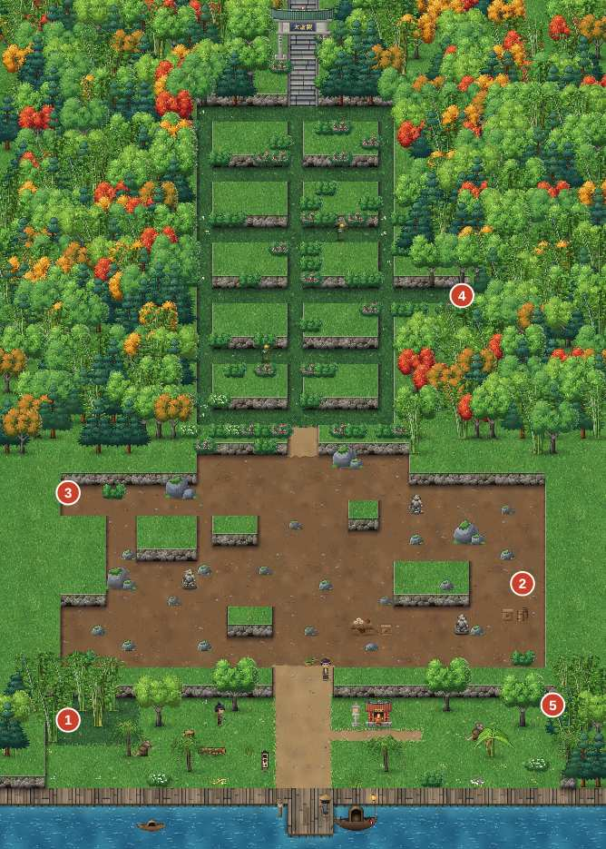

步道由南往北共有 **5 個岔路口**，每個都有左、中、右三條路。

**正確答案（由南往北）：左 → 右 → 右 → 中 → 左**

- 走錯會被霧帶回步道入口，從第一個岔路重來。
- 提示有三種：
  - 正確的那條路口地上，有被咬過的米糕或草仔粿碎屑，可以調查。
  - 開著靈視時，正確的路上會浮現金色的腳印。
  - 錯滿 3 次後，麻糬每到一個岔路都會朝正確方向「喵」一聲。
- 山腳土地公廟供了飯糰的話，第一個岔路會有一縷香煙指路。
- 第三個岔路的平台往右（東）一直走到底，有一個寶箱（七彩靈蕈）。

劇透警告：碎屑是誰掉的

一路掉點心碎屑、哼著走調小曲的，就是偷吃土地公供品、醉臥在太虛觀屋頂的雲歸。

#### 糊燈籠（淡水・阿狗仔）

交換小風車時的三段小遊戲，任何一段失敗就要從頭再來（可以先休息）：

1. **彎框**：燈火在橫條上左右移動，進入金色區域時按 Z（一次）。
2. **糊紙**：聽「陳伯的手法」示範一段 4 個方向的旋律，再用方向鍵照順序按出來。
3. **點燭**：同彎框，金色區域更窄。

#### 椅仔姑（戲棚後台）

秀蘭被一個從前被綁在竹椅上餓死的小姑娘附身，她只想在中秋夜唱一齣戲。

| 選擇 | 結果 |
|---|---|
| 讓雲歸貼符，請她走 | 秀蘭立刻醒來，中秋夜照常演出。**沒有心燈** |
| **問問秀蘭姑娘自己怎麼想**（推薦） | 白芷吹渡魂謠，秀蘭願意把身體借她一晚。中秋夜由椅仔姑唱英台，戲演完她向觀眾鞠躬後離去，得到心燈⑧ |

不論選哪個，接著都會和紙紮人打一場（紙紮人 ×3＋鼠精，紙紮人弱火）。

#### 戲棚燈（中秋夜）

開演時選「操作戲棚燈（小遊戲）」。共 6 個提示，每個提示出現後 **3 秒內**按對方向鍵：

| 提示 | 按鍵 |
|---|---|
| 亮 | ↑ |
| 暗 | ↓ |
| 紅 | → |

- **答對 5 個以上**：賞錢 **200 文**＋**胭脂**。
- 其他（或選略過）：賞錢 100 文。

畫面下方的金色橫條是剩餘時間，提示一出現就馬上按。

#### 擲筊（龍山寺）

雲歸問觀音媽兩個問題，結果是固定的：

1. 「我師父清虛……還活著嗎？」→ 聖筊。
2. 「他……平安嗎？」→ 陰筊。

吳廟公會順便講解：一正一反是**聖筊**（同意），兩面平的朝上是**笑筊**，兩面凸的朝上是**陰筊**（不是）。這是劇情演出，可以略過。

### 頭目戰

| 頭目 | Lv | HP | 屬性 | 弱點 ×1.5 | 抗性 ×0.5 | 招式 | 階段 | 同場敵人 | 經驗 / 錢 | 類型 |
| --- | ---: | ---: | :---: | --- | --- | --- | --- | --- | ---: | --- |
| 石猴王 | 12 | 1,875 | 土 | 木 | — | 丟石頭（土）、猴拳（土）、香火亂舞、扮鬼臉 | — | 石猴×2 | 802 / 500 | 頭目 |
| 鬼面 | 11 | 7,792 | 金 | 火 | 金 | 鬼面劍（金）、洛家劍・連環（金）、月牙劍氣（金）、鬼影步 | —；剩 50% 時劇情結束 | 陰兵×2 | 1,503 / 700 | 頭目 |
| 阿水伯 | 12 | 11,647 | 水 | 土 | — | 老拳、「是你們先放火！」 | — | 阿旺伯×1 | 0 / 0 | 劇情（結果固定） |
| 河伯怨靈 | 13 | 4,698 | 水 | 土 | 火 | 濁浪（水）、水草纏繞、吞噬（水）、呼喚水鬼 | — | 水鬼×2 | 342 / 799 | 頭目 |

> 圖表：第三章　觀音艋舺・頭目 HP——普通難度的最大生命（劇情難度 ×0.8、困難 ×1.3）。深淺交替區分章節；同場的小怪與召喚物不計。（圖表只在 HTML 版顯示；數據如下）

| 章 | 頭目 | Lv | HP |
| --- | --- | ---: | ---: |
| 第三章 | 石猴王 | 12 | 1,875 |
| 第三章 | 鬼面 | 11 | 7,792 |
| 第三章 | 河伯怨靈 | 13 | 4,698 |

#### 石猴王（3-4，附帶石猴 ×2）

| 項目 | 內容 |
|---|---|
| 石猴王 | Lv12／HP 1875，土屬性，**弱木**，免疫睡眠、暈眩、幻境 |
| 石猴 | Lv11／HP 598，土屬性 |
| 推薦 | Lv10。三人：第二章最佳裝備（青銅古劍、青嵐笛、菁染長衫、菁布頭巾、雄黃香囊）；山產便當、烏龍茶、還魂香 |

| 招式 | 效果 |
|---|---|
| 丟石頭 | 全體土屬性物理，威力 0.6 |
| 猴拳 | 單體土屬性物理，威力 1.3 |
| 扮鬼臉 | 單體防禦 -30%，持續 3 回合 |
| 香火亂舞 | HP 一半以下才會用。攻擊 +30%，持續 3 回合 |
| 石猴的石拳 | 單體土屬性物理，威力 1.45 |

**打法**：

- 隊上還沒有木屬性，就用一般的高傷害招式。
  - 注意白芷的水屬性打土會打折（土剋水，只剩 0.7 倍），她專心補血就好。
- 先用紅纓的橫掃千軍、星河的燎原（Lv9）清掉兩隻石猴，避免被三隻輪流猛打。
- 石猴王點燃頭上的香（香火亂舞）之後攻擊會變高，這 3 回合多防禦、多補血。
- BALANCE 模擬勝率 100%，約 6 回合。

#### 陰兵 ×3 → 鬼面（3-9，雲歸以客人身分參戰）

| 項目 | 內容 |
|---|---|
| 陰兵 | Lv10／HP 443，金屬性，**弱火** |
| 鬼面 | Lv11／HP 7792（**HP 剩一半時戰鬥結束**，實際要打掉約 3900），金屬性，**弱火、抗金**，免疫睡眠、暈眩、幻境 |
| 推薦 | Lv10，同上。兩場之間**不能休息** |

| 招式 | 使用者 | 效果 |
|---|---|---|
| 陰兵長矛 | 陰兵 | 單體金屬性物理 |
| 陰兵過境 | 陰兵 | 全體術法，附帶速度下降 |
| 鬼面劍 | 鬼面 | 單體金屬性物理，威力 1.5 |
| 洛家劍・連環 | 鬼面 | 隨機 4 段金屬性物理 |
| 月牙劍氣 | 鬼面 | 全體金屬性物理，威力 0.9 |
| 鬼影步 | 鬼面（HP 75% 以下） | 速度 +30%，持續 3 回合 |

**特殊機制**：

- **鬼面每次行動時，紅纓都會自動進入防禦狀態**，他從不對紅纓下重手。所以紅纓可以放心全力進攻，傷害由她扛也無妨。
- 雲歸雖然是客人，一樣由你操作。他的**火符**正好打得到鬼面和陰兵的弱點（火剋金）。
- 鬼面還帶著兩隻陰兵。

**打法**：

1. **先清陰兵**：陰兵弱火，星河的燎原、螢火斬一次清很快。
2. **鬼面抗金**：紅纓的金屬性招式（紅纓點、連環槍）只剩一半傷害。改用沒有屬性的**橫掃千軍**、普攻，或用**蓄勢**拉高攻擊再打。
3. **主力是星河的火**：螢火斬、燎原打弱點。合擊「火樹銀花」（火屬性 3 段）在這場特別強。
4. 月牙劍氣、洛家劍・連環的傷害比較分散，白芷保持全員 HP 在一半以上即可。
5. 鬼影步加速後鬼面的行動次數變多，這 3 回合優先補血。

BALANCE 模擬勝率 100%，約 6 回合，約 14% 的戰鬥會有人倒下。

#### 戲棚紙人（3-12）

紙紮人 ×3（Lv12／HP 524，木屬性，**弱火**）＋鼠精（Lv12／HP 408，水屬性）。

- 紙紮人的「畫上的眼睛」有 30% 機率讓人暈眩。鼠精的啃咬會下毒。
- 星河的燎原、雲歸的火符，加上合擊「符火燎原」（星河＋雲歸 Lv12，火屬性全體），兩三回合就能結束。

#### 河伯怨靈（心燈⑥，舊渡頭）

| 項目 | 內容 |
|---|---|
| 河伯怨靈 | Lv13／HP 4698，水屬性，**弱土、抗火**，免疫睡眠、暈眩、幻境 |
| 水鬼 ×2 | Lv10／HP 422，水屬性，弱火、土 |
| 推薦 | Lv13。四人：艋舺裝備（精鋼劍→**改用觀音山石劍**、紫竹簫、鑌鐵槍、桃木符扇、艋舺短打／繡花褙子、木屐）。月餅 ×3、凝神丹 ×3、還魂香 ×2 |

| 招式 | 效果 |
|---|---|
| 濁浪 | 全體水屬性術法，威力 0.9 |
| 水草纏繞 | 單體，60% 機率**封印 2 回合** |
| 吞噬 | 單體水屬性物理，威力 1.5 |
| 呼喚水鬼 | 召喚一隻水鬼 |

**特殊機制**：第 3 回合起，河伯第一次行動時，**阿德會出手拉住它**，讓它暈眩一回合，只會發生一次。

**打法**：

1. **土屬性是關鍵**：星河換上**觀音山石劍**（土屬性），普攻就打得到弱點；雲歸用**土符**（土屬性，Lv4 學會）。
   - 火屬性會被抵抗（只剩一半），這場不要用燎原、火符、火樹銀花。
2. 河伯的速度和攻擊都很高（BALANCE 把它調成約一回合行動兩次），**濁浪**全體水傷會一直削血。
   - 白芷戴阿德的斗笠，或穿舊渡頭撿到的水紋紗衣，都能減輕水傷。
   - 合擊「雲水禪心」（白芷＋雲歸 Lv12，全體大回復＋持續回復）是本場的保命招。
3. **水草纏繞**會封印人，被封印的是白芷或雲歸時，用**青草茶**解除。
4. 水鬼只要沒在抓人就先不管，集中火力打本體。
5. 阿德拉住河伯的那一回合，用合擊或絕技集中輸出。

BALANCE 模擬勝率 100%，約 10 回合，約 31% 的戰鬥會有人倒下。

#### 頂下郊老鬼（心燈⑨，可選）

阿水伯、阿旺伯：HP 都很高，而且**打不死**（HP 最低停在 1）。撐過 **3 回合**就自動結束。他們只會用很弱的「老拳」和降攻擊的吼叫，不需要特別準備。

### 小技巧

- **第一晚一定要去紅毛城**。這是本章唯一會錯過的心燈。
- **太虛觀的蕈床**：鬼面夜襲前在後院偷吃一朵蕈（扣 10 HP），會得到 60 秒靈視，馬上去開後院的靈視寶箱（雲紋道靴）。雲歸入隊後再去調查，他會說「我數過了，少一朵。」
- **艋舺客棧**住宿會把八月十四推進到八月十五白天。所以打完戲棚紙人後，先把八月十四夜能做的夜間支線做完再睡，比較順。
- **淡水長明宮燈販**、艋舺的阿標都在賣長明燈。白芷說那燈「好冷」，和後面的劇情有關。
- 雲歸 **Lv12** 學會迷魂扇（敵全體攻擊下降），**Lv14** 學會五雷正法。紅纓 **Lv11** 學會破甲（降防）。
- 星河＋雲歸、白芷＋雲歸、紅纓＋雲歸的合擊都需要 **Lv12**，雲歸加入後會很快解鎖。
- 第三章開頭會清掉第二章沒完成的支線（紅纓的廚房、兩盞平溪心燈）。
- 本章結尾會顯示你在第三章點亮的心燈數量（最多 5 盞）。

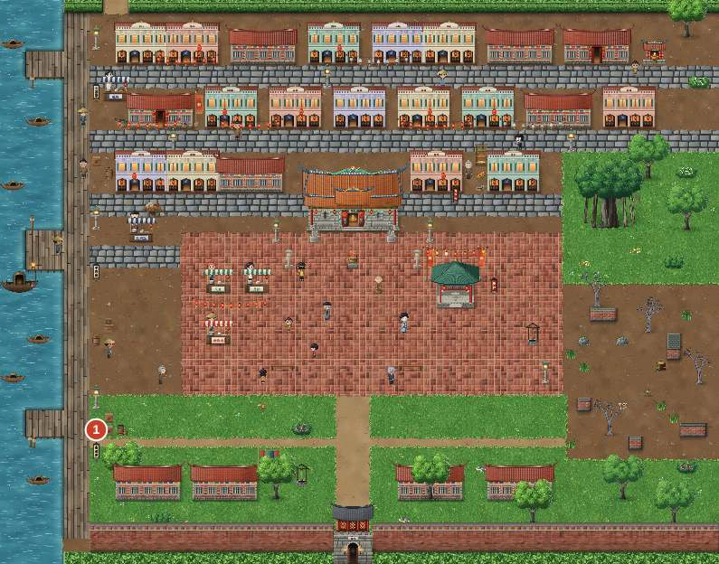

## 第四章　竹塹風起

> 圖表：第四章　竹塹風起・路線——本章走過的地點：竹塹 → 向天湖。（圖表只在 HTML 版顯示）

### 概要

九月下旬，一行人沿著海線官道南下來到「風城」竹塹。今年的九降風又濕又鹹，米粉曬一天就發酸，風裡還夾著溺死者的哭聲。城隍爺的生死簿對不起帳，線索指向東邊五指山上的「風穴」，以及府城長明宮賣到北部的那些藍火長明燈。

| 項目 | 內容 |
|---|---|
| 推薦等級 | Lv13～17（米粉架 Lv14；柿鼠大王 Lv16～17；風魔 Lv16） |
| 隊伍 | 星河、白芷、紅纓、雲歸（四人，本章開始時至少 Lv13）。麻糬、芋圓兩隻貓跟隨 |
| 主要地圖 | 竹塹北郊（米粉曬場）、竹塹城、都城隍廟、往柿樹坪山路、鼠窩、柿樹坪客家庄、劉家伙房、義民廟、五指山山徑、向天湖、五指山風穴（三層） |
| 心燈 | ⑩ 嶺上松（義民塚）　⑪ 九降風裡的阿母（米粉曬場） |
| 七仙蕈 | 第二種「風穴石耳」（風穴第一層，需靈視） |

本章的據點有兩個：**竹塹城**（商店、城隍廟）和**柿樹坪**（劉家伙房可免費過夜，能選「睏到天光」或「睏到暗晡」切換早晚）。

> 4-18 出竹塹南門時會提示：「離開竹塹後，本地未完成的委託將無法再接。」本章所有支線（含兩盞心燈）都要在這之前做完。

### 流程

#### 4-1～4-3　竹塹北郊、竹塹城

1. 抵達**竹塹北郊・米粉曬場**。米粉架被九降風精啃得發酸，馬上進入第一場戰鬥：**九降風精 ×2**。戰鬥中會出現提示：「九降風精屬木。**金剋木**——紅纓的槍、雲歸的金符特別有效。」這句話適用整個第四章。
2. 戰後阿順伯送 **米粉湯 ×2**，指路往南的北門「拱宸門」。北邊的回頭路走不了。曬場有三個寶箱（金創藥、200 文、香包），土地公祠可以存檔。
3. 從曬場南端的拱宸門進入**竹塹城**（4-2）。家家戶戶門口掛著藍火的長明燈。東門、南門、西門這時都還不能出。
4. **（可選）4-3 長明宮燈攤**：城中央東側的溫先生在賣長明燈。問「一盞多少錢？」他會說「隨喜即可」，追問才報價三百文。**打完本章頭目後攤子就消失了**，想看這段劇情要趁早。
5. 先逛商店（見〈商店〉），再去城中央的**都城隍廟**。

#### 4-4～4-5　都城隍廟

6. 廟公阿池伯說，城隍廟的大算盤半夜會自己響。雲歸說師父清虛每到一座城必先拜城隍，於是一行人擲筊請示。解答見〈謎題與小遊戲〉。
7. 第三個聖筊落地，進入**城隍幻境**。謝將軍、范將軍說，魂隨風捲入東山，風穴裡有一盞「裂而不滅」的長明燈。
8. 回到廟裡，得到 **生死簿殘頁**（重要物品，上面淡掉的名字就是被風捲走的魂）和 **平安符 ×3**。東門「迎曦門」開放。

劇透警告：范將軍對白芷說的話

范將軍的目光落在白芷身上，停了很久，只說了一句：「……燈，亦有歸期。」

> 從這時起，回北郊找阿順伯，可以接心燈⑪的前半段（夜裡守米粉架）。

#### 4-6～4-8　往柿樹坪山路、柿樹坪

9. 出東門進入**往柿樹坪山路**。山坡上的柿子有一半發黑。芋圓衝向柿餅寮，被彭阿伯當成偷柿餅的賊（支線「柿柿如意」，見〈心燈與支線〉）。路邊的伯公壇可以存檔，沿路有 4 個寶箱，其中一個是 **800 文**。
10. 繼續往東抵達**柿樹坪客家庄**，觸發 **4-7 山歌擂台**：
    - 第一局由紅纓上場，固定唱成「再唱一句就揍你」，全場爆笑，不計分。
    - 接著換白芷，和阿福對唱兩局，解法見〈謎題與小遊戲〉。
    - **白芷贏了**，晚飯時德興伯會送 **山歌竹笛**（白芷的武器，法 +31）。
11. 賽夏族的阿成提醒：「要上山，趁清早，**中午前一定要下來**。」滿妹婆把大家拉進劉家伙房吃飯，德興伯說起幾個月前，有黑衫人扛著大木箱上五指山。
12. **4-8 伙房之夜**：自動進入晚上。遠處義民廟方向傳來一段沒人回唱的山歌，這是心燈⑩的開端。
    - 晚上**不能上五指山**，東邊出口會被德興伯擋下。
    - 晚上可以做：擂茶課、義民塚、山歌擂台・道士篇（見〈心燈與支線〉）。
13. 到劉家伙房的床鋪休息，選「**睏到天光**」，進入 4-8b 清晨。滿妹婆會塞給大家 **菜包 ×4**。

#### 4-9～4-12　五指山、向天湖

14. 從柿樹坪東口進入**五指山山徑**。
    - 山徑一路往北蜿蜒，有四個寶箱：歇腳亭旁、西側岩棚上的**八卦鏡墜**、北段岩縫、東邊往向天湖的岔路。歇腳亭可以存檔。
    - 靠近山頂的一段，風會一陣陣往下吹，風來時站穩，風停再走。
15. **4-9 風穴口**：走到山頂的風穴口，劇情固定是「正午」。風穴先吸氣再吐氣，全員被吹下南坡。這段**無法避免**，所以寶箱可以先開，也可以之後回來再開。

劇透警告：被吹下山時，白芷怎麼了

風穴吐氣時，白芷摀住耳朵跪倒，她的輪廓邊緣變得半透明，像被風吹薄的燭火。醒來後，她放在被子外的手，指尖透著淡淡的光，幾乎看得見底下的竹蓆。星河握住她的手，光才退去。

16. **4-10 向天湖・夏家**：醒來時已經在賽夏族阿成的家。數日後白芷醒來，阿成邀大家留下參加兩年一次的 **paSta'ay（矮靈祭）**。夏阿公說了三條客人的規矩：綁芒草；不吵、不鬧、不罵人、不爭東西；只看、只聽，不亂學、不亂碰。
    - 白芷恢復前，北邊回山徑的路會被阿成擋下。
    - 夏家的床不能用來休息。
17. 和部落裡的人聊完後，找**夏阿公**選「準備好了」，進入 **4-11 祭典之夜**。
18. **4-11 祭典之夜**：這是一段**只能看、只能聽**的劇情：
    - 不能存檔，沒有 BGM，沒有戰鬥。
    - 往祭場走會被阿成溫和地請回客人的坡地。
    - 夥伴、阿福、阿桃都能對話。最後和**夏阿公**對話，劇情繼續。
    - 這一段不會得到任何道具、錢、經驗或心燈。
19. **4-12 湖邊的清晨**：白芷說「這一次，我想回答他們」。阿成帶大家走南邊稜線，回到五指山山徑東側的岔路。

#### 4-13～4-15　五指山風穴

20. 再次走到風穴口（4-13），星河走到最前面，風裡的光點遲疑地向兩旁分開，白芷用渡魂謠讓風牆裂開一道縫。從這裡進入**五指山風穴**。
21. **第一層・風道**：
    - 先穿過一陣一陣往南吹的風道。
    - 再推動兩顆「風帆石」堵住漏風口，就會升起上升氣流，把大家吹上第二層。
    - 東北角的岩縫要開著**靈視**才過得去，裡面有本章的七仙蕈和靈視寶箱。
22. **第二層・風鈴廳／回音廊**：
    - 先敲對風鈴，讓大風車轉起來，打開東牆石門。
    - 再走過三組「回音隧道」。
    - 隧道盡頭的小室是 **4-14**：岩壁上有清虛燒了一半的黃符，雲歸收下 **清虛的殘符**。這裡有存檔石。
23. **第三層・燈室**：
    - 風會把人往北吸，走廊上橫著三道「風刃」，要從缺口通過。
    - 盡頭的圓形石室觸發 **4-15 頭目戰：風魔**。

所有謎題的解法見〈謎題與小遊戲〉。

劇透警告：燈座下刻的字

長明燈碎了，千百個藍色光點在白芷的渡魂謠中轉為金色，往竹塹城隍廟飄去。生死簿殘頁上淡掉的名字重新浮現。有一顆光點碰了碰白芷的額頭，她看見無邊的黑色海面，自己站在燈火的盡頭，向每一盞燈點頭，「我好像……做過這件事。很多、很多次。」

燈座下的石壁上有清虛用劍尖刻的字：「燈裂而魂未釋，吾力不逮。此燈底款，出自鹿港。吾往鹿港，追其源。」得到 **長明燈碎片**。紅纓說：鹿港，是她家。

#### 4-16～4-18　歸途

24. 打完頭目後會回到風穴口，九降風恢復成乾爽的好風，五指山和風穴的風也都停了。很多支線的後半段要在這之後才能做，見〈心燈與支線〉。
25. **4-16**：白天回到柿樹坪，柿子上長出了柿霜。滿妹婆、德興伯道謝，送 **菜包 ×5、600 文**。
26. **4-17**：回竹塹的都城隍廟，把生死簿殘頁放回供桌，再擲一次筊（固定三聖筊）。
    - 城裡的長明燈一夜之間全部熄滅，溫先生的燈攤也不見了。
    - 如果心燈⑩已經完成，殘頁最後一行會多出「鍾阿松」這個名字。
27. **4-18**：從南門「**歌薰門**」出城。
    - 選「再等一下」可以繼續留在竹塹。
    - 選「**前往鹿港**」就進入第五章。

### 心燈與支線

#### 心燈⑩　嶺上松（柿樹坪・義民塚）

最早在 4-8 的第一個晚上就能開始，**全程要在晚上進行**。夜晚可以在劉家伙房選「睏到暗晡」切換。

1. **晚上**從柿樹坪北口到**義民廟**，往廟的東側走到**義民塚**，遇見抱著舊鋤頭、半透明的年輕人阿松。他一直唱著「九降風吹嶺上松，阿妹門前柿曬紅……」等人回歌，卻想不起對方的名字，也想不起自己的名字。
2. 回柿樹坪問阿福或阿桃，兩人都說只有滿妹婆那一輩會唱這種老歌。也可以直接進下一步。
3. 進**劉家伙房**找**滿妹婆**。她捧出秋妹姑婆留下的舊藍衫，反摺的袖口內側繡著回歌的四行字。得到重要物品「秋妹的藍衫」。
4. 到**義民廟**找廟公**古伯**。名冊上只寫著「無名義民十七位」，他答應請示義民爺添名。
5. **晚上**再找滿妹婆，她會跟著你上義民塚（「……揹就揹。」）。走到塚前，滿妹婆接唱下半首，阿松想起自己叫**鍾阿松**。古伯擲出三聖筊，把名字寫入名冊。
6. 點亮**心燈⑩「嶺上松」**，得到 **秋妹的藍衫**（防具，白芷／紅纓專用）：防 +22、法 +6、HP +30，**減輕木屬性傷害**。

> **建議在打風魔之前完成**。秋妹的藍衫比店賣的藍衫（防 +17）好，而且能減輕風魔的「九降・亂流」「腐風」這類木屬性招式。

劇透警告：袖口繡的四行字

柿霜白過幾十冬，竹床年年曬日紅；阿哥若係名字忘，阿妹聲聲喊阿松。

秋妹姑婆一輩子沒嫁，活到八十八歲，教全庄的小孩唱山歌。她每次只哼前兩句，問她，她就笑著說「等人回」。

#### 心燈⑪　九降風裡的阿母（竹塹北郊）

分成前後兩段，中間要先打倒風魔。

1. **前段**（城隍幻境之後）：
   - 到北郊米粉寮前找**阿順伯**，選「好！」，陪他夜裡守米粉架。
   - 接著**連打三場**（不能逃跑，中間不能補給）：九降風精 ×3 → 哭風精＋九降風精 ×2 → 哭風精 ×2＋九降風精。
   - 阿順伯說起六歲那年渡黑水溝，船翻了，阿母沒有再浮起來。風裡叫他小名的，就是阿母。
   - 得到 **米粉湯 ×3、炒米粉 ×2**。
2. **後段**（打倒風魔後）：
   - 再找阿順伯，選「今暗再來」。夜裡乾爽的風吹過米粉架，阿母的魂來和他道別。
   - 點亮**心燈⑪「九降風裡的阿母」**。
   - 前段沒做也沒關係，直接做後段一樣能拿到心燈，只是少了三場戰鬥和前段的獎勵。
3. **喜宴**：再找阿順伯一次，參加女兒阿玉的喜宴，得到 **炒米粉 ×5、喜糖 ×3、500 文**。

#### 支線　柿柿如意（往柿樹坪山路）

1. 和**彭阿伯**對話：他的柿餅少了三百個，卻怪到芋圓頭上。雲歸答應幫他抓真正的賊。
2. 調查柿餅寮附近的**三處線索**，順序不拘：
   - 竹床上被咬過的柿餅（齒痕）。
   - 柿霜上的四爪腳印。
   - 竹林邊一路掉的柿蒂。
3. 三處都調查完，竹林底大石頭旁會出現洞口，進入**鼠窩**。裡面有兩場固定戰鬥（柿鼠群），打過不會再出現。最深處是頭目「**柿鼠大王**」（打法見〈頭目戰〉）。
4. 戰後拿到「失竊的柿餅」。王座旁的寶箱是 **銅鈴＋續命散 ×2**（銅鈴：法 +3，免疫睡眠）。
5. 交還彭阿伯，得到 **柿柿如意**（飾品，運 +10、HP +20）和 **柿餅 ×6**。打倒風魔後再和他說話，額外得到 **霜柿餅 ×3**。

#### 支線　擂茶課（劉家伙房）

在劉家伙房過夜之後（4-8 的晚上就可以），和**滿妹婆**對話：

1. 紅纓搶著上場，選了茶葉、辣椒、鹹魚、冰糖，把擂棍擂斷。滿妹婆說「你這係武器」，得到 **紅纓擂茶 ×3**（戰鬥道具，敵全體 200 點土屬性傷害）。
2. 接著選「星河來」或「白芷來」玩擂茶小遊戲，兩人難度相同，解法見〈謎題與小遊戲〉。
   - 成功：得到 **擂茶 ×5**。
   - 普通：得到 **擂茶 ×3**。
   - 失敗：得到 **苦擂茶 ×2**。
3. 之後滿妹婆會販賣**擂茶**（100 文）：回復真氣 80，並解除中毒。
4. **紅纓的再挑戰**：打倒風魔後，**晚上**回劉家伙房，紅纓會主動找滿妹婆重學。
   - 這次小遊戲的速度比較快，失敗了可以一直重來。
   - 只要「普通」以上就過關，得到 **硬頸頭帕**（紅纓專用頭飾：防 +10、攻 +4，**免疫暈眩**）。

#### 支線　山歌擂台・道士篇（柿樹坪）

4-7 之後和**阿福**對話，選「跟阿福對山歌（雲歸）」。**每休息一次只能挑戰一次**。解法見〈謎題與小遊戲〉。

| 結果 | 獎勵 |
|---|---|
| 不作弊贏（或作弊沒被抓到也贏） | **花布頭巾**（只給一次） |
| 偷用應聲符被抓包 | 米酒 ×2（只給一次） |
| 輸了 | 米酒 ×1（只給一次） |

#### 小支線

- **小風的風箏**：竹塹城西側大榕樹的樹梢卡著一隻紅風箏，調查後紅纓會用槍尖挑下來。拿去北郊交給小風，得到 **還魂香**。
- **老秀才**：打倒風魔後，他會在城隍廟附近問你要不要聽竹塹建城史。選「好」，聽完「第一卷」後得到 **秀才毛筆**（飾品，法 +4，**戰鬥經驗提升**）。
- **夏大嫂、阿成**：向天湖的居民在祭典前後的台詞都會改變。

#### 支線　雲歸的蕈譜（七仙蕈，跨章節）

本章的蕈是 **風穴石耳**，位置在風穴第一層東北角的岩縫，詳見〈寶箱與秘密〉。雲歸吃了會打出風鈴聲的嗝（「蕈譜上寫，連打三天」）。得到素材 **風穴石耳**。

### 寶箱與秘密

| 地圖 | # | 座標 (x, y) | 內容 | 備註 |
| --- | ---: | --- | --- | --- |
| 竹塹北郊 | 1 | (8, 4) | 金創藥 ×3 |  |
| 竹塹北郊 | 2 | (42, 16) | 200 文 |  |
| 竹塹北郊 | 3 | (6, 26) | 香包 ×2 |  |
| 竹塹城 | 1 | (31, 12) | 續命散 |  |
| 竹塹城 | 2 | (52, 18) | 解毒草 ×3 | 開啟時有事件 |
| 往柿樹坪山路 | 1 | (36, 18) | 柿餅 ×2 |  |
| 往柿樹坪山路 | 2 | (6, 31) | 粄條 ×2 |  |
| 往柿樹坪山路 | 3 | (17, 24) | 800 文 |  |
| 往柿樹坪山路 | 4 | (20, 5) | 香包 ×2 |  |
| 鼠窩 | 1 | (16, 4) | 銅鈴 | 依劇情出現、開啟時有事件 |
| 五指山山徑 | 1 | (23, 28) | 續命散 ×2＋300 文 |  |
| 五指山山徑 | 2 | (4, 20) | 八卦鏡墜 |  |
| 五指山山徑 | 3 | (30, 10) | 還魂香 ×2 |  |
| 五指山山徑 | 4 | (35, 42) | 鞭炮 ×3＋500 文 |  |
| 五指山風穴 | 1 | (23, 19) | 續命散 ×2 |  |
| 五指山風穴 | 2 | (33, 6) | 螢石墜 |  |
| 五指山風穴 | 3 | (10, 12) | 還魂香 ×2＋600 文 |  |
| 五指山風穴 | 4 | (36, 3) | 七彩靈蕈 | 靈視才看得見、開啟時有事件 |
| 五指山風穴 | 1 | (9, 26) | 仙草 ×3 |  |
| 五指山風穴 | 2 | (26, 4) | 鹿皮靴 | 開啟時有事件 |
| 五指山風穴 | 3 | (4, 8) | 續命散 ×2＋600 文 | 開啟時有事件 |
| 五指山風穴 | 4 | (39, 30) | 古錢串 | 靈視才看得見 |
| 五指山風穴深處 | 1 | (20, 27) | 還魂香 | 開啟時有事件 |

座標以地圖左上角為 (0, 0)，向右為 x、向下為 y；「#」對應地圖圖片上的寶箱編號。

- **風穴第一層・東北岩縫**：
  - 入口：螢石墜寶箱那間石室再往東，有一塊**幻象岩石**。開著靈視，石頭就會消失。
  - 寶箱：裡面是**靈視寶箱**（**七彩靈蕈＋400 文**），等於把進來用掉的靈蕈還給你。
  - 七仙蕈：最深處的岩壁就是「風穴石耳」。麻糬會先嗅一嗅提示。
- **風穴第二層・東南角**：石門打開後，往東的走廊南端也有一塊幻象岩石，後面是**靈視寶箱「古錢串」**（飾品，運 +6，戰鬥獲得的錢增加）。
- **靈視來源**：竹塹城的回春堂有賣**七彩靈蕈**（120 文）。進風穴前至少帶 2 朵：第一層、第二層各吃一朵。
- **回音廊的鹿皮靴**：第二層第二組隧道最右邊那條，盡頭是寶箱「**鹿皮靴**」（防 +8、速 +4）。拿完會被「留下來……」的聲音送回岔路口，屬於正常現象。
- **山徑西側岩棚**的**八卦鏡墜**（免疫封印）對風魔很有用，不必多買一個。
- 鼠窩的寶箱要打倒柿鼠大王後才會出現。

### 商店

**米粉湯攤**

| 商品 | 類別 | 價格（文） | 效果／能力 |
| --- | --- | ---: | --- |
| 米粉湯 | 道具 | 90 | 我方全體：生命 +120 |
| 炒米粉 | 道具 | 160 | 我方全體：生命 +200 |

**柿餅攤**

| 商品 | 類別 | 價格（文） | 效果／能力 |
| --- | --- | ---: | --- |
| 柿餅 | 道具 | 60 | 我方單體：真氣 +50 |
| 霜柿餅 | 道具 | 110 | 我方單體：真氣 +100 |

**打鐵舖**

| 商品 | 類別 | 價格（文） | 效果／能力 |
| --- | --- | ---: | --- |
| 九降風劍 | 武器 | 520 | 武+32 速+3（星河） |
| 竹節鋼槍 | 武器 | 520 | 武+31 速+2（紅纓） |
| 竹骨符扇 | 武器 | 520 | 武+5 法+34 氣+8（雲歸） |
| 斗笠 | 頭飾 | 30 | 防+3 |
| 布鞋 | 鞋履 | 40 | 防+2 速+2 |
| 木屐 | 鞋履 | 160 | 防+5 速+3 |

**回春堂**

| 商品 | 類別 | 價格（文） | 效果／能力 |
| --- | --- | ---: | --- |
| 金創藥 | 道具 | 30 | 我方單體：生命 +120 |
| 續命散 | 道具 | 120 | 我方單體：生命 +400 |
| 解毒草 | 道具 | 12 | 我方單體：解除中毒 |
| 香包 | 道具 | 40 | 我方單體：解除沉睡・封印・定身・幻境 |
| 還魂香 | 道具 | 150 | 倒下的同伴：復活（30% 生命） |
| 平安符 | 道具 | 80 | 我方單體：解除中毒・沉睡・封印・定身，護盾 3 回合 |
| 七彩靈蕈 | 道具 | 120 | 我方單體：幻境 4 回合，靈視約 75 秒 |
| 八卦鏡墜 | 佩飾 | 600 | 防+4；免疫封印 |
| 螢石墜 | 佩飾 | 800 | 運+4；劍意累積 ×1.5 |

**徐記雜貨**

| 商品 | 類別 | 價格（文） | 效果／能力 |
| --- | --- | ---: | --- |
| 金創藥 | 道具 | 30 | 我方單體：生命 +120 |
| 續命散 | 道具 | 120 | 我方單體：生命 +400 |
| 解毒草 | 道具 | 12 | 我方單體：解除中毒 |
| 香包 | 道具 | 40 | 我方單體：解除沉睡・封印・定身・幻境 |
| 米酒 | 道具 | 50 | 我方單體：真氣 +40 |
| 鞭炮 | 道具 | 25 | 敵全體：火屬性傷害 40 |
| 還魂香 | 道具 | 150 | 倒下的同伴：復活（30% 生命） |

**粄條店**

| 商品 | 類別 | 價格（文） | 效果／能力 |
| --- | --- | ---: | --- |
| 粄條 | 道具 | 80 | 我方單體：生命 +300 |
| 菜包 | 道具 | 70 | 我方單體：生命 +180，真氣 +20 |
| 仙草 | 道具 | 70 | 我方單體：生命 +150，解除中毒・沉睡・封印・定身・幻境 |
| 柿餅 | 道具 | 60 | 我方單體：真氣 +50 |

**藍衫裁縫**

| 商品 | 類別 | 價格（文） | 效果／能力 |
| --- | --- | ---: | --- |
| 藍衫 | 衣裝 | 400 | 防+17 命+20 |
| 花布頭巾 | 頭飾 | 260 | 防+9 |
| 布鞋 | 鞋履 | 40 | 防+2 速+2 |

**劉家擂茶**

| 商品 | 類別 | 價格（文） | 效果／能力 |
| --- | --- | ---: | --- |
| 擂茶 | 道具 | 100 | 我方單體：真氣 +80，解除中毒 |

| 商店 | 位置 | 重點商品 |
|---|---|---|
| 打鐵舖 | 竹塹城東北 | **九降風劍、竹節鋼槍、竹骨符扇**（各 520 文）、斗笠、布鞋、**木屐** |
| 回春堂 | 竹塹城東北 | 續命散、還魂香、平安符、**七彩靈蕈**、**八卦鏡墜**（600 文）、螢石墜 |
| 客棧 | 竹塹城西北 | 30 文，完全回復（也會重置道士篇的挑戰次數） |
| 阿桂嫂米粉湯攤 | 城隍廟前 | 米粉湯；打倒風魔後加賣**炒米粉**（全體回復 200） |
| 阿梅柿餅攤 | 城隍廟前 | 柿餅；打倒風魔後加賣**霜柿餅**（真氣 100） |
| 徐記雜貨 | 柿樹坪西側 | 續命散、還魂香、米酒、鞭炮 |
| 粄條店（阿香姐） | 柿樹坪 | **粄條**（回復 300）、**菜包**（回復 180、真氣 20）、仙草、柿餅 |
| 藍衫裁縫（曾師傅） | 柿樹坪東側 | **藍衫**（防 +17、HP +20）、**花布頭巾**（防 +9）、布鞋 |
| 劉家擂茶 | 劉家伙房（擂茶課後） | 擂茶（真氣 80＋解毒） |

**採購建議**（docs/BALANCE.md 打米粉架、柿鼠大王、風魔時的設定）：

| 角色 | 武器 | 身體 | 頭 | 腳 | 飾品 |
|---|---|---|---|---|---|
| 星河 | 九降風劍（攻 +32、速 +3） | 藍衫 | 花布頭巾 | 木屐 | 八卦鏡墜 |
| 白芷 | 紫竹簫（沿用）→ 有**山歌竹笛**就換上 | 藍衫 → **秋妹的藍衫** | 花布頭巾 | 木屐 | 八卦鏡墜 |
| 紅纓 | 竹節鋼槍（攻 +31、速 +2） | 藍衫 → 秋妹的藍衫二選一 | 花布頭巾 → **硬頸頭帕** | 木屐 | 黑皮護臂（沿用） |
| 雲歸 | 竹骨符扇（法 +34、真氣 +8） | 藍衫 | 花布頭巾 | 木屐 | 八卦鏡墜 |

- **回復品**：續命散 ×5、粄條 ×3、真氣回復品 ×3、還魂香 ×2。
  - BALANCE 的配置是霜柿餅 ×3，但霜柿餅**要打倒風魔後才買得到**。打風魔時改帶擂茶或柿餅。
- **錢不夠的優先順序**：三把武器 → 藍衫 → 八卦鏡墜。
  - 山徑寶箱會送一個八卦鏡墜，所以只要再買兩個。
  - 八卦鏡墜可以擋掉風魔「萬聲哭嚎」的封印。
- **鹿皮靴**在風穴第二層，比木屐好（防 +8、速 +4），拿到就換。

### 謎題與小遊戲

#### 擲筊（都城隍廟，4-4）

阿池伯先講解筊杯：一平一凸是**聖筊**（神明答應），兩面平是**笑筊**（問得不清楚，或答案你心裡早就知道），兩面凸是**陰筊**（不行、不是）。大事要**連續三個聖筊**才算數。

**第一問**（問錯不會扣分，只是多看幾段對話）：

| 問題 | 結果 |
|---|---|
| **那些失蹤的魂，跟這陣怪風有關嗎？** | 三聖筊，進入第二問 |
| 我們會不會發大財？ | 笑筊（紅纓：「笨蛋！」） |
| 白芷她……到底是誰？ | 笑筊，「時候到了，自然就知影。」 |

**第二問「那些魂，往哪裡去了？」**：

| 問題 | 結果 |
|---|---|
| 往海上？ | 陰筊 |
| 在城裡？ | 陰筊 |
| **往東邊山裡？** | 三聖筊，進入城隍幻境 |

#### 山歌擂台（柿樹坪，4-7）

每局的流程：

1. 阿福先唱一句，畫面告訴你**韻腳**。
2. 白芷先選上句，再選下句。
3. 玩一段「山歌」節奏小遊戲：聽阿福唱一段方向鍵旋律，再用方向鍵照順序唱回去。白芷的旋律依序是 2、3、4 個音。

**計分方式**：

| 項目 | 分數 |
|---|---|
| 句子評價：妙／趣／平／衝 | 15／12／7／-5（上句、下句各算一次） |
| 下句押韻 | +30 |
| 節奏小遊戲 | 每唱對一段 +14（最多 42） |

**最佳解答**：

| 局 | 阿福的上句 | 上句 | 下句 | 阿福得分 |
|---|---|---|---|---|
| 第 2 局（韻腳ㄢ） | 敢係月光跌落地，還係露水變人間？ | **我是海上漂來燈**（妙） | **照你歸路不孤單**（妙、押韻） | 72 |
| 第 3 局（韻腳ㄞ） | 山歌唱過千百首，問妹風從哪裡來？ | **風是人心嘆一聲**（妙） | **嘆完花就一朵開**（妙、押韻） | 78 |

- **勝利條件**：兩局總分超過 150 分。
  - 照上表選，兩局的句子分共 120 分。小遊戲六段裡**唱對三段以上**（+42）就能贏。
  - 下句選「先吃粄條再來談」「吹得滿山柿子歪」（趣、押韻）也行，只是少 3 分。
  - 選到不押韻的下句會被庄民說「押毋著韻喔」，很難贏。
- **輸了**：可以選「再唱一遍」無限重來。**千萬不要選「認輸」**，那樣就拿不到山歌竹笛了。
  - 輸了的話，阿福會說「歌係𠊎贏，聲係佢贏」。
- 第 2 局的上句選「我是海上漂來燈」時，全場會安靜一瞬，阿福愣在原地忘了下一句（劇情彩蛋）。

#### 山歌擂台・道士篇（雲歸）

三局都由雲歸上場。每局開始前可以選「**自己想詞**」或「**偷用應聲符**」。偷用應聲符時，芋圓會躲在禾稈堆後面提詞。

- **偷用應聲符的效果**：自動選最好的句子，節奏小遊戲也會變短（從 2 個音開始）。
- **被抓包的條件**：
  - 第二次偷用時，有一半的機率被抓。
  - 偷用三次一定被抓。
  - 總分達到 300 分（幾乎是滿分）也會露餡。
- **只偷用一次的話，實際上不會被抓**，贏了一樣拿得到花布頭巾。

**自己想詞的最佳解答**：

| 局 | 阿福的上句 | 上句 | 下句 | 阿福得分 |
|---|---|---|---|---|
| 1（ㄡ） | 道士哥哥葫蘆大，裝酒還係裝符咒？ | **葫蘆裝酒也裝夢**（妙） | **醉了伸手把月偷**（妙、押韻） | 74 |
| 2（ㄤ） | 講你道法恁高強，敢會唱歌喚太陽？ | **喚得太陽喚月亮**（妙） | **再喚芋圓滾山崗**（趣、押韻） | 80 |
| 3（ㄧ） | 山歌唱到日落西，看你還有幾招奇？ | **道法自然歌自起**（妙） | **唱得你我笑嘻嘻**（妙、押韻） | 86 |

- **勝利條件**：三局總分超過 240 分。
  - 照上表選，三局的句子分共 177 分。雲歸自己唱時，旋律依序是 3、4、5 個音。
  - 九段小遊戲要**唱對五段以上**（+70）才會贏。
- 覺得難的話，第一局偷用一次應聲符，後面兩局自己唱。

#### 擂茶（劉家伙房）

**第一步：選料**。托盤上有八樣料，最多選四樣：

| 料 | 結果 |
|---|---|
| **茶葉、白芝麻、花生** | 三樣都要選 |
| 南瓜子 | 可加可不加 |
| 米香 | 選了滿妹婆會說「米香係最尾撒在頂高个！」，不算數 |
| 辣椒、鹹魚、冰糖 | 選到任何一樣**直接失敗** |

選好後按「開始擂」。

**第二步：擂**。共 5 圈，在力道剛好（綠色區域）時按 Z，**命中 3 次以上**就過關。

**第三步：沖熱水**。1 次，水位到七、八分滿時按 Z。

**評價**：三步全過是「成功」；只錯一步是「普通」；錯兩步以上，或選了怪料，就是「失敗」。紅纓的再挑戰速度明顯比較快，綠色區域也比較窄，「慢一點……再慢一點」。

#### 風穴第一層：風道與風帆石

**風道**：

- 入口北邊是一條長長的風道，風每隔幾秒往南猛吹一陣，順風會把人推回去，逆風也走不動。
- 白芷的提示：「**風停的時候往前走，風來的時候躲進岩壁的凹洞裡**」。風道兩側左右交錯有幾個凹洞。
- 走到風道北端就過關了（雲歸：「這陣風，一陣一陣的，像在喘氣。」）。

**風帆石**（西北角的小石室）：

- 室內並排著兩顆可以推的風帆石。兩顆石頭的**外側斜下方**各有一個漏風口：左石頭的左下、右石頭的右下。
- **解法**：
  1. 站到兩顆石頭**中間**，往左推，左邊的石頭會移一格到左邊。
  2. 繞到左石頭**正上方**，往下推，石頭蓋住左邊的漏風口。
  3. 回到中間，往右推右邊的石頭。
  4. 繞到右石頭**正上方**，往下推，右邊的漏風口也蓋住了。
- 兩個漏風口都蓋住後，石室北側會升起一道**上升氣流**。走進去就會被「吐」上第二層。
- **推錯了**：
  - 敲石室入口附近的**小風鈴**，兩顆石頭會被風吹回原位。
  - 沒解開就離開石室，石頭也會自動重置。

#### 風穴第二層：風鈴廳

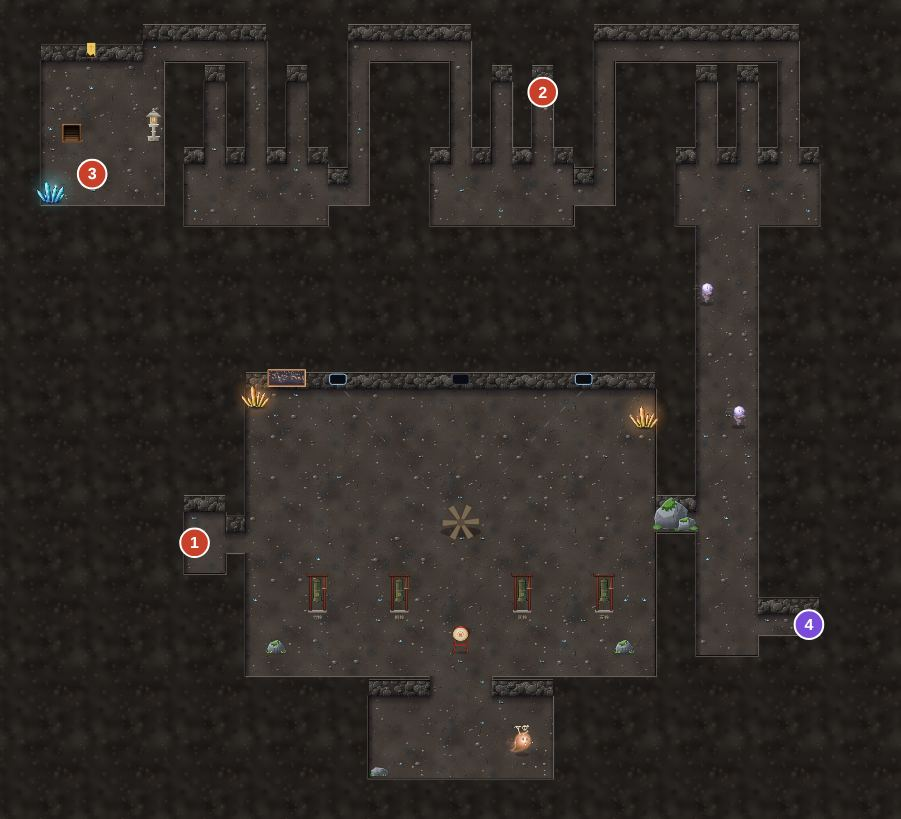

- **風口**：大廳北牆有三個風口（左、中、右），一開始是**左、右開著，中間關著**。
- **目標**：只開中間的風口，大風車就會轉起來，打開東牆的石門。
  - 壁畫的提示：「北風三門，獨開其中；風車自轉，石門自通。」
- **四個風鈴**由左到右排在大廳南側，每個風鈴會切換固定的風口：

| 風鈴（由左到右） | 切換的風口 |
|---|---|
| 竹鈴 | 左、中 |
| 銅鈴 | 中、右 |
| 貝鈴 | 左、右 |
| 石鈴 | 中 |

**解答：先敲貝鈴（全部關上），再敲石鈴（只開中間）。** 用竹鈴＋銅鈴代替貝鈴也可以。

- 三個風口同時打開時，三股風會把人往南吹退 4 格。
  - 例如一開始就先敲石鈴，就會變成三個全開。
- 敲大廳中央的**鑼**，三個風口會回到初始狀態。

#### 風穴第二層：回音廊

從石門往北走，會連續遇到**三個岔路室**，每室往北有三條隧道。靠近隧道口時，牆上會浮現魂的低語。白芷的提示：「**想留下的聲音，是冷的。想離開的聲音……有一點暖。**」

正確的低語是**暖黃色**，錯誤的是冷藍色：

| 岔路 | 正確隧道 | 正確的低語 |
|---|---|---|
| 第一組（最東） | 右 | 「……讓我回家。」 |
| 第二組（中間） | 左 | 「我想……放手了。」 |
| 第三組（最西） | 中 | 「替我跟阿母說……我不怕了。」 |

- 走錯會聽到「留下來……」，被送回同一組岔路室，並有一半機率遭遇**溺風魂 ×3**。白芷的渡魂謠可以直接送走它們，不用硬打。
- 第二組的**右邊隧道**盡頭有鹿皮靴寶箱，拿完一樣會被送回岔路室。

#### 風穴第三層：風刃走廊

- 走廊的風往北吸，地上有三道白色的「**風刃**」，每道都只留一格缺口。
- 碰到風刃：全員扣最大 HP 的 5%（不會致死），並被送回最近的檢查點。過了第一道、第二道風刃，各會記錄一個檢查點。
- **缺口位置**（走廊寬 5 格，由南往北）：

| 風刃 | 缺口 |
|---|---|
| 第一道 | **最左** |
| 第二道 | **最右** |
| 第三道 | **正中** |

- 入口的存檔石旁有寶箱（還魂香＋續命散 ×2）。走廊盡頭就是頭目戰，**先存檔、補滿再上去**。

### 頭目戰

| 頭目 | Lv | HP | 屬性 | 弱點 ×1.5 | 抗性 ×0.5 | 招式 | 階段 | 同場敵人 | 經驗 / 錢 | 類型 |
| --- | ---: | ---: | :---: | --- | --- | --- | --- | --- | ---: | --- |
| 柿鼠大王 | 15 | 5,776 | 水 | 土 | — | 肚皮彈（土）、鼠群、叫小弟、狂吃柿餅 | — | 柿鼠×2 | 552 / 308 | 頭目 |
| 風魔 | 18 | 7,321 | 木 | 金 | 木 | 裂風爪（金）、九降哀風、逆風陣、萬聲哭嚎（水）、萬聲呼喚、腐風（木）、吞魂、風穴漩渦 | 60% 召喚 變身、30% 變身 | — | 1,485 / 3,500 | 頭目 |

> 圖表：第四章　竹塹風起・頭目 HP——普通難度的最大生命（劇情難度 ×0.8、困難 ×1.3）。深淺交替區分章節；同場的小怪與召喚物不計。（圖表只在 HTML 版顯示；數據如下）

| 章 | 頭目 | Lv | HP |
| --- | --- | ---: | ---: |
| 第四章 | 柿鼠大王 | 15 | 5,776 |
| 第四章 | 風魔 | 18 | 7,321 |

| 敵人 | Lv | HP | 屬性 | 弱點 ×1.5 | 抗性 ×0.5 | 經驗 | 錢 | 掉落 |
| --- | ---: | ---: | :---: | --- | --- | ---: | ---: | --- |
| 九降風精 | 14 | 583 | 木 | 金 | — | 86 | 42 | 柿餅 20% |
| 柿鼠 | 14 | 686 | 水 | 土 | — | 100 | 49 | 柿餅 25%、解毒草 15% |
| 鼠精 | 14 | 480 | 水 | 土 | — | 78 | 38 | 解毒草 25%、芋圓湯 15% |
| 山鬼 | 15 | 962 | 土 | 木 | — | 131 | 61 | 粄條 20%、仙草 10% |
| 風穴蝙蝠 | 15 | 592 | 木 | 金 | — | 93 | 43 | 香包 15% |
| 哭風精 | 15 | 777 | 木 | 金 | — | 113 | 53 | 風精絮 40%、香包 10% |
| 山鬼頭目 | 16 | 1,352 | 土 | 木 | 水 | 253 | 81 | 山鬼毛 50%、續命散 10% |
| 溺風魂 | 16 | 875 | 水 | 土 | 火 | 177 | 0 | 溺魂淚 30% |
| 亂流精 | 17 | 937 | 木 | 金 | 水 | 204 | 63 | 風精絮 50%、續命散 8% |

#### 米粉架三連戰（心燈⑪前段）

| 戰鬥 | 敵人 |
|---|---|
| 第一波 | 九降風精 ×3（Lv14／HP 583，木屬性） |
| 第二波 | 哭風精（Lv15／HP 777，木屬性）＋九降風精 ×2 |
| 第三波 | 哭風精 ×2＋九降風精 |

- 三場連打，不能逃跑，中間不能休息。風精的「風刃」是金屬性術法，「九降哀風」是全體術法，「捲風」會降速度。
- 推薦 Lv14。**金剋木**：紅纓的紅纓點、連環槍、梨花槍（Lv14）和雲歸的金符都打得到弱點，全體招式用橫掃千軍、劍氣縱橫。
- BALANCE 模擬勝率 100%，每場約 2 回合。

#### 柿鼠大王（支線「柿柿如意」，鼠窩）

| 項目 | 內容 |
|---|---|
| 柿鼠大王 | Lv15／HP 5776，水屬性，**弱土**，免疫睡眠、暈眩、幻境 |
| 柿鼠 ×2 | Lv14／HP 686，水屬性，**弱土** |
| 推薦 | **Lv16～17**（BALANCE 的基準是 Lv15，勝率 93%，但 84% 的戰鬥有人倒下；自動測試用 Lv17）。竹塹裝備＋續命散、粄條 |
| 獎勵 | 552 經驗、308 文、鼠王金牙、柿餅 |

| 招式 | 使用者 | 效果 |
|---|---|---|
| 肚皮彈 | 大王 | 單體土屬性物理，威力 1.6 |
| 鼠群 | 大王、柿鼠 | 隨機目標物理 |
| 叫小弟 | 大王 | 召喚一隻柿鼠（場上不滿 3 隻時才會用） |
| **狂吃柿餅** | 大王（HP 50% 以下） | 自身回復約 640，**整場最多 2 次** |
| 啃咬 | 柿鼠 | 單體物理，35% 機率中毒 |
| 擲爛柿 | 柿鼠 | 單體物理，防禦 -30%（2 回合） |

**打法**：

1. **先上完擂茶課再來**。開場用 **紅纓擂茶**：敵全體 200 點土屬性傷害，打弱點變 300。
   - 柿鼠只剩一半 HP，再用一次就清場了。
2. 柿鼠會下毒、降防，**先清小的**。
   - 清掉後大王偶爾會叫一隻回來，但場上已有 3 隻時不會叫。
3. **主攻大王**：
   - 雲歸的**土符**（土屬性，打弱點）。
   - 紅纓的連環槍、梨花槍（Lv14）。
   - 星河的星墜劍（Lv15）。
   - 合擊「月下紅纓」（白芷＋紅纓，降防 30%）。
4. **大王 HP 降到一半後**會抱著柿餅狂啃，每次回復約 640。
   - 他最多只吃兩次，把劍意和奧義留到這時一口氣打完。
5. 肚皮彈的單體傷害很高，白芷隨時補血。中毒用擂茶或白芷的解厄解除。

#### 風魔（4-15，五指山風穴深處）

| 項目 | 內容 |
|---|---|
| 風魔 | Lv18／HP 7321，木屬性，**弱金、抗木**，免疫睡眠、暈眩、幻境 |
| 溺風魂（第二階段召喚） | Lv16／HP 875，水屬性，弱土、抗火 |
| 推薦 | **Lv16**。竹塹裝備（九降風劍、竹節鋼槍、竹骨符扇、紫竹簫／山歌竹笛、藍衫、花布頭巾、木屐、八卦鏡墜 ×3＋黑皮護臂）。續命散 ×5、粄條 ×3、真氣回復 ×3、還魂香 ×2 |
| 獎勵 | 1485 經驗、3500 文、**風骨墜**（飾品：速 +5，減輕木屬性傷害） |

**三個階段的招式**：

| 階段 | 招式 | 效果 |
|---|---|---|
| 一（HP 100～60%） | 裂風爪 | 單體金屬性物理，威力 1.9 |
| | 九降哀風 | 全體術法，威力 0.85 |
| | **逆風陣** | 我方全體攻擊、速度 -30%（3 回合） |
| 二（60% 以下） | 開場召喚溺風魂 ×2 | |
| | 萬聲哭嚎 | 全體水屬性術法，威力 0.9，20% 機率**封印** 2 回合 |
| | 萬聲呼喚 | 再召喚溺風魂 ×2（場上不到 2 隻時才會用，有冷卻） |
| | 腐風 | 全體木屬性，45% 機率中毒 |
| | 裂風爪 | 同上 |
| 三（30% 以下） | 胸口裂開 | 長明燈露出來，**風魔的防禦永久 -30%** |
| | **九降・亂流** | **每 3 次行動固定使用一次**。全體木屬性術法，威力 1.2，速度 -30% |
| | 吞魂 | 自身回復約 360，法術 +30%（3 回合） |
| | 風穴漩渦 | 全體術法，威力 1.2，15% 機率暈眩 |
| | 裂風爪 | 同上 |

**特殊機制**：

- **逆風陣 → 風歇**：風魔放出逆風陣後，**再過 3 次行動**一定會「風勢忽然一歇——破綻！」，自身**防禦 -30%（2 回合）**。
  - 第一次逆風陣時，雲歸會提醒：「逆風！先穩住，等風歇的時候再一口氣打！」
  - 逆風陣之後至少隔 4 次行動才會再用。
- **渡魂謠能「送走」溺風魂**：白芷對溺風魂使用渡魂謠（敵全體，真氣 8）時，溺風魂會說聲「……謝謝」後消失。
  - **每送走一隻，風魔就扣最大 HP 的 4%**（約 293）。
  - 送走的溺風魂沒有錢和掉落物。
  - 一次送走兩隻，等於只花 8 點真氣就打掉約 586 HP，而且風魔還會一直叫新的出來。
- 風魔 HP 剩 10% 時會說「……放……我……走……」，再加把勁就贏了。

**打法**：

1. **第一階段**：
   - 金屬性是主力：
     - 紅纓的紅纓點、連環槍、破甲（降防）、梨花槍。
     - 雲歸的金符。
     - 紅纓的奧義「紅纓破陣」（金屬性全體，威力 3.3）也打得到弱點。
   - 星河用星墜劍（Lv15，火屬性，對木無加減）或普攻。合擊「星河渡燈」沒有屬性，也可以用。
   - **不要用木屬性**：雲歸的雷符、五雷正法，合擊「雷霆槍陣」都只剩一半傷害。
   - 被逆風陣壓住的 3 次行動，主要用來補血、上增益：白芷的月霧護身曲、星河的護燈訣、紅纓的蓄勢。
   - 等到「**風歇**」出現，蓄勢後的紅纓、雲歸的金符、合擊一起全力輸出。
2. **第二階段**（HP 60%）：
   - 白芷說「讓我來——用渡魂謠，送它們走！」
   - **溺風魂一出現，白芷就放渡魂謠**。其他三人繼續打本體。
   - 萬聲哭嚎的封印，戴八卦鏡墜的人不會中。
   - 腐風的中毒，用白芷的解厄或擂茶解除。
3. **第三階段**（HP 30%，約 2200）：
   - 風魔防禦永久降低，是收尾的好時機。
   - **數著它的行動**：每 3 次一定放一次九降・亂流（全體木屬性＋降速），之前先把全員 HP 補到 6 成以上。
   - 吞魂會回血並提升法術，但回復量不大，直接用劍意、奧義壓過去即可。
4. **白芷的「彼岸・渡魂」**（奧義：全體大回復、解除異常、復活）留著當保險。

- 白芷或紅纓穿上**秋妹的藍衫**（減輕木屬性），亂流和腐風的傷害會小很多。
- BALANCE 模擬（Lv16）：勝率 100%，約 10 回合，約 45% 的戰鬥會有人倒下。

### 小技巧

- **金剋木**：本章大部分敵人是木屬性的風精。另外：
  - 山鬼是土屬性，用雲歸的雷符、五雷正法打（木剋土）。
  - 柿鼠是水屬性，用土符打（土剋水）。
- **溺風魂不用打**：風穴裡遇到溺風魂，白芷的渡魂謠會直接送走所有溺風魂，算戰鬥勝利。這樣仍然有經驗值，只是沒有錢和掉落物。
- **本章的時間軸**：
  - 柿樹坪的「早上／晚上」由劉家伙房的床鋪切換：「睏到天光」是早上，「睏到暗晡」是晚上，免費。
  - 4-8 第一個晚上就能做心燈⑩、擂茶課、道士篇，不必等到最後。
- **打倒風魔後會變的東西**：
  - 炒米粉、霜柿餅開賣。
  - 彭阿伯送霜柿餅 ×3。
  - 老秀才送秀才毛筆。
  - 紅纓的擂茶再挑戰開放。
  - 阿順伯的心燈後段開放。
  - 溫先生的長明燈攤消失。
  - 五指山和風穴的風停了：風刃、風道都失效，部分風精類敵人也不再出現。
- **秀才毛筆、古錢串**都是很適合練功的飾品，在第五章以後也一直有用。
- 雲歸 **Lv16** 學會回春符（單體回復＋持續回復）。星河 **Lv15** 學會星墜劍，**Lv18** 學會九份燈火（全體回復）。白芷 **Lv17** 學會海潮（水屬性全體）。
- 祭典之夜不能存檔，而且一進去就會一路演到隔天清晨。**進祭典前先在山徑或柿樹坪存好檔**。

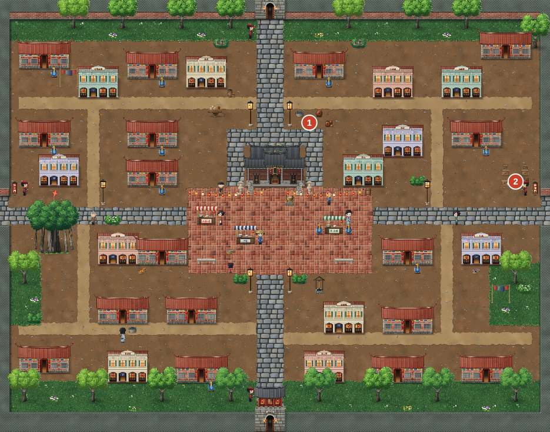

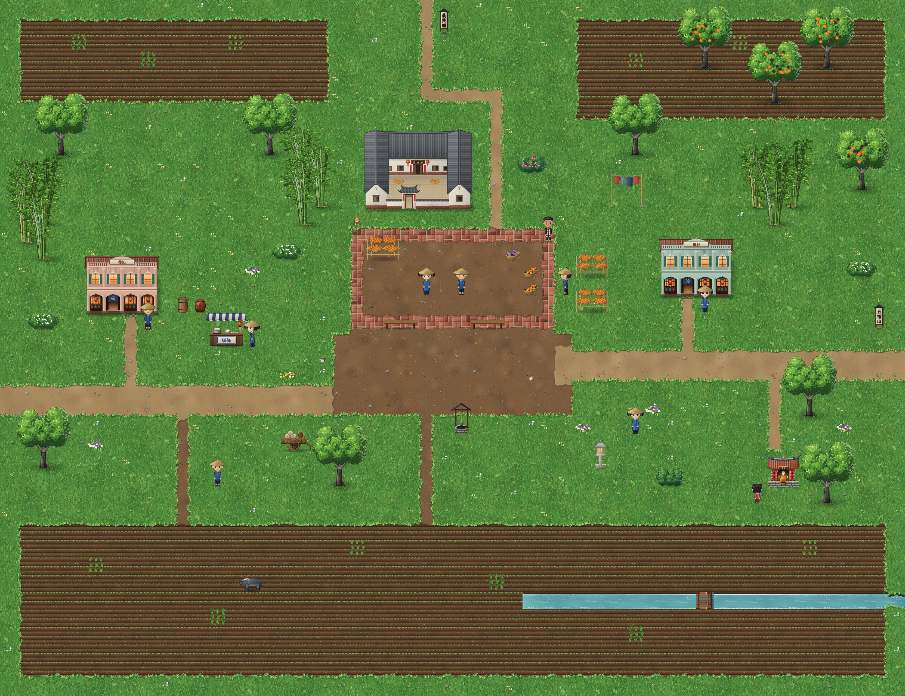

## 第五章　鹿港舊夢

> 圖表：第五章　鹿港舊夢・路線——本章走過的地點：鹿港。（圖表只在 HTML 版顯示）

### 概要

冬至前一日，一行人順著東北季風南下，來到「一府二鹿三艋舺」的鹿港。這裡是紅纓的家鄉。三年前的中元夜，洛家一門在古厝中遇害，大門從此貼上了符。清虛真人的線索在這裡交會：那些長明燈的燈骨出自鹿港，洛家門口吹出的冷風，也和長明宮的燈是同一種味道。

| 項目 | 內容 |
|---|---|
| 推薦等級 | Lv16～21（本章開始時至少 Lv16；洛家古厝的雜兵 Lv17～19；頭目怨宴建議 **Lv20～21**） |
| 隊伍 | 星河、白芷、紅纓、雲歸。麻糬、芋圓跟隨 |
| 主要地圖 | 鹿港街（天后宮、不見天街）、九曲巷（摸乳巷、半邊井、施家燈籠舖、王家）、施家鐵舖、鹿港客棧、鹿港舊港・墓仔埔、洛家古厝（大門、一樓、二樓） |
| 心燈 | ⑫ 半邊井（九曲巷）　⑬ 顧門的福伯（洛家大門） |
| 七仙蕈 | 第三種「憶蕈」（洛家古厝後院） |

**鹿港的時間**：本章的時間只會往前走，不能用住宿調回來。

| 時段 | 何時開始 | 重點 |
|---|---|---|
| 午後 | 抵達鹿港 | 白天的攤販、路人都在 |
| 黃昏 | 天后宮劇情之後 | 可以開始半邊井 |
| **夜** | 從施家燈籠舖出來之後 | 舊港開放、半邊井結局、九曲巷隘門關閉、進洛家古厝 |
| 冬至～除夕 | 打完頭目後，回客棧休息 | **全自動劇情**，直接進入第六章 |

> **最重要的一點**：打完洛家古厝後回客棧休息，就會一路演到除夕、進入第六章，**中間沒有自由行動的時間**。舊港的寶箱、兩盞心燈、所有商店的採購，都要在**夜晚**這段做完。

### 流程

#### 3-1～3-3　鹿港街、洛家大門、天后宮

1. 從北邊的官道進入**鹿港**，紅纓望著街的南端說：「先回家。」北邊的來時路走不回去。
2. 一路往南走到**洛家古厝大門**：
   - 門上貼著清虛的鎮宅符。
   - 紅纓推門時，三年前的老管家**福伯**的鬼魂擋在門後，喊著「莫入來！」。他還以為今晚是中元夜。
   - 冷風把紅纓推退兩步，門「砰」地關上，這時還進不去。
3. 雲歸推測師父會借宿在廟裡，於是到街北邊的**天后宮**。
   - 許廟公說，清虛住了三晚，每晚都站在洛家門口到天亮，最後說：「要進那間厝，得提一盞燈——一盞**愛過那間厝的人親手點的燈**。」
   - 清虛到九曲巷的施師傅那裡訂了燈，燈還沒做好，就先往府城去追「長明宮」了。
4. 廟公說完後，會出現選項「**讓白芷擲筊**」：
   - 白芷問：「紅纓回家以後，會好好的嗎？」結果是三聖筊。
   - 這會讓**頭目戰時紅纓的防禦 +10%**。只有這一次機會，**一定要選**。
5. 天色轉為黃昏。下一個目標是九曲巷的施家燈籠舖。

#### 3-4～3-5　九曲巷、施家燈籠舖

6. 從街東側廣場的巷口進入**九曲巷**，一進來就觸發**摸乳巷**劇情：
   - 芋圓卡在只容一人側身的窄巷中間。
   - 星河和白芷在巷子裡面對面撞個正著，被紅纓吼出來。
7. 九曲巷的直巷子是風洞，解法見〈謎題與小遊戲〉。往**施家燈籠舖**最安全的路是：曬衣的小廣場 → **半邊井** → 往東南，全程沒有風。
   - 經過半邊井時，會觸發心燈⑫的開端。
8. **施家燈籠舖**：
   - 施燈師拿出清虛訂的白燈籠，紅纓親手寫上「洛」字，得到 **洛家燈**。
   - 第四章拿到長明燈碎片的話，雲歸會請施燈師辨認底款。

劇透警告：長明燈的底款、兔子燈

- **長明燈的底款**：碎片上的半個字是「施」，正是施家的店號。去年府城有人說廟裡要用燈，一口氣訂了三百副燈骨。施燈師說：「我做了一輩子的燈，是給人照路的。不是……不是給人關人的！」洛家燈因此不收錢。
- **兔子燈**：白芷被角落一盞褪色的兔子燈吸引。二十幾年前，陳伯（陳渡）和一位姓夜的斯文男人常來訂海上用的白燈。姓夜的人帶過他三四歲的女兒「念念」，念念最愛兔子燈。白芷碰到兔子燈時，看見一個提著兔子燈的小女孩在黑水上就快到了，卻被人拉了回去。
  - 想起渡魂謠殘句：「名也忘來鄉也忘，岸頭仍有一人等。」
  - 得到 **兔子燈**。

9. 走出燈籠舖時已經**入夜**。這是本章唯一的自由行動時段，建議依序做完：
   - 半邊井結局（自動觸發）。
   - 舊港・墓仔埔的兩個寶箱。
   - 施家鐵舖採購。
   - 再提著洛家燈回洛家古厝。

#### 3-6～3-10　洛家古厝

10. 提著洛家燈回到大門，門上的符燃成灰。福伯退進門房的陰影，說：「小姐，燈要提好。裡面的東西，怕光。」
11. **一樓**格局：
    - 南端是門廳，往北是練武場（天井），再往北是被黑氣封住的大廳。
    - 練武場西邊是廚房，西北是下人房（福伯的房間）。
    - 練武場東邊是帳房，東北是樓梯間。
    - 下人房、樓梯間的後門都通往北邊的後院。
    - 屋裡很暗，洛家燈只照得到身邊幾步。
12. **記憶之門**：要看完兩段記憶，再加上二樓的戲箱，二樓的公媽廳才會開放：
    - **練武場東牆的月洞門**（門框會發紅光）：十歲的紅纓偷練槍，哥哥青鋒教她「槍握太緊，就刺不遠」和**回馬槍**。
    - **廚房的大灶**：十四歲的紅纓為哥哥的冬至生日煮麵線，煮成一鍋黑炭。青鋒吃完了一整碗，說：「這是我吃過最好吃的生日麵線。」
13. 從東北的樓梯上**二樓**：
    - 二樓由一條東西向的迴廊連起四個房間：西北是書房，北邊中間是公媽廳，西南是紅纓的房間，東南是青鋒的房間。
    - **青鋒的房間**：調查**戲箱**，一排面具中間空了一格「鬼王面」。第三章撿到面具碎片的話，紅纓會拿出來比對。
    - **紅纓的房間**：調查籃子，芋圓會叼出 **毛線石虎**（紅纓專用飾品：防 +8、運 +6）。
14. **公媽廳**：
    - 黑得像一口井。把洛家燈放上燈座，用四面嫁妝銅鏡把光引到祖先牌位前，解法見〈謎題與小遊戲〉。
    - 光照到牌位後，屋裡的黑霧散去，樓下大廳的門開了。
    - 這時書房的寶箱「**父親的槍纓**」才會出現。

#### 3-11～3-13　記憶之門③、怨宴、鬼面

15. **補給、存檔之後**，走進一樓大廳門口，觸發第三段記憶：三年前的中元黃昏。
    - 洛父叫紅纓提供品去天后宮上香。
    - 青鋒把一條紅緞帶綁上她的馬尾：「快去快回，戲我替妳看，回來演給妳看。」
    - 記憶褪成冷藍色，無數藍色的手爬進大廳，接著是**頭目戰：怨宴**。

劇透警告：鬼面卸下面具

戰後，鬼面在二樓公媽廳的牌位前上香。紅纓連刺數槍，最後背身一記洛家回馬槍挑裂面具。面具下是哥哥**洛青鋒**，右半邊臉有冷火燒過的疤。

青鋒說，那晚殺人的是怨宴這些「從海那邊爬上來的東西」：

- 街坊看不見鬼，只看見滿地的人和拿著血劍的他。
- 他戴上戲箱裡的鬼王面逃走，被玄冥法師（夜玄）所救。
- 他相信「逆潮」能讓黑水溝倒流，把被海帶走的家人帶回來。

紅纓問：「回來的……還會是爹娘嗎？」他沒有回答。翻上窗台前，他只說：「……別再煮焦了。」

#### 3-14～3-17　福伯、冬至、除夕

16. 回到**洛家大門**，福伯問起老爺、夫人、少爺。最後他說「走之前好想吃一片牛舌餅」，這是心燈⑬，見〈心燈與支線〉。
17. 回**鹿港客棧**找蔡頭家休息：
    - 如果福伯或半邊井還沒完成，會出現警告「還沒辦完的事，可能就來不及了」，可以選「還有事要辦」。
    - **半邊井如果從來沒開始過，就不會有任何警告**。
18. 之後是全自動劇情：
    - **冬至**：紅纓又煮了一碗焦麵線，放在洛家門檻上。隔天碗空了，碗底壓著「焦了。——但很好吃。」得到 **青鋒的字條**。
    - 白芷的指尖透出光，雲歸說她的魂「變輕了」，大家決定留在鹿港過年。
    - **除夕圍爐**、**初一推開洛家大門**。
    - 最後顯示本章與全部的心燈數，進入第六章。

### 心燈與支線

#### 心燈⑫　半邊井（九曲巷）

一口被王家紅磚牆從中間穿過的井，一半在牆內、一半在牆外。王少爺的船在黑水溝沉了，他要把外面那半邊封起來，好把井水挑去賣。

1. **黃昏以後**（天后宮劇情後），從曬衣廣場往東走進半邊井，觸發劇情。
2. 到半邊井北側的**王家側門**找王少爺，選「**巷子裡的人，也許會想幫你。**」
   - 選另一個選項只會被白芷說「井會難過的」，之後可以重來。
3. 向三個人打聽王家的事，順序不拘：

   | 人物 | 位置 | 得到 |
   |---|---|---|
   | 井邊阿婆 | 半邊井旁 | 王字水桶（三十年前王家失火，全巷傳水救火） |
   | 牛舌餅阿嬸 | 鹿港街・不見天街的牛舌餅攤 | 舊帳本（她阿爸跟王家賒了三年麵粉，沒收過利息） |
   | 打更阿福伯 | 九曲巷東北的土地公廟廣場 | 答應天黑去敲鑼 |

4. **入夜後**回到九曲巷就會自動觸發結局：
   - 阿福伯敲鑼起會仔，鄰居們提著米袋、銅錢、雞蛋來幫忙，王少爺把磚頭一塊塊拿下來。
   - 點亮**心燈⑫「半邊井」**，得到 **半邊井水 ×3**（全體回復三成氣血與真氣）、**1500 文**。
   - 白天就問完的話，從施家燈籠舖出來（入夜）再走回九曲巷即可。

劇透警告：井邊的老人

白芷看見井邊站著一個穿舊式長衫、拄拐杖的老人鬼魂，笑得滿臉皺紋——是挖井的王老太爺。他拍拍井欄，化成一點光落進井水裡。王少爺說：「牆裡一半是王家的，牆外一半是大家的——原來，是同一口水。」

#### 心燈⑬　顧門的福伯（洛家大門）

打倒怨宴、鬼面離開後，回到洛家大門就會自動開始：

1. 福伯問家人的下落，紅纓告訴他爹娘已經走了，哥哥還活著，「只是迷路了」。
2. 福伯說：「福伯好想吃一片牛舌餅。」
3. **身上有牛舌餅就直接交給他**：
   - 一樓下人房的寶箱有牛舌餅 ×3，攤子上也買得到。
   - 沒有的話，到不見天街的牛舌餅攤，阿嬸會**免費**送一片。
4. 點亮**心燈⑬「福伯」**，得到 **洛家大門鑰匙**和 **福伯的煙斗**（飾品：防 +12，**免疫睡眠、中毒**）。

> 回客棧休息前一定要完成，休息後福伯就不在了。

#### 支線　雲歸的蕈譜（七仙蕈，跨章節）

本章的蕈是 **憶蕈**：

- **位置**：洛家古厝一樓**後院**，老榕樹的氣根間。從下人房北邊的後門出去，麻糬會在那裡停下來嗅。
- **條件**：要先進入古厝（夜晚）才調查得到，**不需要靈視**。
- 雲歸吃了之後會說出一段榕樹的回憶：「記得，跟放不下，是兩件事。」

#### 紅纓房間的小東西

- 調查**籃子**：芋圓叼出 **毛線石虎**。
- 梳妝台、父親書桌上的空匣、青鋒的書架和劍架都有對話。
  - 空匣是被拿走的**洛家槍譜**，和之後的劇情有關。

### 寶箱與秘密

| 地圖 | # | 座標 (x, y) | 內容 | 備註 |
| --- | ---: | --- | --- | --- |
| 鹿港 | 1 | (6, 14) | 續命散 ×2＋800 文 |  |
| 九曲巷 | 1 | (37, 11) | 鹿港風衣 |  |
| 九曲巷 | 2 | (33, 2) | 還魂香＋500 文 |  |
| 鹿港舊港 | 1 | (26, 2) | 鎮屍銅錢劍 |  |
| 鹿港舊港 | 2 | (10, 15) | 擂茶 ×3 |  |
| 洛家古厝 | 1 | (37, 14) | 洛家算盤＋600 文 |  |
| 洛家古厝 | 2 | (3, 11) | 牛舌餅 ×3＋800 文 | 開啟時有事件 |
| 洛家古厝 | 3 | (14, 16) | 洛家虎頭槍＋600 文 | 開啟時有事件 |
| 洛家古厝 | 1 | (9, 15) | 紅纓的舊髮簪＋600 文 |  |
| 洛家古厝 | 2 | (8, 3) | 父親的槍纓＋600 文 | 依劇情出現 |
| 洛家古厝 | 3 | (29, 17) | 少年劍 | 開啟時有事件 |

座標以地圖左上角為 (0, 0)，向右為 x、向下為 y；「#」對應地圖圖片上的寶箱編號。

本章的寶箱裡有大量**比商店更好的免費裝備**，全拿到的話，施家鐵舖只需要買頭和腳：

| 裝備 | 位置 | 能力 |
|---|---|---|
| **少年劍**（星河） | 二樓・青鋒的房間 | 攻 +42，**金屬性** |
| **洛家虎頭槍**（紅纓） | 一樓・練武場 | 攻 +41、防 +3 |
| **鎮屍銅錢劍**（雲歸） | 舊港・墓仔埔東北角（**只有夜晚能去**） | 法 +45、攻 +8、真氣 +10 |
| **福伯的老棉襖** | 一樓・下人房（同一箱還有 800 文、牛舌餅 ×3） | 防 +22、HP +30，**免疫睡眠** |
| **鹿港風衣** | 九曲巷・東側的逆風死巷盡頭 | 防 +23，**不會被減速** |
| **紅纓的舊髮簪** | 二樓・紅纓的房間 | 防 +11、速 +5 |
| **父親的槍纓**（紅纓） | 二樓・書房（**銅鏡謎題解開後**才出現） | 攻 +12、速 +2，**容易暴擊** |
| **洛家算盤** | 一樓・帳房 | 運 +15，戰鬥獲得的錢增加 |

- **舊港・墓仔埔**：從鹿港街西南角的沙路往西走。**白天風沙太大進不去，只有夜晚能去**。
  - 墓仔埔東北角的寶箱是鎮屍銅錢劍。
  - 南邊擱淺的舢舨旁的寶箱是擂茶 ×3。
  - 這裡有殭屍、吊死鬼出沒（殭屍弱木、火）。
- **鹿港街西側的泥灘**：有 800 文＋續命散 ×2 的寶箱，白天就能拿。
- **九曲巷的土地公廟廣場**：寶箱裡是還魂香＋500 文。

### 商店

**燈籠攤**

| 商品 | 類別 | 價格（文） | 效果／能力 |
| --- | --- | ---: | --- |
| 小燈籠 | 佩飾 | 450 | 運+5 防+3 氣+10 |

**蚵仔煎攤**

| 商品 | 類別 | 價格（文） | 效果／能力 |
| --- | --- | ---: | --- |
| 蚵仔煎 | 道具 | 110 | 我方單體：生命 +350 |
| 麵線糊 | 道具 | 50 | 我方單體：生命 +180 |

**鹿港藥鋪**

| 商品 | 類別 | 價格（文） | 效果／能力 |
| --- | --- | ---: | --- |
| 金創藥 | 道具 | 30 | 我方單體：生命 +120 |
| 續命散 | 道具 | 120 | 我方單體：生命 +400 |
| 解毒草 | 道具 | 12 | 我方單體：解除中毒 |
| 香包 | 道具 | 40 | 我方單體：解除沉睡・封印・定身・幻境 |
| 還魂香 | 道具 | 150 | 倒下的同伴：復活（30% 生命） |
| 仙草 | 道具 | 70 | 我方單體：生命 +150，解除中毒・沉睡・封印・定身・幻境 |
| 薑母茶 | 道具 | 45 | 我方單體：生命 +80，解除沉睡・定身 |
| 鎮屍符 | 道具 | 120 | 敵單體：定身 2 回合（僅限戰鬥） |
| 定身符 | 道具 | 90 | 敵單體：定身 1 回合 |

**牛舌餅攤**

| 商品 | 類別 | 價格（文） | 效果／能力 |
| --- | --- | ---: | --- |
| 牛舌餅 | 道具 | 90 | 我方單體：生命 +250，真氣 +20 |
| 麵線糊 | 道具 | 50 | 我方單體：生命 +180 |
| 蚵仔煎 | 道具 | 110 | 我方單體：生命 +350 |

**施家鐵舖**

| 商品 | 類別 | 價格（文） | 效果／能力 |
| --- | --- | ---: | --- |
| 百煉鋼劍 | 武器 | 730 | 武+40（星河） |
| 精鋼長槍 | 武器 | 760 | 武+39 速+1（紅纓） |
| 鹿港雕花笛 | 武器 | 730 | 武+7 法+39 氣+12（白芷） |
| 硃砂符冊 | 武器 | 730 | 武+6 法+43 氣+12（雲歸） |
| 鹿港錦袍 | 衣裝 | 560 | 防+21 法+4 |
| 暖帽 | 頭飾 | 300 | 防+10；免疫沉睡 |
| 鹿皮靴 | 鞋履 | 330 | 防+8 速+4 |

| 商店 | 位置 | 重點商品 | 營業時間 |
|---|---|---|---|
| 施家鐵舖 | 不見天街北側（「兵器」招牌） | **百煉鋼劍、精鋼長槍、鹿港雕花笛、硃砂符冊**（各 730～760 文）、**鹿港錦袍**（560）、**暖帽**（300，免疫睡眠）、鹿皮靴（330） | 全天 |
| 鹿港藥鋪 | 東側廣場 | 續命散、還魂香、仙草、**薑母茶**（解除睡眠、暈眩）、**鎮屍符**（定身 2 回合）、定身符 | 全天 |
| 牛舌餅攤 | 不見天街 | **牛舌餅**（回復 250、真氣 20，90 文）、麵線糊、**蚵仔煎**（回復 350，110 文） | 全天 |
| 蚵仔煎攤、麵線糊攤 | 不見天街 | 蚵仔煎、麵線糊（回復 180） | **入夜後收攤** |
| 燈籠攤 | 不見天街 | 小燈籠（飾品：運 +5、防 +3、真氣 +10） | 冬至前 |
| 鹿港客棧 | 東側廣場 | 50 文。打完頭目後在這裡休息會推進劇情 | |

**採購建議**（docs/BALANCE.md 打怨宴時的設定）：

| 角色 | 武器 | 身體 | 頭 | 腳 |
|---|---|---|---|---|
| 星河 | 百煉鋼劍（攻 +40）→ **少年劍** | 鹿港錦袍 | **暖帽** | 鹿皮靴 |
| 白芷 | **鹿港雕花笛**（法 +39） | 鹿港錦袍 | 暖帽 | 鹿皮靴 |
| 紅纓 | 精鋼長槍（攻 +39）→ **洛家虎頭槍** | 鹿港錦袍 | 暖帽 | 鹿皮靴 |
| 雲歸 | 硃砂符冊（法 +43）→ **鎮屍銅錢劍** | 鹿港錦袍 | 暖帽 | 鹿皮靴 |

- **飾品**：八卦鏡墜（第四章）。紅纓用黑皮護臂，拿到父親的槍纓後換上。
- **回復品**：續命散 ×5、蚵仔煎 ×3、霜柿餅 ×3、還魂香 ×2。
- **暖帽最優先**：怨宴的「勸酒」和「冷飯」都會讓人睡著，四頂暖帽能讓兩招的睡眠全部失效。
  - 拿到福伯的老棉襖的人（同樣免疫睡眠）可以改戴別的頭飾。
- 武器如果打算拿寶箱裡的，就只需要買**白芷的鹿港雕花笛**，省下約 2200 文。
  - 寶箱武器：少年劍、虎頭槍、銅錢劍。
  - 鎮屍銅錢劍要夜晚去舊港拿。

### 謎題與小遊戲

#### 九曲巷的風

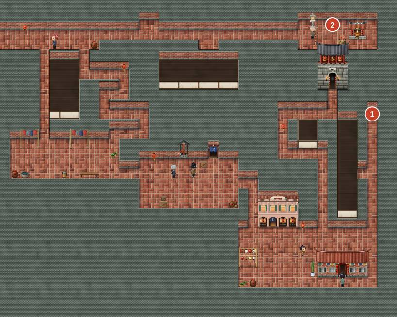

- 九曲巷的**直巷子是風洞**：每 2.5 秒會颳一陣 0.5 秒的強風。站在風裡的人會被往回推 2 格。
  - 靠近風洞時，畫面左下角會出現「**風勢**」計量條。
  - 條子跑滿就是「陣風！」，要趁風停時前進。
- **入口往東的長直巷**：
  - 風從東往西吹（迎面）。
  - 途中北側、南側各有一處凹口可以躲風。
  - 走到底是**土地公廟廣場**（寶箱、打更阿福伯）。
- **東側的死巷**：
  - 從燈籠舖前的廣場東北角往北，風從北往南吹。
  - 巷子中段的西側有一個凹口，可以先躲進去再衝。
  - 盡頭的寶箱是**鹿港風衣**。
- **不想吹風的路線**：
  - 從摸乳巷或旁邊彎來彎去的「九拐」小巷走到曬衣廣場。
  - 再經過半邊井往東南，就能到燈籠舖，全程無風。
  - 巷口的小孩也提醒：「要彎過去、彎過去！」
- **隘門**：
  - 土地公廟廣場南邊有一道隘門，夜晚（二更）會關上，打更阿福伯會守在門口。
  - 跟他說「麻煩開個門」就能通過。

#### 公媽廳的銅鏡與燈（洛家古厝二樓）

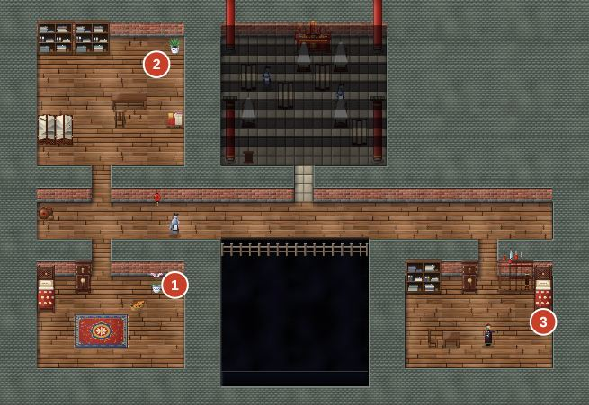

**前置條件**：看完一樓的兩段記憶（月洞門、大灶），並調查二樓青鋒房間的戲箱。

公媽廳是一個 9×7 格的房間：

- 祖先牌位在北牆正中央。
- **燈座**在西南角，入口左手邊，光只會**往北**射。
- 房間裡有四座蓋著白布的**銅鏡**、四座屏風，四個角落各有一根柱子。
- 屏風和柱子會擋光。

| 銅鏡 | 位置 | 誰的嫁妝 | 正確方向 |
|---|---|---|---|
| 鏡一 | 燈座**正北 2 格** | 曾曾祖母 | **／** |
| 鏡二 | 鏡一**往東 5 格** | 娘 | **／** |
| 鏡三 | 鏡二**正北 3 格** | 奶奶 | **＼** |
| 鏡四 | 鏡三**往西 2 格**（牌位正下方） | 曾祖母（從唐山抱過黑水溝） | **＼** |

**光的路線**：燈座 → 往北 → 鏡一轉東 → 鏡二轉北 → 鏡三轉西 → 鏡四轉北 → 牌位。

**操作步驟**：

1. 調查燈座，選「把洛家燈放上去」。
2. 四面鏡子各調查一次，掀開白布。紅纓會說出每一面鏡子的主人。
3. 掀開時，四面鏡子的方向**全部和答案相反**。所以**每面鏡子再調查一次，選「轉動銅鏡」**。
4. 鏡面上會畫出粗粗的「／」或「＼」，對照上表即可。
5. 四面都對了，光就會落在牌位上：「洛門歷代祖先」一塊塊亮起。

- 廳裡有兩隻**怨婢**會追人（每隻帶兩隻怨婢的戰鬥）。站在**光束上**的怨婢會被定住，不能抓人。
  - 所以先放燈，再沿著光走比較安全。
- 解開後，怨婢消失，書房出現寶箱「**父親的槍纓**」。

#### 擲筊（天后宮）

天后宮劇情最後的選項：選「**讓白芷擲筊**」，結果固定是三聖筊。這不只是劇情，頭目戰時**紅纓的防禦會 +10%**。

### 頭目戰

| 頭目 | Lv | HP | 屬性 | 弱點 ×1.5 | 抗性 ×0.5 | 招式 | 階段 | 同場敵人 | 經驗 / 錢 | 類型 |
| --- | ---: | ---: | :---: | --- | --- | --- | --- | --- | ---: | --- |
| 怨宴 | 20 | 5,271 | 土 | 木 | 水 | 狼吞（土）、杯盤狼藉、勸酒、入座、上菜・全豬、上菜・紅龜、宴終（土） | 50% 變身 | 祭盤・全豬×1、祭盤・紅龜×1 | 3,503 / 3,002 | 頭目 |

> 圖表：第五章　鹿港舊夢・頭目 HP——普通難度的最大生命（劇情難度 ×0.8、困難 ×1.3）。深淺交替區分章節；同場的小怪與召喚物不計。（圖表只在 HTML 版顯示；數據如下）

| 章 | 頭目 | Lv | HP |
| --- | --- | ---: | ---: |
| 第五章 | 怨宴 | 20 | 5,271 |

| 敵人 | Lv | HP | 屬性 | 弱點 ×1.5 | 抗性 ×0.5 | 經驗 | 錢 | 掉落 |
| --- | ---: | ---: | :---: | --- | --- | ---: | ---: | --- |
| 紙人 | 16 | 557 | 木 | 火・金 | — | 139 | 45 | 鞭炮 20%、牛舌餅 10% |
| 吊死鬼 | 17 | 809 | 金 | 火 | — | 181 | 56 | 香包 20% |
| 殭屍 | 17 | 1,150 | 土 | 木・火 | — | 233 | 72 | 金創藥 30%、牛舌餅 10% |
| 吊死鬼 | 18 | 864 | 金 | 火 | — | 201 | 60 | 香包 20% |
| 怨婢 | 18 | 864 | 水 | 土 | — | 198 | 59 | 香包 20%、牛舌餅 15% |
| 殭屍 | 18 | 1,228 | 土 | 木・火 | — | 258 | 77 | 金創藥 30%、牛舌餅 10% |
| 祭盤・全豬 | 19 | 969 | 土 | 火・木 | — | 78 | 41 | — |
| 祭盤・紅龜 | 19 | 969 | 土 | 火・木 | — | 78 | 41 | — |
| 骷髏將 | 19 | 1,405 | 金 | 火 | — | 166 | 87 | 續命散 15%、鹿港錦袍 4% |

#### 怨宴（3-12，洛家古厝大廳）

| 項目 | 內容 |
|---|---|
| 怨宴 | Lv20／HP 5271，土屬性，**弱木、抗水**，免疫睡眠、暈眩、幻境。**速度很快**，行動次數大約是我方每個人的 1.4 倍 |
| 祭盤・全豬 | Lv19／HP 969，土屬性，**弱火**。「供奉」：替怨宴回復約 180 HP |
| 祭盤・紅龜 | Lv19／HP 969，土屬性，**弱火**。「添壽」：敵方全體防禦 +30%（2 回合） |
| 推薦 | **Lv20～21**。施家鐵舖裝備或寶箱裡的免費裝備，**四頂暖帽**。續命散 ×5、蚵仔煎 ×3、真氣回復 ×3、還魂香 ×2、薑母茶 |
| 獎勵 | 3503 經驗、3002 文、**怨宴燭台**（飾品：攻 +6、法 +10） |

| 招式 | 效果 |
|---|---|
| 狼吞 | 單體土屬性物理，威力 1.6（攻擊力很高，單發傷害很痛） |
| 杯盤狼藉 | 全體物理，威力 0.8 |
| 勸酒 | 單體術法，40% 機率**睡眠** 2 回合 |
| 入座 | 第 3 回合起，召喚一隻怨婢 |
| 上菜・全豬／紅龜 | 祭盤被打倒後，重新端上來 |
| 宴終 | HP 25% 以下才會用。全體土屬性術法，威力 1.3 |

**特殊機制**：

- **上菜**：怨宴每 3 次行動是一個循環。
  - 第 2 次行動時，會先預告「**……上……菜……（防禦可以擋下）**」。
  - 第 3 次行動不攻擊，改成隨機端一道菜給我方一人：

    | 菜 | 效果 |
    |---|---|
    | 冷飯 | 睡眠 2 回合（暖帽、老棉襖可擋） |
    | 苦酒 | 中毒 3 回合＋法術下降 3 回合 |
    | 紙錢湯 | 真氣減少 40% |

  - 被端菜的人**如果在防禦，就會把菜打翻**。
- **燭火熄滅**（HP 50% 以下）：
  - 大廳一片漆黑，我方的**物理攻擊多 25% 的機率落空**（「看不清」）。
  - 我方用任何**火屬性**招式打中敵人，燭台就會重新點亮，維持怨宴的 3 次行動。
- **燒焦的壽麵**：第二階段的第一道菜，一定是端給紅纓的焦豬腳麵線。紅纓會大喊「那碗麵線，我哥吃完了！一根都沒剩！」：
  - 劍意 +50。
  - 解除所有異常。
  - 攻擊提升 3 回合。
- **福伯的提示**：第二階段怨宴第 2 次行動時，福伯會喊「小姐！主位！那張椅子後面！」。之後**紅纓打怨宴的傷害 ×1.25**。
- **天后宮擲過筊**：紅纓防禦 +10%。

**打法**：

1. **開場先清全豬**：
   - 星河的**燎原**（火屬性全體）同時打兩個祭盤的弱點。
   - 雲歸的**五雷正法**（木屬性全體）打祭盤和怨宴也都是 1.5 倍。
   - 全豬會一直替怨宴補血，最優先。紅龜第二。
   - 祭盤被打倒後，怨宴會花行動重新端上來，等於少打你一次，不必擔心。
2. **主力是木屬性**：
   - 雲歸的**雷符**、五雷正法。
   - 合擊「**雷霆槍陣**」（紅纓＋雲歸，木屬性單體，威力 5.5）是本場最強的一招。
   - **不要用水屬性**：白芷的水月、海潮，以及合擊月下紅纓，都只剩一半傷害。白芷專心補血、解除異常。
3. **看到「上菜」預告**：
   - 下一次被端菜的人是隨機的。至少讓**白芷和雲歸**防禦，被紙錢湯抽掉真氣最傷。
   - 全員戴暖帽的話，冷飯就不用怕。
4. **第二階段（50%）**：
   - 星河每隔幾回合用一次**螢火斬**（真氣 4，最便宜的火屬性招式）重新點亮燭台，紅纓、星河的物理攻擊才不會落空。
   - 紅纓吃完壽麵、福伯喊出弱點之後，她的攻擊最痛。這時用**回馬槍**（Lv18）、紅纓破陣。
5. **HP 25% 以下**：怨宴會開始用「宴終」（全體土屬性大傷害）。保持全員 HP 在六成以上，星河的**九份燈火**（Lv18，全體回復）、白芷的潮生曲輪流補血。

- 被勸酒睡著的人，用**薑母茶**或白芷的**解厄**叫醒。
- BALANCE 模擬（Lv19，施家鐵舖裝備）：勝率 92%，平均 12.6 回合，但 **78% 的戰鬥會有人倒下**。自動測試用的是 Lv21。
- 寶箱裡的免費裝備大多比店裡的好。練到 Lv20 以上再來會輕鬆很多。

### 小技巧

- **本章的「最後期限」是客棧**：打倒怨宴後到客棧休息，就會直接演到第六章。在這之前要完成：
  - 心燈⑫半邊井、心燈⑬福伯。
  - 舊港的鎮屍銅錢劍（只有夜晚能去）。
  - 所有的採購。
- **天后宮一定要讓白芷擲筊**：紅纓防禦 +10%，而且之後不會再問。
- **麵線糊攤、蚵仔煎攤入夜就收攤**，但牛舌餅攤整晚都有賣蚵仔煎和麵線糊，不用急。
- **憶蕈**在古厝後院，不需要靈視，也不需要上一章的蕈，麻糬會帶路。
- 天后宮、洛家大門的石獅子可以調查，芋圓會擺出石獅子的姿勢（紅纓：「好、好可愛。」）。
- 本章末會顯示「這一章點亮了幾盞心燈」，最多 2 盞。

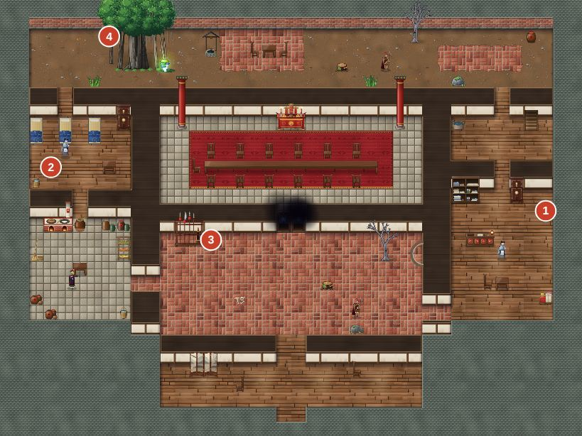

## 第六章　府城長明

> 圖表：第六章　府城長明・路線——本章走過的地點：鹽水 → 府城。（圖表只在 HTML 版顯示）

### 概要

元宵前夕，一行人南下鹽水看蜂炮，再進府城打聽雲歸師父清虛真人的下落。白天是做十六歲、燈謎和小吃攤；入夜之後，林投林的哭聲與長明宮的藍燈，會把這趟元宵之旅帶往完全不同的方向。

| 項目 | 內容 |
|---|---|
| 推薦等級 | Lv19 → Lv23（疫聚 Lv21、林投姐 Lv22、冥燈護法 Lv23） |
| 隊伍 | 沈星河、白芷、洛紅纓、雲歸（四人全員） |
| 主要地圖 | 海線官道、鹽水、府城（赤崁樓／大天后宮／孔廟／七娘媽廟）、林投林、長明宮（水門倉／迴廊／經閣）、萬燈閣 |
| 心燈 | 2 盞（轎夫與母親〔可錯過〕、林投姐〔主線〕） |
| 七仙蕈 | 潮音蕈（林投林，需靈視） |

> 本章是白芷在隊上的最後一章。第七到第十一章的隊伍只有星河、紅纓、雲歸三人，白芷的專用裝備（白玉簫、錦褙子等）在她離隊後就派不上用場，買之前請想清楚。

### 流程

#### 1. 海線官道 → 鹽水（正月十四・黃昏）

1. 開場劇情後，從官道南端（下方出口）走進**鹽水**。
2. 鹽水是本章第一個城鎮。先別急著去武廟，**這時候可以做的事很多**：
   - 主街上的**賣斗笠的阿伯**（斗笠攤）有今晚要用的防具，見〈商店〉。
   - 西側（3,18）與東南角大疫塚旁（41,30）各有一個寶箱。後者的**艾草香囊**可以免疫中毒，蜂炮夜非常好用。
3. 走進主街北側的**鹽水武廟**（門口在 21,6）。林伯會講蜂炮的由來，主線任務開始。
4. **離開武廟後，馬上去找主街上的轎夫阿義**，他只在蜂炮夜開始前出現。這是心燈支線「轎夫與母親」的起點，錯過就沒了，詳見〈心燈與支線〉。
5. 準備好了，回武廟跟林伯對話，選「**開始吧。（蜂炮夜）**」。

#### 2. 蜂炮夜（連戰）

神轎出巡，沿主街一路往南。途中會在三個巷口各打一場，最後在大疫塚前對上頭目：

| 順序 | 地點 | 敵人 | 戰後 |
|---|---|---|---|
| 1 | 小巷 A 口 | 瘟鬼 ×3 | 斗笠阿伯丟來濕毛巾，全員回復 30% |
| 2 | 小巷 B 口 | 瘟鬼 ×2＋長明燈傀 | 回復 30% |
| 3 | 小巷 C 口 | 瘟鬼 ×4 | 回復 35% |
| 4 | 大疫塚 | **疫聚**＋瘟鬼 ×2 | 頭目戰，見〈頭目戰〉 |

這四場都**無法逃跑**，中間也沒有機會開選單買東西，所以裝備和道具要在按下「開始吧」之前備齊。每回合開始時，炮城有機率對敵方齊射（見〈謎題與小遊戲〉），對你很有利。

劇透警告：蜂炮夜的結局

打倒疫聚後，茫然的瘟鬼們並沒有消失。關帝的神轎在大疫塚前自己轉了向，朝它們輕輕點了三下。所有炮城同時齊發，瘟鬼化成微光，跟著火花升上夜空。林伯說：「帝君出巡，不只是趕瘟。也是來接那些走得太急、來不及說再見的人。」

6. 蜂炮夜結束後，如果有接阿義的支線，這時去大疫塚找那位咳嗽的婦人（見支線）。
7. 走進**鹽水客棧**（25,16），老闆娘這晚免費招待。選「**休息到天亮（前往府城）**」就會直接進府城，**鹽水的事要在這之前全部辦完**。

#### 3. 府城（元宵・午後）

到達府城北門後，地圖很大，先記住幾個重點位置：

| 地點 | 門口座標 | 備註 |
|---|---|---|
| 長明宮正門前埕 | 西側（6,4 附近） | 走進前埕觸發墨鴉劇情 |
| 赤崁樓 | (37,5) | 燈謎、寶箱 |
| 大天后宮 | (46,12) | 月老 |
| 鄭家 | (18,13) | 做十六歲之後可免費休息 |
| 七娘媽廟 | (26,13) | 做十六歲 |
| 武館兵器鋪 | (35,23) | 本章武器防具 |
| 府城客棧 | (53,16) | 一晚 60 文 |
| 府城藥鋪 | (57,16) | 藥品 |
| 孔廟 | (50,26) | 隱藏道具 |
| 林投林入口 | 西南角（0,40） | 肉粽伯劇情後才能進 |

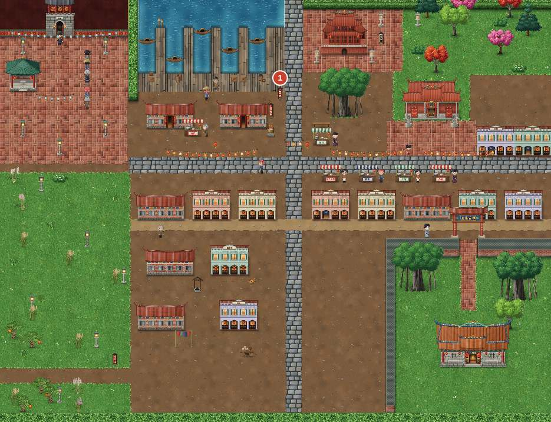

1. **長明宮前埕（3-5）**：往西走進排隊的人群就會觸發。墨鴉（升官成「墨護法」了）出現，芋圓一口扯下他的羽毛，一行人趁亂溜走。這裡沒有戰鬥。
2. **七娘媽廟（3-6 做十六歲）**：進廟就觸發。看鄭家阿進做十六歲，接著白芷也想「轉大人」，擲筊得聖筊（劇情固定，按 Z 擲就好）。獲得**七娘媽的胭脂**（法力＋10、運氣＋10、戰鬥開始時持續回復）與**麻油雞 ×3**。
3. **肉粽伯（3-7）**：做完十六歲後，走到五條港碼頭的肉粽攤（22,14 附近）就會觸發。肉粽伯告訴你林投林與水門的事，並交給白芷**鄭家肉粽 ×2**（關鍵道具），另外送**府城肉粽 ×5**。之後天色轉為黃昏。
4. 黃昏時可以自由逛府城：赤崁樓燈謎、大天后宮月老、孔廟、小吃攤，都建議這時做完（見〈心燈與支線〉）。**進了林投林以後，就一路打到章末，回不了府城**。
5. 準備完畢，從府城西南角走進**林投林**。

#### 4. 林投林（哭聲迷宮）→ 林投姐

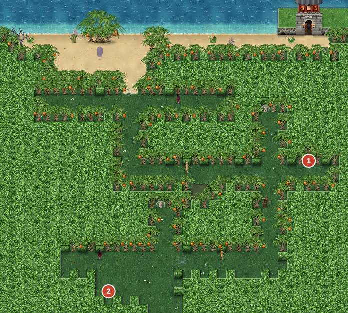

1. 林投林由三個岔路組成，每個岔路有三條分支。**哭聲最清楚的那條才是正路**（地面上漣漪最大、最密的方向）。走錯會碰到一座擺著乾肉粽的無名墳，然後被送回該岔路的入口。完整解法見〈謎題與小遊戲〉。
2. 走到最北邊的老林投樹下（14,9），觸發**林投姐**。這不是一般的頭目戰，**請先讀〈頭目戰〉再打**：打法對了，才拿得到額外獎勵「昭娘的銀簪」。
3. 戰後劇情，白芷把鄭家肉粽交給林投姐母子，點亮**心燈「林投姐」**，獲得**林投姐的木梳**。天色入夜，林投姐撥開葉子，開出一條通往東北方水門的小路。
4. 走到東北角的**石砌水門**（33~37,4 一帶），進入長明宮。

#### 5. 長明宮潛行（S1 水門倉 → S2 迴廊 → S3 經閣）

潛行規則與三區的走法見〈謎題與小遊戲〉。重點：

- 長明宮內**不能存檔**。進水門前，林投林裡可以先存一次。
- 每一區都有一個「整區沒被發現才會出現」的寶箱，裡面是本章最好的幾件裝備。
- 被一般守衛抓到會開打，打贏後**回到該區入口的石燈（檢查點）重來**，紀錄也會歸零。

1. **S1 水門倉**：從西南角入口出發，目標是北牆正中的門（15,1）。
2. **S2 迴廊**：從西南角出發，繞著迴廊走到東北角的門（36,1）。南側走廊有墨鴉在巡邏。
3. **S3 經閣**：解開書架機關，取得**清虛真人的信**，北邊（12,2）出現往下的暗門。

#### 6. 萬燈閣 → 冥燈護法 → 夜玄

1. 從暗門下到**萬燈閣**。入口旁（16,25）有寶箱：**回魂香**＋1,000 文，劇情開始前記得拿。
2. 長篇劇情後，連續兩場戰鬥：**冥燈護法**（真正的頭目戰）→ **夜玄**（強制敗北）。兩場之間**沒有回復也不能開選單**，冥燈護法要打得有餘裕。
3. 之後是不能操作的章末劇情（北郊沙丘、甘蔗田），自動進入第七章。

劇透警告：第六章的結局

夜玄現身，自稱長明宮之主。他說萬燈閣的一萬三千七百盞燈，都是家人跪著求來的「不要忘記他」；彼岸燈會洗去一個人的一切，他稱之為「第二次死亡」。他的計畫叫「逆潮」：讓黑水溝倒流，把所有人帶著記憶送回岸上。為此，他需要燈靈——白芷。

強制敗北之後，夜玄發現星河身上沒有魂燈，胸口那縷金色的火其實屬於白芷，開始把火抽出來。白芷擋在星河身前說「我跟你走」，把刻著自己名字的玉牌交給星河保管：「那你要來追我喔。」紅纓的哥哥洛青鋒也站在夜玄身邊。雲歸用師父留下的遁符帶著眾人逃到府城北郊。星河的火只回來一半，而且離白芷越遠，燒得越弱。

### 心燈與支線

#### 心燈「轎夫與母親」（可錯過）

| 步驟 | 時機與地點 | 內容 |
|---|---|---|
| 1 | 武廟劇情之後、蜂炮夜之前，鹽水主街（23,8） | 和**阿義**對話，聽他講八年前的瘟疫和母親。任務開始。 |
| 2 | 蜂炮夜之後，大疫塚（38,29） | 墳間多了一個「咳嗽的婦人」。和她對話，她是阿義的母親。 |
| 3 | 鹽水主街 | 走回主街中段（20~22, 18~27 一帶）就會觸發：神轎回駕，母親看著扛轎的兒子，說出「這次有說再見喔」。 |

- 獎勵：**心燈「轎夫與母親」**、**武廟平安符**（防禦＋10、氣血＋40、免疫中毒）。
- **錯過條件**：蜂炮夜一開始，阿義就不在主街了；而在客棧選「休息到天亮」後會直接前往府城。所以第 1 步一定要在按下「開始吧」**之前**，第 2、3 步要在**睡覺之前**。客棧老闆娘那邊，雲歸也會提醒你「大疫塚那邊，好像還有放不下的人」。

#### 心燈「林投姐」（主線）

打完林投姐的劇情必定點亮。若戰鬥中「傾聽」（防禦）累積 **3 次以上**，會額外獲得**昭娘的銀簪**（頭飾，白芷／紅纓專用，防禦＋12、法力＋8、身法＋5）。

#### 支線與小事件

| 事件 | 地點與條件 | 獎勵 |
|---|---|---|
| 赤崁樓燈謎 | 赤崁樓的文伯（19,11）。五題、每題只能答一次 | 答對 3 題以上：**燈謎紙扇**（雲歸武器，法力＋56）；全對再加**文昌筆**（法力＋18、真氣＋40） |
| 大天后宮・月老 | 進大天后宮後往右側殿走（17,7） | **月老紅線**（星河專用，運氣＋20、身法＋3） |
| 孔廟泮池 | 孔廟南側泮池橋墩（12,16）調查 | **秀才的硯台**（素材，可賣 400 文） |
| 鄭家休息 | 做十六歲之後，鄭家的鄭嫂 | 免費全員回復，可無限次使用 |
| 陳秀才 | 孔廟裡的陳秀才 | 聽雲歸說他「考過，沒中」的小對話 |
| 元宵攤 | 白芷第一次會問「吃了也會加一歲嗎？」 | 小對話 |

#### 雲歸的蕈譜：潮音蕈

林投林裡，正路 B 往西的長走廊南側（22,21）長著潮音蕈。它是**靈視才看得見**的蕈：從選單使用**七彩靈蕈**開啟靈視（約 75 秒），走到那格就會觸發雲歸「為了研究」的試吃小劇場，蕈譜記下一格。本章商店不賣七彩靈蕈，請從前面的章節帶過來。

### 寶箱與秘密

| 地圖 | # | 座標 (x, y) | 內容 | 備註 |
| --- | ---: | --- | --- | --- |
| 鹽水 | 1 | (3, 18) | 大金創藥 ×3＋600 文 |  |
| 鹽水 | 2 | (41, 30) | 艾草香囊＋600 文 |  |
| 府城 | 1 | (30, 8) | 凝神丹 ×3＋800 文 | 開啟時有事件 |
| 赤崁樓 | 1 | (5, 19) | 赤崁紅磚護符 |  |
| 林投林 | 1 | (35, 18) | 還魂丹 ×2 |  |
| 林投林 | 2 | (12, 33) | 海潮劍 |  |
| 長明宮・水門倉 | 1 | (26, 2) | 長明宮衛甲 | 依劇情出現 |
| 長明宮・迴廊 | 1 | (2, 20) | 大金創藥 ×2＋800 文 | 開啟時有事件 |
| 長明宮・迴廊 | 2 | (37, 2) | 冥燈護符＋800 文 | 依劇情出現 |
| 長明宮・經閣 | 1 | (2, 16) | 清虛的舊葫蘆 | 依劇情出現 |
| 萬燈閣 | 1 | (16, 25) | 回魂香＋1,000 文 |  |

座標以地圖左上角為 (0, 0)，向右為 x、向下為 y；「#」對應地圖圖片上的寶箱編號。

| 地圖 | 位置 | 內容 | 備註 |
|---|---|---|---|
| 鹽水 | 西側 (3,18) | 大金創藥 ×3＋600 文 | |
| 鹽水 | 大疫塚東南 (41,30) | 艾草香囊＋600 文 | 免疫中毒，打疫聚前拿 |
| 府城 | 五條港北側 (30,8) | 凝神丹 ×3＋800 文 | |
| 赤崁樓 | 西南角 (5,19) | 赤崁紅磚護符 | 防禦＋15、火屬性減傷 |
| 林投林 | 岔路 B 東側死路旁 (35,18) | 還魂丹 ×2 | 走錯路的小安慰 |
| 林投林 | 入口西側三座無名墳旁 (12,33) | **海潮劍** | 星河專用，水屬性，攻擊＋52 |
| 長明宮 S1 | 東北角 (26,2) | **長明宮衛甲**（防禦＋30） | 需 S1 全程未被發現 |
| 長明宮 S2 | 西側走廊 (2,20) | 大金創藥 ×2＋還魂丹＋800 文 | 一般寶箱 |
| 長明宮 S2 | 東北出口旁 (37,2) | **冥燈護符**＋800 文 | 需 S2 全程未被發現；免疫封印 |
| 長明宮 S3 | 西南角 (2,16) | **清虛的舊葫蘆** | 雲歸專用，每回合回真氣；需 S3 未被發現 |
| 萬燈閣 | 入口旁 (16,25) | 回魂香＋1,000 文 | 劇情前拿 |

**隱藏道具與小秘密**

- **秀才的硯台**：孔廟泮池橋墩下，調查即可。上面刻著「陳記・三十七次落第紀念」。
- **赤崁樓的贔屭**：調查石碑（9,15），白芷會摸摸牠的頭。沒有道具，但很可愛。
- **蜂炮夜被炸到**：齊射偶爾會打中我方一人，傷害不大，但那名角色**運氣＋20**（「今年會很旺！」）。
- **墨鴉的黑鴉羽**：在 S2 被墨鴉抓到並打贏他，會掉落**黑鴉羽**（身法＋12）。代價是 S2 會被算作「已被發現」，見〈謎題與小遊戲〉。
- **冥燈殘芯**：冥燈護法必定掉落，免疫封印與沉睡，第七章以後很實用。

### 商店

**肉粽攤**

| 商品 | 類別 | 價格（文） | 效果／能力 |
| --- | --- | ---: | --- |
| 府城肉粽 | 道具 | 140 | 我方單體：生命 +450 |

**元宵攤**

| 商品 | 類別 | 價格（文） | 效果／能力 |
| --- | --- | ---: | --- |
| 元宵 | 道具 | 160 | 我方全體：生命 +20% |

**斗笠攤**

| 商品 | 類別 | 價格（文） | 效果／能力 |
| --- | --- | ---: | --- |
| 鹽水斗笠 | 頭飾 | 380 | 防+11 速+1 |
| 厚棉襖 | 衣裝 | 800 | 防+24；抗火 |
| 濕毛巾 | 道具 | 25 | 我方單體：生命 +150，解除中毒 |
| 蜂炮 | 道具 | 220 | 敵全體：火屬性傷害 350 |
| 鞭炮 | 道具 | 25 | 敵全體：火屬性傷害 40 |
| 仙草 | 道具 | 70 | 我方單體：生命 +150，解除中毒・沉睡・封印・定身・幻境 |

**虱目魚粥攤**

| 商品 | 類別 | 價格（文） | 效果／能力 |
| --- | --- | ---: | --- |
| 虱目魚粥 | 道具 | 260 | 我方全體：生命 +300 |
| 府城肉粽 | 道具 | 140 | 我方單體：生命 +450 |
| 青草茶 | 道具 | 30 | 我方單體：生命 +100，解除中毒 |

**碗粿攤**

| 商品 | 類別 | 價格（文） | 效果／能力 |
| --- | --- | ---: | --- |
| 碗粿 | 道具 | 150 | 我方單體：生命 +500 |
| 鹹粿 | 道具 | 80 | 我方單體：生命 +280 |
| 鳳梨酥 | 道具 | 200 | 我方單體：生命 +400，真氣 +40 |

**武館兵器鋪**

| 商品 | 類別 | 價格（文） | 效果／能力 |
| --- | --- | ---: | --- |
| 七星劍 | 武器 | 970 | 武+48 法+6（星河） |
| 麒麟槍 | 武器 | 970 | 武+48（紅纓） |
| 白玉簫 | 武器 | 970 | 武+8 法+47 氣+15（白芷） |
| 七星符扇 | 武器 | 970 | 武+7 法+52 氣+15（雲歸） |
| 鎖子甲 | 衣裝 | 730 | 防+26 |
| 錦袍 | 衣裝 | 820 | 防+27 法+3（星河・雲歸） |
| 錦褙子 | 衣裝 | 860 | 防+25 法+8（白芷・紅纓） |
| 玉冠 | 頭飾 | 480 | 防+13 法+4 |
| 官靴 | 鞋履 | 440 | 防+9 速+5 |
| 夜明珠 | 佩飾 | 1,100 | 法+12 氣+20 |

**府城藥鋪**

| 商品 | 類別 | 價格（文） | 效果／能力 |
| --- | --- | ---: | --- |
| 金創藥 | 道具 | 30 | 我方單體：生命 +120 |
| 大金創藥 | 道具 | 90 | 我方單體：生命 +300 |
| 特級金創藥 | 道具 | 280 | 我方單體：生命 +900 |
| 凝神丹 | 道具 | 90 | 我方單體：真氣 +60 |
| 大凝神丹 | 道具 | 240 | 我方單體：真氣 +150 |
| 還魂香 | 道具 | 150 | 倒下的同伴：復活（30% 生命） |
| 解毒草 | 道具 | 12 | 我方單體：解除中毒 |
| 香包 | 道具 | 40 | 我方單體：解除沉睡・封印・定身・幻境 |
| 青草茶 | 道具 | 30 | 我方單體：生命 +100，解除中毒 |
| 回魂香 | 道具 | 1,200 | 我方全體：復活（30% 生命） |

| 商店 | 地點 | 商品 |
|---|---|---|
| 斗笠攤 | 鹽水主街，賣斗笠的阿伯 | 鹽水斗笠 380、厚棉襖 800、濕毛巾 25、蜂炮 220、鞭炮 25、仙草 70 |
| 鹽水客棧 | 鹽水 | 住宿 50 文（蜂炮夜後免費） |
| 武館兵器鋪 | 府城 (35,23) | 七星劍／麒麟槍／白玉簫／七星符扇 各 970、鎖子甲 730、錦袍 820、錦褙子 860、玉冠 480、官靴 440、夜明珠 1,100 |
| 府城藥鋪 | 府城 (57,16) | 金創藥 30、大金創藥 90、特級金創藥 280、凝神丹 90、大凝神丹 240、還魂香 150、解毒草 12、香包 40、青草茶 30、回魂香 420 |
| 虱目魚粥攤／碗粿攤 | 府城小吃街 | 虱目魚粥 260、府城肉粽 140、青草茶 30／碗粿 150、鹹粿 80、鳳梨酥 200 |
| 肉粽攤・元宵攤 | 府城 | 府城肉粽 140／元宵 160 |
| 府城客棧 | 府城 (53,16) | 住宿 60 文 |

**採購建議**（依 BALANCE 的配裝假設：頭目前能到的商店，每個欄位買最好的那件）

- **鹽水（打疫聚前）**：只有斗笠攤能買。四人各一件**厚棉襖**（防禦 24，火屬性減傷，正好擋疫聚的「高燒」），錢夠再補**鹽水斗笠**。帶 3~4 個**蜂炮**（全體火屬性 350 傷害，正中疫聚和瘟鬼的弱點）和幾條濕毛巾（解毒）。
- **府城（打林投姐、冥燈護法前）**：武館兵器鋪換上**七星劍、麒麟槍、七星符扇**；防具選**錦袍**（星河、雲歸）與**錦褙子**（紅纓）；頭飾**玉冠**、鞋子**官靴**。白芷的白玉簫與錦褙子只能用到本章結束，預算緊的話可以省下。
- **藥品**：冥燈護法前請準備**大金創藥**、**特級金創藥**、**大凝神丹**、**回魂香**（復活並回六成）各數個，加幾個**香包**解封印。BALANCE 的標準是「兩種最好的單體回復 5＋3 個、真氣藥 3 個、復活藥 2 個」。
- 本章頭目給錢很大方（疫聚 2,500、冥燈護法約 5,000），一般玩家到府城時買齊整套不成問題。

### 謎題與小遊戲

#### 蜂炮齊射（鹽水蜂炮夜）

- 三場巷口戰：每回合開始時有 **40%** 機率，炮城對**全體敵人**齊射火屬性傷害（約「我方平均等級 ×12」，打中弱點 ×1.5）。
- 疫聚戰：機率提高到 **60%**、傷害係數 15；疫聚 HP 降到 **30%** 時必定觸發一次大齊射。
- 齊射有 10% 機率順便炸到我方一人：傷害等於「平均等級 ×4」，但那人**運氣永久＋20**（該場戰鬥中）。

#### 擲筊

七娘媽廟（聖筊）與大天后宮月老（笑筊）的擲筊結果都是劇情固定的，按 Z 擲一次即可。

#### 赤崁樓燈謎（全對解答）

和文伯對話選「來猜！」。五題、每題三選一，**每題只有一次機會**，而且整個燈謎攤只能玩一輪：

| 題目 | 答案 | 說明 |
|---|---|---|
| 「一口咬掉牛尾巴」 | **告** | 「牛」去掉尾巴，加一個「口」 |
| 「千里相逢」 | **重** | 「千」＋「里」 |
| 「人在草木間」 | **茶** | 艸＋人＋木 |
| 「十張口，一顆心」 | **思** | 「十」＋「口」成「田」，下面加「心」 |
| 「半部春秋」 | **秦** | 「春」的上半＋「秋」的「禾」 |

全對可拿到燈謎紙扇與文昌筆兩樣獎品。

#### 林投林（哭聲迷宮）

三個岔路，依序 A → B → C。正路的判斷方法：

- 地上的藍色漣漪：正路有三圈、又大又亮；死路只有一圈淡淡的。
- 靠近正路岔口時會聽到哭聲。
- 走錯三次以後，白芷會直接說出方向。

| 岔路 | 正路 | 白芷的提示 |
|---|---|---|
| A（入口北邊） | **往右**（東） | 「……我聽得到，往右邊。」 |
| B（A 走到底後往北） | **往左**（西） | 「……我聽得到，往左邊。」 |
| C（B 的長走廊盡頭往北） | **往前，中間那條**（北） | 「……往前走，中間那條。」 |

死路盡頭都有一座無名墳，墳前有一顆被咬過的乾肉粽。走錯只會被送回該岔路的入口，沒有其他懲罰。林投林裡有五組巡邏的怪物（林投刺精、水鬼、吊死鬼），碰到就會開打。

#### 長明宮潛行（S1–S3）

**基本規則**（進水門時的教學內容）：

- 只有隊長在地圖上行動，同伴躲在暗處跟著。
- 守衛看得到前方的扇形範圍。你站在**長明燈 2.5 格內的光裡，會被看到 5 格遠；在暗處只有 3 格**。
- 被看見時守衛頭上的量表上升（亮處較快，2 格內加倍）：**超過約三分之一會起疑**，走過來東張西望；**滿了就警戒**，衝過來追你。
- **跑步（Shift）**和深色的**吱嘎木板**會發出聲音。前門每 **30 秒**放一次煙火，煙火聲會**蓋住所有聲音 3 秒**。
- **發光的大甕**可以躲進去（Z），但被警戒中的守衛在 2 格內盯著時躲不了。
- 按 **F**：芋圓會衝出去撞翻東西，把附近守衛引過去。
- **傀儡哨**每 3 秒順時針轉 90 度，看見人就搖鈴，叫 8 格內的守衛過來。**從它正後方**靠近並調查，雲歸會貼上**定身符**（30 秒內不動）。
- 被抓到：與守衛戰鬥，打贏後回到入口石燈重來，守衛也回到原位。
- 「已被發現」的判定：守衛進入警戒、你被抓、或傀儡搖鈴，任一發生都算。被一般守衛抓到並傳回檢查點時，紀錄會**歸零**，可以重新挑戰無傷通關寶箱。

**S1 水門倉**（入口在西南角，出口在北牆中央 15,1）

- 守衛 g1 繞著西半邊的方形路線（6,4）→（6,14）→（12,14）→（12,4）巡邏；g2 在北側（18,7）↔（27,7）來回，停下時面朝下。
- 傀儡哨在（15,11），一開始面朝上。
- 北邊（13~16, 5）是一整排吱嘎木板，往出口時用走的、或抓煙火的時機過去。
- 走法：先躲進（4,10）的大甕，等 g1 往東走遠，沿西牆北上；繞到傀儡背後（15,12）貼符；再趁 g2 走到東端時從（14,3）的大甕附近溜向出口。無傷寶箱在東北角（26,2），要趁 g2 往西走時去拿。

**S2 迴廊**（入口在西南角，出口在東北角 36,1）

- 中庭點滿長明燈，**一進去就會被看得很遠**，請沿外圈迴廊走。
- 守衛：g3 在西側走廊（4,6）↔（4,21）；g4 在北側走廊（6,3）→（33,3）來回，會在中段停下面朝下；g5 在東側走廊（35,6）↔（35,23）。
- **墨鴉**在南側走廊（9,25）↔（33,25）巡邏，視野固定 5 格。被他抓到會打一場墨鴉戰（見〈頭目戰〉），打贏他就逃走，不會傳回檢查點。
- 傀儡哨：（5,4）面朝下、（35,26）面朝左。
- 吱嘎木板：北走廊（15~18, 3~4）、東走廊（35~36, 15）。
- 屏風後面（2,11）（2,19）（26,5）（36,13）等處是死角。大甕在（10,26）（30,26）（36,8）。
- 路線建議：從入口往東沿南走廊走在墨鴉**背後**，用（10,26）（30,26）兩個大甕躲他回頭；在（35,26）那隻傀儡的背後（36,26）貼符；等 g5 往南走時沿東走廊北上，經（36,8）的大甕，到東北角出口。無傷寶箱「冥燈護符」就在出口旁（37,2）。西側走廊的普通寶箱（2,20）不受發現與否影響。

**S3 經閣（書架機關）**

- 一名守衛在桌邊（15,8）打瞌睡。中央（11~12, 8~10）是吱嘎木板，從兩側書架之間繞過去。
- 八座書架上的木牌，依位置是：西側由北到南「**一、念、清、靜**」，東側由北到南「**萬、緣、皆、歸**」——合起來就是太虛觀鐘上的「一念清靜，萬緣皆歸」。
- 桌上字條（13,8）：「**先取師之字，後取徒之字。**」
- **解答**：先抽西側第三座「**清**」（清虛真人的清，位置 2,9），再抽東側最下面「**歸**」（雲歸的歸，位置 20,12）。
- 抽錯書架會讓書嘩啦掉一地，發出半徑 6 格的大聲響，順序也要重來。錯兩次以上雲歸會給提示。
- 解開後獲得**清虛真人的信**，北邊（12,2）出現往萬燈閣的暗門。無傷寶箱「清虛的舊葫蘆」在西南角（2,16），建議**先拿寶箱再解書架**。

### 頭目戰

> 圖表：第六章　府城長明・頭目 HP——普通難度的最大生命（劇情難度 ×0.8、困難 ×1.3）。深淺交替區分章節；同場的小怪與召喚物不計。（圖表只在 HTML 版顯示；數據如下）

| 章 | 頭目 | Lv | HP |
| --- | --- | ---: | ---: |
| 第六章 | 疫聚 | 21 | 9,259 |
| 第六章 | 林投姐 | 22 | 7,036 |
| 第六章 | 墨鴉 | 23 | 4,279 |
| 第六章 | 冥燈護法 | 24 | 7,829 |

| 頭目 | Lv | HP | 屬性 | 弱點 ×1.5 | 抗性 ×0.5 | 招式 | 階段 | 同場敵人 | 經驗 / 錢 | 類型 |
| --- | ---: | ---: | :---: | --- | --- | --- | --- | --- | ---: | --- |
| 疫聚 | 21 | 9,259 | 土 | 火・木 | — | 咳疫（土）、高燒（火）、拖入、聚眾 | 50% 回復10% | 瘟鬼×2 | 4,008 / 2,500 | 頭目 |
| 林投姐 | 22 | 7,036 | 水 | 土 | — | 林投刺（木）、纏髮、黑淚（水）、呼喚林投 | — | 林投刺精×2 | 4,994 / 0 | 頭目 |
| 墨鴉 | 23 | 4,279 | 水 | 土 | — | 鴉羽亂舞、黑翼遮天、啄眼、升官的氣勢 | 50% | 長明宮衛×1 | 684 / 600 | 頭目 |
| 冥燈護法 | 24 | 7,829 | 水 | 土 | 火 | 鎖魂鏈（金）、冷燈照（水）、長明縛 | 50% 變身、20% 變身 | 魂罐・北×1、魂罐・東×1、魂罐・南×1、魂罐・西×1 | 5,006 / 4,999 | 頭目 |
| 夜玄 | 44 | 999,999 | 水 | 土 | — | 請住手。 | — | — | 0 / 0 | 劇情（結果固定） |

#### 疫聚（鹽水・大疫塚）

| 項目 | 內容 |
|---|---|
| 等級／HP | Lv21／9,259（附帶瘟鬼 ×2，各約 1,150） |
| 屬性 | 土 |
| 弱點 | 火（指定弱點）、木（五行相剋） |
| 推薦 | Lv21；四人各穿**厚棉襖**，紅纓、雲歸戴**艾草香囊**／平安符類免毒飾品 |

**招式**

- **咳疫**：全體土屬性術法，40% 中毒 3 回合。
- **高燒**：單體火屬性術法，威力 1.4，本戰最痛的一招。厚棉襖可以減輕。
- **拖入**：單體 60% 沉睡 2 回合。
- **聚眾**：HP 低於一半後才會用，叫出新的瘟鬼。
- **半血**：HP 降到 50% 時，它會把整條街的哭聲吸回去，回復 10% HP。
- 蜂炮齊射：每回合 60% 機率打全體敵人，HP 30% 時必定大齊射一次。

**打法**

1. 第 1 回合：白芷放**月霧護身曲**（全體防禦提升），雲歸放**五雷正法**（木屬性全體，打疫聚是剋制），星河放**燎原**或**焚天劍氣**，紅纓用**怒焰紅纓**（Lv22 學會）或**蜂炮**道具，先把兩隻瘟鬼清掉。
2. 瘟鬼倒下後集中疫聚：雲歸**雷符**／五雷正法、星河**星墜劍**、紅纓**回馬槍**。
3. 中毒用濕毛巾、青草茶或白芷的**解厄**處理；被拖入睡著的人用香包叫醒。
4. 半血時它會回 10% 並開始叫小弟，叫出來的瘟鬼用全體技一起掃掉，蜂炮齊射也會幫你清。
5. 劍意滿了就放大招，30% 的必定齊射之後通常一兩回合就收工。

戰後掉落**蜂炮**，經驗 4,008、金錢 2,500。

#### 林投姐（林投林深處）

| 項目 | 內容 |
|---|---|
| 等級／HP | Lv22／7,036（HP 條在本戰是她的「怨」）；附帶林投刺精 ×2 |
| 屬性 | 水 |
| 弱點 | 土（林投刺精：木屬性，弱金） |
| 推薦 | Lv22，府城武館裝備 |

**機制：她不是惡鬼**

- 畫面上方的紫色量表是「**怨**」，降到 0 戰鬥就結束（她不會死）。
- 林投姐每行動三次，第三次是「**泣訴**」：她不攻擊，只說話。之前那一次會先出現「林投姐的肩膀在發抖……」作為預告。
- 泣訴之後，到她下一次行動之前是「**傾聽時間**」，畫面會寫「她在訴說——選擇『防禦』靜靜傾聽」：
  - 這段時間裡，**每個選「防禦」的人＝傾聽一次**：怨 −8%，而且她的攻擊力下降。每人每次泣訴只算一次。
  - 這段時間裡**攻擊她**（任何會造成傷害的行動）：不但沒傷害，怨反而 **+5%**（「被打斷了」）。
- 白芷的**渡魂謠**任何時候都能讓怨 −6%。
- 怨降到 **30%** 時觸發劇情（白芷吹笛、星河發現她背後有人），之後她的攻擊與法力都降為七成。

**招式**：林投刺（全體木屬性物理）、纏髮（單體 70% 封印）、黑淚（單體水屬性術法，降法力）、呼喚林投（召喚林投刺精，場上已有兩隻時改用林投刺）。

**打法**

1. 平常回合：雲歸用**土符**（剋水）、星河紅纓普通輸出；紅纓用金屬性的**紅纓點**／**連環槍**清林投刺精。白芷每回合**渡魂謠**（怨 −6%）或補血。
2. 看到「肩膀在發抖」就停手準備，**泣訴一出現，四個人全部防禦**：一輪就是 −32% 的怨，還能累積劍意。
3. 傾聽 3 次以上會拿到**昭娘的銀簪**；一次泣訴全員防禦就達標了。
4. 被纏髮封印的人照樣可以防禦傾聽。
5. BALANCE 的模擬中這是「溫柔」的一戰，跟著提示傾聽幾乎不可能輸。

#### 冥燈護法（萬燈閣）

| 項目 | 內容 |
|---|---|
| 等級／HP | Lv24／7,829；附帶魂罐 ×4（北、東、南、西，各 714 HP、防禦很高） |
| 屬性 | 水 |
| 弱點／抗性 | 弱土；**抗火** |
| 推薦 | Lv23（BALANCE 模擬勝率 93%），府城整套裝備；帶**冥燈護符**、香包、回魂香 |

**招式**

- **鎖魂鏈**：單體金屬性物理，威力 1.5，並降身法。
- **冷燈照**：全體水屬性術法。
- **長明縛**：單體 85% 封印 3 回合（冥燈護符可免疫）。
- **重鑄**：有魂罐被打破時，30% 機率掰下自己的燈芯（自己 −10% HP）把罐子封回去，整場最多 2 次。

**魂罐機制**

- 每個還在的魂罐，讓護法**防禦 +8%**，而且護法每次行動前回復 **1.5% HP**（四罐就是 6%）。
- 打破一個魂罐，裡面的魂被放走，**我方全體回復 10% HP**。
- 白芷的**渡魂謠**會直接放走 HP 最低的那個魂罐。

**第二階段（HP 50%）**：燈籠頭裂開，開始使用「**燈印**」：隨機烙在一名隊員身上，畫面會在他的狀態欄上寫「燈印 2」。護法再行動兩次後燈印燃燒，是一記非常重的術法傷害。破解方法：
- 星河對被烙印的人放**護燈訣** → 完全抵銷（狀態欄改成「燈印（已護住）」）。
- 或讓被烙印的人在燃燒時處於**防禦**狀態 → 傷害只剩兩成。

**第三階段（HP 20%）**：萬燈齊鳴，護法身法＋30%，而且每次行動都吸走全隊 5% 真氣。

**打法**

1. 第 1 回合：白芷**渡魂謠**放走一罐；星河**劍氣縱橫**、紅纓**橫掃千軍**（無屬性全體，不吃抗火）砍其他罐子；雲歸**迷魂扇**降護法攻擊。星河的火屬性招式對護法只有一半效果，打罐子時用全體招即可。
2. 罐子全破之前不要急著打本體：活著的罐子讓它又硬又會回血，而每破一個罐子你就回 10%。之後它「重鑄」一次罐子，就用渡魂謠再放走。
3. 罐子清完後集中本體：紅纓**破甲**（降防）→ **回馬槍**；雲歸**土符**（剋水 ×1.5）；星河**星墜劍**／普攻。
4. 進入第二階段後，**星河保留 MP 和行動給護燈訣**。燈印一出現，下一個輪到星河就對那人放護燈訣；星河自己被烙印時也可以對自己放。
5. 被長明縛封印的人用香包或白芷的**解厄**解除。
6. 第三階段開始吸真氣，用大凝神丹補，並把劍意大招、合擊（**星河渡燈**、**雲水禪心**）一口氣放出去。

戰後必定掉落**冥燈殘芯**，經驗約 5,000、金錢約 5,000。打完**不會回復**，緊接著就是夜玄。

#### 夜玄（強制敗北）

| 項目 | 內容 |
|---|---|
| 等級／HP | 畫面顯示「Lv ？？」「？？？」 |
| 結果 | **一定會輸**，輸了劇情照常進行，不會 Game Over |

這一戰你的任何攻擊都只會打出「……」。他的四次行動是固定的：

1. **請住手。**：不出手，只是看著你們。
2. **長明・縛**：全員封印 3 回合（「你們的法術，在這裡點不亮。」）。
3. **歸寂**：紅纓與雲歸直接倒下（「睡吧。不會痛的。」）。
4. **抽燈**：星河剩 1 HP，戰鬥結束。

不能逃跑（「逃不掉。」）。小彩蛋：如果在這場放出**劍意大招**，夜玄會說「……陳渡的劍法。他教得很好。」

#### 墨鴉（再戰，可選）

只有在 S2 迴廊被墨鴉抓到時才會發生。

| 項目 | 內容 |
|---|---|
| 等級／HP | Lv23／4,279，附帶長明宮衛 ×1 |
| 屬性 | 水；弱土 |
| 招式 | 鴉羽亂舞（全體 3 連擊）、黑翼遮天（全體降身法）、啄眼（單體 60% 沉睡）、升官的氣勢（HP 半血以下，自身攻擊＋30%） |
| 掉落 | **黑鴉羽**（身法＋12） |

先用雲歸的**土符**和紅纓的全體技把長明宮衛清掉，再集中墨鴉。睡著的人用香包或解厄叫醒；半血後他會自我強化，白芷的**月霧護身曲**頂住鴉羽亂舞即可。打贏後墨鴉「戰略性撤退」，從此不在 S2 巡邏。

### 小技巧

- **鹽水是一次性地圖**：阿義的支線第 1 步要在蜂炮夜之前，第 2、3 步要在客棧睡覺之前。厚棉襖、蜂炮也要在按「開始吧」之前買好。
- **府城黃昏是最後的自由時間**：燈謎、月老、硯台、武館與藥鋪的採購，都要在走進林投林前完成。章末之後不會再回到府城。
- **鄭家可以免費全員回復**，做完十六歲後隨時回去找鄭嫂。
- **燈謎只能玩一輪**，答案照抄上面的表格就能全對。
- 林投林是長明宮前**最後一個能存檔的地方**，萬燈閣裡兩場連戰沒有回復，進水門前請先存檔。
- 潛行時，S3 的無傷寶箱在入口附近，先拿再去抽書架，最保險。
- S2 被墨鴉抓到會失去「冥燈護符」（無傷寶箱）的資格。想兩樣都要，可以故意讓一般守衛抓到一次：傳回檢查點時紀錄會歸零。
- 白芷在本章結束時離隊，她身上的裝備會一直留在她身上，直到第十一章歸隊。進萬燈閣前可以把**七娘媽的胭脂**、**冥燈護符**之類通用飾品從她身上換下來，留給第七章的三人。
- 七娘媽的胭脂（戰鬥開始時持續回復）給第七章的紅纓或雲歸戴，非常好用。

#### 心燈檢查表（第六章）

| 心燈 | 取得方式 | 可錯過 |
|---|---|---|
| 轎夫與母親 | 鹽水支線（阿義） | **是**（蜂炮夜前接、睡覺前完成） |
| 林投姐 | 主線（林投林） | 否 |

真結局需要在通關前累積 **14 盞**心燈。第五章結束時最多 13 盞，本章最多再加 2 盞，到這裡最多 15 盞。

## 第七章　雲山入夢

> 圖表：第七章　雲山入夢・路線——本章走過的地點：府城 → 阿里山 → 玉山 → 日月潭。（圖表只在 HTML 版顯示）

### 概要

星河胸口借來的火一天比一天暗。三人帶著兩隻貓上山，從阿里山的鄒族大社、玉山的布農人家，一路走到雲霧林深處的藤婆小屋，在夢裡面對各自的傷，最後來到日月潭霧底下的燈母祠。

| 項目 | 內容 |
|---|---|
| 推薦等級 | Lv23 → Lv27（黑熊精 Lv24、心魔・雲歸 Lv25、無光之影與蛟 Lv26、清虛真人＋冥燈印 Lv27） |
| 隊伍 | 沈星河、洛紅纓、雲歸（**白芷不在隊上**，第七到第十一章都是三人隊） |
| 主要地圖 | 甘蔗田・土地公廟、阿里山古道、鄒族大社、神木林、玉山山徑、Biung 的家、雲霧林、藤婆小屋、靈境、日月潭、湖霧之徑、燈母祠 |
| 心燈 | 2 盞（霧中的獵刀、燈母祠的壁畫，**兩盞都可錯過**） |
| 七仙蕈 | 雲芝（雲霧林，不需靈視） |

> 本章少了白芷這個專職補師，回復主要靠雲歸的**回春符**、星河的**九份燈火**和道具。前半章星河還有「燈芯將盡」的限制，請先讀〈小技巧〉。

### 流程

#### 1. 甘蔗田・土地公廟 → 阿里山古道

1. 開場劇情後可以自由行動。工寮裡的**木箱**可以拿到甘蔗 ×2，鍋子旁有一段吃粥的小對話；廟後（6,4）有寶箱。
2. 和牛車旁的**阿伯**對話（再送甘蔗 ×3），選「搭牛車去山腳」，前往阿里山古道。
3. **阿里山古道**：山腳交易寮的**老吳**是本章第一間商店（見〈商店〉）。順便買一包**粗鹽**（10 文），之後的小支線要用。
4. 沿古道往北。在中段的倒木一帶（18~31, 11~13）觸發**黑熊精**戰。Voyu 說「不要殺牠！牠病了」，這一戰只要把黑熊精打到剩三成 HP 就結束，雲歸會用淨化符替牠洗去潮病。
5. 跟著 Voyu，從古道北端進入**鄒族大社**。

#### 2. 鄒族大社（Tsou）

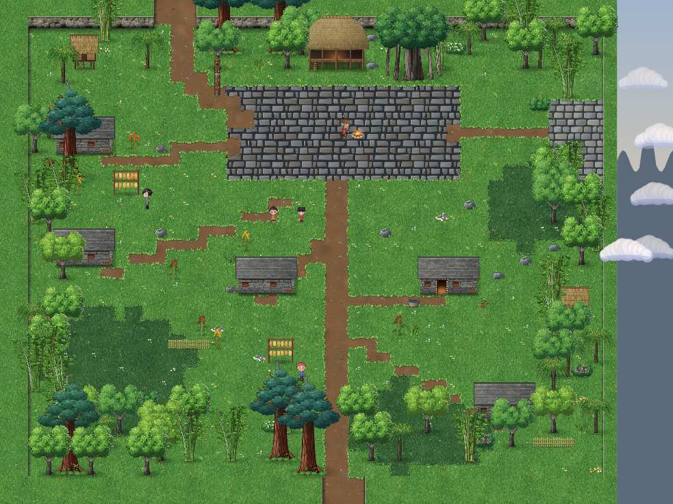

1. 抵達後是部落的迎客劇情，長老講述塔山的故事。
2. 北邊的 **kuba（男子會所）**只能在外面調查，不能進去，這是對部落規矩的尊重。東側崖邊可以「眺望」塔山，但同樣過不去。
3. 把**粗鹽**交給小米架旁的婦人（10,14），換到**愛玉凍 ×3**（支線「老吳的鹽」）。
4. 走進廣場東南的 **Voyu 的家**（31,20），和 Voyu 的母親對話，選「在火塘邊休息」。第一晚會聽到 Voyu 的弟弟 Pasuya 的事，星河的燈芯也會回復一些。
5. 天亮後出門和 **Voyu** 對話，接下心燈支線「霧中的獵刀」（見〈心燈與支線〉）。
6. 從大社北邊出口前往**神木林**。

#### 3. 神木林 → 玉山山徑

1. 走到神木前觸發劇情（7-4a）。
2. **一定要先去東邊崖上看雲海**（38~40, 10~13），否則北邊出口會被雲歸叫回來。
3. 若接了 Pasuya 的支線，這時在西側推開倒木，下到霧谷調查三處「微光」（見支線）。
4. 從神木林北邊出口進入**玉山山徑**。
5. 玉山山徑中段（21,27）有「進入後將無法折返」的提示。**選「繼續往上走」之前，請先完成 Pasuya 的支線，並拿完阿里山古道、神木林的寶箱**。過了這裡就回不去了。
6. 往上走會觸發坍方（7-5b），一行人被布農族的獵人 **Biung** 救回家。

#### 4. Biung 的家（Bunun）→ 雲霧林

1. 在 Biung 家的石板屋過夜。屋裡傳來 **pasibutbut（八部合音）**，遊戲裡只會從屋內靜靜聽見，不會有小遊戲，也不能存檔，請好好聽完。
2. 隔天早上聽完洪水的傳說，祖母送星河**黑鵯紅羽**（星河專用，抗水、火屬性傷害提升），另外拿到小米糕 ×3、醃山肉 ×2。燈芯也會回復。
3. 選「跟著 Biung 去雲霧林」。之後也可以從 Biung 家西邊回到玉山山徑，拿北側（40,4）的**赤霞劍**寶箱，再從山徑西北（6,0）進雲霧林。
4. **雲霧林**：跟著藤婆的木牌走，路線見〈謎題與小遊戲〉。途中（8,20）有本章的七仙蕈**雲芝**。

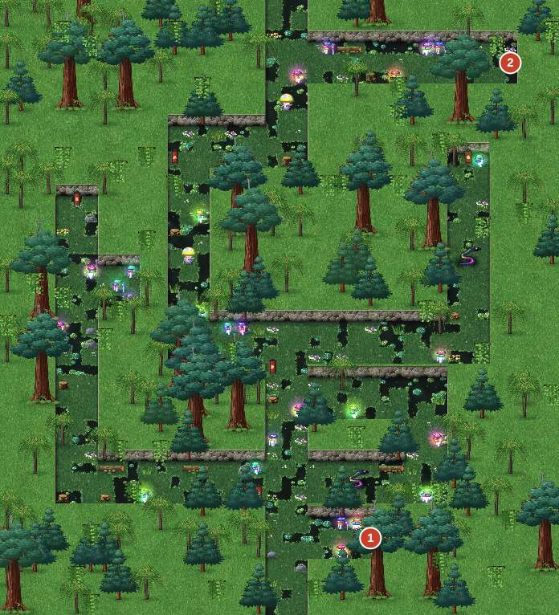

#### 5. 藤婆小屋 → 入夢禮

1. 見到**藤婆**，她要三人禁食三天。這段期間不能離開小屋一帶。
2. 和藤婆對話選「我準備好了（入夢禮）」。入夢前每個人要說出走進夢裡的意圖，星河的三個選項：
   - 「我想活下去。」
   - 「我想救回白芷。」
   - 「我想知道，我借來的光該怎麼還。」

   三個選項只影響之後**心火覺醒時星河說的台詞**，不影響數值或結局，選你喜歡的就好。

> 入夢禮與夢藤是本作虛構的、只屬於藤婆一人的儀式，與任何真實的族群祭儀無關。

#### 6. 靈境（呼吸之庭與三道試煉）

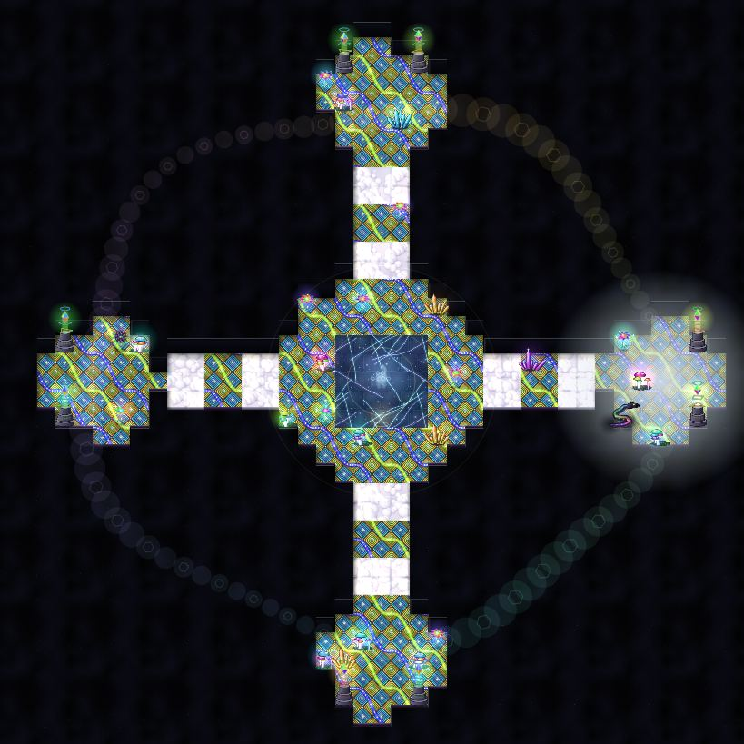

1. **呼吸之庭**是靈境的中樞，橋會跟著呼吸出現、消失（見〈謎題與小遊戲〉）。中央右下的**水晶**（23,23）可以存檔，也可以把呼吸調慢。
2. 西門：**紅纓之境**（刀鏡謎題 → 心魔・鬼面，紅纓單挑）。完成後紅纓學會被動技「**放手**」（HP 低於三成時防禦提升）。
3. 北門：**雲歸之境**（九燈謎題 → 心魔・雲歸）。完成後雲歸學會被動技「**慢看**」（戰鬥中敵人頭上會顯示弱點屬性）。
4. 兩道試煉都完成後，東門打開：**星河之境**（五音水燈）。之後是本章的高潮：心火覺醒、**無光之影**頭目戰。
5. 醒來後是 7-11 黎明，藤婆送星河**藤心結**（星河專用，最大 HP＋10%、戰鬥開始時持續回復），另有雲霧藥草包 ×3 與關鍵道具**雲豹之紋**。

劇透警告：三道試煉與心火

紅纓在洛家古厝面對「鬼面」，在第四回合喊出他的名字「哥哥。青鋒。」，鬼面碎成光蝶，底下是十六歲的哥哥。她也在一瞬間看見：黑色的海、一道黑雷、一個張開雙臂擋在她面前的背影。

雲歸在雲上的太虛觀面對「師父想要的那個弟子」，最後看見湖底盤坐著一個背上燃著藍黑色燈的人影：清虛真人。

星河回到十八年前中元夜的八斗子，看見一次又一次輪迴的自己。他明白借來的光是白芷的，但自己的火「是用這十八年的每一個人點起來的」。心火覺醒：燈芯將盡的限制解除，星河學會心火・燃燈／照夜／不滅。

#### 7. 日月潭（Thao）→ 湖霧之徑 → 燈母祠

1. 從藤婆小屋東邊跟著雲豹，到**日月潭**。和邵族長老見面，看見白鹿，聽杵音。
2. 湖心的島是 **Lalu**，是邵族祖靈所在的地方。岸邊的獨木舟調查後星河會說「我們不划過去」，遊戲裡也無法抵達。
3. 東邊碼頭的**阿財**（43,18）是湖畔雜貨船，賣本章最好的武器。蘆葦間的破木箱（44,22）裡有一包**還魂香**。
4. 到長老家（西邊，4,24）選「休息」，觸發 7-12d：雲豹在霧上踏出一條路，進入**湖霧之徑**。
5. **湖霧之徑**：中段（11~19, 20~22）觸發**蛟**頭目戰。打完往北，燈母祠浮出水面。
6. **燈母祠・上殿**：看壁畫、解**五行燈**謎題（見〈謎題與小遊戲〉），池水退去出現往下的石階。
7. **燈母祠・下殿**：再看三幅壁畫，打開北邊的巨門，進入**祠心**。
8. **祠心**：**清虛真人（被附身）＋冥燈印**頭目戰。打完後是本章結尾劇情，自動進入第八章。

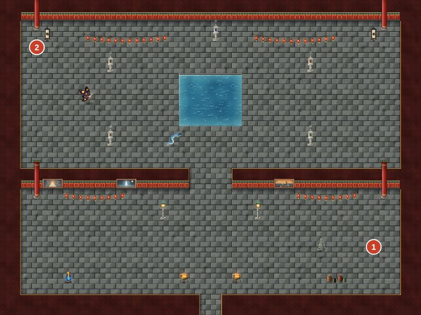

劇透警告：燈母祠的結局

清虛真人被長明宮的「冥燈印」操縱，在祠心等著。冥燈印碎裂後，清虛倒在雲歸懷裡：「……雲歸。你長高了。」雲歸學會**太虛神雷**，並得到師父的**清虛古符**（雲歸專用武器，法力＋74）。之後燈母的聲音在祠裡響起，章末一行人在日月潭邊吃了一碗魚粥。

### 心燈與支線

#### 心燈「霧中的獵刀」（可錯過）

| 步驟 | 時機與地點 | 內容 |
|---|---|---|
| 1 | 鄒族大社，第一晚在 Voyu 家過夜之後 | 天亮後和廣場上的 **Voyu**（33,22）對話，他拜託你們去霧谷看看。 |
| 2 | 神木林西側（6,23） | 調查橫倒的大木頭，紅纓把它推開，往西南的**霧谷**露出來。（沒接任務時推不動。） |
| 3 | 霧谷的三處「微光」 | (10,29)、(4,32)、(10,35)。第三處找到 Pasuya 的**褪色的皮帽**與**獵刀**。 |
| 4 | Voyu 的家 | 把東西交給 Voyu 的母親。 |

- 獎勵：**心燈「霧中的獵刀」**、**小米酒（小葫蘆）**（戰鬥外全隊回復 80 真氣）、**烤山肉 ×3**。
- **錯過條件**：在玉山山徑選「繼續往上走」之後就回不了阿里山。星河會在那裡提醒「Voyu 拜託的事，還沒有給他答覆」。
- 霧谷裡會多出兩組怪物（百眼、霧精），寶箱（5,36）有還魂香。
- 星河在崖下看到的那點光，三人選擇不去碰它：「那不是我們該送的路，是他們家、他們族裡的事。」

#### 心燈「燈母祠的壁畫」（可錯過）

燈母祠上殿與下殿各有三幅壁畫，**六幅全部調查完**就會點亮。

| 壁畫 | 位置 |
|---|---|
| 1~3 | 上殿 (4,17)、(11,17)、(26,17) |
| 4~6 | 下殿 (4,17)、(11,17)、(26,17) |

- **錯過條件**：下殿北邊的巨門通往祠心，進去後就直接進入章末。第一次走到門前，如果壁畫沒看完，雲歸會提醒你一次；之後就能直接推門進去。祠心之後不能回頭，請務必先看完六幅。

#### 支線「老吳的鹽」

在山腳交易寮買**粗鹽**（10 文），交給鄒族大社小米架旁的婦人，換到**愛玉凍 ×3**（回復 HP 200、MP 30）。

#### 雲歸的蕈譜：雲芝

雲霧林西側（8,20）發光的菇叢，調查即可，**不需要靈視**。雲歸「為了研究」吃下雲芝，蕈譜記下一格，並得到素材**雲芝**。

### 寶箱與秘密

| 地圖 | # | 座標 (x, y) | 內容 | 備註 |
| --- | ---: | --- | --- | --- |
| 甘蔗田・土地公廟 | 1 | (6, 4) | 金創藥 ×2＋1,500 文 |  |
| 阿里山古道 | 1 | (9, 40) | 止血草 ×3 |  |
| 阿里山古道 | 2 | (4, 27) | 雲紋衣 |  |
| 阿里山古道 | 3 | (41, 10) | 回氣散 ×2 |  |
| 神木林 | 1 | (24, 20) | 山參 ×2＋1,200 文 |  |
| 神木林 | 2 | (5, 36) | 還魂香 |  |
| 玉山山徑 | 1 | (36, 32) | 鐵骨護腕＋1,000 文 |  |
| 玉山山徑 | 2 | (40, 4) | 赤霞劍 |  |
| 雲霧林 | 1 | (26, 38) | 雲霧藥草包 ×2＋1,000 文 |  |
| 雲霧林 | 2 | (36, 4) | 青嵐扇 |  |
| 湖霧之徑 | 1 | (6, 30) | 湖月石＋1,500 文 |  |
| 湖霧之徑 | 2 | (25, 12) | 還魂丹＋1,000 文 |  |
| 燈母祠・上殿 | 1 | (35, 23) | 燈母織衣 |  |
| 燈母祠・上殿 | 2 | (3, 4) | 太乙符 ×3 |  |
| 燈母祠・下殿 | 1 | (4, 10) | 金剛護符 |  |
| 燈母祠・下殿 | 2 | (35, 23) | 還魂丹 |  |

座標以地圖左上角為 (0, 0)，向右為 x、向下為 y；「#」對應地圖圖片上的寶箱編號。

| 地圖 | 位置 | 內容 | 備註 |
|---|---|---|---|
| 甘蔗田・土地公廟 | 廟後 (6,4) | 金創藥 ×2＋1,500 文 | |
| 阿里山古道 | 南段西側 (9,40) | 止血草 ×3 | |
| 阿里山古道 | 西側 (4,27) | **雲紋衣**（防禦 30、身法＋2、抗木） | |
| 阿里山古道 | 東北 (41,10) | 回氣散 ×2 | |
| 神木林 | 中央 (24,20) | 山參 ×2＋1,200 文 | |
| 神木林 | 霧谷 (5,36) | 還魂香 | 推開倒木後 |
| 玉山山徑 | 下段東側 (36,32) | 鐵骨護腕＋1,000 文 | |
| 玉山山徑 | 北段東側 (40,4) | **赤霞劍**（星河專用，火屬性） | 坍方之後才到得了 |
| 雲霧林 | 南段東側 (26,38) | 雲霧藥草包 ×2＋1,000 文 | |
| 雲霧林 | 東北 (36,4) | **青嵐扇**（雲歸專用，木屬性，法力＋66） | |
| 湖霧之徑 | 西側 (6,30) | **湖月石**（抗水）＋1,500 文 | 蛟戰前拿 |
| 湖霧之徑 | 東北 (25,12) | 還魂丹＋1,000 文 | |
| 燈母祠・上殿 | 東南 (35,23) | **燈母織衣**（白芷專用） | 現在用不到，留著 |
| 燈母祠・上殿 | 西北 (3,4) | 太乙符 ×3（敵全體 500 傷害） | |
| 燈母祠・下殿 | 西側 (4,10) | **金剛護符**（防禦＋14、免疫暈眩） | |
| 燈母祠・下殿 | 東南 (35,23) | 還魂丹 | |

**隱藏道具**

- 甘蔗田工寮的**木箱**：甘蔗 ×2；糖廍阿伯再送 ×3。
- 日月潭蘆葦間的**破木箱**（44,22）：還魂香。
- 頭目掉落：黑熊精→熊膽（素材）、心魔・雲歸→回氣散、無光之影→**星火石**（火屬性傷害提升）、蛟→蛟鱗（素材）、冥燈印→太虛古籍（關鍵道具）。

### 商店

**山腳交易寮**

| 商品 | 類別 | 價格（文） | 效果／能力 |
| --- | --- | ---: | --- |
| 止血草 | 道具 | 60 | 我方單體：生命 +250 |
| 金創藥 | 道具 | 30 | 我方單體：生命 +120 |
| 續命散 | 道具 | 120 | 我方單體：生命 +400 |
| 回氣散 | 道具 | 120 | 我方單體：真氣 +60 |
| 解毒草 | 道具 | 12 | 我方單體：解除中毒 |
| 醒神香 | 道具 | 50 | 我方單體：解除沉睡・幻境 |
| 粗鹽 | 其他 | 10 | — |
| 赤銅劍 | 武器 | 1,350 | 武+60（星河） |
| 寒玉槍 | 武器 | 1,220 | 武+56 速+3（紅纓） |
| 雲海扇 | 武器 | 1,220 | 武+8 法+61 氣+18（雲歸） |
| 獵人皮衣 | 衣裝 | 950 | 防+30 命+30 |
| 山行草鞋 | 鞋履 | 600 | 防+10 速+6 |

**藤婆的藥草**

| 商品 | 類別 | 價格（文） | 效果／能力 |
| --- | --- | ---: | --- |
| 雲霧藥草包 | 道具 | 300 | 我方全體：生命 +400 |
| 山參 | 道具 | 420 | 我方單體：生命 +700，真氣 +40 |
| 還魂香 | 道具 | 150 | 倒下的同伴：復活（30% 生命） |
| 清心苔 | 道具 | 150 | 我方單體：解除中毒・封印・沉睡・定身・幻境・武力↓・防禦↓・法力↓・身法↓ |
| 藤婆的菸草 | 道具 | 250 | 敵全體：幻境 3 回合 |
| 苔衣 | 衣裝 | 1,200 | 防+32 法+8 |

**湖畔雜貨船**

| 商品 | 類別 | 價格（文） | 效果／能力 |
| --- | --- | ---: | --- |
| 金創藥 | 道具 | 30 | 我方單體：生命 +120 |
| 續命散 | 道具 | 120 | 我方單體：生命 +400 |
| 回氣散 | 道具 | 120 | 我方單體：真氣 +60 |
| 還魂丹 | 道具 | 700 | 倒下的同伴：復活（100% 生命） |
| 奇力魚乾 | 道具 | 220 | 我方全體：生命 +300 |
| 湖月珮 | 佩飾 | 1,400 | 法+10；抗水 |
| 赤霞劍 | 武器 | 1,600 | 武+64 法+4；武器屬性：火（星河） |
| 鎮潮槍 | 武器 | 1,500 | 武+64（紅纓） |
| 青嵐扇 | 武器 | 1,600 | 武+8 法+66 氣+18；武器屬性：木（雲歸） |

| 商店 | 地點 | 商品 |
|---|---|---|
| 山腳交易寮（老吳） | 阿里山古道 (10,38) | 止血草 60、金創藥 30、續命散 120、回氣散 120、解毒草 12、醒神香 50、粗鹽 10、赤銅劍 1,350、寒玉槍 1,220、雲海扇 1,220、獵人皮衣 950、山行草鞋 600 |
| 藤婆的藥草 | 藤婆小屋 | 雲霧藥草包 300、山參 420、還魂香 150、清心苔 150、藤婆的菸草 250、苔衣 1,200 |
| 湖畔雜貨船（阿財） | 日月潭 (43,18) | 金創藥 30、續命散 120、回氣散 120、還魂丹 700、奇力魚乾 220、湖月珮 1,400、赤霞劍 1,600、鎮潮槍 1,500、青嵐扇 1,600 |

**休息點**（全員回復、免費）：Voyu 的家（和母親對話）、Biung 的家、7-11 黎明後的藤婆小屋內（蓆子）、日月潭長老家。

**採購建議**

- **老吳（黑熊精前）**：三人換上**赤銅劍、寒玉槍、雲海扇**；防具**獵人皮衣**（三件）、**山行草鞋**。這就是 BALANCE 為黑熊精假設的配裝。藥品帶續命散與回氣散，再買一包粗鹽。
- **藤婆（無光之影前）**：**苔衣**（防禦 32、法力＋8）比獵人皮衣好，錢夠就換。**清心苔**能解除所有異常與能力下降，對心魔・雲歸、清虛戰很有用。
- **阿財（蛟、清虛前）**：紅纓換**鎮潮槍**。赤霞劍、青嵐扇在寶箱裡就拿得到（玉山山徑、雲霧林），不必花錢；有錢再替一人買**湖月珮**抗水。蛟、無光之影、冥燈印都是水屬性。
- 本章沒有販售頭飾。玉冠、鹽水斗笠等第六章的頭飾繼續用。

### 謎題與小遊戲

#### 雲霧林（藤婆的木牌）

木牌都是藤婆寫的，**照字面走就對了**，她沒有在說反話：

| 木牌 | 位置 | 內容 | 怎麼走 |
|---|---|---|---|
| s1 | 南端岔路 (18,35) | 第一次：「回去。」再讀一次：「還不回去？好吧。中間那條。」 | 走**中間**那條往北 |
| s2 | 中段 (19,26) | 「右邊的霧是我養的，會咬人。走左上。」 | 走**左上** |
| s3 | 北段 (12,11) | 「快到了。進門前把鞋上的泥刮乾淨。」 | 往北到小屋 (19,0) |

走錯會碰到嘲諷你的新木牌（西邊 5,14：「我說了中間。孩子，你們識字嗎？」；東邊 33,11：「我說了左上。你們是不是以為我在說反話？我沒有。」），然後被霧送回南端岔路（20,36）。

#### 呼吸之庭（呼吸的橋）

- 中央平台通往四方的橋，會跟著「呼吸」週期變化，預設 **4 秒一次**：
  - **吸氣（金色、半透明）**：橋不能走。
  - **吐氣（青色、有邊框）**：橋可以走。
- 等橋變成青色再走過去；如果在橋上時剛好吸氣，會被送回最近的平台，藤婆會說「別急，孩子。跟著呼吸走。」
- 在水晶（23,23）選「讓呼吸慢一點」可以改成 **6 秒一次**，比較好走。

#### 紅纓之境（刀鏡月光）

院子裡有四座「刀鏡槍架」，每座調查一次就會在「\」與「/」之間切換。月光從西邊射入，要經過四面鏡子轉折，照進東邊的正廳。

- **解答：四座刀鏡（A、B、C、D）各轉動一次**。
- A (14,13)、B (14,10)、C (17,10)、D (17,15)。完成後月光路徑是：入口 → A 往上 → B 往右 → C 往下 → D 往右 → 正廳。
- 光線打到中間的雕像時，會聽到「……妳還在恨我嗎？」，那是錯的路徑。

#### 雲歸之境（九燈）

九盞石燈排成 3×3，一開始四個角與正中央是暗的。**碰一盞燈，它和上下左右相鄰的燈都會翻轉（亮變暗、暗變亮）**。目標是九盞全亮。

- 石碑提示：「直路不一定最近。——清虛」（也就是：走斜的）。
- **解答：依序觸碰左上 (13,10)、正中 (15,12)、右下 (17,14) 三盞**，也就是對角線。
- 亮燈數變少時清虛的幻聲會罵人（「又錯了」「心浮氣躁」「這也不會？」）；碰了 15 次還沒解開，紅纓會提示「試試斜的」。石碑可以把燈陣重置。

#### 星河之境（五音水燈）

海上有五盞水燈，分別是五個音：

| 音 | 位置 |
|---|---|
| 宮 | (14,19) |
| 商 | (26,19) |
| 角 | (8,20) |
| 徵 | (32,20) |
| 羽 | (21,21) |

- 遠方會哼一段旋律「**角……徵……羽……徵……宮……**」，岸邊的貝殼（12,25）可以再聽一次。
- **解答：依序點亮 角 → 徵 → 羽 → 徵 → 宮**（徵要點兩次）。
- 點錯一次，所有燈熄滅、黑水漲一格；**錯三次**會被拉進一場戰鬥（溺影 ×3，土屬性有效，輸了也沒關係），之後重新開始。

#### 燈母祠・五行燈

上殿中央水池旁有五座燈座：水 (20,3)、火 (29,6)、木 (29,13)、金 (10,13)、土 (10,6)。東西兩牆的石刻是提示：

- 西牆「戰」：金克木，木克土，土克水，水克火，火克金。（**錯誤的方法**）
- 東牆「春」：春生於木。木生火，火生土，土生金，金生水，水歸於木。（**正確的方法**）

**解答：依「相生」順序點燈：木 → 火 → 土 → 金 → 水。**

點錯一盞，五盞全熄；**每錯第二次**，熄滅的燈芯會飛出一群燈蛾（燈蛾 ×3 的戰鬥）。用「相剋」的順序點錯時，雲歸會提醒「燈要用『生』的方式點，不是用『克』的」。

### 頭目戰

> 圖表：第七章　雲山入夢・頭目 HP——普通難度的最大生命（劇情難度 ×0.8、困難 ×1.3）。深淺交替區分章節；同場的小怪與召喚物不計。（圖表只在 HTML 版顯示；數據如下）

| 章 | 頭目 | Lv | HP |
| --- | --- | ---: | ---: |
| 第七章 | 黑熊精（潮病） | 24 | 10,146 |
| 第七章 | 心魔・雲歸 | 25 | 5,338 |
| 第七章 | 無光之影 | 26 | 9,208 |
| 第七章 | 蛟 | 26 | 5,885 |
| 第七章 | 清虛真人（被附身） | 27 | 6,537 |

| 頭目 | Lv | HP | 屬性 | 弱點 ×1.5 | 抗性 ×0.5 | 招式 | 階段 | 同場敵人 | 經驗 / 錢 | 類型 |
| --- | ---: | ---: | :---: | --- | --- | --- | --- | --- | ---: | --- |
| 黑熊精（潮病） | 24 | 10,146 | 土 | 木 | — | 熊掌（土）、痛苦的咆哮、利爪 | 50%；剩 30% 時劇情結束 | — | 4,002 / 3,001 | 頭目 |
| 心魔・鬼面 | 24 | 8,768 | 金 | — | 金・木・水・火・土 | 鬼面斬（金）、冷笑 | — | — | 0 / 0 | 劇情（結果固定） |
| 心魔・雲歸 | 25 | 5,338 | 木 | 金 | — | 五雷（木）、定身、五行符・木（木） | 50% | 符靈×2 | 4,004 / 0 | 頭目 |
| 無光之影 | 26 | 9,208 | 水 | 火・土 | 水 | 熄燈（水）、黑潮（水）、借光、吞火 | 50% | — | 4,500 / 0 | 頭目 |
| 蛟 | 26 | 5,885 | 水 | 土 | 水・火 | 蛟牙（水）、甩尾（水） | — | — | 4,500 / 3,497 | 頭目 |
| 清虛真人（被附身） | 27 | 6,537 | 木 | 金 | — | 太虛劍氣、定身咒 | 60% 召喚 | — | 0 / 0 | 頭目 |

#### 黑熊精（潮病）（阿里山古道）

| 項目 | 內容 |
|---|---|
| 等級／HP | Lv24／10,146（**打到 30% 以下就獲勝**，實際只要打掉約 7,100） |
| 屬性 | 土；五行上**怕木**（雲歸的雷符、五雷正法） |
| 推薦 | Lv24；老吳的赤銅劍、寒玉槍、雲海扇＋獵人皮衣、山行草鞋（BALANCE 模擬勝率 91%） |

**招式**：熊掌（單體土屬性物理，威力 1.7，本戰主力）、利爪（單體物理）、痛苦的咆哮（全體攻擊力下降）。**HP 50% 時「黑潮狂怒」**，攻擊力＋30%，持續 8 回合。

**打法**

1. 第 1 回合：紅纓**蓄勢**（攻擊＋30%），雲歸**迷魂扇**（降低黑熊攻擊，牠幾乎只用物理），星河**護燈訣**給紅纓或自己。
2. 接著雲歸用**雷符**／**五雷正法**（木剋土），紅纓**破甲**降防後接**回馬槍**，星河用**星墜劍**。
3. 半血進入狂怒後，迷魂扇效果過了就再補一次；HP 低的人用續命散補，雲歸用**回春符**持續回復。
4. 被咆哮降攻時，清心苔可以解除。劍意滿了就放大招，壓到三成即結束。

#### 心魔・鬼面（紅纓之境，紅纓單挑）

| 項目 | 內容 |
|---|---|
| 等級／HP | Lv24／8,768；抗所有五行屬性 |
| 結果 | **輸了也會繼續劇情**（loseOk） |

**機制**：紅纓的前三個回合，鬼面打不動，而且紅纓的攻擊會以一半的傷害**反彈到自己身上**（「恨」）。從**紅纓的第 4 個回合**起，指令會多出「**喚他的名字**」，選它戰鬥立刻結束。

**打法**：前三回合**不要攻擊**，選防禦或用道具補血；第 4 回合選「喚他的名字」。鬼面的招式只有鬼面斬（單體金屬性）、冷笑（降防）和普攻，防禦三回合很安全。

#### 心魔・雲歸（雲歸之境）

| 項目 | 內容 |
|---|---|
| 等級／HP | Lv25／5,338；附帶符靈 ×2（各 893） |
| 屬性 | 木；**弱金**（紅纓的槍） |
| 推薦 | Lv25；BALANCE 模擬勝率 86%，是本章最容易翻車的一戰 |

**招式與機制**

- 55% 的機率，對隨機一名隊員丟出**剋制他屬性的五行符**：打星河（火）用水符、打紅纓（金）用火符、打雲歸（木）用金符。
- 其他招式：五雷（全體木屬性術法）、定身（30% 暈眩）、五行符・木。
- 符靈：符火（單體火屬性）、護主（替心魔提升防禦）。
- 這場雲歸會以**小時候的模樣**參戰（只是外觀）。

**打法**

1. 第 1 回合：雲歸**迷魂扇**意義不大（心魔主要用法術），改用**回春符**先替最脆的人上持續回復；紅纓**蓄勢**；星河**劍氣縱橫**掃符靈。
2. 先清掉兩隻符靈（護主會讓心魔變硬），之後紅纓用**紅纓點**、**連環槍**、**回馬槍**（金屬性，打弱點 ×1.5）。
3. 星河的 HP 在本章前半被燈芯壓低，被水符點名時要優先補他。暈眩用清心苔解。
4. 50% 時心魔會嗆一句「你連我都打不贏，還想找他？」，沒有其他變化，穩穩補血、穩穩打即可。

#### 無光之影（心火之核）

| 項目 | 內容 |
|---|---|
| 等級／HP | Lv26／9,208 |
| 屬性 | 水；**弱火**、抗水 |
| 推薦 | Lv26（BALANCE 模擬勝率 92%）；戰前心火剛覺醒，HP／MP 全滿 |

**招式**：熄燈（單體水屬性術法，威力 1.4）、黑潮（全體水屬性術法）、借光（吸血並降法力）、普攻。**HP 50% 後會用一次「吞火」**：解除我方全體的增益效果（攻防提升、持續回復、護盾）。

**打法**

1. 這場是星河的舞台：剛學會的**心火・照夜**（全體火屬性術法，威力 3.4）打弱點，心火加成再＋10%。
2. 紅纓用**怒焰紅纓**（火屬性全體），雲歸用**火符**；星河＋雲歸的合擊**符火燎原**（火屬性全體）威力很大。
3. 回復交給**心火・燃燈**（全體回復＋持續回復）。有人倒下用**心火・不滅**復活。
4. 半血後牠會用「吞火」洗掉增益，所以**半血前不要花太多 MP 上增益**；吞火之後再補一次燃燈。
5. 小彩蛋：半血後使用心火・燃燈，星河會說「熄不掉的。這不是借來的火。」

戰後掉落**星火石**（火屬性傷害提升 15%）。

#### 蛟（日月潭・湖霧之徑）

| 項目 | 內容 |
|---|---|
| 等級／HP | Lv26／5,885 |
| 屬性 | 水；**弱土**；**抗水、抗火** |
| 推薦 | Lv26；戴湖月石／湖月珮、黑鵯紅羽（抗水）。BALANCE 模擬勝率 89% |

**招式與機制**

- 蛟牙（單體水屬性物理，威力 1.45）、甩尾（全體水屬性物理）、普攻。
- **每第 3 次行動「潛水」**：沉入水中，**物理攻擊全部無效**（顯示「無效」）。
- 潛水後的下一次行動必定是**翻浪**：全體水屬性術法，威力 1.1。

**打法**

1. 平時：雲歸**土符**（剋水，弱點 ×1.5）是主力；紅纓**破甲**後物理輸出；星河本場火屬性被抗，改用**劍氣縱橫**或普通的物理招式。
2. 牠一潛水，紅纓和星河改做**防禦**或補血，雲歸繼續丟土符（術法打得到）。
3. 下一次行動就是翻浪，全隊防禦硬吃，之後用**心火・燃燈**補滿。
4. 抗水飾品可以讓翻浪和甩尾的傷害大幅降低。

#### 清虛真人（被附身）＋冥燈印（祠心）

| 項目 | 內容 |
|---|---|
| 等級／HP | 清虛 Lv27／6,537；冥燈印 Lv27／7,590 |
| 屬性 | 清虛：**每次行動輪換五行屬性**；冥燈印：水，**弱火**、抗水 |
| 推薦 | Lv27（BALANCE 模擬勝率 86%）；清心苔、金剛護符（免疫暈眩） |
| 勝利條件 | **打倒冥燈印**（清虛不會被打死） |

**流程**

1. 開場只有清虛。他每次行動輪換屬性，60% 用該屬性的五行符（單體），25% 太虛劍氣（全體物理），15% 定身咒（35% 暈眩）。
2. 清虛 HP 降到 **60%** 時，他喊出「雲歸……燈在我背上……打它……」，**冥燈印**現身。
3. 冥燈印出現後，清虛的 HP **不會低於 1**；把他打到 1 時，他會暈眩兩回合，雲歸大喊「別再打他了——打燈！」
4. 冥燈印每次行動會從清虛身上**吸走 2% 最大 HP** 補到自己身上（「吸命」）。平時用冥火（全體水屬性術法）。
5. 冥燈印 HP 降到 **50%** 後，改成交替行動：先「**雷雲聚集**」（預告），下一次放「**五雷轟頂**」（全體木屬性術法，威力 1.4）。
6. 清虛每第 3 次行動會「掙扎」：冥燈印的光暗下來，**冥燈印防禦下降 2 回合**。這時是集中火力的好時機。

**打法**

1. 前半：用一般火力把清虛打到 60%，不要浪費大招。
2. 冥燈印出現後，**全員集中打燈**：星河**心火・照夜**／**星墜劍**（火屬性打弱點），紅纓**怒焰紅纓**，雲歸**火符**。合擊**符火燎原**非常有效。
3. 看到「掙扎」就把劍意大招丟出去。
4. 冥燈印半血後，看到「雷雲聚集」就讓全隊**防禦**，五雷轟頂之後用心火・燃燈或雲霧藥草包補血。
5. 清虛的定身咒用金剛護符免疫，或用清心苔解除。

戰後：雲歸學會**太虛神雷**（全體木屬性術法，30% 暈眩），獲得**清虛古符**；冥燈印掉落**太虛古籍**。

### 小技巧

- **燈芯將盡**：本章開頭到心火覺醒前，星河的最大 HP 會被「燈芯」壓低（畫面左下的燈芯條）。燈芯從 80 開始，**每打一場戰鬥（贏或逃）−2**，部分劇情 −4，在鄒族與布農人家過夜各 ＋8（各限一次），最低 30。**心火覺醒前盡量避開不必要的戰鬥**，碰到地圖上的怪可以繞路。
- 星河在燈芯低落時倒下並全滅，Game Over 畫面會變成「燈，熄了。」
- 心火覺醒之後燈芯限制解除，星河最大 HP 反而＋8%，再戴上**藤心結**又＋10%。
- **玉山山徑的「無法折返」**：之後回不了阿里山古道、鄒族大社、神木林。Pasuya 支線、霧谷寶箱都要在這之前完成。
- **心魔・鬼面可以輸**，但不必輸：前三回合防禦，第四回合「喚他的名字」。
- 呼吸之庭的水晶可以**存檔**，三道試煉之間記得存。
- 青嵐扇、赤霞劍都在寶箱裡，不必在阿財那邊買。阿財的錢留給鎮潮槍和湖月珮。
- **燈母織衣**（白芷專用）現在穿不上，但一定要拿，第十一章白芷歸隊時就是她的好裝備。
- 雲歸學會的被動技「慢看」，會在敵人頭上顯示弱點屬性，之後的章節都很實用。

#### 心燈檢查表（第七章）

| 心燈 | 取得方式 | 可錯過 |
|---|---|---|
| 霧中的獵刀 | 鄒族大社 Voyu 的支線 | **是**（玉山山徑「繼續往上走」之前完成） |
| 燈母祠的壁畫 | 燈母祠上下殿六幅壁畫 | **是**（推開下殿巨門之前看完） |

真結局需要 **14 盞**心燈。到本章結束時最多可累積 17 盞。

## 第八章　逆潮

> 圖表：第八章　逆潮・路線——本章走過的地點：北港 → 府城。（圖表只在 HTML 版顯示）

### 概要

三月瘋媽祖。一行人到北港想找船去澎湖，卻在迎媽祖的夜裡遇上海水第一次倒流：死去的人走上岸了。線索指向安平的觀潮台，紅纓的哥哥在那裡等著。

| 項目 | 內容 |
|---|---|
| 推薦等級 | Lv27 → Lv30（潮怨・百手 Lv28、洛青鋒 Lv29~30） |
| 隊伍 | 沈星河、洛紅纓、雲歸（白芷不在隊上） |
| 主要地圖 | 北港、進香客棧、北港溪口、安平、熱蘭遮舊城、觀潮台 |
| 心燈 | 2 盞（北港的香客、蚵殼阿嬤，**兩盞都可錯過**） |
| 七仙蕈 | 本章沒有 |

> 媽祖在本作中從不以角色現身，八家將與千里眼・順風耳神將也只以遶境隊伍的身分出現，不會成為戰鬥對象。

### 流程

#### 1. 北港（白天）

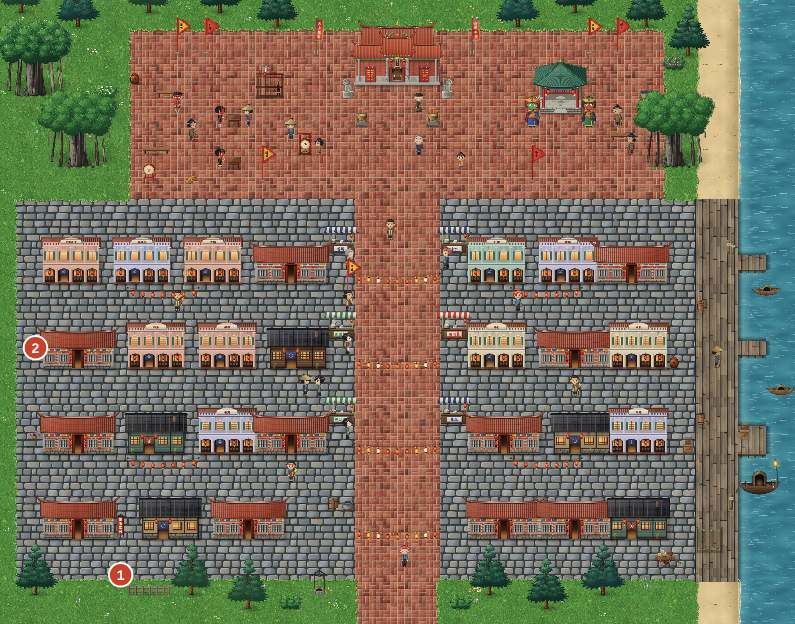

1. 開場後先逛北港。商店集中在中段的店街（花生、麻油行、香鋪、打鐵店、秀英姨的煎盤粿），見〈商店〉。
2. 到東邊**渡頭**和船夫**海生**（50,25）對話：媽祖生前後沒有船肯出海（8-1b）。渡頭邊的木箱（52,30）可以拿到**花生糖 ×3**。
3. 往北走向朝天宮，穿過廟前那條橫街（第 12~13 列）就會觸發 8-1c「八家將與神將」。
4. 這兩件事都做完後，和廟前的**添壽伯**（29,7）對話，選「我們準備好了」，進入起駕與鑽轎腳（8-2）。獲得**北港香火袋 ×3**（防睡眠、封印，運氣＋8），三人剛好一人一個。
5. 天黑，遶境隊伍出發。往南走到大街中段（23~32, 24~28）觸發逆潮（8-3a），先打一場街頭戰（溺屍兵 ×2＋潮怨），然後進入**北港溪口**。

#### 2. 北港溪口（逆潮之夜）→ 潮怨・百手

這是本章最重要的一段，**請先讀〈謎題與小遊戲〉的「潮位」說明**。

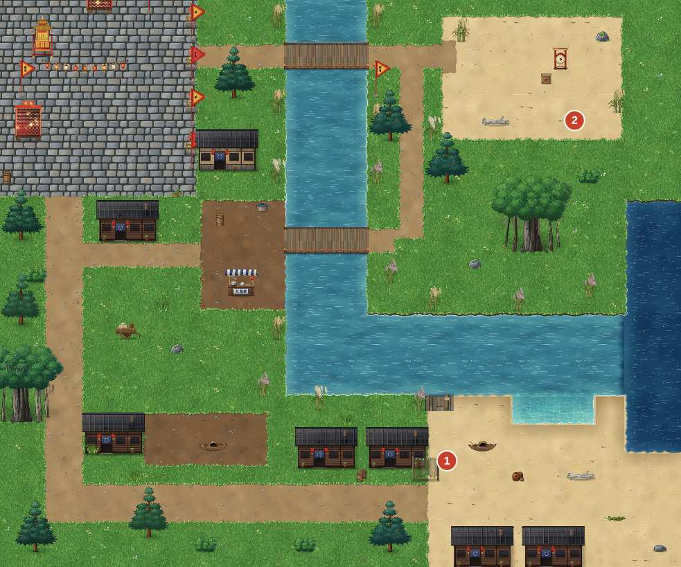

1. 西北角的街口是**安全區**，神轎停在這裡。**廟方的阿姨**（5,11）會請你喝平安茶，**全員 HP／MP 全滿**，次數不限。
2. 五名香客困在河邊，每救一個都要打一場。建議順序：
   1. **① 老阿伯**：北橋頭東側（26~31, 2~9）。
   2. **③ 阿添**：北橋過河後的沙洲（33~42, 1~7）。他一直在打鼓，這場敵人的速度會變慢。
   3. **④ 秀英姨**：河岸小巷（14~19, 18~21）。
   4. **⑤ 阿福**：救滿三人後自動出現，鏡頭帶你到河口灘地，直接開打。
   5. **② 還願的夫妻**：西岸路上翻倒的牛車旁（6~12, 21~27）。
3. 每救一人之前，先回安全區找阿姨補滿。
4. 五人都救出後，河口（44,34 一帶）出現**潮怨・百手**，打倒它結束逆潮之夜。
5. 天亮回到北港廟埕（8-3d）。救滿五人就會點亮**心燈「北港的香客」**並拿到**媽祖餅 ×5**。

#### 3. 北港（天亮）→ 安平

1. 有救出秀英姨的話，去她的攤子：免費送**煎盤粿 ×5**，之後煎盤粿永遠半價（65 文）。
2. 這時北港東北（49,0）可以回到北港溪口，拿昨晚沒空拿的寶箱。
3. 走到東邊渡頭（49~51, 22~26）觸發 8-3e：溺死者說安平的觀潮台上有人在點燈。
4. 從大街南端出口選「出發」，前往**安平**。

#### 4. 安平

1. 抵達後，先到西邊海邊找剖蚵的**蚵殼阿嬤**（8,21），接心燈支線（見〈心燈與支線〉）。**對話選項會決定能不能拿到心燈**。
2. 和廣場上的**長明宮弟子**（21,17）**對話兩次**，聽到觀潮台上的年輕劍客的傳聞。
3. 和廟前的**阿興伯**（27,10）對話，問出上觀潮台的方法。天色轉為黃昏。
4. 走到北邊城門洞（21,2），選「在這裡等到入夜」，進入**熱蘭遮舊城**。
5. 安平客棧一晚 90 文。進舊城前把裝備、藥品補齊。

#### 5. 熱蘭遮舊城（潮閘）→ 觀潮台

1. 舊城的水道被長明宮引進的潮水淹沒，要轉動三座水閘排水，解法見〈謎題與小遊戲〉。
2. 走進中庭時，長明宮衛認出紅纓，觸發一場戰鬥（長明宮衛 ×2＋潮怨）。
3. 入口與中庭各有一塊**潮信石**，可以**存檔**，也可以直接傳回安平補給。
4. 排完水後從北邊石階登上**觀潮台**，觸發長篇劇情與**洛青鋒**頭目戰。觀潮台**不能存檔**。

劇透警告：觀潮台上發生的事

觀潮台上站著幾十個全身濕透的「歸潮者」，其中一男一女穿著洛家的綢衫：紅纓的爹娘。青鋒相信爹娘已經回來了，要紅纓留下「團圓」。紅纓打贏了哥哥。

青鋒跪下之後，海上劈來一道黑色的雷，是夜玄的力量。青鋒張開雙臂擋在妹妹面前，就是紅纓在靈境裡看到的那個背影。洛家父母化成三點光，帶著上百個歸潮者往外飄，「往彼岸的方向」。紅纓把額頭貼在哥哥的額頭上。

紅纓得到**洛家劍譜**，奧義變成「洛家劍譜・青鋒」。天亮後，陳伯來到安平，帶一行人往南去找王船。

#### 6. 安平（天亮）

1. 有接蚵殼阿嬤支線的話，**一定要先去找她**，點亮心燈。
2. 和東邊的**陳伯**（39,17）對話選「出發」，進入第九章。和陳伯對話之後就不能回頭了。

### 心燈與支線

#### 心燈「北港的香客」（可錯過）

逆潮之夜在**潮位漲滿（8／8）之前**救出全部五名香客，天亮時點亮。獎勵：**媽祖餅 ×5**（全體回復 500 並解除一切異常）。

潮位滿了的話，八家將的陣頭會把剩下的人救回去，劇情照常進行，但**拿不到這盞心燈**。

#### 心燈「蚵殼阿嬤」（可錯過）

| 步驟 | 時機與地點 | 內容 |
|---|---|---|
| 1 | 抵達安平後，西邊海邊 (8,21) | 阿嬤說她的丈夫十年前出海，三天前自己走回來，卻一口粥也不吃。 |
| 2 | 同上，選項 | 選「**阿嬤，您不傻。**」→ 她拜託你們讓丈夫走。**選「他會想起來的。」就拿不到心燈。** |
| 3 | 觀潮台之後（天亮） | 再去找阿嬤。點亮**心燈「蚵殼阿嬤」**，獲得**虱目魚粥 ×5**。 |

選了另一個選項的話，天亮後只會拿到虱目魚粥 ×2。

#### 秀英姨的煎盤粿

逆潮之夜救出秀英姨（④），天亮後她會送**煎盤粿 ×5**，而且以後北港所有地方賣的煎盤粿都**半價**（130 → 65 文）。

### 寶箱與秘密

| 地圖 | # | 座標 (x, y) | 內容 | 備註 |
| --- | ---: | --- | --- | --- |
| 北港 | 1 | (8, 40) | 續命散 ×3＋1,500 文 |  |
| 北港 | 2 | (2, 24) | 進香布衫＋1,500 文 |  |
| 北港溪口 | 1 | (31, 32) | 還魂丹＋2,000 文 |  |
| 北港溪口 | 2 | (40, 8) | 驚濤槍 |  |
| 安平 | 1 | (6, 26) | 虱目魚粥 ×2＋1,000 文 |  |
| 安平 | 2 | (26, 8) | 劍獅護符＋1,000 文 |  |
| 熱蘭遮舊城 | 1 | (5, 25) | 還魂香 ×2 |  |
| 熱蘭遮舊城 | 2 | (36, 12) | 雷音扇 |  |
| 熱蘭遮舊城 | 3 | (20, 22) | 長明宮手記 | 開啟時有事件 |

座標以地圖左上角為 (0, 0)，向右為 x、向下為 y；「#」對應地圖圖片上的寶箱編號。

| 地圖 | 位置 | 內容 | 備註 |
|---|---|---|---|
| 北港 | 西南、客棧附近 (8,40) | 續命散 ×3＋1,500 文 | |
| 北港 | 西側小巷 (2,24) | **進香布衫**（防禦 36、抗水）＋1,500 文 | 百手戰前拿 |
| 北港溪口 | 南岸漁村 (31,32) | 還魂丹＋2,000 文 | 天亮後也能回來拿 |
| 北港溪口 | 沙洲東側 (40,8) | **驚濤槍**（紅纓專用，攻擊＋66） | 救阿添時順路 |
| 安平 | 西南海邊 (6,26) | 虱目魚粥 ×2＋1,000 文 | |
| 安平 | 北側廟旁 (26,8) | **劍獅護符**（免疫暈眩）＋1,000 文 | |
| 熱蘭遮舊城 | 西側小室 (5,25) | 還魂香 ×2 | |
| 熱蘭遮舊城 | 東塔殘基 (36,12) | **雷音扇**（雲歸專用，木屬性，法力＋72） | |
| 熱蘭遮舊城 | 中庭 (20,22) | 長明宮手記（關鍵道具，水閘提示） | |

**隱藏道具**

- 北港渡頭的木箱（52,30）：花生糖 ×3。
- 起駕時添壽伯給的**北港香火袋 ×3**。
- 百手掉落**潮心珠**（大幅減輕水屬性傷害）；第九、十章水屬性敵人很多，非常好用。
- 安平的劍獅（13,7）可以調查，阿興伯說牠們「在流汗」。

### 商店

**北港花生**

| 商品 | 類別 | 價格（文） | 效果／能力 |
| --- | --- | ---: | --- |
| 花生糖 | 道具 | 110 | 我方單體：真氣 +60 |
| 煎盤粿 | 道具 | 130 | 我方單體：生命 +450 |
| 碗粿 | 道具 | 150 | 我方單體：生命 +500 |

**麻油行**

| 商品 | 類別 | 價格（文） | 效果／能力 |
| --- | --- | ---: | --- |
| 麻油雞 | 道具 | 380 | 我方單體：生命 +1000，武力↑ 3 回合 |
| 鴨肉羹 | 道具 | 520 | 我方全體：生命 +500 |

**香鋪雜貨**

| 商品 | 類別 | 價格（文） | 效果／能力 |
| --- | --- | ---: | --- |
| 續命散 | 道具 | 120 | 我方單體：生命 +400 |
| 碗粿 | 道具 | 150 | 我方單體：生命 +500 |
| 煎盤粿 | 道具 | 130（依劇情變動） | 我方單體：生命 +450 |
| 花生糖 | 道具 | 110 | 我方單體：真氣 +60 |
| 麻油雞 | 道具 | 380 | 我方單體：生命 +1000，武力↑ 3 回合 |
| 鴨肉羹 | 道具 | 520 | 我方全體：生命 +500 |
| 愛玉 | 道具 | 200 | 我方單體：真氣 +100 |
| 還魂香 | 道具 | 150 | 倒下的同伴：復活（30% 生命） |
| 還魂丹 | 道具 | 700 | 倒下的同伴：復活（100% 生命） |
| 香包 | 道具 | 40 | 我方單體：解除沉睡・封印・定身・幻境 |
| 仙草 | 道具 | 70 | 我方單體：生命 +150，解除中毒・沉睡・封印・定身・幻境 |

**北港打鐵店**

| 商品 | 類別 | 價格（文） | 效果／能力 |
| --- | --- | ---: | --- |
| 流光劍 | 武器 | 1,500 | 武+62 運+2；武器屬性：火（星河） |
| 驚濤槍 | 武器 | 1,600 | 武+66 速+2（紅纓） |
| 雷音扇 | 武器 | 1,600 | 武+9 法+72 氣+20；武器屬性：木（雲歸） |
| 進香布衫 | 衣裝 | 1,250 | 防+36 運+2；抗水 |
| 進香斗笠 | 頭飾 | 700 | 防+16 速+4 |
| 綁紅線的草鞋 | 鞋履 | 700 | 防+12 速+7 運+4 |

**秀英的煎盤粿**

| 商品 | 類別 | 價格（文） | 效果／能力 |
| --- | --- | ---: | --- |
| 煎盤粿 | 道具 | 130（依劇情變動） | 我方單體：生命 +450 |

**安平小吃與雜貨**

| 商品 | 類別 | 價格（文） | 效果／能力 |
| --- | --- | ---: | --- |
| 安平蝦捲 | 道具 | 600 | 我方全體：生命 +600 |
| 豆花 | 道具 | 110 | 我方單體：生命 +300，解除中毒・沉睡・封印・定身・幻境 |
| 虱目魚粥 | 道具 | 260 | 我方全體：生命 +300 |
| 續命散 | 道具 | 120 | 我方單體：生命 +400 |
| 愛玉 | 道具 | 200 | 我方單體：真氣 +100 |
| 還魂丹 | 道具 | 700 | 倒下的同伴：復活（100% 生命） |
| 劍獅護符 | 佩飾 | 1,500 | 防+10 武+4；免疫定身 |
| 海風披風 | 衣裝 | 1,300 | 防+37 速+4 |

| 商店 | 地點 | 商品 |
|---|---|---|
| 北港花生（花生阿嬸） | 北港店街 (4,19) | 花生糖 110、煎盤粿 130、碗粿 150 |
| 麻油行 | 北港店街 (9,19) | 麻油雞 380、鴨肉羹 520 |
| 香鋪雜貨 | 北港店街 (14,19) | 續命散 120、碗粿 150、煎盤粿 130、花生糖 110、麻油雞 380、鴨肉羹 520、愛玉 200、還魂香 150、還魂丹 700、香包 40、仙草 70 |
| 北港打鐵店 | 北港 (34,19) | 流光劍 1,500、驚濤槍 1,600、雷音扇 1,600、進香布衫 1,250、進香斗笠 700、綁紅線的草鞋 700 |
| 秀英的煎盤粿 | 北港 (24,24) | 煎盤粿 130（救出秀英姨後 65） |
| 安平小吃與雜貨 | 安平 | 安平蝦捲 600、豆花 110、虱目魚粥 260、續命散 120、愛玉 200、還魂丹 700、劍獅護符 1,500、海風披風 1,300 |
| 進香客棧／安平客棧 | 北港／安平 | 住宿 80／90 文 |

**採購建議**

- **北港打鐵店（百手前）**：星河**流光劍**（火屬性）、雲歸**雷音扇**、三人各一件**進香布衫**（抗水，百手和溺死者全是水屬性）、**進香斗笠**、**綁紅線的草鞋**。這是 BALANCE 為百手假設的整套。驚濤槍會在溪口沙洲的寶箱裡拿到，雷音扇也會在熱蘭遮舊城拿到，預算緊的話這兩把可以等。
- 但百手是本章的難關（BALANCE 記錄過它「卡住」只跟主線走的玩家），**防具一定要先買齊**。
- **藥品**：北港的鴨肉羹（全體 500）、麻油雞（單體 1000＋攻擊上升）、愛玉（MP 100）是主力；救香客時有阿姨免費補滿，所以藥留給百手。
- **安平（青鋒前）**：**海風披風**（防禦 37、身法＋4）比進香布衫硬一點；青鋒是金屬性，不需要抗水，可以換上。安平蝦捲（全體 600）是本章最好的全體回復。

### 謎題與小遊戲

#### 潮位（北港溪口・逆潮之夜）

- 救援開始後，畫面會顯示**潮位（0／8）**。**每打完一場戰鬥（贏或逃都算）潮位＋1**。
- 潮位 **3**：河岸小巷（14~19, 14~21）和河彎小巷（10~18, 29~32）淹成淺水，走路變慢。
- 潮位 **5**：**南橋**淹沒，只能繞北橋過河。
- 潮位 **7**：兩條小巷整片沒入水中，不能走。
- 潮位 **8**，或剩下的香客已經走不到：八家將救回其他人，救援失敗。

救五個人本身就要打五場，所以只有 **3 場的餘裕**。地圖上另有三組會追人的溺死者（西岸 4,28、東北 34,13、南岸 26,35），**全部閃開**：一碰到就會用掉一格潮位。

**建議路線**（與測試的通關路線相同）：①北橋頭老阿伯 → ③沙洲阿添 → ④河岸小巷秀英姨 →（⑤阿福自動出現並開打）→ ②西岸夫妻。這樣全部救完時潮位只有 5，小巷也還沒淹。每場之間回安全區讓阿姨補滿，喝茶不會增加潮位。

#### 熱蘭遮舊城・潮閘

三座水閘控制三條水道：

| 水閘 | 位置 | 控制 |
|---|---|---|
| 南閘 A | 入口廣場 (18,36)、中庭 (18,28)（兩座是同一個閘） | 開：水道一（入口→中庭）乾 |
| 中閘 B | 中庭 (25,18) | 開：水道二（中庭→東塔）乾 |
| 東閘 C | 東塔殘基 (37,10) | 開，**而且南閘關著**：水道三（中庭→觀潮台石階）乾 |

中庭寶箱的**長明宮手記**寫著提示：「東閘開，則北道通。唯南閘須閉——前路既開，退路自斷。」

**解答**

1. 在入口廣場轉動**南閘 A**（開）→ 水道一乾了，往北進中庭（觸發長明宮衛戰）。
2. 在中庭轉動**中閘 B**（開）→ 往東走到東塔。
3. 在東塔轉動**東閘 C**（開），順便拿雷音扇。
4. 回到中庭，轉動中庭那座**南閘 A**（關）→ 水道三乾了（水道一重新淹水，退路斷了）。
5. 從水道三往北，石階通往觀潮台。

要回安平的話，用中庭的潮信石直接傳送即可。

### 頭目戰

> 圖表：第八章　逆潮・頭目 HP——普通難度的最大生命（劇情難度 ×0.8、困難 ×1.3）。深淺交替區分章節；同場的小怪與召喚物不計。（圖表只在 HTML 版顯示；數據如下）

| 章 | 頭目 | Lv | HP |
| --- | --- | ---: | ---: |
| 第八章 | 潮怨・百手 | 28 | 8,370 |
| 第八章 | 洛青鋒 | 30 | 8,653 |

| 頭目 | Lv | HP | 屬性 | 弱點 ×1.5 | 抗性 ×0.5 | 招式 | 階段 | 同場敵人 | 經驗 / 錢 | 類型 |
| --- | ---: | ---: | :---: | --- | --- | --- | --- | --- | ---: | --- |
| 潮怨・百手 | 28 | 8,370 | 水 | 土 | 水 | 千手拖拽（水）、怨潮（水）、潮怨、溺魂召喚 | 50%、30% | — | 2,619 / 3,500 | 頭目 |
| 洛青鋒 | 30 | 8,653 | 金 | 火 | — | 洛家劍・青鋒（金）、鬼面七殺（金）、洛家劍・斷潮（金）、槍尖，太低了（金）、洛水迴瀾、逆潮劍（水） | 50% | 潮引燈芯×2 | 5,013 / 3,497 | 頭目 |

#### 潮怨・百手（北港溪口・河口）

| 項目 | 內容 |
|---|---|
| 等級／HP | Lv28／8,370 |
| 屬性 | 水；抗水；五行上**怕土**（雲歸的土符） |
| 推薦 | Lv28（BALANCE 模擬勝率 89%，平均 18 回合的長期戰）；北港打鐵店整套、進香布衫（抗水） |

**招式**

- **千手拖拽**：全體水屬性物理，35% 機率降身法。
- **怨潮**：全體水屬性術法，威力 1.0。
- **潮怨**：單體術法，60% 降身法。
- **溺魂召喚**：第 3 回合以後，叫出水鬼。
- **HP 50%**：百手開始說話（「有人在點燈叫我們……」），沒有額外變化。
- **HP 30%**：縮回漩渦，獲得**持續回復 3 回合**。

**打法**

1. 這場是消耗戰。開場紅纓**蓄勢**，雲歸**迷魂扇**（降物理攻擊，對千手拖拽有效），星河補**護燈訣**。
2. 主力是雲歸的**土符**（剋水）。紅纓**破甲**後用**回馬槍**；星河的火屬性對水是被剋的，改用**劍氣縱橫**順便清水鬼，或專心當補師。
3. 水鬼一出來就用全體技收掉，不要讓它們疊上來。
4. 回復：雲歸**回春符**、星河**心火・燃燈**（全體回復＋持續回復），全體受傷就吃鴨肉羹。
5. 30% 它開始回血時，把劍意大招、**雷霆槍陣**（紅纓＋雲歸合擊，木屬性、可能暈眩）一口氣砸下去，別讓它回太多。

掉落**潮心珠**。

#### 洛青鋒（觀潮台）

| 項目 | 內容 |
|---|---|
| 等級／HP | Lv30／8,653；附帶潮引燈芯 ×2（各 2,055） |
| 屬性 | 金；五行上**怕火**（星河！） |
| 燈芯 | 水屬性，**弱火**、抗水 |
| 推薦 | Lv29（BALANCE 模擬勝率 91%）；劍獅護符或金剛護符（防暈眩）、海風披風 |
| 結果 | 青鋒 HP 歸零時會**跪下**，戰鬥結束（不會死在你手上） |

**招式**

- **洛家劍・青鋒**：單體金屬性物理，威力 1.75。
- **鬼面七殺**：隨機 7 連擊。**HP 50% 後使用頻率變高**。
- **洛家劍・斷潮**：全體金屬性物理。
- **槍尖，太低了**：一定先打**紅纓**，80% 降防。
- **洛水迴瀾**：自身攻擊、防禦各＋30%，2 回合。
- **逆潮劍**：全體水屬性術法。
- 潮引燈芯：**潮引**（替青鋒加攻擊）、**逆浪**（全體水屬性術法）。**每有一盞燈芯活著，青鋒每回合回復 1.5% HP**。

**特殊規則**

- 青鋒 HP **25% 以下**時會「**猶豫**」：第一次必定跳過行動（「……手腕……不要僵……」），之後每回合 40% 機率跳過。
- 青鋒 HP 25% 以下時，**紅纓對他的攻擊必定爆擊**。

**打法**

1. 第 1~2 回合：先把**兩盞燈芯**打掉。星河**焚天劍氣**、**心火・照夜**（全體火屬性），燈芯弱火、青鋒怕火，一招兩得。雲歸**火符**／合擊**符火燎原**。
2. 燈芯滅了之後集中青鋒：星河**星墜劍**、**心火・照夜**；雲歸**迷魂扇**降他的攻擊。
3. 「槍尖，太低了」一定打紅纓，被降防就用媽祖餅或清心苔解除；紅纓 HP 低於三成時，她的被動「放手」會自動提高防禦。
4. 看到**洛水迴瀾**，那兩回合改成防禦、補血，等增益過去。
5. 壓到 25% 以下時，**讓紅纓出手收尾**：必定爆擊，劍意大招也留給她。
6. 有人倒下，用**心火・不滅**或還魂丹拉起來。

### 小技巧

- **溪口的潮位只看戰鬥次數**，不看時間。慢慢走、回安全區喝茶都不會漲潮，放心補滿。
- 救香客時**不要碰巡邏的溺死者**，牠們走得比你慢一點，繞開就好。
- **阿福**會在救滿三人後才出現，所以別急著找他。
- 北港溪口的兩個寶箱，天亮後從北港東北角可以回去拿，不必在潮水裡冒險。
- **蚵殼阿嬤選「阿嬤，您不傻。」**，否則拿不到心燈。
- 熱蘭遮舊城裡兩塊潮信石都能存檔，觀潮台本身不能存，打青鋒前在中庭存一次。
- 天亮後**先找蚵殼阿嬤，再找陳伯**。
- 洛家劍譜讓紅纓的奧義變成「洛家劍譜・青鋒」，第九章以後是她的主力大招。

#### 心燈檢查表（第八章）

| 心燈 | 取得方式 | 可錯過 |
|---|---|---|
| 北港的香客 | 逆潮之夜潮位滿前救出五人 | **是** |
| 蚵殼阿嬤 | 安平，選「阿嬤，您不傻。」，觀潮台後回報 | **是**（選錯或在找陳伯前沒回報） |

真結局需要 **14 盞**心燈。到本章結束時最多可累積 19 盞。

## 第九章　王船南行

> 圖表：第九章　王船南行・路線——本章走過的地點：打狗 → 東港 → 恆春 → 鵝鑾鼻。（圖表只在 HTML 版顯示）

### 概要

只有王船能渡黑水溝。陳伯帶著三人南下打狗、東港，向千歲爺借王船；千歲爺允了，但條件是「先繞島巡境」。王船出港後一路往南，穿過恆春的落山風，把鵝鑾鼻燈塔的火點上船頭。

| 項目 | 內容 |
|---|---|
| 推薦等級 | Lv30 → Lv34（大肚貪鬼 Lv31、瘟鬼頭 Lv32、落山風靈 Lv33、潮病鰻王 Lv34） |
| 隊伍 | 沈星河、洛紅纓、雲歸；**陳伯**以非戰鬥同行者身分跟著（在城鎮裡會跟在後面，王船上掌舵） |
| 主要地圖 | 旗後、旗後天后宮、半屏山下／半屏山腹、東港、東隆宮、王船廠、王船甲板、恆春、東門城牆、龍磐風原、鵝鑾鼻、燈塔、龍坑 |
| 心燈 | 3 盞（半屏山湯圓、月琴伯的名字、燈塔守的家書，**三盞都可錯過**） |
| 七仙蕈 | **潮汐蕈**（龍坑，正路旁，不需靈視） |

> 本章畫面上會出現「距關鬼門　N 日」的倒數。這是故事的時間軸，**只會在劇情事件時減少**，不會因為你在地圖上閒逛、練功而減少，可以安心做支線。

> 王船、千歲爺（王爺）在本作中從不成為敵人。擲筊的結果都是劇情安排好的，按 Z 擲即可。

### 流程

#### 1. 旗後（打狗）

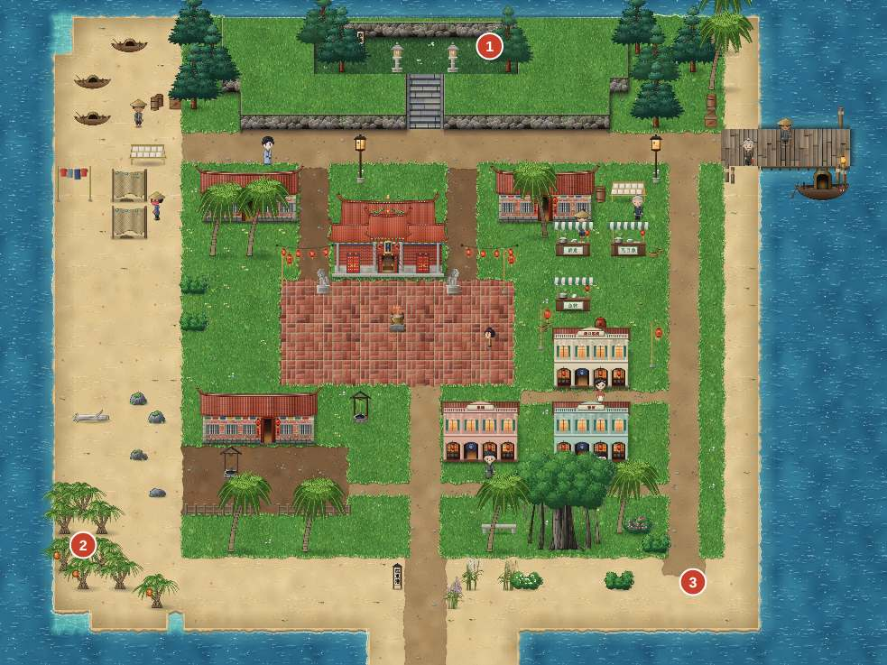

1. 抵達旗後後，先走進**旗後天后宮**（20,14），觸發 C9-02。出廟時天色入夜。
2. 走到西側海灘（3~9, 12~21），觸發**夜灘**：連打兩場（溺魂、海霧魂、海鰻），然後是營火邊的對話。紅纓問「人死了，是不是真的什麼都會忘記？」，兩個選項都只影響對話：
   - 「他不會忘。」
   - 「就算他忘了，妳也還記得。」
3. 天亮後，鎮上的商店開門了（見〈商店〉）。這時可以先做**半屏山湯圓**支線（見〈心燈與支線〉）。
4. 從南邊出口（20~27, 35）出發往東港。選「沿路巡一巡」會多打兩場（經驗與金錢），選「趕路」直接到。

#### 2. 東港 → 東隆宮（擲筊）

1. 抵達東港。**先到廟埕的天公爐（23,8）上香**，否則拜拜阿嬤會攔住你，不讓你直接進殿。
2. 走進**東隆宮**（23,5），向千歲爺擲筊借王船。這段的結果是固定的：
   - 第一個選項選「千歲爺，借我王船！拜託！」會得到**笑筊**（千歲爺笑你沒講清楚），選「好好稟報」則直接進入正式稟報。
   - 正式稟報：聖筊、聖筊、**陰筊**。
   - 接著問「是要我們添香油錢嗎？」→ 陰筊；問「是要我們先做什麼事嗎？」→ 聖筊。
   - 最後稟報「先繞全島巡境」→ **三聖筊**。
3. 獲得**千歲爺令旗**與**巡境圖**（標著六個巡境點：東港、鵝鑾鼻、蘭嶼、台東、太魯閣、頭城）。

#### 3. 王船廠（夜）→ 瘟鬼頭

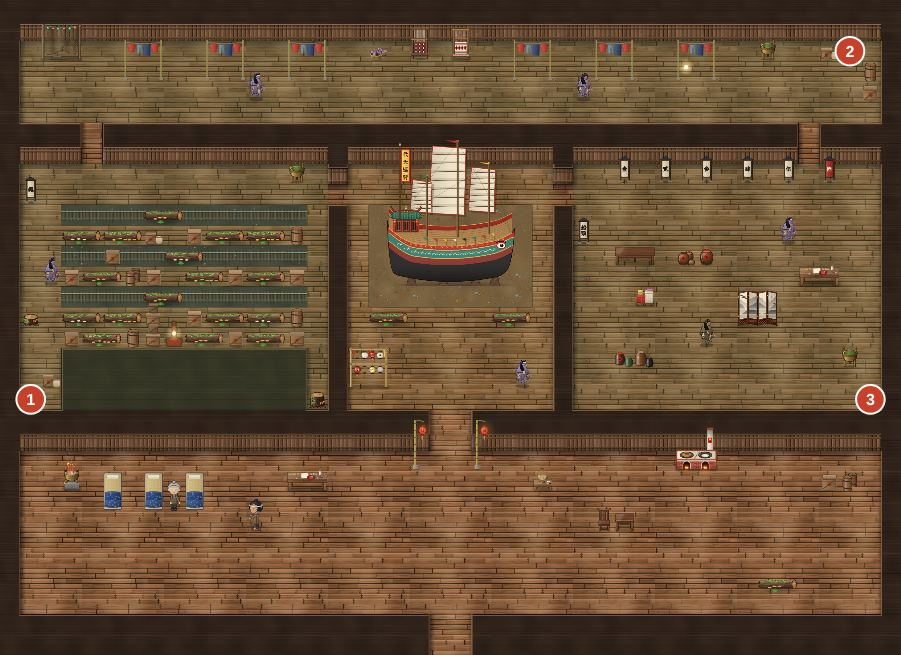

1. 從東港東側（46,9）進王船廠。工寮裡的阿杉師說：瘟鬼把舵拖去**木料場**、帆扯去**帆布坊**、龍目藏在**彩繪間**。學徒給你**艾草束**。
2. 三個區域都有綠色瘴氣，把艾草束丟進該區的火盆就會散：木料場 (14,8)、帆布坊 (37,2)、彩繪間 (41,17)。艾草用完了可以再跟學徒拿。
3. 依序取回三件東西（解法見〈謎題與小遊戲〉）：
   - **王船舵**：木料場，推開鐵軌上的三台推車。
   - **王船帆**：帆布坊 (33,3)，直接調查。
   - **龍目**：彩繪間的六面龍目板，只有兩面是對的。
4. 三件到齊後回到中央船台（18~25, 16~17），**瘟鬼頭**頭目戰。
5. 打完後王船出港（C9-08），獲得**巡境號衣 ×3**（防禦 40、免疫中毒）。巡境地圖點亮第一個點：東港。

#### 4. 王船甲板（移動據點）

從這裡開始，**王船甲板是本章的中樞**：

- 船艙口（9,6）「休息」：免費全員回復。上船時會**自動存檔**。
- 和船尾的**陳伯**對話選目的地：旗後、東港、南灣（恆春）、鵝鑾鼻，之後還有「出航・往東」。
- 甲板下方（12,10）上岸。

選「往南（繞過南岬）」：南岬逆風過不去（C9-09），船只能先泊在南灣，一行人進恆春城。

#### 5. 恆春 → 龍磐風原 → 落山風靈

1. **恆春**風沙很大。先和城南的**潘家阿嬸**（18,32）說話（她想不起丈夫的名字），再去找彈月琴的**阿順伯**（33,9）。
2. 跟阿順伯上**東門城牆**（42,4），觸發 C9-11：七個出海沒回來的人的名字被落山風吹走了。支線「被風偷走的七個名字」開始，東門打開。
3. 城內客棧一晚 100 文。恆春武具行有本章的好防具，打落山風靈前務必看一下。
4. 從東門（37,1）出城到**龍磐風原**。風原上有陣風、滲穴和沙橋，走法見〈謎題與小遊戲〉。
5. 走到台地北緣（14~31, 7）觸發**落山風靈**頭目戰。
6. 風停之後，回恆春找剩下的名字，再上東門城牆，點亮心燈「月琴伯的名字」。拿到**渡魂謠殘篇・恆春**與**月琴弦護符**，城牆頂的寶箱（2,000 文）也能打開了。
7. 從南門外的南灣（23~25, 41）回到王船。

#### 6. 鵝鑾鼻 → 龍坑 → 潮病鰻王

1. 讓陳伯開到**鵝鑾鼻**，上岸遇見燈塔守的魂**湯姆**，拿到**燈塔之火**（裝在防風燈裡）。湯姆的倉庫也能買東西。
2. 燈塔可以進去參觀（1F 起居間、樓上燈室）。
3. 從燈塔東南的洞口（34,25）進**龍坑**。洞裡要一路護著防風燈的火，見〈謎題與小遊戲〉。
4. 途中撿齊三張**燈塔日誌殘頁**、在中央珊瑚礁吃到**潮汐蕈**。
5. 走到南端海蝕拱門（16~27, 38），**潮病鰻王**頭目戰。
6. 打完後星河把燈塔之火點上王船的船頭燈；撿齊三張日誌的話，會自動回到燈室，送湯姆回家，點亮心燈「燈塔守的家書」。

劇透警告：燈塔守湯姆

湯姆是英國來的燈塔守，早就是魂了。他的日誌殘頁寫著故鄉 Whitby，和每天晚上在窗口點蠟燭、等父親回家的母親。他燒了母親的信讓燈一直亮著。最後他把燈交給學徒阿目：「燈不是燒自己。燈是……留下來。」也託星河帶話給白芷：「不用燒掉自己。分出去就好。」

#### 7. 出航・往東

回到甲板和陳伯對話選「出航・往東」，再確認「**出航（之後將無法再回到南部海域）**」，進入第十章。**本章所有支線都要在這之前完成。**

### 心燈與支線

#### 心燈「半屏山湯圓」（可錯過）

| 步驟 | 時機與地點 | 內容 |
|---|---|---|
| 1 | 夜灘之後，旗後 (15,25) | 和小女孩**阿秀**對話：她的阿公、旗後首富金萬，為了「兩碗不用錢」的湯圓去了半屏山就沒回來。 |
| 2 | 旗後渡頭 | 和船夫**阿水**對話，選「到哨船頭（往半屏山）」。 |
| 3 | 半屏山下 | 大榕樹下的**仙翁**（16,10）賣湯圓：選「**付一文錢，買一碗**」。 |
| 4 | 半屏山腹 | 三間藏寶室各**只拿一箱**，在供盤門放一樣東西，見〈謎題與小遊戲〉。 |
| 5 | 山腹最深處 | **大肚貪鬼**頭目戰，之後金萬的選擇題（兩個都可以）。點亮心燈。 |
| 6 | 回到旗後 | 金萬打開水窟仔分水給鄰居，送你 **1,000 文**。 |

- 仙翁的選項：
  - 「付一文錢，買一碗」：之後會多拿到**仙翁湯圓**（全體 HP／MP 全滿）。**推薦**。
  - 「拿兩碗（不用錢）」：雲歸吃到一嘴泥巴，沒有獎勵。
  - 「不吃」：沒有獎勵。
- 打完大肚貪鬼必定得到**仙翁的銅錢**（運氣＋12，戰鬥金錢增加）。
- 金萬的選項（「給金萬一文錢」或「告訴他『把水窟仔打開』」）只影響對話。
- 錯過條件：選「出航・往東」之後。

#### 心燈「月琴伯的名字」（可錯過）

找回被落山風吹走的**七個名字**，回東門城牆給阿順伯。

| 名字 | 取得方式 |
|---|---|
| ① 陳水生、② 黃阿九、③ 李順德 | 落山風靈戰中分裂出的三個風團，各帶一個名字，打倒即可 |
| ④ 王木 | 落山風靈戰後自動取得 |
| ⑤ 潘金水 | 風停之後和**潘家阿嬸**對話（她會在南門外的海邊） |
| ⑥ 林添福 | 風停之後調查恆春城內**阿福仔家門口的舊槳**（34,25） |
| ⑦ 阿財仔 | 龍磐風原東側沙溝對岸 (43,18)。風停前趁陣風時走沙橋；風停後用**月琴弦護符**在 (37,18)「撥弦」 |

- 七個都到齊後走上東門城牆，阿順伯唱完〈思想起〉，點亮心燈。
- 不到七個也可以先上城牆：故事會照常進行，拿到殘篇與護符，但**沒有心燈**。之後補齊再找城牆上的阿順伯說話，就能補拿心燈。
- 錯過條件：選「出航・往東」之後。

#### 心燈「燈塔守的家書」（可錯過）

龍坑三個側洞裡的**燈塔日誌殘頁**：(5,5)、(39,18)、(40,30)。

- 撿齊三張再打鰻王，戰後會自動回到燈室交給湯姆。
- 沒撿齊的話，陳伯會提醒「還可以回鵝鑾鼻，把日誌殘頁交給湯先生」。補齊後上燈室找湯姆對話即可。
- 交日誌時的選項（「你已經在了很久了。」／「現在有人可以接你的班了。」）只影響對話。
- 獎勵：心燈、**湯姆的望遠鏡**（運氣＋10、身法＋6）。

#### 雲歸的蕈譜：潮汐蕈

龍坑中央珊瑚礁上的積水小坑（23,19），就在正路旁邊，調查即可，**不需要靈視**。麻糬會先停在那裡。這是補齊七仙蕈的重要一格（第三到第七章若有漏掉，這一格能讓第十一章的玄武蕈湊滿七種）。

### 寶箱與秘密

| 地圖 | # | 座標 (x, y) | 內容 | 備註 |
| --- | ---: | --- | --- | --- |
| 旗後 | 1 | (26, 2) | 仙草凍 ×3 |  |
| 旗後 | 2 | (4, 29) | 虱目魚粥 ×2 |  |
| 旗後 | 3 | (37, 31) | 600 文 |  |
| 東港 | 1 | (13, 7) | 雙糕潤 ×2 |  |
| 東港 | 2 | (53, 10) | 鐵釘符 |  |
| 東港 | 3 | (36, 17) | 800 文 |  |
| 王船廠 | 1 | (1, 19) | 巡海劍 |  |
| 王船廠 | 2 | (41, 2) | 艾草束 | 開啟時有事件 |
| 王船廠 | 3 | (42, 19) | 金紙護符 |  |
| 恆春 | 1 | (31, 14) | 港口茶 ×3 |  |
| 恆春 | 2 | (38, 29) | 恆春斗笠 |  |
| 東門城牆 | 1 | (22, 4) | 2,000 文 | 依劇情出現 |
| 龍磐風原 | 1 | (1, 31) | 落山風石 |  |
| 龍磐風原 | 2 | (1, 32) | 綠豆蒜 ×2 |  |
| 龍磐風原 | 3 | (34, 26) | 鹿角護腕 |  |
| 龍坑 | 1 | (27, 3) | 還魂香 ×2 |  |
| 龍坑 | 2 | (8, 21) | 潮音符 |  |
| 龍坑 | 3 | (9, 36) | 百草膏 ×2 |  |
| 龍坑 | 4 | (34, 37) | 珊瑚簪 |  |

座標以地圖左上角為 (0, 0)，向右為 x、向下為 y；「#」對應地圖圖片上的寶箱編號。

| 地圖 | 位置 | 內容 | 備註 |
|---|---|---|---|
| 旗後 | 北側小丘 (26,2) | 仙草凍 ×3 | |
| 旗後 | 西南林投叢 (4,29) | 虱目魚粥 ×2 | |
| 旗後 | 東南小巷 (37,31) | 600 文 | |
| 東港 | 市場 (13,7) | 雙糕潤 ×2 | |
| 東港 | 東北船廠外 (53,10) | 鐵釘符（敵一體 700 土屬性傷害） | 鰻王戰很好用 |
| 東港 | 榕樹下 (36,17) | 800 文 | |
| 王船廠 | 木料場西側 (1,19) | **巡海劍**（星河專用，火屬性，攻擊＋78） | |
| 王船廠 | 帆布坊閣樓 (41,2) | 艾草束＋虱目魚粥 ×3 | |
| 王船廠 | 彩繪間東側 (42,19) | 金紙護符（免疫中毒） | |
| 恆春 | 土地公廟 (31,14) | 港口茶 ×3 | |
| 恆春 | 曬衣場 (38,29) | **恆春斗笠**（抗木） | 落山風靈前拿 |
| 東門城牆 | 城牆東端 (22,4) | 2,000 文 | 落山風靈之後 |
| 龍磐風原 | 西側 (1,31) | 落山風石 | |
| 龍磐風原 | 西側 (1,32) | 綠豆蒜 ×2 | |
| 龍磐風原 | 東南 (34,26) | 鹿角護腕 | |
| 龍坑 | 入口東側 (27,3) | 還魂香 ×2 | |
| 龍坑 | 西側礁台 (8,21) | **潮音符**（雲歸專用，水屬性，法力＋84） | |
| 龍坑 | 西南 (9,36) | 百草膏 ×2 | |
| 龍坑 | 東南 (34,37) | 珊瑚簪 | |

**半屏山腹的寶物**（三間藏寶室，每間只能拿一箱，見〈謎題與小遊戲〉）

| 房間 | 三個寶箱（由左到右） |
|---|---|
| 西室 (5/7/9, 10) | 貪狼護符（攻擊＋14、防禦−6）／還魂香 ×2／1,500 文 |
| 中室 (15/17/23, 19) | 半屏石（素材）／蚵仔煎 ×3／**山泥甲**（防禦 40、抗土） |
| 東室 (30/32/34, 10) | 金縷頭巾／百草膏 ×2／仙草凍 ×5 |

推薦：西室 1,500 文、中室**山泥甲**（大肚貪鬼是土屬性）、東室金縷頭巾。

**其他**

- 頭目掉落：大肚貪鬼→半屏石、瘟鬼頭→百草膏、落山風靈→落山風石＋**風骨簪**（頭飾，法力＋12、身法＋5）、鰻王→鰻王鱗。
- 大肚貪鬼「吞食」吞掉的道具，打贏後會全部還你。

### 商店

**旗後雜貨**

| 商品 | 類別 | 價格（文） | 效果／能力 |
| --- | --- | ---: | --- |
| 虱目魚粥 | 道具 | 260 | 我方全體：生命 +300 |
| 仙草凍 | 道具 | 160 | 我方單體：真氣 +80 |
| 蚵仔煎 | 道具 | 110 | 我方單體：生命 +350 |
| 艾草束 | 道具 | 60 | 我方全體：解除中毒 |
| 還魂香 | 道具 | 150 | 倒下的同伴：復活（30% 生命） |

**旗後藥鋪**

| 商品 | 類別 | 價格（文） | 效果／能力 |
| --- | --- | ---: | --- |
| 解毒散 | 道具 | 50 | 我方單體：解除中毒 |
| 清心丹 | 道具 | 80 | 我方單體：解除封印・沉睡 |
| 百草膏 | 道具 | 220 | 我方單體：解除中毒・沉睡・封印・定身・幻境・武力↓・防禦↓・法力↓・身法↓ |
| 鹿茸酒 | 道具 | 300 | 我方單體：武力↑ 3 回合 |

**雙糕潤**

| 商品 | 類別 | 價格（文） | 效果／能力 |
| --- | --- | ---: | --- |
| 雙糕潤 | 道具 | 220 | 我方單體：真氣 +120 |
| 虱目魚粥 | 道具 | 260 | 我方全體：生命 +300 |
| 旗魚丸湯 | 道具 | 300 | 我方單體：生命 +900 |
| 櫻花蝦餅 | 道具 | 600 | 我方全體：生命 +600 |

**東港雜貨**

| 商品 | 類別 | 價格（文） | 效果／能力 |
| --- | --- | ---: | --- |
| 虱目魚粥 | 道具 | 260 | 我方全體：生命 +300 |
| 仙草凍 | 道具 | 160 | 我方單體：真氣 +80 |
| 蚵仔煎 | 道具 | 110 | 我方單體：生命 +350 |
| 艾草束 | 道具 | 60 | 我方全體：解除中毒 |
| 還魂香 | 道具 | 150 | 倒下的同伴：復活（30% 生命） |
| 驅瘟符 | 道具 | 150 | 敵單體：金屬性傷害 900 |

**阿鐵打鐵店**

| 商品 | 類別 | 價格（文） | 效果／能力 |
| --- | --- | ---: | --- |
| 破浪槍 | 武器 | 2,150 | 武+80 速+4（紅纓） |
| 鐵骨劍 | 武器 | 1,700 | 武+70（星河） |
| 魚鱗甲 | 衣裝 | 1,400 | 防+37 |
| 包鐵綁腿 | 鞋履 | 760 | 防+13 速+5 |

**港口茶攤**

| 商品 | 類別 | 價格（文） | 效果／能力 |
| --- | --- | ---: | --- |
| 港口茶 | 道具 | 150 | 我方單體：解除中毒・沉睡・封印・定身・幻境・武力↓・防禦↓・法力↓・身法↓ |
| 綠豆蒜 | 道具 | 380 | 我方全體：生命 +500 |
| 港口茶葉罐 | 道具 | 500 | 我方全體：真氣 +150（僅限野外） |

**恆春雜貨**

| 商品 | 類別 | 價格（文） | 效果／能力 |
| --- | --- | ---: | --- |
| 虱目魚粥 | 道具 | 260 | 我方全體：生命 +300 |
| 仙草凍 | 道具 | 160 | 我方單體：真氣 +80 |
| 還魂香 | 道具 | 150 | 倒下的同伴：復活（30% 生命） |
| 蚵仔煎 | 道具 | 110 | 我方單體：生命 +350 |
| 煙燻飛魚 | 道具 | 520 | 我方全體：生命 +700 |

**恆春武具**

| 商品 | 類別 | 價格（文） | 效果／能力 |
| --- | --- | ---: | --- |
| 海風符扇 | 武器 | 1,800 | 武+10 法+79 氣+24（雲歸） |
| 恆春斗笠 | 頭飾 | 800 | 防+16；抗木 |
| 牛皮護心 | 衣裝 | 1,550 | 防+39 命+30 |
| 海星墜 | 佩飾 | 1,400 | 防+8 命+60 運+4 |
| 月牙槍＊ | 武器 | 2,300 | 武+79 速+3（紅纓） |

＊ 只在特定時段或劇情進度後上架。

**湯姆的倉庫**

| 商品 | 類別 | 價格（文） | 效果／能力 |
| --- | --- | ---: | --- |
| 船用硬餅乾 | 道具 | 30 | 我方單體：生命 +300 |
| 燈油 | 道具 | 200 | 我方單體：真氣 +100 |
| 防水火柴 | 道具 | 120 | 敵全體：火屬性傷害 260 |

| 商店 | 地點 | 商品 |
|---|---|---|
| 旗後雜貨 | 旗後 (32,25) | 虱目魚粥 260、仙草凍 160、蚵仔煎 110、艾草束 60、還魂香 150 |
| 旗後藥鋪 | 旗後 (26,25) | 解毒散 50、清心丹 80、百草膏 220、鹿茸酒 300 |
| 雙糕潤 | 東港 (9,12) | 雙糕潤 220、虱目魚粥 260、旗魚丸湯 300、櫻花蝦餅 600 |
| 東港雜貨 | 東港 (13,19) | 虱目魚粥、仙草凍、蚵仔煎、艾草束、還魂香、驅瘟符 150 |
| 阿鐵打鐵店 | 東港 (49,19) | 破浪槍 2,150、鐵骨劍 1,700、魚鱗甲 1,400、包鐵綁腿 760 |
| 港口茶攤 | 恆春 (17,9) | 港口茶 150、綠豆蒜 380、港口茶葉罐 500 |
| 恆春雜貨 | 恆春 (9,18) | 虱目魚粥、仙草凍、還魂香、蚵仔煎、煙燻飛魚 520 |
| 恆春武具 | 恆春 (9,26) | 海風符扇 1,800、恆春斗笠 800、牛皮護心 1,550、海星墜 1,400；風停後加賣**月牙槍** 2,300 |
| 湯姆的倉庫 | 鵝鑾鼻（湯姆） | 船用硬餅乾 30、燈油 200、防水火柴 120 |
| 客棧 | 旗後／東港／恆春 | 80／90／100 文 |

**採購建議**

- **旗後（大肚貪鬼前）**：旗後沒有武器店，靠第八章的裝備就好。半屏山腹中室的**山泥甲**一定要拿。
- **東港（瘟鬼頭前）**：阿鐵打鐵店的**破浪槍、鐵骨劍、魚鱗甲**（三件）、**包鐵綁腿**。巡海劍在王船廠寶箱裡（比鐵骨劍強），星河可以省下這筆。另外買幾張**驅瘟符**（金屬性 900，瘟鬼的弱點）和艾草束。
- **恆春（落山風靈前）**：雲歸**海風符扇**、三人**牛皮護心**、**恆春斗笠**（抗木，落山風靈全是木屬性）。
- **恆春（鰻王前）**：風停後紅纓換**月牙槍**。BALANCE 為鰻王假設的就是這套。
- 全體回復推薦**櫻花蝦餅**（600）與**煙燻飛魚**（700）；**港口茶**／**百草膏**解除一切異常。

### 謎題與小遊戲

#### 半屏山腹（貪肚）

石刻寫著「一碗一文錢，兩碗不用錢」。這裡的規則就是「**不要貪**」：

- 三間藏寶室（西、中、東）各有三個寶箱。**每間只能拿一箱**。
- 拿了一箱之後，另外兩箱會發出金光（「再拿一個吧？反正不用錢」）。這時選「**不要**」。
- 選「打開」：寶箱裡伸出泥手，打一場伏擊戰（貪鬼 ×3），而且**這間房間拿到的東西會化成泥巴**，整間房的寶箱消失。
- 中室前有一道石門：「拿了，門才開。」可以拿一箱後通過，也可以選「不拿寶物，直接推門」。
- 最深處的**供盤門**（石盤在 22,6）：「給出去，才過得去。」從背包選一樣東西放上去就會開門。背包空空的話，回答一句「謝謝」也行。
- 開門後往北走，觸發大肚貪鬼戰。

#### 擲筊（東隆宮）

結果都是劇情固定的，詳見〈流程〉。按 Z 擲筊就好。

#### 王船廠

**木料場推車**：三台推車停在鐵軌上（第 10、12、14 列），擋住中間 x=8 的通道。推車只能沿著鐵軌左右推，站在推車旁、面向它調查就會推一格。

**解答**：

1. 第 10 列的推車：從左側往**右**推兩次。
2. 第 12 列的推車：從右側往**左**推兩次。
3. 第 14 列的推車：從左側往**右**推兩次。

三台都讓開後，沿 x=8 往南走到底，面向下方調查「取舵」（8,16）。推錯了可以拉西北角 (1,9) 的「重置繩」。

**龍目**：彩繪間牆上掛著六面龍目板（壹～陸，第 8 列 x=30~40），牆上的箭頭標著「船頭 →」。阿杉師提示：「龍目要成對……瞳仁朝前，看路，不往後看。」

| 板 | 位置 | 說明 | 對錯 |
|---|---|---|---|
| 壹 | (30,8) | 瞳仁朝船頭，「左龍目」 | **對** |
| 貳 | (32,8) | 瞳仁朝後 | 錯 |
| 參 | (34,8) | 瞳仁往上 | 錯 |
| 肆 | (36,8) | 瞳仁朝船頭，「右龍目」 | **對** |
| 伍 | (38,8) | 瞳仁往下 | 錯 |
| 陸 | (40,8) | 也寫「左龍目」，但**眼白裡有綠色血絲** | 錯（陷阱） |

**解答：取下「壹」和「肆」**。拿錯的板子會變成瘟鬼（瘟鬼 ×2 的伏擊戰），之後掛回牆上、已經選的那面也要重拿。

#### 龍磐風原

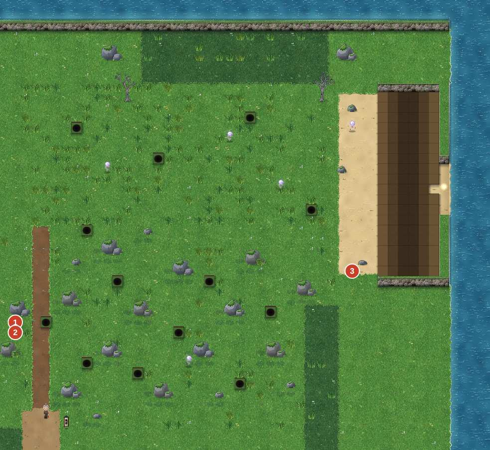

- **陣風**：每 7 秒一循環。畫面出現「**風要來了……**」之後約 1 秒就是「**陣風！**」，持續 3 秒，把隊伍往**左下**推。
- **躲風**：陣風時站在大石頭的**正下方**（石頭南側 1~2 格），就不會被吹走。
- **滲穴**：草原上的黑色坑洞，位置：(8,35)(13,36)(17,32)(4,31)(11,27)(20,27)(26,30)(8,22)(23,37)(15,15)(24,11)(7,12)(30,20)。踩到會掉下去，全員損失 5% HP 並回到入口。陣風把你吹進坑裡也會掉，所以**陣風前先躲到石頭後面**。
- 被吹進草叢會遇到伏擊戰。
- **沙橋**（往名字⑦）：東側沙溝 (37~42, 18) 平常過不去。陣風時沙會往坡上流，一格一格浮出沙橋，約 3 秒後再一格一格崩落。陣風一開始就從西端踏上去往東走。風停之後沙橋不會再出現，改用**月琴弦護符**在 (37,18)「撥弦」，叫出一次沙橋（約 6 秒）。

#### 龍坑（防風燈）

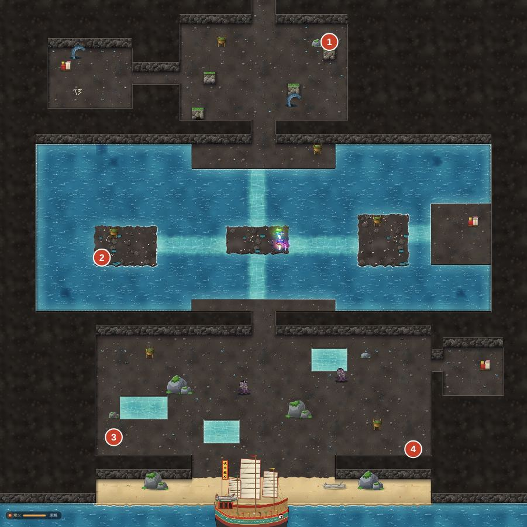

- 畫面左下有**燈火**量表（0~100），燈火越亮，照得越遠。
- 消耗：一般地面**每 2 步 −1**；淺水上**每步 −2**；**每場戰鬥 −10**；被潮水沖回 −15。
- **咾咕石火盆**：點燃後燈火回滿 100，之後可以再「取火」補滿。位置：(18,3)(26,12)(9,19)(31,18)(12,29)(31,35)。
- 燈火歸零：洞裡變暗，隊伍會被送回上一個點過的火盆，燈火回滿。
- **潮水通道**：中央幾條淺水道每 **10 秒漲退一次**（10 秒低潮可以走、10 秒高潮變成深水）。高潮時站在通道上會被浪沖回入口、燈火 −15。看到退潮再快步走過去。
- **鰻王戰會用到燈火**：進拱門前先在 (31,35) 的火盆把燈補滿。

### 頭目戰

> 圖表：第九章　王船南行・頭目 HP——普通難度的最大生命（劇情難度 ×0.8、困難 ×1.3）。深淺交替區分章節；同場的小怪與召喚物不計。（圖表只在 HTML 版顯示；數據如下）

| 章 | 頭目 | Lv | HP |
| --- | --- | ---: | ---: |
| 第九章 | 大肚貪鬼 | 31 | 9,293 |
| 第九章 | 瘟鬼頭 | 31 | 10,162 |
| 第九章 | 落山風靈 | 32 | 7,789 |
| 第九章 | 潮病鰻王 | 33 | 9,907 |

| 頭目 | Lv | HP | 屬性 | 弱點 ×1.5 | 抗性 ×0.5 | 招式 | 階段 | 同場敵人 | 經驗 / 錢 | 類型 |
| --- | ---: | ---: | :---: | --- | --- | --- | --- | --- | ---: | --- |
| 大肚貪鬼 | 31 | 9,293 | 土 | 木 | 土・水 | 吞食、山腹（土）、再來一碗（土）、狼吞虎嚥 | — | 貪鬼×2 | 4,509 / 1,012 | 頭目 |
| 瘟鬼頭 | 31 | 10,162 | 木 | 金・火 | 水 | 瘟息（木）、高燒之手（木）、咳出瘟鬼、群咳 | — | 瘟鬼×2 | 5,006 / 1,796 | 頭目 |
| 落山風靈 | 32 | 7,789 | 木 | 金 | 木・水 | 陣風（木）、風吹沙、鹽霧、呼嘯 | 50% 召喚 | — | 5,003 / 2,006 | 頭目 |
| 潮病鰻王 | 33 | 9,907 | 水 | 土 | 水・火 | 鰻王噬（水）、甩尾（水）、撲火（水）、漲潮、甩尾連擊（水） | 40% 變身 | — | 2,783 / 1,101 | 頭目 |

#### 大肚貪鬼（半屏山腹）

| 項目 | 內容 |
|---|---|
| 等級／HP | Lv31／9,293；附帶貪鬼 ×2 |
| 屬性 | 土；**弱木**；抗土、抗水 |
| 推薦 | Lv31（BALANCE 模擬勝率 94%）；**山泥甲**（抗土） |

**招式**

- **吞食**：從你的背包裡隨機吞掉一個消耗品（打贏後全部還你）。
- **山腹**：全體土屬性物理，威力 1.0。
- **再來一碗**：單體土屬性物理，威力 1.3，降防。
- **狼吞虎嚥**：HP 低於 60% 後，回復約 12% 最大 HP。

**打法**

1. 雲歸**太虛神雷**（木屬性全體，可能暈眩）或**五雷正法**，一次打全部；紅纓＋雲歸的合擊**雷霆槍陣**（木屬性單體大傷害）打本體。
2. 星河的火對土沒有加成，改用**劍氣縱橫**清貪鬼，或用**心火・燃燈**補血。
3. 牠會吞你的藥，**重要的藥寧可早點用掉**；反正打贏都會還。
4. 60% 以下會回血，合擊與大招集中在這之後放。

#### 瘟鬼頭（王船廠船台）

| 項目 | 內容 |
|---|---|
| 等級／HP | Lv32／10,162；附帶瘟鬼 ×2 |
| 屬性 | 木；**弱金、弱火**；抗水；免疫中毒 |
| 推薦 | Lv32（BALANCE 模擬勝率 93%）；阿鐵的裝備、金紙護符、驅瘟符、艾草束 |

**招式與機制**

- **躲在人群裡**：場上還有小瘟鬼時，瘟鬼頭受到的傷害 **−30%**。
- **瘟息**：全體木屬性術法，60% 中毒。
- **高燒之手**：單體木屬性術法，50% 降法力。
- **咳出瘟鬼**：小瘟鬼死掉時會補叫（最多 2 次）。
- **群咳**：全體攻擊力下降。
- **在戰鬥中使用艾草束**：全體解毒，而且瘟鬼頭下一次行動**噴不出瘟息**。
- **HP 50%「高燒」**：陳伯大喊「星河！龍目！」——瘟鬼頭防禦大降並附加降防 3 回合，**星河的下一擊必定爆擊**；之後瘟鬼頭每次行動前，全隊各受 2% 最大 HP 的灼燒。

**打法**

1. 先清小瘟鬼：星河**焚天劍氣**／**心火・照夜**（火屬性全體，正好打弱點），紅纓**怒焰紅纓**。
2. 小瘟鬼清光後集中本體：紅纓的金屬性招式（**回馬槍**、**鐵騎破陣**）、星河**星墜劍**，再丟**驅瘟符**（900 金屬性）。
3. 中毒多的時候用艾草束，一次解全隊又能封住下一次瘟息。
4. 打到 50% 後，星河留一個大招接龍目的必定爆擊；高燒灼燒會持續，速戰速決。

#### 落山風靈（龍磐風原）

| 項目 | 內容 |
|---|---|
| 等級／HP | Lv32／7,789（分裂後的風團各 1,979） |
| 屬性 | 木；**弱金**；抗木、抗水 |
| 推薦 | Lv33（BALANCE 模擬勝率 89%）；**恆春斗笠**（抗木）、牛皮護心、海風符扇。這一戰還沒有月琴弦護符 |

**風勢量表**（畫面上方三格）

- 敵人每行動一次，風勢＋1（三個風團要合計行動三次才＋1）。
- 風勢滿 **3** 格：落山風靈強制使用「**落山**」（全體木屬性重擊，威力 1.4），並把沒有防禦的人「**吹離**」（行動順序大幅延後）。
- 風勢到 **2** 格時，雲歸會喊「**它要吹了！伏低！**」→ 全隊**防禦**，就會「穩住了！」。
- 我方用**金屬性攻擊**打中敵人：風勢 **−1**（「刺穿風眼！」）。

**階段**

1. **HP 70%**：遠方傳來阿順伯的月琴聲，全隊獲得**持續回復 3 回合**。
2. **HP 50%**：散成三個**風團**（水生、阿九、順德），每個胸口纏著一個名字。風團用陣風、喚名（可能封印）。打倒一個就找回一個名字。
3. 三個風團都打倒後，落山風靈以 **50% HP** 重新聚起，風勢上限降為 2（**不會再有落山**），改用「最後的風」等全體木屬性術法。

**打法**

1. **紅纓每回合都用金屬性招式**（紅纓點、連環槍、回馬槍、洛家劍譜），把風勢一直壓著。
2. 風勢到 2 格、聽到「伏低！」就全員防禦。
3. 雲歸本場用**金符**打弱點；星河輸出或補血（心火・燃燈）。
4. 風團階段用全體技一起削，金屬性的**梨花槍**（隨機多段）也很好用。
5. 最後階段沒有落山了，放心把大招全丟出去。

戰後掉落**風骨簪**。

#### 潮病鰻王（龍坑・海蝕拱門）

| 項目 | 內容 |
|---|---|
| 等級／HP | Lv34／9,907 |
| 屬性 | 水；**弱土**；抗水、抗火；免疫中毒 |
| 推薦 | Lv34（BALANCE 模擬勝率 86%）；月牙槍、潮心珠／進香布衫（抗水）、鐵釘符 |

**燈火機制**

- 戰鬥會沿用你帶進來的**燈火**（最低 40）。
- 鰻王的「**撲火**」（全體水屬性術法）每次讓燈火 **−10**。
- 燈火歸零：拱門下一片漆黑，我方每回合**法力下降**。
- 星河這場會多一個指令「**護燈**」：本回合防禦，燈火 **+15**。
- **每 4 回合**，湯姆的燈塔光束掃進拱門，讓鰻王**暈眩 1 回合**（第 5、9、13… 回合）。

**招式**：鰻王噬（單體水屬性物理，可能中毒）、甩尾（全體水屬性物理）、撲火、漲潮（叫出一條海鰻，只會一次）。**HP 40%**：藤壺剝落，防禦 −25%、速度變快，甩尾改成兩段的「甩尾連擊」。

**打法**

1. 進場前在最近的火盆把燈火補滿。
2. 主力是雲歸的**土符**與**鐵釘符**（700 土屬性）；星河的火被抗，改用無屬性的**劍氣縱橫**、**星河倒懸**，或當護燈與補血。
3. 燈火掉到一半以下時，讓星河用一次**護燈**。
4. 光束暈眩的那一回合，紅纓、雲歸全力輸出，劍意大招也留到這時。
5. 40% 後牠防禦變低但更快，全體回復（櫻花蝦餅、心火・燃燈）跟上。

### 小技巧

- **王船甲板會自動存檔、可以免費全回復**，而且能在旗後、東港、南灣、鵝鑾鼻之間自由往返。商店和支線都可以回頭補。
- 唯一的「不能回頭」是「出航・往東」：之後就回不到南部海域了。
- 天后宮劇情之後到夜灘結束前是晚上，旗後的商店與大部分 NPC 都不在；第二天早上再逛。
- 東隆宮之前記得先在天公爐上香。
- 半屏山腹**每間只拿一箱**，別被金光騙了。
- 落山風靈打完才會拿到**月琴弦護符**，它在龍磐風原（撥弦叫沙橋）和之後的章節都用得到（抗木、不會被風吹離）。
- 恆春武具的**月牙槍**要等風停後才上架。
- 龍坑的潮汐蕈就在正路上，別錯過；這是七仙蕈的保險。

#### 心燈檢查表（第九章）

| 心燈 | 取得方式 | 可錯過 |
|---|---|---|
| 半屏山湯圓 | 旗後阿秀的支線，打倒大肚貪鬼 | **是**（出航・往東之前） |
| 月琴伯的名字 | 找齊七個名字，回東門城牆 | **是**（出航・往東之前） |
| 燈塔守的家書 | 龍坑三張日誌殘頁交給湯姆 | **是**（出航・往東之前） |

真結局需要 **14 盞**心燈。到本章結束時最多可累積 22 盞。

## 第十章　後山巡境

> 圖表：第十章　後山巡境・路線——本章走過的地點：蘭嶼 → 台東 → 太魯閣 → 頭城。（圖表只在 HTML 版顯示）

### 概要

王船乘著黑潮沿後山北上，繼續繞島巡境：蘭嶼的達悟家族、台東的卑南與阿美族部落、花蓮的太魯閣族，最後在頭城的普渡之夜搶下順風旗。這一章是「在別人的家裡，守別人的規矩」。

| 項目 | 內容 |
|---|---|
| 推薦等級 | Lv34 → Lv38（潮病海蛇 Lv35、大潮怨 Lv36、石巨靈 Lv37、孤魂眾 Lv38） |
| 隊伍 | 沈星河、洛紅纓、雲歸（白芷不在隊上）；陳伯在王船上掌舵 |
| 主要地圖 | 王船甲板、蘭嶼（灘頭／礁盤）、寶桑、阿美族部落、台東海岸、洄瀾、太魯閣族部落、清水斷崖、太魯閣峽谷、頭城 |
| 心燈 | 3 盞（達悟家族的拼板舟〔可錯過〕、阿美族海祭〔主線〕、羅漢腳阿義〔可錯過〕） |
| 七仙蕈 | 本章沒有 |

> 本章的原住民族內容都依照各族自己的方式呈現：達悟族的界石與禁忌由達悟家族自己說明、執行，隊伍不進入聚落；阿美族的海祭只能在觀禮樹下遠遠看（不能移動、沒有配樂、沒有小遊戲）；太魯閣族的 Gaya 與彩虹橋，是依旺奶奶分享自己族人的信仰。全章唯一的小遊戲是漢人節慶「搶孤」。

### 流程

#### 0. 王船甲板（本章中樞）

- 艙口（10,7）「休息」：免費全員回復。
- 船頭神位（19,4）「參拜後記錄旅程」：**存檔**。
- 船尾的**陳伯**：「出航」選目的地。黑潮只往北流，所以**不能回西岸**，但已經去過的港口都能回去。
- 跨區航行時可以選「沿途巡海」，會打一場海上戰（輸了也沒關係），想練功就選它。
- 舢舨（5,9）：在目前停泊的港口上岸。

#### 1. 蘭嶼（Pongso no Tao）

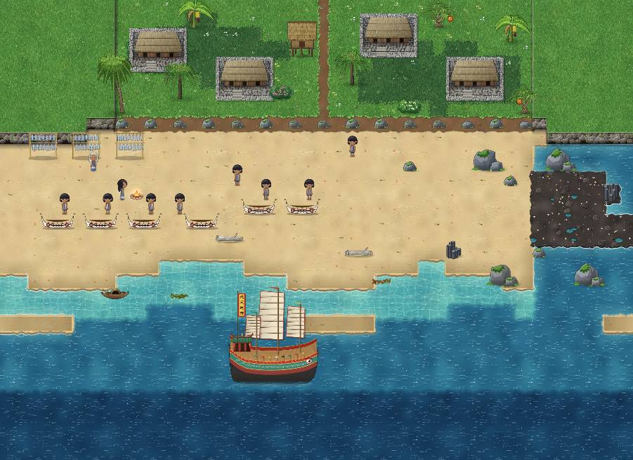

1. 選「出航 → 蘭嶼」。上岸後，達悟家族的長者 **Syapen** 說明規矩：灘頭北邊有一排**界石**（y=8），**請留在海邊**。
2. 這一段的「信任」會決定能不能拿到心燈，詳見〈心燈與支線〉。重點：
   - **不要越過界石**。第一次會被溫和地請回來，之後每次越界都會扣信任。
   - 吃完飯後芋圓偷偷爬向飛魚曬架，選「**抓住芋圓**」。
3. 和 **Sinan** 說完規矩後，礁盤開放。從灘頭東側（43,15）去**礁盤**，在低潮時涉水救出 Kaswal、撿回兩支槳與船首木雕（見〈謎題與小遊戲〉）。
4. 把東西交還給 Syaman 後，和 Syapen 對話選「準備好了」，夜裡守住灘頭的船：**潮病海蛇**頭目戰。
5. 第二天看 Syaman 修船。選「**安靜地看**」。之後獲得**船眼護符**（關鍵道具），信任夠的話點亮心燈。
6. 巡境地圖點亮第三點：蘭嶼。

> 界石北邊是達悟人的家與生活，請把它當成真的別人家門口。

#### 2. 台東：寶桑 → 阿美族部落 → 台東海岸（夜）

1. 「出航 → 寶桑（台東）」。寶桑是交易小街，有商店、客棧（100 文）。
2. **巴拉冠（卑南族會所）青年**（30,16）想和紅纓比賽跑，見〈心燈與支線〉。
3. 從寶桑北邊（12,0）到**阿美族部落**。和頭目 **Kolas**、Panay 見面：海祭之前，海邊不乾淨。
4. 從部落東北（36,0）到**台東海岸**（夜）。三處有溺魂聚集：
   - **A 河口**（18~22, 23~27）：打完一場後，到水漬旁的招魂點（20,25）「招魂」。
   - **B 礁岸**（27~33, 11~15）：一個潮怨守著，打完到（30,13）招魂。
   - **C 岬角**（17~25, 2~5）：**大潮怨**頭目戰，打完到（14,5）招魂。
5. 三處都送走後天亮，回到部落，在觀禮樹下遠遠看**海祭**。點亮心燈「阿美族海祭」，獲得**阿里鳳鳳 ×3**。
6. **在同一個晚上**（中途不離開台東海岸）把三處都清完，Kolas 會另外送**Kolas 的魚鉤**。

#### 3. 花蓮：洄瀾 → 太魯閣族部落 → 清水斷崖 → 太魯閣峽谷

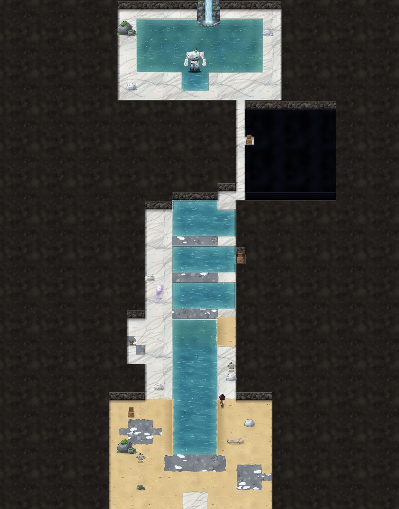

1. 「出航 → 洄瀾（花蓮）」。七月初一，開鬼門。洄瀾有商店、客棧（110 文）。
2. 從洄瀾西邊（0,3）到**太魯閣族部落**。依旺奶奶（Iwan）說起 Gaya；獲得**入山許可（依旺的麻線）**。
3. 部落的獵徑現在下不去（溪口全是黑水），Watan 會帶你從海上繞：回王船，「出航 → 清水斷崖下」。
4. **清水斷崖**：沿岩棚往上，落石區的走法見〈謎題與小遊戲〉。途中星河推開 Watan、替他擋下落石。北端（31,0）進峽谷。
5. **太魯閣峽谷**：用心火融開三道**鹽壩**（順序很重要）；中段的山羌可以「用心火融開鹽殼」放走。
6. 北端最窄處（20~26, 10）觸發**太魯閣石巨靈**頭目戰。
7. 戰後回到部落（C10-14），看見彩虹。依旺奶奶送星河**依旺的織帶**（星河專用，HP＋70、免疫封印、劍意累積加快）。

劇透警告：依旺奶奶與彩虹橋

依旺奶奶說，太魯閣族的人死後要走過彩虹橋，Gaya 守得好的人才走得過去。她也清楚地說：「這是我們的橋。你們漢人的路，你們自己知道。」星河在峽谷裡放走了山羌、替 Watan 擋下落石。奶奶把織帶綁在他手上：「你綁著，記得今天。」

#### 4. 頭城（普渡與搶孤）

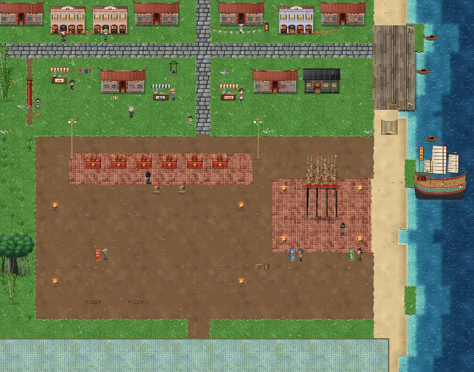

1. 「出航 → 頭城（烏石港）」。途中在甲板上會發生中元節與星河生日的劇情（C10-15、C10-16），陳伯送星河**星河的燈籠**。
2. 抵達頭城，被阿坤拉進搶孤隊。碼頭邊的木箱（46,12）是搶孤隊的盤纏 **3,000 文**。
3. 和阿坤對話可以「練習（油柱）」，不計輸贏。
4. 到客棧（120 文）休息，時間變成**傍晚**。這時燈篙下（8,19）會出現一個瘦小的孤魂**阿義**，心燈支線見下方。
5. 準備好後和阿坤對話選「準備好了」，進入普渡之夜：孤魂撲向孤棚，雲歸撿起黃道長的法鈴，學會**普渡咒**，**孤魂眾**頭目戰。
6. 戰後就是**搶孤**（見〈謎題與小遊戲〉）。搶到**順風旗**後回到王船，自動進入第十一章。

劇透警告：玄武嶼的插敘

本章中段有一段插敘，鏡頭轉到澎湖外海的玄武嶼：一間點滿魂燈罐的石室，白芷在那裡。這是第十一章的伏筆。

### 心燈與支線

#### 心燈「達悟家族的拼板舟」（可錯過）

看完 Syaman 修船時，若**信任 ≥ 3** 就會點亮，並拿到**飛魚乾 ×5**；不足則只拿到飛魚乾 ×2，沒有心燈。

| 信任變化 | 條件 |
|---|---|
| ＋1 | 芋圓爬向曬架時選「**抓住芋圓**」（選「假裝沒看到」−1） |
| ＋1 | 把兩支槳與船首木雕交還 Syaman（劇情必定） |
| ＋1 | 打倒潮病海蛇（劇情必定） |
| ＋1 | 修船時選「**安靜地看**」（「問他船是怎麼造的」不加） |
| ＋1 | 結算時**從來沒有越過界石** |
| −1 | 第二次以後每次越過界石 |

必定拿到的有 2 點，所以只要「抓住芋圓」「安靜地看」「不越界」三件事做到一件就夠。建議三件都做。

#### 心燈「阿美族海祭」（主線）

清完台東海岸三處溺魂後，天亮的海祭必定點亮。

- **Kolas 的魚鉤**（運氣＋12、身法＋2、戰鬥金錢增加）：三處要在**同一個晚上**清完，中途不能從台東海岸走回部落。

#### 心燈「羅漢腳阿義」（可錯過）

| 步驟 | 時機與地點 | 內容 |
|---|---|---|
| 1 | 頭城，在客棧休息後的傍晚 | 燈篙下（8,19）的孤魂**阿義**：沒有人記得他的名字。 |
| 2 | 回王船 | 和陳伯對話選「**請陳伯做燈籠**」，星河親手寫上「阿義」。 |
| 3 | 回頭城 | 調查燈篙（8,18）「把燈籠掛上燈篙」。 |
| 4 | 普渡之夜 | 孤魂眾戰後，阿義吃飽了，順著燈篙飛上夜空。點亮心燈。 |

- 錯過條件：在掛上燈籠之前就跟阿坤說「準備好了」。
- 有掛燈籠的話，孤魂眾戰中半血時會多一段：「……有喔。有人寫了。」全隊獲得持續回復。

#### 寶桑海灘賽跑

和寶桑的巴拉冠青年（30,16）對話選「比一圈（紅纓上場）」：連按 Z 的小遊戲，11 秒內跑完一圈礫石灘。輸了可以再比，次數越多對手越快一點點。贏了得到**卑南溪石 ×2**與**快腿綁腿**（防禦 14、身法＋9）。

### 寶箱與秘密

| 地圖 | # | 座標 (x, y) | 內容 | 備註 |
| --- | ---: | --- | --- | --- |
| 台東海岸 | 1 | (6, 34) | 鯨歌符扇 |  |
| 台東海岸 | 2 | (36, 16) | 百草膏 ×2＋1,000 文 |  |
| 台東海岸 | 3 | (33, 5) | 還魂香 ×2＋2,000 文 | 開啟時有事件 |

座標以地圖左上角為 (0, 0)，向右為 x、向下為 y；「#」對應地圖圖片上的寶箱編號。

| 地圖 | 位置 | 內容 | 備註 |
|---|---|---|---|
| 蘭嶼・礁盤 | 東北漂流木箱 (29,12) | 海鹽結晶 ×2、還魂香 | |
| 台東海岸 | 西南 (6,34) | **鯨歌符扇**（雲歸專用，法力＋82） | |
| 台東海岸 | 東側 (36,16) | 百草膏 ×2＋1,000 文 | |
| 台東海岸 | 東北岬角 (33,5) | 還魂香 ×2＋2,000 文＋**珊瑚護符**（抗水） | |
| 清水斷崖 | 礫灘木箱 (28,35) | 虱目魚粥 ×3 | |
| 清水斷崖 | 岩棚盡頭木箱 (22,7) | **斷崖槍**（紅纓專用，攻擊＋88） | 過落石區後 |
| 太魯閣峽谷 | 南段木箱 (14,45) | 百草膏 ×2 | |
| 太魯閣峽谷 | 壺穴木箱 (26,28) | **雲澗符扇**（雲歸專用，法力＋90） | 鹽壩全開後 |
| 太魯閣峽谷 | 北段崖邊木箱 (27,15) | **黑潮劍**（星河專用，攻擊＋87） | 鹽壩全開後 |
| 頭城 | 碼頭木箱 (46,12) | 3,000 文 | |
| 頭城 | 練習油柱旁竹簍 (4,13) | 糕渣 ×2 | |

**其他獎勵**

- 潮病海蛇：海蛇鱗、**蛇鱗護腕**（防禦 12、HP＋40、抗水）；有機率掉**鯤鱗冠**。
- 大潮怨：百草膏。石巨靈：大理石心、**石紋護符**（抗土）；有機率掉**順風履**。
- 孤魂眾：普渡香灰。搶到頭旗：**頭旗綵帶**（戰鬥開始時搶先行動）。

### 商店

**寶桑雜貨**

| 商品 | 類別 | 價格（文） | 效果／能力 |
| --- | --- | ---: | --- |
| 虱目魚粥 | 道具 | 260 | 我方全體：生命 +300 |
| 旗魚丸湯 | 道具 | 300 | 我方單體：生命 +900 |
| 小米糕 | 道具 | 260 | 我方單體：真氣 +150 |
| 還魂香 | 道具 | 150 | 倒下的同伴：復活（30% 生命） |
| 百草膏 | 道具 | 220 | 我方單體：生命 +800 |
| 番薯籤粥 | 道具 | 480 | 我方全體：生命 +600 |
| 解毒草 | 道具 | 12 | 我方單體：解除中毒 |
| 香包 | 道具 | 40 | 我方單體：解除沉睡・封印・定身・幻境 |

**寶桑武具**

| 商品 | 類別 | 價格（文） | 效果／能力 |
| --- | --- | ---: | --- |
| 潮聲劍 | 武器 | 2,000 | 武+76（星河） |
| 洄浪槍 | 武器 | 2,000 | 武+78（紅纓） |
| 藤甲 | 衣裝 | 1,500 | 防+40 |
| 鹿皮帽 | 頭飾 | 900 | 防+19 |
| 鹿皮綁靴 | 鞋履 | 800 | 防+14 速+5 |

**洄瀾雜貨**

| 商品 | 類別 | 價格（文） | 效果／能力 |
| --- | --- | ---: | --- |
| 虱目魚粥 | 道具 | 260 | 我方全體：生命 +300 |
| 旗魚丸湯 | 道具 | 300 | 我方單體：生命 +900 |
| 小米糕 | 道具 | 260 | 我方單體：真氣 +150 |
| 還魂香 | 道具 | 150 | 倒下的同伴：復活（30% 生命） |
| 百草膏 | 道具 | 220 | 我方單體：生命 +800 |
| 番薯籤粥 | 道具 | 480 | 我方全體：生命 +600 |
| 驅邪符 | 道具 | 200 | 敵單體：火屬性傷害 600 |
| 香包 | 道具 | 40 | 我方單體：解除沉睡・封印・定身・幻境 |
| 解毒草 | 道具 | 12 | 我方單體：解除中毒 |
| 花蓮麻糬 | 道具 | 700 | 我方全體：生命 +700 |

**洄瀾武具**

| 商品 | 類別 | 價格（文） | 效果／能力 |
| --- | --- | ---: | --- |
| 洄瀾槍 | 武器 | 2,400 | 武+83 速+2（紅纓） |
| 石紋甲 | 衣裝 | 1,800 | 防+43 命+20 |
| 竹編笠 | 頭飾 | 1,000 | 防+21；抗木 |
| 鹿皮綁靴 | 鞋履 | 800 | 防+14 速+5 |

**頭城小吃**

| 商品 | 類別 | 價格（文） | 效果／能力 |
| --- | --- | ---: | --- |
| 糕渣 | 道具 | 420 | 我方單體：生命 +1400 |
| 米粉羹 | 道具 | 300 | 我方單體：真氣 +180 |
| 普渡糕 | 道具 | 700 | 我方全體：生命 +900 |

**頭城雜貨**

| 商品 | 類別 | 價格（文） | 效果／能力 |
| --- | --- | ---: | --- |
| 糕渣 | 道具 | 420 | 我方單體：生命 +1400 |
| 米粉羹 | 道具 | 300 | 我方單體：真氣 +180 |
| 還魂香 | 道具 | 150 | 倒下的同伴：復活（30% 生命） |
| 百草膏 | 道具 | 220 | 我方單體：生命 +800 |
| 普渡糕 | 道具 | 700 | 我方全體：生命 +900 |
| 驅邪符 | 道具 | 200 | 敵單體：火屬性傷害 600 |
| 香包 | 道具 | 40 | 我方單體：解除沉睡・封印・定身・幻境 |

**頭城武具**

| 商品 | 類別 | 價格（文） | 效果／能力 |
| --- | --- | ---: | --- |
| 蘭陽劍 | 武器 | 1,900 | 武+84 運+3（星河） |
| 海神符扇 | 武器 | 2,000 | 武+11 法+92 氣+26（雲歸） |
| 漁家護腕 | 佩飾 | 1,100 | 武+12 |
| 蕉絲衫 | 衣裝 | 1,600 | 防+45；抗水 |

**蕉絲阿姨的布攤**

| 商品 | 類別 | 價格（文） | 效果／能力 |
| --- | --- | ---: | --- |
| 蕉絲衫 | 衣裝 | 1,600 | 防+45；抗水 |
| 蕉絲頭巾 | 頭飾 | 850 | 防+22 法+6 |
| 蕉絲綁腿 | 鞋履 | 750 | 防+16 速+7 |

**糕渣攤**

| 商品 | 類別 | 價格（文） | 效果／能力 |
| --- | --- | ---: | --- |
| 糕渣 | 道具 | 420 | 我方單體：生命 +1400 |
| 米粉羹 | 道具 | 300 | 我方單體：真氣 +180 |
| 普渡糕 | 道具 | 700 | 我方全體：生命 +900 |

| 商店 | 地點 | 商品 |
|---|---|---|
| 寶桑雜貨（阿旺伯） | 寶桑 | 虱目魚粥、旗魚丸湯 300、小米糕 260、還魂香、百草膏 220、番薯籤粥 480、解毒草、香包 |
| 寶桑武具 | 寶桑 | 潮聲劍 2,000、洄浪槍 2,000、藤甲 1,500、鹿皮帽 900、鹿皮綁靴 800 |
| 洄瀾雜貨（阿和嫂） | 洄瀾 | 同上，另有驅邪符 200、花蓮麻糬 700 |
| 洄瀾武具 | 洄瀾 | 洄瀾槍 2,400、石紋甲 1,800、竹編笠 1,000、鹿皮綁靴 800 |
| 頭城小吃／糕渣攤 | 頭城 | 糕渣 420、米粉羹 300、普渡糕 700 |
| 頭城雜貨 | 頭城 | 糕渣、米粉羹、還魂香、百草膏、普渡糕、驅邪符、香包 |
| 頭城武具 | 頭城 | 蘭陽劍 1,900、海神符扇 2,000、漁家護腕 1,100、蕉絲衫 1,600 |
| 蕉絲阿姨的布攤 | 頭城 (8,10) | 蕉絲衫 1,600、蕉絲頭巾 850、蕉絲綁腿 750 |
| 客棧 | 寶桑／洄瀾／頭城 | 100／110／120 文 |

**採購建議**

- **寶桑（海蛇之後、大潮怨前）**：潮聲劍、洄浪槍、藤甲 ×3、鹿皮帽、鹿皮綁靴。（打海蛇時還沒有寶桑可去，靠第九章的裝備＋船上休息。）
- **洄瀾（石巨靈前）**：紅纓**洄瀾槍**、**石紋甲** ×3、**竹編笠**（抗木）。台東海岸的**鯨歌符扇**給雲歸。BALANCE 為石巨靈假設的就是這套。
- **頭城（孤魂眾前）**：蘭陽劍、海神符扇、蕉絲衫（抗水，孤魂眾是水屬性）、蕉絲頭巾、蕉絲綁腿、漁家護腕。峽谷撿到的黑潮劍（攻擊 87）、雲澗符扇（法力 90）其實比頭城的武器更好，星河與雲歸可以省錢。
- 藥品：**糕渣**（單體 1400）、**普渡糕**（全體 900）、**花蓮麻糬**（全體 700）是本章主力；**驅邪符**（火屬性 600）對孤魂眾有效。

### 謎題與小遊戲

#### 蘭嶼・礁盤（潮汐）

- 礁盤有四塊礁台（入口 P0、P1、P2、孤礁 P3），中間由三條淺水道相連。
- 潮汐 **24 秒一循環：低潮 14 秒、漲潮 10 秒**。畫面左下會顯示「低潮　漲潮還有 N 秒」。
- 低潮時水道可以涉水走過；漲潮時變深水，站在水道上會被浪沖回上一塊礁台。
- 路線：P0 →（水道 x=17）→ P1 →（水道 x=13）→ P2 →（水道 y=23 往東）→ 孤礁 P3 的 Kaswal。
- 兩支槳在 P1 (22,12) 與 P2 (6,24)，船首木雕在孤礁的潮池（28,25）。沒撿到的槳，救出 Kaswal 後會自動補給你。
- 救 Kaswal 時要打一場（海鰻＋潮病蟹精 ×2，蟹精弱木）。

#### 清水斷崖（落石）

- 落石區在岩棚上（x=18~29，y=15~18）。分成三條**落石帶**：x=19~21、x=23~25、x=27~29。
- **每 3 秒**，地面的影子會預告其中一條，3 秒後石頭落在那條上；三條依序輪流。
- 被砸到：全員 −8% HP，被逼回岩棚起點。
- 安全位置：落石帶之間的 **x=18、22、26 三排**永遠不會被砸；北側的三個凹處 (21,14)、(25,14)、(28,14) 也安全。
- 走法：站在安全排上，等前方那條落石帶**剛砸完**，馬上穿過去到下一個安全排；你有 6 秒。

#### 太魯閣峽谷（鹽壩）

- 溪道上有三道鹽壩：①（第 26 列，上游）、②（第 30 列）、③（第 34 列，下游），各自擋著一個水潭。
- 用心火融開鹽壩，水就會流到下一個水潭。**下游的水潭還滿著就融上游**，整片溪道會淹水，隊伍被沖回 B 入口，而且所有鹽壩重新結起來。
- **解答：由下往上融：③ → ② → ①**（三道鹽壩都在 x=19）。
- 全開後東邊的岩棚露出來，可以拿壺穴與崖邊的木箱。
- 山羌（14,37）：選「用心火融開鹽殼」把牠放走，依旺奶奶之後會提到這件事。

#### 搶孤（頭城）

三段小遊戲，沒有 Game Over。先排站位：

| 站位 | 看的能力 | 最適合 |
|---|---|---|
| 底座 | 力 | 紅纓（3） |
| 中段 | 穩 | 芋圓（3）或星河（3） |
| 攀頂 | 輕 | 星河（3） |
| 看風 | 眼 | 雲歸（3） |

**選「照雲歸說的排（紅纓底座・芋圓中段・星河攀頂・雲歸看風）」就是全部最佳的組合**。

1. **第一段・上孤柱**：12 秒內**連按 Z**，比兩支隊伍先爬到孤棚底。底座、中段越強，需要按的次數越少。
2. **第二段・翻棚**：指針擺到**金色區域**時按 Z，三次中要成功兩次。攀頂越輕，金色區越寬；看風越好，指針越慢。失敗的話會再給一次機會。
3. **第三段・攀孤棧**：開始前會問四次要不要「割下供品，丟給群眾」，**四次都選割下**，群眾的加油會讓需要的連打次數變少。然後 12 秒連按 Z 搶頭旗。

沒搶到頭旗也一定能拿到自家孤棧上的**順風旗**，劇情照常進行；之後可以選「再挑戰頭旗」重打第三段，搶到就有**頭旗綵帶**。

### 頭目戰

> 圖表：第十章　後山巡境・頭目 HP——普通難度的最大生命（劇情難度 ×0.8、困難 ×1.3）。深淺交替區分章節；同場的小怪與召喚物不計。（圖表只在 HTML 版顯示；數據如下）

| 章 | 頭目 | Lv | HP |
| --- | --- | ---: | ---: |
| 第十章 | 潮病海蛇 | 36 | 12,198 |
| 第十章 | 大潮怨 | 36 | 4,667 |
| 第十章 | 峽谷巨像 | 38 | 9,137 |
| 第十章 | 孤魂眾 | 38 | 6,852 |

| 頭目 | Lv | HP | 屬性 | 弱點 ×1.5 | 抗性 ×0.5 | 招式 | 階段 | 同場敵人 | 經驗 / 錢 | 類型 |
| --- | ---: | ---: | :---: | --- | --- | --- | --- | --- | ---: | --- |
| 潮病海蛇 | 36 | 12,198 | 水 | 土・木 | — | 潮蛇噬（水）、黑潮翻湧（水）、潮病、觸手（水） | — | — | 8,017 / 4,004 | 頭目 |
| 大潮怨 | 36 | 4,667 | 水 | 土 | 水 | 暗流（水）、望鄉（水）、逆潮（水）、拖上岸 | 50% | 溺魂×2 | 12,509 / 3,508 | 頭目 |
| 峽谷巨像 | 38 | 9,137 | 土 | 木 | — | 斷崖崩擊（土）、峽谷震（土）、濁流（水）、大理石殼 | — | — | 9,501 / 5,993 | 頭目 |
| 孤魂眾 | 38 | 6,852 | 水 | 土・火 | — | 搶食、孤魂夜哭、搶供品、呼喚同伴 | — | 孤魂×2 | 5,987 / 4,001 | 頭目 |

#### 潮病海蛇（蘭嶼・夜的灘頭）

| 項目 | 內容 |
|---|---|
| 等級／HP | Lv36／戰鬥中約 9,760（資料上 12,198 的八成） |
| 屬性 | 水；**弱土、弱木** |
| 推薦 | Lv35（BALANCE 模擬勝率 86%）；第九章的裝備、抗水飾品（潮心珠、湖月石、進香布衫） |

**招式**：潮蛇噬（單體水屬性物理，威力 1.8）、黑潮翻湧（全體水屬性術法）、潮病（全體 50% 中毒）、觸手（隨機多段）。

**機制**

- **每第 3 次行動「潛水」**：沉進黑水裡，這段期間你的攻擊和法術都打不到。船頭燈會照出牠朝誰游過去（那人頭上出現「！」）。
- 下一次行動是**破浪突襲**（單體水屬性物理，威力 1.7）打那個人。**被鎖定的人選防禦**：傷害減輕，而且海蛇一頭撞在防禦上，**暈眩 1 回合**。
- **HP 60%**：陳伯從王船上用引魂槳把牠推回深水，牠的下一次行動被拖慢。之後每隔幾次行動會撲向灘頭的拼板舟，星河會擋在船前（單體重擊）。
- **HP 25%**：藤壺剝落，**防禦永久下降**；之後常用連環甩尾（全體兩段）。

**打法**

1. 雲歸用**土符**、**太虛神雷**（木屬性全體）打雙重弱點；紅纓＋雲歸的**雷霆槍陣**（木屬性）也是剋制。
2. 看到「！」→ 那個人**防禦**，其他人補血或上增益（打不到牠，別浪費攻擊）。撞上後牠暈眩，正好全力輸出。
3. 中毒用百草膏或心火・燃燈的持續回復撐住。
4. 25% 以後牠變脆，大招一起砸下去。

#### 大潮怨（台東海岸・岬角）

| 項目 | 內容 |
|---|---|
| 等級／HP | Lv36／4,667；附帶溺魂 ×2 |
| 屬性 | 水；**弱土**；抗水 |
| 推薦 | Lv36（BALANCE 模擬勝率 94%）；寶桑的裝備 |

**招式**：暗流（單體水屬性物理，降防）、望鄉（全體水屬性術法，降身法）、逆潮、拖上岸（HP 70% 以下會叫出新的溺魂）。**HP 50%** 後更常用望鄉。

**打法**：先用全體技清溺魂（溺魂弱火、弱土，星河的**焚天劍氣**很好用），再用土符集中大潮怨。望鄉降身法，用百草膏或港口茶解除。這場前面還有 A、B 兩場普通戰，但三處是分開的地圖事件，**中間可以補血**。

#### 太魯閣石巨靈（峽谷巨像）

| 項目 | 內容 |
|---|---|
| 等級／HP | Lv38／戰鬥中約 7,770（資料上 9,137 的八成五） |
| 屬性 | 土；**弱木** |
| 推薦 | Lv37（BALANCE 模擬勝率 86%）；洄瀾槍、石紋甲、竹編笠、鯨歌符扇 |

**招式**：斷崖崩擊（單體土屬性物理，威力 2.1）、峽谷震（全體土屬性物理，15% 暈眩）、濁流（全體水屬性術法）、大理石殼（半血後，自身防禦上升）。

**石甲機制**（畫面上方有「石甲」三格）

- 有石甲時，你的傷害只剩 **六成**。
- 用**木屬性**攻擊打中一次，石甲**少一層**。三層都打掉後「胸口暴露」：接下來它的 3 次行動期間，你的傷害 **×1.3**；之後石甲回復兩層。
- 用**火屬性**打中：鹽殼融化，防禦 −15%（最多兩次）。
- **每第 5 次行動**它會放「**潰堤黑水**」（全體水屬性術法，威力 1.4）。如果放的時候石甲是 0，黑水會反沖它自己：損失 5% HP 並暈眩 1 回合。
- **HP 60%**：Watan 從崖上射出一箭，石巨靈防禦 −20%，但胸口的哀號讓我方全隊法力暫時下降。
- **HP 25%**：石甲再也包不住（之後傷害一直 ×1.3），但它進入狂暴，攻擊上升。

**打法**

1. 開場星河用一次火屬性招式（星墜劍、心火・照夜）融鹽殼，再一次讓防禦降兩段。
2. 雲歸**雷符**／**太虛神雷**、紅纓＋雲歸**雷霆槍陣**，連續用木屬性把三層石甲打掉。
3. 胸口暴露的 3 次行動內，全員輸出、劍意大招也放在這裡；算好第 5 次行動的潰堤黑水最好落在暴露期間。
4. 石甲長回來後，重複「木屬性破甲 → 暴露輸出」。
5. 25% 之後它很兇，補血不要省，速戰速決。

#### 孤魂眾（頭城・普渡之夜）

| 項目 | 內容 |
|---|---|
| 等級／HP | Lv38／6,852；附帶孤魂 ×2 |
| 屬性 | 水；**弱土、弱火** |
| 推薦 | Lv38（BALANCE 模擬勝率 92%）；頭城的整套裝備；戰前拿到**普渡供品 ×6** 與雲歸的**普渡咒** |

**招式**：搶食（單體物理，降攻擊）、孤魂夜哭（全體術法）、**搶供品**（從你背包搶走一份普渡供品）、呼喚同伴（HP 70% 以下叫出孤魂）。

**「饑」量表**（畫面上方，從 100 開始）

- 孤魂眾每次行動，饑 **+5**；饑 **≥ 70** 時「餓瘋了」，攻擊上升。
- 對孤魂眾（或小孤魂）使用**普渡供品**：饑 **−20**。
- 雲歸的**普渡咒**（MP 60，全體術法）：饑 **−35**。
- **饑高於 30 時把它的 HP 打到 0，它會重新聚起來（回到 30% HP）**，最多兩次；雲歸會喊「打不散的！它們是餓，不是恨——要餵！」
- HP 50%：「沒有人叫我們的名字……」。有替阿義掛燈籠的話，全隊獲得持續回復。

**打法**

1. 開場：雲歸**普渡咒**（饑 100 → 65，順便打全體），星河、紅纓用**普渡供品**各餵一次（→ 25）。餓瘋狀態一解除，它就溫和很多。
2. 之後每回合饑會慢慢上升，**保持在 30 以下**：雲歸隔一兩回合唸一次普渡咒，或用供品補。
3. 小孤魂弱火：星河**焚天劍氣**／**心火・照夜**一起掃。
4. 供品會被搶走，早點用掉比較划算（戰後剩下的供品也會被收回）。
5. 饑壓在 30 以下時，再把 HP 打完，它就會散去。

### 小技巧

- **在蘭嶼不要越過界石**，就算只是好奇也不要；這會直接影響心燈。
- 甲板的神位可以存檔、艙口可以免費休息，各港口來回都很方便。
- 台東海岸三處溺魂**一口氣清完**，才拿得到 Kolas 的魚鉤。
- 鹽壩**從下游往上融**：③ → ② → ①。
- 峽谷的黑潮劍、雲澗符扇、斷崖槍都比本章商店的武器好，打石巨靈前先拿。
- 頭城的**阿義**只在傍晚出現（先在客棧休息），燈籠要請陳伯在船上做。
- 搶孤選雲歸建議的站位，第三段把供品全部割給群眾。
- 第十一章開頭還會在王船上，但本章的地圖（蘭嶼到頭城）之後就回不來了。

#### 心燈檢查表（第十章）

| 心燈 | 取得方式 | 可錯過 |
|---|---|---|
| 達悟家族的拼板舟 | 蘭嶼，信任 ≥ 3 | **是** |
| 阿美族海祭 | 清完台東海岸三處溺魂 | 否 |
| 羅漢腳阿義 | 頭城，掛上阿義的燈籠再開始普渡 | **是** |

真結局需要 **14 盞**心燈。到本章結束時最多可累積 25 盞。

## 第十一章　黑水溝・彼岸

> 圖表：第十一章　黑水溝・彼岸・路線——本章走過的地點：澎湖 → 彼岸。（圖表只在 HTML 版顯示）

### 概要

七月最後一夜，鬼門將關，夜被釘住了，海退得一乾二淨。王船停在澎湖媽宮，前方是夜玄的長明宮、黑水溝，以及傳說中的彼岸燈塔。這是最後一章：要把白芷帶回家。

| 項目 | 內容 |
|---|---|
| 推薦等級 | Lv38 → Lv44 以上（烏鬚船主 Lv39、鎖魂將 Lv40、鯤 Lv41、千年燈塔守 Lv43、最終戰 Lv44） |
| 隊伍 | 沈星河、洛紅纓、雲歸；**白芷在燈塔頂的「燈心」歸隊**，參加最後的連戰 |
| 主要地圖 | 王船、澎湖媽宮、天后宮、石滬灘・潮停之路、玄武嶼（黑岸／萬魂窟／長明殿／囚室／逆潮台）、黑水溝、彼岸花原、彼岸燈塔（一～五樓）、一息界、燈心 |
| 心燈 | 3 盞（石滬的缺口、唐山客的平安信、她的記憶，**三盞都可錯過**） |
| 七仙蕈 | **玄武蕈**（石滬灘，需靈視）——第七種，集滿七種有特別獎勵 |

> **真結局的條件：通關時心燈 ≥ 14 盞。** 本章是最後補心燈的機會，請看〈小技巧〉的總表。本章開頭會把隊伍等級拉到至少 Lv38。

> 本章的三個「回不去」：①王船「出航」離開澎湖；②在黑水溝選「無光之霧」前往彼岸；③在燈塔五樓打倒千年燈塔守、登上塔頂。每一段的支線都要在這之前完成。

### 流程

#### 1. 王船 → 媽宮（澎湖）

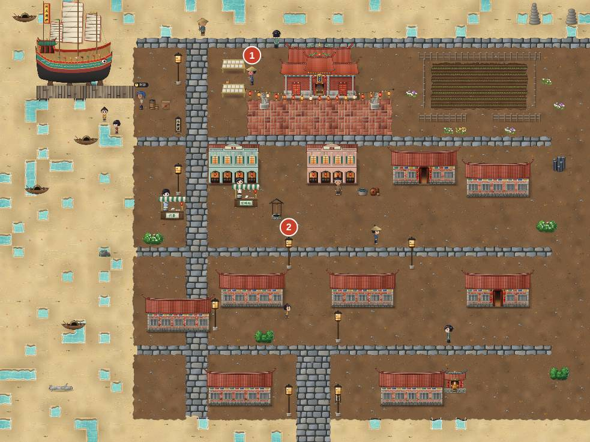

1. 開場在王船甲板（11-01）。甲板上的**存檔點**（24,9）、船艙（休息）在本章前半隨時能用。
2. 上岸到**媽宮**（11-02），廟公阿進伯帶大家進**天后宮**。
3. **拈香**的順序：先拜天井的**天公爐**（11,6），再入殿拜**媽祖**（8,4）。順序錯了阿進伯會糾正，沒有懲罰。
4. 拈香後獲得**媽祖香火袋**（關鍵道具，航行時遇敵率減半）。之後三川門內側的石燈可以存檔。
5. 媽宮可以做的事（都在出航前）：
   - **阿榮師鐵舖**與**秀琴雜貨**：本章唯一的武器防具店，見〈商店〉。
   - 支線「石滬的缺口」（阿添伯，北邊堤岸 16,2）。
   - 支線「海賊的寶藏」（孩子阿珠）。
   - 阿添伯家（40,24）：添姆請吃**金瓜米粉**，全員回滿並送金瓜米粉 ×2。
   - 海口客棧（34,14）一晚 80 文；許秀才要說兩次話（之後的唐山客支線會用到他的話）。
6. 從媽宮南口（24,35）走上**石滬灘・潮停之路**。

#### 2. 石滬灘・潮停之路 → 烏鬚船主

1. 退乾的海床上有海盜鬼巡邏。地圖東北是**添家滬**（石滬支線），西北角（7,7）長著**玄武蕈**（要開靈視）。
2. 往西南走，礁口（5~9, 39）有一道藍色光幕，要先打倒**烏鬚船主**（在 13~28, 31~32 一帶）才過得去。
3. 打贏後拿到**黑水溝海圖**與**烏鬚船主的酒 ×2**，光幕消失，從西南角進**玄武嶼**。

#### 3. 玄武嶼（長明宮）→ 鎖魂將

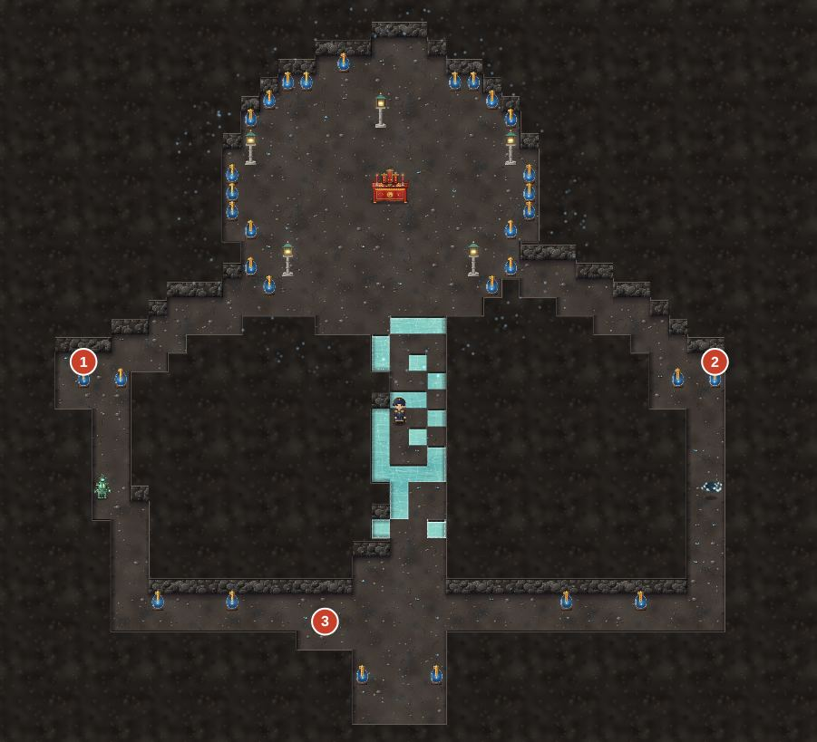

1. **黑岸**（11-06）：島頂大門被寫滿名字的光幕封住。麻糬看向西邊——從西側崖下的洞口（2,18）進**萬魂窟**。
2. **萬魂窟**：熄滅五盞長明燈柱（解法見〈謎題與小遊戲〉）。罐子裡的魂被放出來，祭壇浮起**鎖魂鑰**。
3. 從北邊鐵柵（20,2）上**長明殿**：
   - 東北的書房（40,6）調查，得到**舊畫像**與**夜玄的手記**。
   - 西北角（2,5）是**白芷的囚室**：六盞紙燈（白芷寫的信）、牆上的字、窗台上的**白芷的玉笛**。
   - 北牆的燈（21,3）：選「**把燈座往左轉**」，暗門打開。（紙燈背面也寫著「北牆的燈，往左轉」。）
4. 暗門上去是**逆潮台**：**鎖魂將**頭目戰。打贏後拔掉錨燈，夜終於開始動了，眾人回到王船。

劇透警告：白芷的囚室

囚室的牆上寫滿了字，又一個一個被劃掉。六盞紙燈是白芷寫給星河、紅纓、雲歸、陳伯，還有兩隻貓的信，用的是陳記燈籠舖的摺法。她在一點一點忘記人間的事，所以拚命寫下來。

#### 4. 出航・黑水溝

1. 和陳伯對話選「**出航（出航後無法返回澎湖）**」。如果石滬支線還沒做完，麻糬和雲歸會提醒你一次。
2. 出航後是陳伯的往事（11-11）和漂燈之海（11-12）。之後陳伯的選單：
   - **暗流裡有人在唱歌（溺魂暗流）**：心燈「唐山客的平安信」的第一步，**一定要在選無光之霧前去**。
   - **繼續前進（鯤之淵）**：**鯤**頭目戰，得到**鯤鱗甲**。
   - **繼續前進（無光之霧）**：打完鯤之後出現。這是一段劇情，霧裡的聲音會叫你回頭，星河胸口的心燈會一盞一盞亮起來。之後抵達**彼岸**。
   - 船艙休息、存檔。
3. 航行途中有機率遇到黑水溝的敵人；掛著媽祖香火袋時機率減半。

#### 5. 彼岸花原

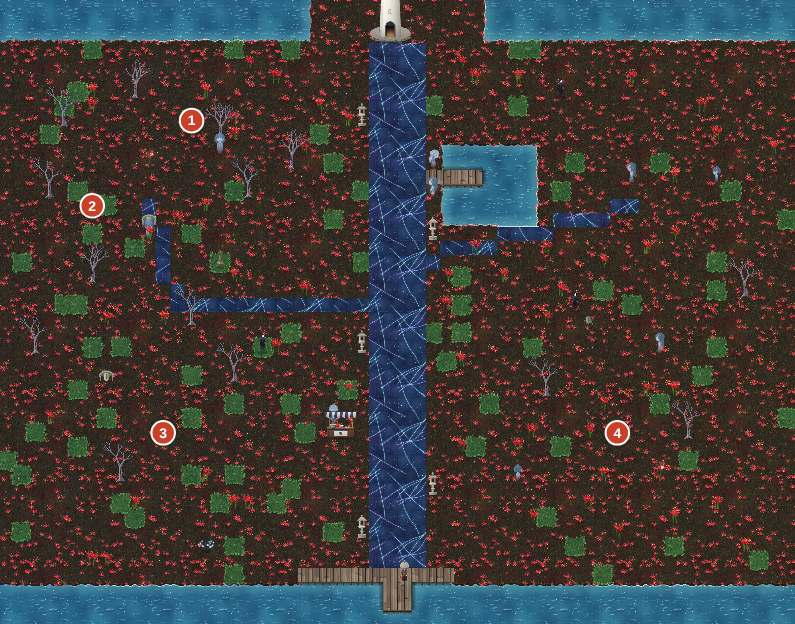

1. 抵達彼岸（11-16）。南端渡口的**陳伯**（28,40）：休息＋存檔，這裡是燈塔前的據點。
2. 花原中段有茶婆的**茶棚**（賣藥）。
3. 中央（26~29, 11~14）遇見**蘇婉**（11-17）；有平安信的話，接著在唐山阿婆處完成唐山客支線。
4. 北端（27,2）是**彼岸燈塔**入口。

#### 6. 彼岸燈塔（一～五樓）

每一層中央都有一盞「**回聲燈**」，調查後會看到一段過去（回聲），之後才能往上。

| 樓層 | 回聲 | 謎題／戰鬥 | 寶箱 |
|---|---|---|---|
| 一樓・紅之層 | 紅纓 | 無 | 赤霄槍（看完回聲後） |
| 二樓・雲之層 | 雲歸 | **五行符柱** | 太虛雷扇（解謎後） |
| 三樓・舊潮之層 | 陳伯與夜玄 | **沉板** | 舊槳穗 |
| 四樓・火之層 | 星河 | 無（星河的劍化為**螢火・明**，自動裝備） | 無 |
| 五樓・燈之層 | 白芷 | **收集六盞記憶燈** → **千年燈塔守** | 還魂丹 ×2、燈芯油 ×2 |

打倒千年燈塔守後登上塔頂**燈心之門**：一口氣的小遊戲（按住 Z 吸氣到滿，再放開），進入**一息界**。

#### 7. 一息界 → 燈心（最終連戰）

1. **一息界**：南邊的萬象童子邀你玩「萬象遊戲」（可選的戰鬥，見〈頭目戰〉）。
2. 北邊的**光之曼陀羅**：轉動寶石，讓光照到中央的座（見〈謎題與小遊戲〉）。站上燈座，進入**燈心**。
3. **燈心**：與白芷重逢（11-27），**白芷歸隊**，獲得**燈心玉笛**（自動裝備）。之後是**不能中斷的連戰**：

| 戰鬥 | 戰前 |
|---|---|
| 夜玄・玄冥法師 | 剛歸隊 |
| 夜玄・逆潮法身 | 全員回復 30% HP／MP |
| 黑潮・無相 | **全員完全回復** |
| 無相・深淵（三人，白芷被吞） | 全員回復 50% HP／MP |
| 無相之心（星河一人） | 不會輸 |

劇透警告：燈心

白芷被鎖在燈室中央的白色火焰裡，已經不太記得人間的事。星河拿出她寫的紙燈，芋圓翻過身露出肚子（「芋圓的肚子，是世界上最軟的地方」——她寫過的），六盞記憶燈飛回她身邊。她從火裡伸出手，跌進星河懷裡。麻糬把額頭抵在她手心，很久很久。

夜玄說，燈靈離開燈，所有的魂都會迷失。星河反問：「你為了一個人，把千千萬萬的魂關在罐子裡！」

打敗夜玄後，夜念的魂出現了：「爹，我好累……讓我走吧。」黑水溝裡所有沒人哀悼、沒人記得名字的悲傷聚成了「黑潮・無相」。它吞下白芷，又把紅纓和雲歸捲走。星河一個人站在夢裡的燈橋上，面前是一個蜷著身子哭泣的黑水孩子。同伴一個一個破開黑暗回來，最後白芷衝出海面——「千燈」。

### 心燈與支線

#### 心燈「石滬的缺口」（可錯過）

| 步驟 | 時機與地點 | 內容 |
|---|---|---|
| 1 | 拈香之後，媽宮北邊堤岸 (16,2) | **阿添伯**：添家滬裡沒有魚，滿滬都是燈，其中一盞叫他「阿兄」。 |
| 2 | 石滬灘東北的添家滬 (39~43, 7~8) | 弟弟**阿湧**的魂：「阮驚，阿兄揣無阮。」要開滬門，得先問滬主。 |
| 3 | 回媽宮找阿添伯 | 選「**阿湧在等你。**」（選「……那就算了。」會被紅纓罵，可以再談）。阿添伯會跟在隊伍後面。 |
| 4 | 帶阿添伯回添家滬 | 兄弟重逢，搬開滬牆，燈流出去。點亮心燈。 |

- 獎勵：心燈、**滬石護符**（防禦＋18、抗水、免疫暈眩）——最終戰非常好用。
- 錯過條件：出航離開澎湖。

#### 心燈「唐山客的平安信」（可錯過）

| 步驟 | 時機與地點 | 內容 |
|---|---|---|
| 1 | 黑水溝，陳伯選單「暗流裡有人在唱歌（溺魂暗流）」 | 唐山來的阿木伯抱著四十幾年的積蓄，想寄一張平安信回家。雲歸代筆，獲得**平安信**。 |
| 2 | 彼岸花原，蘇婉之後 | 找到唐山阿婆（阿木伯的阿娘），把信交給她。點亮心燈。 |

- 寫信時的選項（「好。寫『平安到了』。」／「可是……阿伯，你沒有到啊。」）兩個都可以。在媽宮跟許秀才說過兩次話，星河會多說一句「平安信不是寫給收信的人」。
- 獎勵：心燈、**唐山銅錢**（運氣＋20，戰鬥金錢增加）。
- 錯過條件：沒去溺魂暗流就選了「無光之霧」。

#### 心燈「她的記憶」（可錯過）

燈塔五樓看完回聲後，房間裡飄著**六盞記憶燈**，走到燈的位置就會收下：

(6,12)、(18,6)、(17,16)、(5,8)、(12,17)、(15,5)

- 其中一盞很害羞，你靠近它就會跳開。跳開兩次後，可以選「**麻糬，去！**」讓麻糬叼回來；或者一直追，它跳累了就會停。
- 獎勵：心燈、**憶燈**（白芷專用飾品，法力＋25、戰鬥開始時持續回復）。收齊的話，白芷歸隊時會**自動裝備憶燈，而且劍意直接是滿的**。
- 錯過條件：打倒千年燈塔守、登上塔頂之前沒收齊。

#### 雲歸的蕈譜：玄武蕈（七仙蕈之七）

- 位置：石滬灘西北角（7,7），**需要靈視**。旁邊（7,12）的寶箱就有七彩靈蕈 ×2，秀琴雜貨也有賣。
- 吃下玄武蕈時，如果前面六種都吃過（第三章剝皮寮的杉皮蕈、第四章風穴、第五章洛家、第六章林投林的潮音蕈、第七章雲霧林的雲芝、第九章龍坑的潮汐蕈），蕈譜集滿：雲歸得到**七色蕈鈴**（法力＋14、運氣＋14、每回合回真氣），並學會**萬色符**（隨機降下五行之一的全體大術法，或全體回復）。

#### 支線「海賊的寶藏」

和媽宮的孩子**阿珠**對話後，調查東北海口兩座石塔中**較高的塔公**（43,1）。挖出**海賊金幣**（可賣 3,000 文）和貝殼 ×10，還有烏鬚的字條：「真正的寶，是恁一路的伙伴。」

#### 其他小事件

- 天亮後（打完鎖魂將）回媽宮找**阿桂**，送**丁香魚乾 ×3**。
- 彼岸花原南端，把燈塔三樓拿到的**舊槳穗**拿給陳伯看，他會說那是他二十年前掉進海裡的。

### 寶箱與秘密

| 地圖 | # | 座標 (x, y) | 內容 | 備註 |
| --- | ---: | --- | --- | --- |
| 媽宮 | 1 | (20, 4) | 丁香魚乾 ×2＋2,500 文 |  |
| 媽宮 | 2 | (23, 18) | 還魂香＋2,500 文 |  |
| 石滬灘・潮停之路 | 1 | (49, 3) | 小管麵線 ×3 | 開啟時有事件 |
| 石滬灘・潮停之路 | 2 | (7, 12) | 七彩靈蕈 ×2＋1,000 文 |  |
| 石滬灘・潮停之路 | 3 | (44, 23) | 漁夫的護身符 |  |
| 石滬灘・潮停之路 | 4 | (43, 31) | 還魂丹 |  |
| 玄武嶼・黑岸 | 1 | (31, 24) | 長明宮衛的鐵靴 |  |
| 長明宮・萬魂窟 | 1 | (4, 19) | 燈芯油 ×2＋1,500 文 |  |
| 長明宮・萬魂窟 | 2 | (38, 19) | 黑玉護腕＋1,000 文 |  |
| 長明宮・萬魂窟 | 3 | (17, 33) | 還魂丹＋1,000 文 |  |
| 長明宮・長明殿 | 1 | (34, 21) | 夜玄的舊引魂符 |  |
| 長明宮・長明殿 | 2 | (33, 31) | 還魂香 ×2 | 開啟時有事件 |
| 彼岸花原 | 1 | (13, 8) | 彼岸花簪 |  |
| 彼岸花原 | 2 | (6, 14) | 彼岸茶 ×3 |  |
| 彼岸花原 | 3 | (11, 30) | 還魂丹 ×2 |  |
| 彼岸花原 | 4 | (43, 30) | 燈芯油 ×3 |  |
| 燈塔一樓・紅之層 | 1 | (16, 8) | 赤霄槍 | 依劇情出現 |
| 燈塔二樓・雲之層 | 1 | (17, 10) | 太虛雷扇 | 依劇情出現 |
| 燈塔三樓・舊潮之層 | 1 | (15, 13) | 舊槳穗 |  |
| 燈塔五樓・燈之層 | 1 | (14, 4) | 還魂丹 ×2 | 開啟時有事件 |

座標以地圖左上角為 (0, 0)，向右為 x、向下為 y；「#」對應地圖圖片上的寶箱編號。

| 地圖 | 位置 | 內容 | 備註 |
|---|---|---|---|
| 媽宮 | (20,4) | 丁香魚乾 ×2＋2,500 文 | |
| 媽宮 | (23,18) | 還魂香＋2,500 文 | |
| 石滬灘 | 東北 (49,3) | 小管麵線 ×3＋800 文 | |
| 石滬灘 | 西北 (7,12) | 七彩靈蕈 ×2＋1,000 文 | 玄武蕈就在旁邊 |
| 石滬灘 | 東側 (44,23) | 漁夫的護身符（抗水） | |
| 石滬灘 | 東南 (43,31) | 還魂丹 | |
| 玄武嶼・黑岸 | (31,24) | 長明宮衛的鐵靴（防禦＋20、HP＋30） | |
| 萬魂窟 | 西側 (4,19) | 燈芯油 ×2＋1,500 文 | |
| 萬魂窟 | 東側 (38,19) | 黑玉護腕（防禦＋15、法力＋15）＋1,000 文 | |
| 萬魂窟 | 南側 (17,33) | 還魂丹＋1,000 文 | |
| 長明殿 | (34,21) | **夜玄的舊引魂符**（戰鬥開始時持續回復） | |
| 長明殿 | (33,31) | 還魂香 ×2＋3,000 文 | |
| 彼岸花原 | 西北 (13,8) | **彼岸花簪**（白芷／紅纓，免疫睡眠） | |
| 彼岸花原 | 西側 (6,14) | 彼岸茶 ×3 | |
| 彼岸花原 | 西南 (11,30) | 還魂丹 ×2 | |
| 彼岸花原 | 東南 (43,30) | 燈芯油 ×3 | |
| 燈塔一樓 | (16,8) | **赤霄槍**（紅纓專用，金屬性，攻擊＋96，爆擊提升） | 看完回聲後 |
| 燈塔二樓 | (17,10) | **太虛雷扇**（雲歸專用，木屬性，法力＋98，每回合回真氣） | 解開符柱後 |
| 燈塔三樓 | (15,13) | 舊槳穗（身法＋15、運氣＋10） | |
| 燈塔五樓 | (14,4) | 還魂丹 ×2＋燈芯油 ×2 | |

**頭目與事件獎勵**

- 烏鬚船主：黑水溝海圖、烏鬚船主的酒 ×2、**船主的獨眼罩**（爆擊提升）。
- 鎖魂將：**黑鐵護心**（防禦＋25、免疫暈眩）。
- 鯤：**鯤鱗甲**（防禦 52、法力＋10、抗水）——本作最好的防具之一，最終戰全是水屬性。
- 千年燈塔守：千年燈灰（復活）。
- 萬象遊戲獲勝：**萬象鈴**（五項能力各＋8）、無名之色。
- 燈塔四樓：星河的劍變成**螢火・明**（攻擊 98、法力＋22、火屬性、劍意累積加快）。
- 燈心：白芷的**燈心玉笛**（法力＋100、回復量提升）。

### 商店

**秀琴雜貨**

| 商品 | 類別 | 價格（文） | 效果／能力 |
| --- | --- | ---: | --- |
| 黑糖糕 | 道具 | 900 | 我方全體：生命 +900 |
| 鹹餅 | 道具 | 160 | 我方單體：生命 +500 |
| 小管麵線 | 道具 | 380 | 我方單體：生命 +700，真氣 +60 |
| 丁香魚乾 | 道具 | 320 | 我方單體：真氣 +120 |
| 風茹茶 | 道具 | 150 | 我方單體：生命 +200，解除中毒・封印・沉睡・定身・幻境・武力↓・防禦↓・法力↓・身法↓ |
| 仙人掌冰 | 道具 | 800 | 我方全體：真氣 +120 |
| 金瓜米粉 | 道具 | 1,200 | 我方全體：生命 +1000 |
| 還魂香 | 道具 | 150 | 倒下的同伴：復活（30% 生命） |
| 還魂丹 | 道具 | 700 | 倒下的同伴：復活（100% 生命） |
| 九轉回生丹 | 道具 | 600 | 我方單體：生命 +9999 |
| 七彩靈蕈 | 道具 | 120 | 我方單體：幻境 4 回合，靈視約 75 秒 |

**阿榮師鐵舖**

| 商品 | 類別 | 價格（文） | 效果／能力 |
| --- | --- | ---: | --- |
| 玄武劍 | 武器 | 2,600 | 武+86；武器屬性：土（星河） |
| 鯨骨槍 | 武器 | 2,650 | 武+88 速+4（紅纓） |
| 海月笛 | 武器 | 2,600 | 武+12 法+84 氣+26；武器屬性：水（白芷） |
| 雷霆符扇 | 武器 | 2,650 | 武+12 法+92 氣+28；武器屬性：木（雲歸） |
| 咾咕石甲 | 衣裝 | 2,200 | 防+46 命+40（星河・雲歸） |
| 海紋褙子 | 衣裝 | 2,250 | 防+44 法+8（白芷・紅纓） |
| 漁夫斗笠 | 頭飾 | 1,000 | 防+22 |
| 澎湖布鞋 | 鞋履 | 1,000 | 防+15 速+10 |
| 天人菊香囊 | 佩飾 | 1,500 | 法+10；免疫沉睡 |

**茶婆的茶棚**

| 商品 | 類別 | 價格（文） | 效果／能力 |
| --- | --- | ---: | --- |
| 彼岸茶 | 道具 | 700 | 我方單體：生命 +1000，真氣 +100 |
| 清心茶 | 道具 | 120 | 我方單體：解除中毒・封印・沉睡・定身・幻境・武力↓・防禦↓・法力↓・身法↓ |
| 燈芯油 | 道具 | 600 | 我方單體：真氣 +200 |
| 還魂香 | 道具 | 150 | 倒下的同伴：復活（30% 生命） |
| 還魂丹 | 道具 | 700 | 倒下的同伴：復活（100% 生命） |

| 商店 | 地點 | 商品 |
|---|---|---|
| 秀琴雜貨 | 媽宮 (19,15) | 黑糖糕 900、鹹餅 160、小管麵線 380、丁香魚乾 320、風茹茶 150、仙人掌冰 800、金瓜米粉 1,200、還魂香 150、還魂丹 700、九轉回生丹 600、七彩靈蕈 120 |
| 阿榮師鐵舖 | 媽宮 | 玄武劍 2,600、鯨骨槍 2,650、海月笛 2,600、雷霆符扇 2,650、咾咕石甲 2,200、海紋褙子 2,250、漁夫斗笠 1,000、澎湖布鞋 1,000、天人菊香囊 1,500 |
| 海口客棧 | 媽宮 | 住宿 80 文 |
| 茶婆的茶棚 | 彼岸花原 | 彼岸茶 700、清心茶 120、燈芯油 600、還魂香 150、還魂丹 700 |

**採購建議**

- **出航後就沒有武器防具店了**，阿榮師鐵舖是最後的機會。BALANCE 從烏鬚船主到最終戰，假設的都是這一套：
  - 星河：**玄武劍**（土屬性，烏鬚船主、鯤、夜玄、無相全是水屬性，土正好剋水）、**咾咕石甲**。
  - 紅纓：**鯨骨槍**、**海紋褙子**。
  - 雲歸：**雷霆符扇**、**咾咕石甲**。
  - 三人：**漁夫斗笠**、**澎湖布鞋**、**天人菊香囊**（免疫睡眠，夜玄的引魂・回首會讓人睡著）。
- 之後燈塔裡會拿到更強的武器（赤霄槍、太虛雷扇、螢火・明），所以如果錢不夠，優先買防具與飾品。
- **海月笛**（白芷）不必買：她歸隊時會拿到更強的燈心玉笛。
- 藥品：**九轉回生丹**（單體全回復，600）CP 值極高；**黑糖糕**、**金瓜米粉**全體回復；**風茹茶**／清心茶解除所有異常；**燈芯油**（MP 200）留給最終戰。復活藥（還魂丹）多帶幾顆。
- 本章賺錢很快（媽宮兩個寶箱就有 5,000 文，頭目各給約 5,000 文），放心花。

### 謎題與小遊戲

#### 天后宮拈香

先拜**天井的天公爐**（11,6），再入殿拜**神龕前的香爐**（8,4）。「天公上大，媽祖上親」——順序反了，阿進伯會提醒：「囝仔，先拜天公，才拜媽祖。」

#### 萬魂窟・五盞長明燈柱

五盞燈柱圍成一圈：①(20,6)、②(27,8)、③(25,14)、④(15,14)、⑤(13,8)。一開始全亮。

- 調查任何一盞選「熄滅／點亮這盞燈」，**它和左右相鄰的兩盞**（圈狀相連，①的鄰居是⑤和②）都會翻轉。
- 目標：五盞**全部熄滅**。
- 祭壇上的字：「萬魂一燈，一燈萬魂。**一盞都不能漏**。」

**解答：①到⑤每一盞各操作一次**（順序不拘）。每盞燈都會被翻三次，最後全熄。弄亂了可以在祭壇選「重新點燃全部燈柱」重來。操作幾次之後，燈暗了偶爾會有溺魂群冒出來打一場。

#### 長明殿・北牆暗門

北牆的長明燈（21,3）選「**把燈座往左轉**」。

#### 燈塔二樓・五行符柱

門上寫著「**始於春，生生不息**」。五根符柱：

| 符柱 | 位置 |
|---|---|
| 木 | (8,15) |
| 火 | (16,7) |
| 土 | (7,7) |
| 金 | (15,15) |
| 水 | (12,5) |

**解答：木 → 火 → 土 → 金 → 水**（春屬木，五行相生）。點錯會全部熄滅並落雷（全員 −5% HP），第一次錯雲歸會給提示。

#### 燈塔三樓・沉板

- 回聲之海上浮著一排木板，要踩著木板走到北邊的石台（11,4 附近）。
- **踩上去約 1.5 秒後木板會下沉**（沉 3 秒後浮回來），所以不要停。
- 每 6 秒有一波浪：部分木板先**閃白框**（預告），1 秒後被浪蓋過。閃白框的木板別踩。
- 掉下去會回到上一塊安全的石地板。掉 3 次後木板下沉變慢（3 秒）；掉 6 次後芋圓會游過去綁繩子，木板不再下沉。

#### 燈塔頂・一口氣

**按住 Z**，吸氣量表約 3 秒集滿，聽到鈴聲後**放開**，吐氣。中途放開會慢慢洩氣，再按住就好。

#### 一息界・光之曼陀羅

- 南緣的光柱往北射出，途中會被五顆寶石（可轉動的水晶）反射。要讓光依序經過**紅、藍、金**三朵寶石蓮花，最後照到中央的「座」。
- 五顆水晶的位置：(19,8)、(16,8)、(16,3)、(22,3)、(22,6)。
- **解答：轉動 (19,8)、(16,3)、(22,6) 三顆各一次**（另外兩顆不動）。
- 光的路徑：往北 → 在 (19,8) 轉向西經過紅花 → 在 (16,8) 往北 → 在 (16,3) 轉向東經過藍花 → 在 (22,3) 往南經過金花 → 在 (22,6) 轉向西 → 照到座。
- 萬象童子（北邊那隻）會依你轉的次數給提示：「紅色的花最想要光！」「最上面那排，光要往右走喔！」
- 光照到座後，站上燈座。

### 頭目戰

> 圖表：第十一章　黑水溝・彼岸・頭目 HP——普通難度的最大生命（劇情難度 ×0.8、困難 ×1.3）。深淺交替區分章節；同場的小怪與召喚物不計。（圖表只在 HTML 版顯示；數據如下）

| 章 | 頭目 | Lv | HP |
| --- | --- | ---: | ---: |
| 第十一章 | 烏鬚船主 | 39 | 8,878 |
| 第十一章 | 鎖魂將 | 40 | 10,789 |
| 第十一章 | 鯤 | 41 | 10,786 |
| 第十一章 | 千年燈塔守 | 42 | 11,812 |
| 第十一章 | 夜玄・玄冥法師 | 43 | 14,923 |
| 第十一章 | 夜玄・逆潮法身 | 44 | 16,818 |
| 第十一章 | 黑潮・無相 | 44 | 19,621 |
| 第十一章 | 無相・深淵 | 45 | 16,641 |

| 頭目 | Lv | HP | 屬性 | 弱點 ×1.5 | 抗性 ×0.5 | 招式 | 階段 | 同場敵人 | 經驗 / 錢 | 類型 |
| --- | ---: | ---: | :---: | --- | --- | --- | --- | --- | ---: | --- |
| 烏鬚船主 | 39 | 8,878 | 水 | 土 | — | 船主刀（水）、小的們！、火藥桶、搶劫、彎刀（金） | — | 海盜鬼×2 | 11,983 / 5,001 | 頭目 |
| 鎖魂將 | 40 | 10,789 | 金 | 火 | 水 | 鎖鏈橫掃（金）、長明鎮壓、吸魂（水）、重鎖（金）、補罐 | — | 魂罐×3 | 13,995 / 5,004 | 頭目 |
| 鯤 | 41 | 10,786 | 水 | 土 | 水 | 吞、鯤噴潮（水）、翻身（水） | —；剩 3% 時劇情結束 | 吞魂燈瘤×2 | 15,986 / 0 | 頭目 |
| 千年燈塔守 | 42 | 11,812 | 金 | 火 | — | 千年燈杖（金）、黑燈、燈灰、守燈 | — | 燈塔守×1 | 17,981 / 4,999 | 頭目 |
| 赤金童 | 42 | 3,367 | 火 | 水 | — | 搔癢、變變變、彩色泡泡、躲貓貓 | — | 青碧童×1、紫玉童×1 | 0 / 0 | 劇情（結果固定） |
| 夜玄・玄冥法師 | 43 | 14,923 | 水 | 土 | 水 | 引魂槳・逆（水）、封魂罐、引魂・回首（水）、渡厄逆流、召燈 | — | 傀儡×2 | 1,791 / 0 | 頭目 |
| 夜玄・逆潮法身 | 44 | 16,818 | 水 | 土 | 水・火 | 千魂回岸（水）、引魂槳・逆（水）、逆潮（水） | —；剩 20% 時劇情結束 | — | 4,199 / 1,651 | 頭目 |
| 黑潮・無相 | 44 | 19,621 | 水 | 土 | 水 | 無相之潮（水）、溺（水）、回頭吧、無面之手 | — | — | 1,866 / 0 | 頭目 |
| 無相・深淵 | 45 | 16,641 | 水 | 土 | 水 | 深淵（水）、吞噬、冷、千聲 | — | — | 1,943 / 0 | 頭目 |
| 無相之心 | 45 | 6,005 | 水 | 土 | — | 「冷……」（水）、「沒有人叫我們」、哭 | — | — | 14,573 / 0 | 劇情（結果固定） |

#### 烏鬚船主（石滬灘）

| 項目 | 內容 |
|---|---|
| 等級／HP | Lv39／8,878；附帶海盜鬼 ×2 |
| 屬性 | 水；**弱土** |
| 推薦 | Lv39（BALANCE 模擬勝率 89%）；阿榮師鐵舖的整套 |

**招式**：船主刀（單體水屬性物理，威力 1.6）、彎刀（單體金屬性物理）、搶劫（伸手摸了一把……又放回去，沒效果）、小的們！（有手下倒下時再叫海盜鬼）、**火藥桶**。HP 30% 時「老子還沒輸！」，攻擊上升。

**火藥桶**：船主滾出一個火藥桶（HP 450）。**船主下一次行動時它會爆炸**，對我方全體造成火屬性傷害。**搶先把它打爆**，它就會炸到他們自己人：敵方全體各受 600 傷害，船主還會氣得大叫「老子的鬍子！！」

**打法**：火藥桶一出現，第一個能行動的人就把它打掉（普攻就夠）。其餘時間用星河的**玄武劍**（土屬性）、雲歸**土符**打船主，紅纓用全體技清海盜鬼。

#### 鎖魂將（逆潮台）

| 項目 | 內容 |
|---|---|
| 等級／HP | Lv40／10,789；附帶魂罐 ×3（各 1,747） |
| 屬性 | 金；**弱火**；抗水 |
| 推薦 | Lv40（BALANCE 模擬勝率 90%）；天人菊香囊、清心茶／風茹茶（解封印） |

**招式**：鎖鏈橫掃（全體金屬性物理）、長明鎮壓（單體 50% 封印 3 回合）、吸魂（單體水屬性術法，吸血）、重鎖（單體金屬性物理，40% 暈眩）、補罐（HP 50% 以下，補回魂罐，只會一次）。

**魂罐機制**：只要還有魂罐，鎖魂將受到的傷害**減半**。打破一個魂罐，裡面的魂道謝，**我方全體回復 10% HP**。魂罐全破時它會暴怒（攻擊上升 3 回合）。

**打法**

1. 先用全體技把三個魂罐打破：星河**焚天劍氣**、**赤焰龍吟**（Lv36，火屬性全體），紅纓**千軍辟易**／**橫掃千軍**，雲歸**三昧真火符**（火屬性全體）。破罐還順便回血。
2. 罐子清完後集中本體，火屬性打弱點；它暴怒的 3 回合多防禦、多補血。
3. 50% 以下會補一次罐子，用全體技再清一次。
4. 被封印的人用清心茶解；暈眩可用黑鐵護心、滬石護符之類的免疫飾品預防。

#### 鯤（黑水溝・鯤之淵）

| 項目 | 內容 |
|---|---|
| 等級／HP | Lv41／10,786（打到約 2.5% 就獲勝）；附帶吞魂燈瘤 ×2（各 2,652） |
| 屬性 | 水；**弱土**；抗水（燈瘤也弱土） |
| 推薦 | Lv41（BALANCE 模擬勝率 91%） |

**招式**：鯤噴潮（全體水屬性術法）、翻身（全體水屬性物理，15% 暈眩）、**吞**。

**機制**

- **燈瘤**：每次行動替鯤回復 300 HP。
- **吞**：把一名隊員吞進肚子 2 回合（每回合扣 8% HP）。**兩顆燈瘤都打掉，就會立刻吐出來**。
- **HP 40% 以下**：每第 4 次行動「**北冥**」潛入深海，打不到；下一次必定「**鯤破浪而出**」（全體水屬性物理，威力 1.8）。看到「（防禦！）」就全員防禦。

**打法**：開場先用全體土屬性（雲歸**萬色符**運氣好會出土之符；星河**玄武劍**普攻、雲歸**土符**）把兩顆燈瘤清掉，鯤就不會回血、被吞的人也能早點出來。之後土屬性集中鯤，40% 以下注意北冥的節奏。這是一隻迷路的老鯨，不是壞東西。

#### 千年燈塔守（燈塔五樓）

| 項目 | 內容 |
|---|---|
| 等級／HP | Lv42／11,812；附帶燈塔守 ×1 |
| 屬性 | 金；**弱火** |
| 推薦 | Lv43（BALANCE 模擬勝率 94%） |

**招式**：千年燈杖（單體金屬性物理）、黑燈（全體術法，降法力）、燈灰（全體降身法）、守燈（HP 60% 以下，自身防禦上升＋持續回復）。

**打法**：螢火・明（火屬性）與赤焰龍吟、三昧真火符全力打弱點。守燈的持續回復用輸出壓過去；降能力用清心茶解。這一戰沒有特殊機制，**戰前一定要先收齊六盞記憶燈**。

#### 萬象遊戲（一息界，可選）

| 項目 | 內容 |
|---|---|
| 對手 | 赤金童、青碧童、紫玉童（各 3,367 HP） |
| 規則 | 15 回合內打倒三人；輸了或超時都沒關係（「這裡沒有人會輸喔！」），可以再玩 |
| 獎勵 | **萬象鈴**、無名之色 |

**規則**：童子們每回合會**換顏色**（頭上會顯示顏色名）。用**剋住那個顏色的屬性**打他們才有效：

| 童子的顏色 | 屬性 | 用這個打（傷害 ×2） | 千萬別用（反而回血） |
|---|---|---|---|
| 白金 | 金 | 火 | 木 |
| 翠綠 | 木 | 金 | 土 |
| 深藍 | 水 | 土 | 火 |
| 赤紅 | 火 | 水 | 金 |
| 金黃 | 土 | 木 | 水 |

其他屬性只有一半傷害。童子幾乎不會傷人，只會搔癢（暈眩）、把你的增益變成減益（變變變）、或送你隨機增益（彩色泡泡）。雲歸的五種符、星河（火）、紅纓（金）分工對付不同顏色最有效率。

#### 夜玄（燈心，第一戰：玄冥法師／第二戰：逆潮法身）

| 項目 | 玄冥法師 | 逆潮法身 |
|---|---|---|
| 等級／HP | Lv43／14,923（打到底即結束） | Lv44／16,818（**打到 20% 即結束**） |
| 屬性 | 水；弱土；抗水 | 水；弱土；**抗水、抗火** |
| 推薦 | Lv44，四人全員（BALANCE：兩戰連打約 90%） | |

**玄冥法師**

- 招式：引魂槳・逆（單體水屬性物理，威力 1.9）、封魂罐（60% 封印＋降身法）、引魂・回首（全體水屬性術法，20% 沉睡）、召燈（有手下倒下時叫傀儡）。
- **渡厄逆流**：我方身上的增益效果（攻防提升、持續回復、護盾）**合計 2 個以上**時，他會全部洗掉並回復 5% HP。增益不要疊太多，或用完就趁機輸出。
- HP 70%：紅纓「青鋒哥，是為了你的『回家』死的！」，紅纓攻擊上升 3 回合。

**逆潮法身**（打完第一戰後回復 30%）

- 招式：千魂回岸（全體水屬性術法）、引魂槳・逆、逆潮（全體水屬性術法）。
- **每第 4 次行動「逆潮」**：全體大傷害，而且把你所有的「提升」**反轉成「下降」**，持續回復變成中毒。逆潮之後馬上用清心茶／風茹茶解，或乾脆在第 4 次行動前不要上增益。
- **舉罐**（約每 5 次行動一次）：「夜玄將罐子高高舉起……（防禦！）」，下一次行動用「黑水溝」重擊**當下 HP 最高的人**（威力 2.6）。全員防禦。
- **白芷的渡魂謠**：第一次、第二次使用時，夜玄會「動搖」**暈眩 1 回合**（「……這首歌……念兒她娘……也會唱……」）。
- HP 50%：遠方傳來陳伯的吼聲「阿玄——！」，夜玄防禦下降 3 回合。

**打法**

1. 第一戰：星河**玄武劍**（土）／**劍落千星**、雲歸**土符**與**萬色符**，紅纓**洛家劍譜**；白芷補血（燈海、映月）與**月霧護身曲**。增益別疊，避免被渡厄逆流洗掉。
2. 第二戰：開場白芷先唱**渡魂謠**讓他暈眩，大家趁機輸出；第二次渡魂謠留到舉罐之後或 50% 時。逆潮後立刻解除異常。
3. 被引魂・回首睡著的人，戴著天人菊香囊就不會睡。

#### 黑潮・無相（三個階段）

**第一階段：黑潮・無相**（戰前全員完全回復）

| 項目 | 內容 |
|---|---|
| 等級／HP | Lv44／19,621（打到底即結束） |
| 屬性 | 水；**弱土**；抗水；免疫封印 |

- 招式：無相之潮（全體水屬性術法）、溺（單體水屬性物理）、回頭吧（全體攻擊、法力下降）、無面之手（隨機 4 段）。
- **每第 3 次行動「萬面」**，依序換上三張臉：
  1. 青鋒的聲音：紅纓攻擊下降。（第二次出現時，紅纓「哥會叫我——『護人』！」，反而攻擊上升）
  2. 清虛的聲音：雲歸法力下降。（第二次時，雲歸「師父只說『再試一次』」，反而法力上升）
  3. 夜念的聲音：全體身法下降 1 回合，但白芷獲得持續回復。
- 打法：土屬性全力輸出，白芷每 2~3 回合全體補血；「回頭吧」之後用清心茶解。四人合擊此時還不能用（千燈要到第三階段才解鎖）。

**第二階段：無相・深淵**（白芷被吞下；三人；戰前回復 50% HP／MP）

| 項目 | 內容 |
|---|---|
| 等級／HP | Lv45／16,641（打到底即結束） |
| 屬性 | 水；**弱土**；抗水；免疫封印 |

- 招式：深淵（全體水屬性術法，威力 1.5）、吞噬（單體物理，吸血）、冷（全體降身法、30% 中毒）、千聲（隨機 6 段術法）。
- **每 3 回合**，白芷的歌聲從潮的深處傳來（渡魂謠的一段）：全員**持續回復 3 回合**並解除封印。
- 少了白芷，回復靠道具：**黑糖糕**、**金瓜米粉**、**九轉回生丹**、星河的**心火・燃燈**、雲歸的**回春符**。BALANCE 已經把這一階段調弱（攻擊、速度都比第一階段低），穩穩打就好。

**第三階段：無相之心**（星河一人，**不會輸**）

- 對手是一個蜷著身子哭泣的黑水孩子（6,005 HP）。星河倒下也會馬上站起來。
- 第 1 回合：星河完全回復＋持續回復。第 2 回合：**紅纓**破開黑暗回來。第 3 回合：芋圓把**雲歸**拖回來。第 4 回合：**白芷**衝出海面歸隊（HP／MP 全滿、劍意 100），**四人合擊「千燈」解鎖**。
- 把無相之心的 HP 打到底時，它不會倒下，只會蜷得更緊，畫面提示「**使用『千燈』或白芷的『渡魂謠』**」。
- **用「千燈」收尾**：千燈的威力會隨你的心燈數量提高（心燈越多越強）。用渡魂謠收尾也可以。

劇透警告：兩種結局

最終戰結束後，結局由**心燈的數量**決定：

- **心燈 ≥ 14 → 真結局「千燈」**：星河說出「妳不是一個人在發光。」一路上點亮的心燈，從全島各地升起，照亮彼岸燈。白芷成為人，星河得到自己的魂燈。一年後的中元，八斗子：「星河，這一次，換我來找你了。」
- **心燈 < 14 → 普通結局「彼岸」**：燈還不夠亮。白芷留下來成為燈，帶走了星河關於她的一切記憶。一年後的中元，八斗子，玉牌：「星河……這一次，別再來找我了。」「……我會找到妳的。」

通關後會存一個「通關存檔」，標題畫面會多出「回憶」選單，可以重看看過的結局。兩個結局之後都有片尾彩蛋，請看完名單。

### 小技巧

- **出航前**：做完石滬支線、海賊寶藏，買齊阿榮師鐵舖的裝備，拿完玄武嶼的寶箱。
- **選「無光之霧」前**：先去溺魂暗流，拿到平安信。
- **打千年燈塔守前**：收齊五樓的六盞記憶燈（白芷會帶著憶燈與滿劍意歸隊）。
- **最終連戰中無法存檔、無法開選單換裝備**。進燈心之前（一息界可以存檔）把藥品補滿，至少帶：九轉回生丹、黑糖糕或金瓜米粉、燈芯油、清心茶、還魂丹。
- 白芷歸隊時沿用她第六章離隊時的防具，武器自動換成燈心玉笛。
- 燈塔裡拿到的**赤霄槍**、**太虛雷扇**和四樓的**螢火・明**都比媽宮的武器強，拿到就換上。
- 航行時掛著**媽祖香火袋**，遇敵率減半。
- 夜玄第二戰，白芷的**渡魂謠**用兩次就有兩回合的免費輸出。
- 最終戰收尾用**千燈**，心燈越多威力越大。

#### 心燈總表（全作）

真結局需要通關時 **心燈 ≥ 14 盞**。全作共有 28 盞：

| 章 | 心燈 | 可錯過 |
|---|---|---|
| 一 | 阿土伯的懷錶、阿黃回家 | 見第一章 |
| 二 | 山中的呼喚、寄到了的信 | 見第二章 |
| 三 | 紅毛城的異鄉兵、椅仔姑與花旦、頂下郊的兩個老人、小梅與母親、阿蓮與阿德 | 見第三章 |
| 四 | 九降風裡的阿母、嶺上松 | 見第四章 |
| 五 | 半邊井、福伯 | 見第五章 |
| 六 | 轎夫與母親、林投姐 | 轎夫與母親可錯過；林投姐為主線 |
| 七 | 霧中的獵刀、燈母祠的壁畫 | 兩盞都可錯過 |
| 八 | 北港的香客、蚵殼阿嬤 | 兩盞都可錯過 |
| 九 | 半屏山湯圓、月琴伯的名字、燈塔守的家書 | 三盞都可錯過 |
| 十 | 達悟家族的拼板舟、阿美族海祭、羅漢腳阿義 | 海祭為主線，其餘可錯過 |
| 十一 | 石滬的缺口、唐山客的平安信、她的記憶 | 三盞都可錯過 |

#### 心燈檢查表（第十一章）

| 心燈 | 取得方式 | 可錯過 |
|---|---|---|
| 石滬的缺口 | 媽宮阿添伯的支線 | **是**（出航前） |
| 唐山客的平安信 | 溺魂暗流 → 彼岸花原的唐山阿婆 | **是**（選無光之霧前要先去暗流） |
| 她的記憶 | 燈塔五樓六盞記憶燈 | **是**（打千年燈塔守前） |

# 雙結局條件

《彼岸燈》有兩個結局。走到最後的時候，你一路收集的**心燈數量**會決定看到哪一個。結局本身沒有其他分歧條件：等級、戰鬥結果、對話選擇都不影響結局，只看心燈的數量。

> **提示**　還不想知道門檻的話，只要記得一件事：**每一章的心燈支線都盡量做。** 心燈錯過就拿不回來，而且大部分來自支線，不是主線。

劇透警告：結局判定條件

## 判定條件

- **心燈 14 盞以上 → 真結局「千燈」**
- **心燈 13 盞以下 → 普通結局「彼岸」**

判定發生在最終決戰之後的最後一幕。全遊戲共有 **28 盞**心燈，也就是說要拿到一半以上。只跑主線的話會差很多，至少要做完大約一半的心燈支線；保險起見，建議以 20 盞左右為目標。

**心燈數量還會影響這些地方：**

- **第十一章的黑水溝**：一路上幫助過的人會借光給王船。14 盞以上時，整片黑水溝都會發光；8～13 盞時只照出一條窄窄的水路；更少時只照得亮船頭。這裡等於最後的預告，此時已經來不及回頭補拿前面章節的心燈了。
- **最終決戰的最後階段**：四人合擊「千燈」會解鎖，威力是 `3.0＋0.15 × 心燈數`。28 盞全拿時威力是 7.2，是全遊戲最強的一擊。白芷的「渡魂謠」也能結束這個階段，所以心燈少也不會卡關。
- **真結局的演出**：島上每一個得到心燈的地方，都會依序升起燈火；沒有心燈的地區保持黑暗。片尾名單上漂浮的燈籠數量，也跟心燈數成正比。

> 圖表：心燈分布——全遊戲共 28 盞心燈；真結局需要 14 盞。長條是各章可取得的數量，折線是全部拿到時的累計。（圖表只在 HTML 版顯示；數據如下）

| 章 | 心燈數 | 累計 | 心燈 |
| --- | ---: | ---: | --- |
| 序章 | 0 | 0 | — |
| 第一章 | 2 | 2 | 阿土伯的懷錶、阿黃回家 |
| 第二章 | 2 | 4 | 山中的呼喚、寄到了的信 |
| 第三章 | 5 | 9 | 紅毛城的異鄉兵、阿蓮與阿德、小梅與母親、椅仔姑與花旦、頂下郊的兩個老人 |
| 第四章 | 2 | 11 | 嶺上松、九降風裡的阿母 |
| 第五章 | 2 | 13 | 半邊井、福伯 |
| 第六章 | 2 | 15 | 轎夫與母親、林投姐 |
| 第七章 | 2 | 17 | 霧中的獵刀、燈母祠的壁畫 |
| 第八章 | 2 | 19 | 北港的香客、蚵殼阿嬤 |
| 第九章 | 3 | 22 | 半屏山湯圓、月琴伯的名字、燈塔守的家書 |
| 第十章 | 3 | 25 | 達悟家族的拼板舟、阿美族海祭、羅漢腳阿義 |
| 第十一章 | 3 | 28 | 石滬的缺口、唐山客的平安信、她的記憶 |

劇透警告：兩個結局的內容（只寫輪廓）

## 兩個結局

**共通**　最終決戰之後，無相之心化成千萬張臉。白芷一一叫出他們的名字，彼岸燈只剩下一點餘燼。她鬆開星河的手，朝那點餘燼走去……

**真結局「千燈」**　星河對她說：「妳不是一個人在發光。」全島的心燈從海上升起，重新點亮了彼岸燈。白芷留了下來，成為凡人；夜玄牽著夜念的手渡往彼岸。一年後的中元，各地的朋友寄來了信。最後一幕在八斗子，名單之後還有一段彩蛋。

**普通結局「彼岸」**　燈還不夠亮。白芷化身為那盞燈，也帶走了星河所有關於她的記憶。一年後的九份，他放出一盞水燈，卻不知道自己為什麼流淚；口袋裡，留著一塊刻著「白芷」的玉牌。名單之後同樣有一段不同的彩蛋。

想看另一個結局，建議在進入第十一章前另存一個存檔。

## 心燈檢查表

下表依章節列出全部心燈，以及遊戲內任務日誌的步驟。詳細的走法、地點和對話選項，請翻到對應章節的攻略。

| # | 章 | 心燈 | 任務 | 任務步驟（遊戲內任務日誌） |
| ---: | --- | --- | --- | --- |
| ① | 第一章 | 阿土伯的懷錶 | 阿土伯的懷錶 | 懷錶掉在舊礦坑上層往東、風很大的老坑道裡。阿土伯做記號用「正」字。 → 找到了阿土伯的懷錶。交給阿土嬸吧。 |
| ② | 第一章 | 阿黃回家 | 阿黃回家 | 阿旺說明天要把阿黃送走。跟阿旺談談。 → 阿旺要有人作證，阿黃以前是阿土伯的狗。去找阿土嬸。 → 阿土嬸答應去跟阿旺說。到小金家門口。 |
| ③ | 第二章 | 山中的呼喚 | 山中的呼喚 | 在霧林裡找到阿山。看到他，就敲鑼、喊他的名字。 → 帶阿山回平溪，回到阿竹和阿山嫂身邊。 |
| ④ | 第二章 | 寄到了的信 | 寄到了的信 | 阿興的最後一封信不知道在哪裡。上個月有個挑夫的擔子丟在山裡…… → 找到了阿興的信。念給周家兩老聽吧。 → 周家兩老想放一盞寫著「阿興」的天燈。 |
| ⑤ | 第三章 | 紅毛城的異鄉兵 | 紅毛城的異鄉兵 | 夜裡，紅毛城傳來鼓聲和爭吵聲。 → 找到迪亞哥的扇貝殼、彼得的小風車。 → 問問漁夫阿財：外國人的海在哪裡？ → 帶著兩件信物和水燈座，夜裡回紅毛城。 |
| ⑥ | 第三章 | 阿蓮與阿德 | 阿蓮與阿德 | 夜裡去北邊的舊渡頭看看。 → 阿德被長明燈拴住了。回去找阿蓮。 → 夜裡，陪阿蓮去舊渡頭。 |
| ⑦ | 第三章 | 小梅與母親 | 小梅與母親 | 找一位頭插玉蘭花、會唱搖囝仔歌的母親。 → 請春婆一起去龍山寺。 |
| ⑧ | 第三章 | 椅仔姑與花旦 | （主線劇情） | — |
| ⑨ | 第三章 | 頂下郊的兩個老人 | 頂下郊的兩個老人 | 頂郊的阿水伯、下郊的阿旺伯。到底是誰先放火？（問問吳廟公、剝皮寮老茶店、土地公廟前的阿興） → 帶兩位阿伯去阿興家。 |
| ⑩ | 第四章 | 嶺上松 | 嶺上松 | 找出能回「九降風吹嶺上松」的人。 → 去問柿樹坪的滿妹婆。 → 去問義民廟的古伯。 → 夜裡，帶滿妹婆去義民塚回歌。 |
| ⑪ | 第四章 | 九降風裡的阿母 | 九降風裡的阿母 | 夜裡陪阿順伯顧米粉架。 → 讓九降風變回來。 → 風轉來了——夜裡再去米粉寮看看。 → 阿玉的喜宴。 |
| ⑫ | 第五章 | 半邊井 | 半邊井 | 找王少爺談談半邊井。（九曲巷・王家側門） → 問問巷子裡的人：井邊阿婆、牛舌餅阿嬸、打更的阿福伯。 → 等天黑，打更阿福伯要去敲鑼。 |
| ⑬ | 第五章 | 福伯 | 顧門的福伯 | 買一片牛舌餅給福伯。（不見天街的牛舌餅攤） → 把牛舌餅交給福伯。 |
| ⑭ | 第六章 | 轎夫與母親 | 轎夫與母親 | 阿義說，他要替母親還願。 → 大疫塚上，有一個瘟鬼沒有跟著大家升天。 → 讓她看看長大的兒子。 |
| ⑮ | 第六章 | 林投姐 | （主線劇情） | — |
| ⑯ | 第七章 | 霧中的獵刀 | 霧中的獵刀 | 在神木林西南的霧谷裡，替 Voyu 看一看。 → 把找到的東西帶回 Voyu 的家。 |
| ⑰ | 第七章 | 燈母祠的壁畫 | 燈母祠的壁畫 | 看完燈母祠上殿與下殿的六幅壁畫。 |
| ⑱ | 第八章 | 北港的香客 | 北港的香客 | 在潮位漲滿之前，救出所有受困的香客。 → 天亮了。回到朝天宮的廟埕。 |
| ⑲ | 第八章 | 蚵殼阿嬤 | 蚵殼阿嬤 | 阿嬤拜託你們：如果上面有什麼把他綁在這裡，就讓他走吧。 → 觀潮台的燈熄了。回去看看阿嬤。 |
| ⑳ | 第九章 | 半屏山湯圓 | 半屏山湯圓 | 坐渡船到哨船頭，去半屏山找金萬。 → 進入半屏山腹，帶回金萬。 → 回旗後金萬大厝。 |
| ㉑ | 第九章 | 月琴伯的名字 | 被風偷走的七個名字 | 前往龍磐，平息落山風。 → 收集被風吹散的名字，回東門城牆。 |
| ㉒ | 第九章 | 燈塔守的家書 | 燈塔守的家書 | 在龍坑的三個側洞找回燈塔日誌殘頁。 → 把日誌殘頁交給燈室裡的湯先生。 |
| ㉓ | 第十章 | 達悟家族的拼板舟 | 達悟家族的拼板舟 | 留在海邊，守達悟人的規矩。 → 找回 Kaswal、槳和船首木雕。 → 夜裡守住灘頭的船。 → 看 Syaman 修船。 |
| ㉔ | 第十章 | 阿美族海祭 | 阿美族海祭 | 夜裡清理河口、礁岸、岬角的溺魂。 → 天亮了。回部落。 |
| ㉕ | 第十章 | 羅漢腳阿義 | 羅漢腳阿義 | 請陳伯做一盞燈籠。 → 把阿義的燈籠掛上燈篙。 → 等普渡之夜。 |
| ㉖ | 第十一章 | 石滬的缺口 | 石滬的缺口 | 去石滬灘的「添家滬」看看。 → 滬牆要開口，得先問滬主。回去找阿添伯。 → 帶阿添伯去添家滬。 |
| ㉗ | 第十一章 | 唐山客的平安信 | 唐山客的平安信 | 替阿木伯寫一張平安信。 → 黑水溝兩邊的死人，最後都到同一個岸。在彼岸找找阿木伯的阿娘。 |
| ㉘ | 第十一章 | 她的記憶 | 她的記憶 | 收集白芷的記憶（六盞）。 |

劇透警告：容易錯過的心燈

下面幾盞心燈取決於**對話選擇**或**時間限制**，選錯或拖太久就拿不到：

| 章 | 心燈 | 條件 |
|---|---|---|
| 第三章 | 椅仔姑與花旦 | 戲班後台，雲歸拿出封印符時，選「**問問秀蘭姑娘自己怎麼想**」。選「讓雲歸貼符，請她走」就沒有這盞燈 |
| 第八章 | 北港的香客 | 逆潮之夜，每打完一場戰鬥（不論輸贏或逃跑）潮位就漲一格。**潮位漲滿 8 格之前**要救出全部 5 名香客 |
| 第八章 | 蚵殼阿嬤 | 安平海邊，阿嬤問你時選「**阿嬤，您不傻。**」。選「他會想起來的」就沒有這盞燈 |
| 第九章 | 月琴伯的名字 | 七個被風吹走的名字要全部找回來；沒找齊時可以之後再補 |
| 第十章 | 達悟家族的拼板舟 | 在蘭嶼要守達悟人的規矩，累積足夠的信任（至少 3 點）。**一次都不要嘗試越過界石**（從沒越過＋1，越過兩次以上每次−1）；芋圓亂跑時選「**抓住芋圓**」（＋1，選「假裝沒看到」−1）；之後幫忙找回東西、守夜等事件也會加信任 |
| 第十一章 | 她的記憶 | 燈塔五樓的六盞記憶之燈要全部收集 |

其他心燈只要把支線走完就能拿到，但都只能在**該章之內**完成：下一章開始時，上一章沒做完的支線會從任務日誌裡移除。

# 資料庫

以下資料全部由遊戲資料自動產生，依「第一次出現的章節」排序，同一章再依價格排列。

- 「取得」欄只列出**商店、寶箱和敵人掉落**。寫著「劇情／任務」的，是劇情獎勵、任務獎勵或事件中拿到的東西，詳見各章攻略。
- 價格是買價；賣出時只有一半。
- 後面章節的道具和敵人名稱可能會透露一點劇情。頭目和貴重物品的資料收在劇透摺疊框裡。

## 道具

| 名稱 | 章 | 效果 | 價格 | 取得 |
| --- | --- | --- | ---: | --- |
| 番薯 | 第一章 | 我方單體：生命 +40 | 8 | 第一章・阿財商行；第一章・九份寶箱 |
| 小魚乾 | 第一章 | 我方單體：生命 +20 | 10 | 第一章・阿財商行 |
| 解毒草 | 第一章 | 我方單體：解除中毒 | 12 | 第一章・阿財商行；第一章・回春堂；第二章・阿貴商號・雜貨… |
| 麥芽糖 | 第一章 | 我方單體：生命 +50，真氣 +5 | 12 | 劇情／事件 |
| 茶葉蛋 | 第一章 | 我方單體：生命 +60 | 15 | 第一章・聽雨樓 |
| 芋圓湯 | 第一章 | 我方單體：生命 +80，真氣 +10 | 20 | 第一章・阿柑芋圓；掉落：海霧魂（20%）；掉落：鼠精（15%） |
| 鹽米 | 第一章 | 敵單體：土屬性傷害 70 | 20 | 第一章・阿財商行；第二章・阿貴商號・雜貨；第一章・九份寶箱… |
| 鞭炮 | 第一章 | 敵全體：火屬性傷害 40 | 25 | 第一章・阿財商行；第二章・阿貴商號・雜貨；第四章・徐記雜貨… |
| 金創藥 | 第一章 | 我方單體：生命 +120 | 30 | 第一章・阿財商行；第一章・回春堂；第二章・十分客棧… |
| 紅龜粿 | 第一章 | 我方單體：生命 +120 | 30 | 第一章・粿婆的攤子 |
| 天婦羅 | 第一章 | 我方單體：生命 +80，真氣 +10 | 30 | 第一章・天婦羅 |
| 芋圓冰 | 第一章 | 我方單體：生命 +40，真氣 +25 | 35 | 第一章・阿柑芋圓 |
| 香包 | 第一章 | 我方單體：解除沉睡・封印・定身・幻境 | 40 | 第一章・回春堂；第二章・阿貴商號・雜貨；第三章・林記雜貨… |
| 草仔粿 | 第一章 | 我方單體：生命 +150 | 40 | 第一章・阿財商行；第一章・粿婆的攤子；第二章・十分客棧… |
| 烏龍茶 | 第一章 | 我方單體：真氣 +40 | 45 | 第一章・聽雨樓；第一章・阿財商行；第一章・九份寶箱… |
| 鼎邊趖 | 第一章 | 我方單體：生命 +160 | 45 | 第一章・鼎邊趖 |
| 平安符 | 第一章 | 我方單體：解除中毒・沉睡・封印・定身，護盾 3 回合 | 80 | 第一章・吊飾攤；第四章・回春堂 |
| 紅纓特製山產炒（焦） | 第二章 | 敵單體：火屬性傷害 120（僅限戰鬥） | — | 劇情／事件 |
| 紅龜粿 | 第二章 | 我方單體：生命 +160 | — | 劇情／事件 |
| 竹筍溪蝦湯 | 第二章 | 我方單體：生命 +200，真氣 +25 | — | 劇情／事件 |
| 銅鑼 | 第二章 | 自身：特殊（僅限野外） | — | 劇情／事件 |
| 龍眼乾 | 第二章 | 我方單體：真氣 +20 | 15 | 第二章・阿貴商號・雜貨；第二章・平溪寶箱 |
| 山產便當 | 第二章 | 我方單體：生命 +200 | 50 | 第二章・十分客棧 |
| 雞湯 | 第二章 | 我方單體：生命 +150，真氣 +20 | 70 | 第二章・十分客棧 |
| 七彩靈蕈 | 第二章 | 我方單體：幻境 4 回合，靈視約 75 秒 | 120 | 第三章・林記雜貨；第三章・青草巷；第三章・艋舺藥鋪… |
| 還魂香 | 第二章 | 倒下的同伴：復活（30% 生命） | 150 | 第一章・回春堂（限時）；第二章・阿貴商號・雜貨；第三章・青草巷… |
| 紅纓的飯糰 | 第三章 | 我方單體：生命 +30 | — | 劇情／事件 |
| 同船米酒 | 第三章 | 我方全體：生命 +40%，武力↑ 2 回合（僅限戰鬥） | — | 劇情／事件 |
| 魚丸湯 | 第三章 | 我方單體：生命 +120（僅限野外） | 5 | 第三章・阿珠姨魚丸 |
| 碗粿 | 第三章 | 我方單體：生命 +150（僅限野外） | 6 | 第三章・阿蓮碗粿；第三章・米粉湯攤 |
| 阿蓮碗粿（少鹽） | 第三章 | 我方單體：生命 +180 | 8 | 第三章・阿蓮碗粿（少鹽） |
| 文旦 | 第三章 | 我方全體：真氣 +30（僅限野外） | 10 | 第三章・文旦攤 |
| 魚酥 | 第三章 | 我方全體：生命 +60（僅限野外） | 12 | 第三章・阿珠姨魚丸；第三章・林記雜貨 |
| 青草茶 | 第三章 | 我方單體：生命 +50，解除中毒・沉睡・封印・定身・幻境 | 25 | 第三章・青草巷；第三章・艋舺藥鋪 |
| 月餅 | 第三章 | 我方單體：生命 +200 | 25 | 第三章・月餅攤 |
| 清心露 | 第三章 | 我方單體：真氣 +30 | 40 | 第三章・林記雜貨；第三章・青草巷；第三章・艋舺藥鋪… |
| 米酒 | 第三章 | 我方單體：真氣 +40 | 50 | 第四章・徐記雜貨 |
| 鎮邪符 | 第三章 | 敵單體：封印 3 回合 | 80 | 掉落：陰兵（6%） |
| 凝神丹 | 第三章 | 我方單體：真氣 +60 | 80 | 第三章・青草巷；第三章・艋舺藥鋪 |
| 米粉湯 | 第三章 | 我方全體：生命 +120 | 90 | 第三章・米粉湯攤；第四章・米粉湯攤 |
| 定身符 | 第三章 | 敵單體：定身 1 回合 | 90 | 第五章・鹿港藥鋪；掉落：長明宮衛（10%）；掉落：玄武宮衛（10%） |
| 苦擂茶 | 第四章 | 我方單體：真氣 +30 | — | 劇情／事件 |
| 紅纓擂茶 | 第四章 | 敵全體：土屬性傷害 200 | — | 劇情／事件 |
| 喜糖 | 第四章 | 我方單體：生命 +100，再生 3 回合 | — | 劇情／事件 |
| 柿餅 | 第四章 | 我方單體：真氣 +50 | 60 | 第四章・柿餅攤；第四章・粄條店；第四章・往柿樹坪山路寶箱… |
| 仙草 | 第四章 | 我方單體：生命 +150，解除中毒・沉睡・封印・定身・幻境 | 70 | 第四章・粄條店；第五章・鹿港藥鋪；第六章・斗笠攤… |
| 菜包 | 第四章 | 我方單體：生命 +180，真氣 +20 | 70 | 第四章・粄條店 |
| 粄條 | 第四章 | 我方單體：生命 +300 | 80 | 第四章・粄條店；第四章・往柿樹坪山路寶箱；掉落：山鬼（20%） |
| 擂茶 | 第四章 | 我方單體：真氣 +80，解除中毒 | 100 | 第四章・劉家擂茶；第五章・鹿港舊港寶箱 |
| 霜柿餅 | 第四章 | 我方單體：真氣 +100 | 110 | 第四章・柿餅攤 |
| 續命散 | 第四章 | 我方單體：生命 +400 | 120 | 第四章・回春堂；第四章・徐記雜貨；第五章・鹿港藥鋪… |
| 炒米粉 | 第四章 | 我方全體：生命 +200 | 160 | 第四章・米粉湯攤 |
| 半邊井水 | 第五章 | 我方全體：生命 +30%，真氣 +30% | — | 劇情／事件 |
| 薑母茶 | 第五章 | 我方單體：生命 +80，解除沉睡・定身 | 45 | 第五章・鹿港藥鋪 |
| 麵線糊 | 第五章 | 我方單體：生命 +180 | 50 | 第五章・蚵仔煎攤；第五章・牛舌餅攤 |
| 牛舌餅 | 第五章 | 我方單體：生命 +250，真氣 +20 | 90 | 第五章・牛舌餅攤；第五章・洛家古厝寶箱；掉落：殭屍（10%）… |
| 蚵仔煎 | 第五章 | 我方單體：生命 +350 | 110 | 第五章・蚵仔煎攤；第五章・牛舌餅攤；第九章・旗後雜貨… |
| 鎮屍符 | 第五章 | 敵單體：定身 2 回合（僅限戰鬥） | 120 | 第五章・鹿港藥鋪 |
| 麻油雞 | 第六章 | 我方單體：生命 +9999，武力↑ 2 回合 | — | 劇情／事件 |
| 濕毛巾 | 第六章 | 我方單體：生命 +150，解除中毒 | 25 | 第六章・斗笠攤 |
| 青草茶 | 第六章 | 我方單體：生命 +100，解除中毒 | 30 | 第六章・虱目魚粥攤；第六章・府城藥鋪；掉落：林投刺精（20%） |
| 鹹粿 | 第六章 | 我方單體：生命 +280 | 80 | 第六章・碗粿攤 |
| 大金創藥 | 第六章 | 我方單體：生命 +300 | 90 | 第六章・府城藥鋪；第六章・鹽水寶箱；第六章・長明宮・迴廊寶箱 |
| 凝神丹 | 第六章 | 我方單體：真氣 +60 | 90 | 第六章・府城藥鋪；第六章・府城寶箱 |
| 府城肉粽 | 第六章 | 我方單體：生命 +450 | 140 | 第六章・肉粽攤；第六章・虱目魚粥攤 |
| 碗粿 | 第六章 | 我方單體：生命 +500 | 150 | 第六章・碗粿攤；第八章・北港花生；第八章・香鋪雜貨… |
| 元宵 | 第六章 | 我方全體：生命 +20% | 160 | 第六章・元宵攤 |
| 鳳梨酥 | 第六章 | 我方單體：生命 +400，真氣 +40 | 200 | 第六章・碗粿攤；掉落：長明燈傀（20%）；掉落：石像衛（20%）… |
| 蜂炮 | 第六章 | 敵全體：火屬性傷害 350 | 220 | 第六章・斗笠攤；掉落：瘟鬼（5%）；掉落：疫聚（100%） |
| 大凝神丹 | 第六章 | 我方單體：真氣 +150 | 240 | 第六章・府城藥鋪 |
| 虱目魚粥 | 第六章 | 我方全體：生命 +300 | 260 | 第六章・虱目魚粥攤；第八章・安平小吃與雜貨；第九章・旗後雜貨… |
| 特級金創藥 | 第六章 | 我方單體：生命 +900 | 280 | 第六章・府城藥鋪 |
| 回魂香 | 第六章 | 我方全體：復活（30% 生命） | 1,200 | 第六章・府城藥鋪；第六章・萬燈閣寶箱 |
| 甘蔗 | 第七章 | 我方單體：生命 +150 | — | 劇情／事件 |
| 小米糕 | 第七章 | 我方單體：生命 +350 | — | 劇情／事件 |
| 醃山肉 | 第七章 | 我方單體：生命 +450，武力↑ 3 回合 | — | 劇情／事件 |
| 烤山肉 | 第七章 | 我方單體：生命 +400 | — | 劇情／事件 |
| 愛玉凍 | 第七章 | 我方單體：生命 +200，真氣 +30 | — | 劇情／事件 |
| 小米酒（小葫蘆） | 第七章 | 我方全體：真氣 +80（僅限野外） | — | 劇情／事件 |
| 太乙符 | 第七章 | 敵全體：傷害 500 | — | 第七章・燈母祠・上殿寶箱 |
| 醒神香 | 第七章 | 我方單體：解除沉睡・幻境 | 50 | 第七章・山腳交易寮 |
| 止血草 | 第七章 | 我方單體：生命 +250 | 60 | 第七章・山腳交易寮；第七章・阿里山古道寶箱 |
| 回氣散 | 第七章 | 我方單體：真氣 +60 | 120 | 第七章・山腳交易寮；第七章・湖畔雜貨船；第七章・阿里山古道寶箱… |
| 清心苔 | 第七章 | 我方單體：解除中毒・封印・沉睡・定身・幻境・武力↓・防禦↓・法力↓・身法↓ | 150 | 第七章・藤婆的藥草 |
| 愛玉 | 第七章 | 我方單體：真氣 +100 | 200 | 第八章・香鋪雜貨；第八章・安平小吃與雜貨；掉落：霧精（15%）… |
| 奇力魚乾 | 第七章 | 我方全體：生命 +300 | 220 | 第七章・湖畔雜貨船 |
| 藤婆的菸草 | 第七章 | 敵全體：幻境 3 回合 | 250 | 第七章・藤婆的藥草 |
| 雲霧藥草包 | 第七章 | 我方全體：生命 +400 | 300 | 第七章・藤婆的藥草；第七章・雲霧林寶箱 |
| 山參 | 第七章 | 我方單體：生命 +700，真氣 +40 | 420 | 第七章・藤婆的藥草；第七章・神木林寶箱 |
| 還魂丹 | 第七章 | 倒下的同伴：復活（100% 生命） | 700 | 第七章・湖畔雜貨船；第八章・香鋪雜貨；第八章・安平小吃與雜貨… |
| 媽祖餅 | 第八章 | 我方全體：生命 +500，解除中毒・沉睡・封印・定身・幻境・武力↓・防禦↓・法力↓・身法↓ | — | 劇情／事件 |
| 花生糖 | 第八章 | 我方單體：真氣 +60 | 110 | 第八章・北港花生；第八章・香鋪雜貨 |
| 豆花 | 第八章 | 我方單體：生命 +300，解除中毒・沉睡・封印・定身・幻境 | 110 | 第八章・安平小吃與雜貨 |
| 煎盤粿 | 第八章 | 我方單體：生命 +450 | 130 | 第八章・北港花生；第八章・香鋪雜貨；第八章・秀英的煎盤粿 |
| 麻油雞 | 第八章 | 我方單體：生命 +1000，武力↑ 3 回合 | 380 | 第八章・麻油行；第八章・香鋪雜貨 |
| 鴨肉羹 | 第八章 | 我方全體：生命 +500 | 520 | 第八章・麻油行；第八章・香鋪雜貨 |
| 九轉回生丹 | 第八章 | 我方單體：生命 +9999 | 600 | 第十一章・秀琴雜貨；掉落：孤魂（3%）；掉落：燈塔守（10%） |
| 五雷符 | 第八章 | 敵全體：木屬性傷害 800 | 600 | 掉落：溺屍兵（3%） |
| 安平蝦捲 | 第八章 | 我方全體：生命 +600 | 600 | 第八章・安平小吃與雜貨 |
| 鐵釘符 | 第九章 | 敵單體：土屬性傷害 700 | — | 第九章・東港寶箱 |
| 仙翁湯圓 | 第九章 | 我方全體：生命 +9999，真氣 +999 | — | 劇情／事件 |
| 船用硬餅乾 | 第九章 | 我方單體：生命 +300 | 30 | 第九章・湯姆的倉庫 |
| 解毒散 | 第九章 | 我方單體：解除中毒 | 50 | 第九章・旗後藥鋪 |
| 艾草束 | 第九章 | 我方全體：解除中毒 | 60 | 第九章・旗後雜貨；第九章・東港雜貨；第九章・王船廠寶箱 |
| 清心丹 | 第九章 | 我方單體：解除封印・沉睡 | 80 | 第九章・旗後藥鋪 |
| 防水火柴 | 第九章 | 敵全體：火屬性傷害 260 | 120 | 第九章・湯姆的倉庫 |
| 港口茶 | 第九章 | 我方單體：解除中毒・沉睡・封印・定身・幻境・武力↓・防禦↓・法力↓・身法↓ | 150 | 第九章・港口茶攤；第九章・恆春寶箱 |
| 驅瘟符 | 第九章 | 敵單體：金屬性傷害 900 | 150 | 第九章・東港雜貨 |
| 仙草凍 | 第九章 | 我方單體：真氣 +80 | 160 | 第九章・旗後雜貨；第九章・東港雜貨；第九章・恆春雜貨… |
| 燈油 | 第九章 | 我方單體：真氣 +100 | 200 | 第九章・湯姆的倉庫 |
| 雙糕潤 | 第九章 | 我方單體：真氣 +120 | 220 | 第九章・雙糕潤；第九章・東港寶箱 |
| 百草膏 | 第九章 | 我方單體：解除中毒・沉睡・封印・定身・幻境・武力↓・防禦↓・法力↓・身法↓ | 220 | 第九章・旗後藥鋪；第九章・龍坑寶箱；掉落：瘟鬼・疫火（10%）… |
| 旗魚丸湯 | 第九章 | 我方單體：生命 +900 | 300 | 第九章・雙糕潤 |
| 鹿茸酒 | 第九章 | 我方單體：武力↑ 3 回合 | 300 | 第九章・旗後藥鋪 |
| 綠豆蒜 | 第九章 | 我方全體：生命 +500 | 380 | 第九章・港口茶攤；第九章・龍磐風原寶箱 |
| 烏魚子 | 第九章 | 我方單體：生命 +900 | 450 | 掉落：貪鬼（15%）；掉落：海鰻精（15%） |
| 港口茶葉罐 | 第九章 | 我方全體：真氣 +150（僅限野外） | 500 | 第九章・港口茶攤 |
| 煙燻飛魚 | 第九章 | 我方全體：生命 +700 | 520 | 第九章・恆春雜貨 |
| 櫻花蝦餅 | 第九章 | 我方全體：生命 +600 | 600 | 第九章・雙糕潤；掉落：海妖（10%） |
| 普渡供品 | 第十章 | 敵單體：武力↓ 2 回合（僅限戰鬥） | — | 劇情／事件 |
| 阿里鳳鳳 | 第十章 | 我方單體：生命 +9999，再生 3 回合 | — | 劇情／事件 |
| 驅邪符 | 第十章 | 敵單體：火屬性傷害 600 | 200 | 第十章・洄瀾雜貨；第十章・頭城雜貨 |
| 百草膏 | 第十章 | 我方單體：生命 +800 | 220 | 第十章・寶桑雜貨；第十章・洄瀾雜貨；第十章・頭城雜貨… |
| 小米糕 | 第十章 | 我方單體：真氣 +150 | 260 | 第十章・寶桑雜貨；第十章・洄瀾雜貨；掉落：鹽霧魂（12%） |
| 旗魚丸湯 | 第十章 | 我方單體：生命 +900 | 300 | 第十章・寶桑雜貨；第十章・洄瀾雜貨 |
| 米粉羹 | 第十章 | 我方單體：真氣 +180 | 300 | 第十章・頭城小吃；第十章・頭城雜貨；第十章・糕渣攤 |
| 飛魚乾 | 第十章 | 我方單體：生命 +1200 | 400 | 掉落：溺魂（12%） |
| 糕渣 | 第十章 | 我方單體：生命 +1400 | 420 | 第十章・頭城小吃；第十章・頭城雜貨；第十章・糕渣攤 |
| 番薯籤粥 | 第十章 | 我方全體：生命 +600 | 480 | 第十章・寶桑雜貨；第十章・洄瀾雜貨 |
| 花蓮麻糬 | 第十章 | 我方全體：生命 +700 | 700 | 第十章・洄瀾雜貨；掉落：斷崖石靈（10%）；掉落：孤魂（12%） |
| 普渡糕 | 第十章 | 我方全體：生命 +900 | 700 | 第十章・頭城小吃；第十章・頭城雜貨；第十章・糕渣攤 |
| 烏鬚船主的酒 | 第十一章 | 我方單體：幻境 2 回合，武力↑ 3 回合（僅限戰鬥） | — | 劇情／事件 |
| 千年燈灰 | 第十一章 | 倒下的同伴：復活（30% 生命） | — | 掉落：千年燈塔守（100%） |
| 清心茶 | 第十一章 | 我方單體：解除中毒・封印・沉睡・定身・幻境・武力↓・防禦↓・法力↓・身法↓ | 120 | 第十一章・茶婆的茶棚 |
| 風茹茶 | 第十一章 | 我方單體：生命 +200，解除中毒・封印・沉睡・定身・幻境・武力↓・防禦↓・法力↓・身法↓ | 150 | 第十一章・秀琴雜貨 |
| 鹹餅 | 第十一章 | 我方單體：生命 +500 | 160 | 第十一章・秀琴雜貨 |
| 丁香魚乾 | 第十一章 | 我方單體：真氣 +120 | 320 | 第十一章・秀琴雜貨；第十一章・媽宮寶箱 |
| 小管麵線 | 第十一章 | 我方單體：生命 +700，真氣 +60 | 380 | 第十一章・秀琴雜貨；第十一章・石滬灘・潮停之路寶箱 |
| 燈芯油 | 第十一章 | 我方單體：真氣 +200 | 600 | 第十一章・茶婆的茶棚；第十一章・長明宮・萬魂窟寶箱；第十一章・彼岸花原寶箱 |
| 彼岸茶 | 第十一章 | 我方單體：生命 +1000，真氣 +100 | 700 | 第十一章・茶婆的茶棚；第十一章・彼岸花原寶箱 |
| 仙人掌冰 | 第十一章 | 我方全體：真氣 +120 | 800 | 第十一章・秀琴雜貨 |
| 黑糖糕 | 第十一章 | 我方全體：生命 +900 | 900 | 第十一章・秀琴雜貨；掉落：海盜鬼（8%）；掉落：溺魂群（10%）… |
| 太極符 | 第十一章 | 敵全體：傷害 1500 | 1,200 | 掉落：海盜鬼（2%） |
| 金瓜米粉 | 第十一章 | 我方全體：生命 +1000 | 1,200 | 第十一章・秀琴雜貨 |

## 裝備

### 武器

| 名稱 | 章 | 可裝備 | 能力 | 價格 | 取得 |
| --- | --- | --- | --- | ---: | --- |
| 玉笛 | 序章 | 白芷 | 武+2 法+6 | — | 劇情／事件 |
| 竹劍 | 序章 | 星河 | 武+5 | 20 | 劇情／事件 |
| 螢火 | 第一章 | 星河 | 武+12 運+2；武器屬性：火 | — | 劇情／事件 |
| 引魂槳 | 第一章 | 陳伯 | 武+14 法+6；武器屬性：水 | — | 劇情／事件 |
| 九份竹笛 | 第一章 | 白芷 | 武+3 法+11 | 60 | 第一章・阿財商行（限時） |
| 紅纓槍 | 第二章 | 紅纓 | 武+16 | — | 劇情／事件 |
| 青銅古劍 | 第二章 | 星河 | 武+18 | 180 | 第二章・阿貴商號・武具 |
| 青嵐笛 | 第二章 | 白芷 | 武+4 法+17 | 180 | 第二章・阿貴商號・武具 |
| 太虛符扇 | 第三章 | 雲歸 | 武+4 法+26 | — | 劇情／事件 |
| 觀音山石劍 | 第三章 | 星河 | 武+22 防+2；武器屬性：土 | — | 第三章・觀音山道寶箱 |
| 雷擊木符扇 | 第三章 | 雲歸 | 武+4 法+29；武器屬性：木 | — | 第三章・太虛觀・雲歸的房間寶箱 |
| 艋舺精鋼劍 | 第三章 | 星河 | 武+25 | 330 | 第三章・陳師傅兵器鋪 |
| 紫竹簫 | 第三章 | 白芷 | 武+5 法+24 氣+6 | 330 | 第三章・陳師傅兵器鋪 |
| 鑌鐵槍 | 第三章 | 紅纓 | 武+24 | 330 | 第三章・陳師傅兵器鋪 |
| 桃木符扇 | 第三章 | 雲歸 | 武+5 法+30 | 450 | 第三章・陳師傅兵器鋪 |
| 九降風劍 | 第四章 | 星河 | 武+32 速+3 | 520 | 第四章・打鐵舖 |
| 山歌竹笛 | 第四章 | 白芷 | 武+6 法+31 氣+10 | 520 | 劇情／事件 |
| 竹節鋼槍 | 第四章 | 紅纓 | 武+31 速+2 | 520 | 第四章・打鐵舖 |
| 竹骨符扇 | 第四章 | 雲歸 | 武+5 法+34 氣+8 | 520 | 第四章・打鐵舖 |
| 洛家虎頭槍 | 第五章 | 紅纓 | 武+41 防+3 | — | 第五章・洛家古厝寶箱 |
| 少年劍 | 第五章 | 星河 | 武+42；武器屬性：金 | — | 第五章・洛家古厝寶箱 |
| 鎮屍銅錢劍 | 第五章 | 雲歸 | 武+8 法+45 氣+10 | — | 第五章・鹿港舊港寶箱 |
| 百煉鋼劍 | 第五章 | 星河 | 武+40 | 730 | 第五章・施家鐵舖 |
| 鹿港雕花笛 | 第五章 | 白芷 | 武+7 法+39 氣+12 | 730 | 第五章・施家鐵舖 |
| 硃砂符冊 | 第五章 | 雲歸 | 武+6 法+43 氣+12 | 730 | 第五章・施家鐵舖 |
| 精鋼長槍 | 第五章 | 紅纓 | 武+39 速+1 | 760 | 第五章・施家鐵舖 |
| 燈謎紙扇 | 第六章 | 雲歸 | 武+8 法+56 氣+15 | — | 劇情／事件 |
| 海潮劍 | 第六章 | 星河 | 武+52；武器屬性：水 | — | 第六章・林投林寶箱 |
| 七星劍 | 第六章 | 星河 | 武+48 法+6 | 970 | 第六章・武館兵器鋪 |
| 白玉簫 | 第六章 | 白芷 | 武+8 法+47 氣+15 | 970 | 第六章・武館兵器鋪 |
| 麒麟槍 | 第六章 | 紅纓 | 武+48 | 970 | 第六章・武館兵器鋪 |
| 七星符扇 | 第六章 | 雲歸 | 武+7 法+52 氣+15 | 970 | 第六章・武館兵器鋪 |
| 清虛古符 | 第七章 | 雲歸 | 武+9 法+74 氣+22；武器屬性：木 | — | 劇情／事件 |
| 寒玉槍 | 第七章 | 紅纓 | 武+56 速+3 | 1,220 | 第七章・山腳交易寮 |
| 雲海扇 | 第七章 | 雲歸 | 武+8 法+61 氣+18 | 1,220 | 第七章・山腳交易寮 |
| 赤銅劍 | 第七章 | 星河 | 武+60 | 1,350 | 第七章・山腳交易寮 |
| 赤霞劍 | 第七章 | 星河 | 武+64 法+4；武器屬性：火 | 1,600 | 第七章・湖畔雜貨船；第七章・玉山山徑寶箱 |
| 青嵐扇 | 第七章 | 雲歸 | 武+8 法+66 氣+18；武器屬性：木 | 1,600 | 第七章・湖畔雜貨船；第七章・雲霧林寶箱 |
| 鎮潮槍 | 第八章 | 紅纓 | 武+64 | 1,500 | 第七章・湖畔雜貨船 |
| 流光劍 | 第八章 | 星河 | 武+62 運+2；武器屬性：火 | 1,500 | 第八章・北港打鐵店 |
| 驚濤槍 | 第八章 | 紅纓 | 武+66 速+2 | 1,600 | 第八章・北港打鐵店；第八章・北港溪口寶箱 |
| 雷音扇 | 第八章 | 雲歸 | 武+9 法+72 氣+20；武器屬性：木 | 1,600 | 第八章・北港打鐵店；第八章・熱蘭遮舊城寶箱 |
| 巡海劍 | 第九章 | 星河 | 武+78 運+3；武器屬性：火 | — | 第九章・王船廠寶箱 |
| 潮音符 | 第九章 | 雲歸 | 武+10 法+84 氣+24；武器屬性：水 | — | 第九章・龍坑寶箱 |
| 鐵骨劍 | 第九章 | 星河 | 武+70 | 1,700 | 第九章・阿鐵打鐵店 |
| 旗後鯊牙槍 | 第九章 | 紅纓 | 武+72 運+4 | 1,800 | 劇情／事件 |
| 海風符扇 | 第九章 | 雲歸 | 武+10 法+79 氣+24 | 1,800 | 第九章・恆春武具 |
| 月牙槍 | 第九章 | 紅纓 | 武+79 速+3 | 2,300 | 第九章・恆春武具（限時） |
| 黑潮劍 | 第十章 | 星河 | 武+87 速+3 | — | 劇情／事件 |
| 斷崖槍 | 第十章 | 紅纓 | 武+88 運+4 | — | 劇情／事件 |
| 鯨歌符扇 | 第十章 | 雲歸 | 武+10 法+82 氣+24 | — | 第十章・台東海岸寶箱 |
| 雲澗符扇 | 第十章 | 雲歸 | 武+11 法+90 氣+28 | — | 劇情／事件 |
| 蘭陽劍 | 第十章 | 星河 | 武+84 運+3 | 1,900 | 第十章・頭城武具 |
| 潮聲劍 | 第十章 | 星河 | 武+76 | 2,000 | 第十章・寶桑武具 |
| 洄浪槍 | 第十章 | 紅纓 | 武+78 | 2,000 | 第十章・寶桑武具 |
| 海神符扇 | 第十章 | 雲歸 | 武+11 法+92 氣+26 | 2,000 | 第十章・頭城武具 |
| 破浪槍 | 第十章 | 紅纓 | 武+80 速+4 | 2,150 | 第九章・阿鐵打鐵店 |
| 洄瀾槍 | 第十章 | 紅纓 | 武+83 速+2 | 2,400 | 第十章・洄瀾武具 |
| 赤霄槍 | 第十一章 | 紅纓 | 武+96 速+5；武器屬性：金；暴擊率 +12% | — | 第十一章・燈塔一樓・紅之層寶箱 |
| 太虛雷扇 | 第十一章 | 雲歸 | 武+12 法+98 氣+30；武器屬性：木；每回合回復 3% 真氣 | — | 第十一章・燈塔二樓・雲之層寶箱 |
| 螢火・明 | 第十一章 | 星河 | 武+98 法+22 運+6；武器屬性：火；劍意累積 ×1.5 | — | 劇情／事件 |
| 燈心玉笛 | 第十一章 | 白芷 | 武+12 法+100 氣+32；武器屬性：水；治療量 ×1.25 | — | 劇情／事件 |
| 玄武劍 | 第十一章 | 星河 | 武+86；武器屬性：土 | 2,600 | 第十一章・阿榮師鐵舖 |
| 海月笛 | 第十一章 | 白芷 | 武+12 法+84 氣+26；武器屬性：水 | 2,600 | 第十一章・阿榮師鐵舖 |
| 鯨骨槍 | 第十一章 | 紅纓 | 武+88 速+4 | 2,650 | 第十一章・阿榮師鐵舖 |
| 雷霆符扇 | 第十一章 | 雲歸 | 武+12 法+92 氣+28；武器屬性：木 | 2,650 | 第十一章・阿榮師鐵舖 |

### 衣裝

| 名稱 | 章 | 可裝備 | 能力 | 價格 | 取得 |
| --- | --- | --- | --- | ---: | --- |
| 海沫褙子 | 序章 | 白芷 | 防+4 法+2；抗水 | — | 劇情／事件 |
| 粗布短衫 | 序章 | 全員 | 防+3 | 20 | 劇情／事件 |
| 夾棉短襖 | 第一章 | 全員 | 防+6 | 50 | 第一章・阿財商行 |
| 赤羅短袍 | 第二章 | 紅纓 | 防+10 速+2 | — | 劇情／事件 |
| 牛皮甲 | 第二章 | 全員 | 防+9 | 140 | 第二章・阿貴商號・武具；第二章・虎姑婆的洞窟寶箱；掉落：山豬精（5%） |
| 菁染長衫 | 第二章 | 全員 | 防+10 法+3 | 260 | 第二章・阿藍姐染坊 |
| 太虛道袍 | 第三章 | 雲歸 | 防+12 法+4 | — | 劇情／事件 |
| 水紋紗衣 | 第三章 | 白芷 | 防+12 法+4；抗水 | — | 第三章・舊渡頭寶箱 |
| 艋舺短打 | 第三章 | 星河・雲歸 | 防+14 | 380 | 第三章・陳師傅兵器鋪 |
| 繡花褙子 | 第三章 | 白芷・紅纓 | 防+13 法+3 | 400 | 第三章・陳師傅兵器鋪 |
| 秋妹的藍衫 | 第四章 | 白芷・紅纓 | 防+22 法+6 命+30；抗木 | — | 劇情／事件 |
| 藍衫 | 第四章 | 全員 | 防+17 命+20 | 400 | 第四章・藍衫裁縫 |
| 福伯的老棉襖 | 第五章 | 全員 | 防+22 命+30；免疫沉睡 | — | 劇情／事件 |
| 鹿港風衣 | 第五章 | 全員 | 防+23；免疫身法↓ | — | 第五章・九曲巷寶箱 |
| 鹿港錦袍 | 第五章 | 全員 | 防+21 法+4 | 560 | 第五章・施家鐵舖；掉落：骷髏將（4%） |
| 長明宮衛甲 | 第六章 | 全員 | 防+30 | — | 第六章・長明宮・水門倉寶箱 |
| 鎖子甲 | 第六章 | 全員 | 防+26 | 730 | 第六章・武館兵器鋪 |
| 厚棉襖 | 第六章 | 全員 | 防+24；抗火 | 800 | 第六章・斗笠攤 |
| 錦袍 | 第六章 | 星河・雲歸 | 防+27 法+3 | 820 | 第六章・武館兵器鋪 |
| 錦褙子 | 第六章 | 白芷・紅纓 | 防+25 法+8 | 860 | 第六章・武館兵器鋪 |
| 燈母織衣 | 第七章 | 白芷 | 防+40 法+18；抗水 | — | 第七章・燈母祠・上殿寶箱 |
| 雲紋衣 | 第七章 | 全員 | 防+30 速+2；抗木 | 920 | 第七章・阿里山古道寶箱 |
| 獵人皮衣 | 第七章 | 全員 | 防+30 命+30 | 950 | 第七章・山腳交易寮 |
| 苔衣 | 第七章 | 全員 | 防+32 法+8 | 1,200 | 第七章・藤婆的藥草 |
| 避水衣 | 第八章 | 全員 | 防+34；抗水 | 1,130 | 劇情／事件 |
| 進香布衫 | 第八章 | 全員 | 防+36 運+2；抗水 | 1,250 | 第八章・北港打鐵店；第八章・北港寶箱 |
| 海風披風 | 第八章 | 全員 | 防+37 速+4 | 1,300 | 第八章・安平小吃與雜貨 |
| 巡境號衣 | 第九章 | 全員 | 防+40；免疫中毒 | — | 劇情／事件 |
| 山泥甲 | 第九章 | 全員 | 防+40；抗土 | — | 劇情／事件 |
| 魚鱗甲 | 第九章 | 全員 | 防+37 | 1,400 | 第九章・阿鐵打鐵店 |
| 牛皮護心 | 第九章 | 全員 | 防+39 命+30 | 1,550 | 第九章・恆春武具 |
| 藤甲 | 第十章 | 全員 | 防+40 | 1,500 | 第十章・寶桑武具 |
| 蕉絲衫 | 第十章 | 全員 | 防+45；抗水 | 1,600 | 第十章・頭城武具；第十章・蕉絲阿姨的布攤 |
| 石紋甲 | 第十章 | 全員 | 防+43 命+20 | 1,800 | 第十章・洄瀾武具 |
| 鯤鱗甲 | 第十一章 | 全員 | 防+52 法+10；抗水 | — | 劇情／事件 |
| 咾咕石甲 | 第十一章 | 星河・雲歸 | 防+46 命+40 | 2,200 | 第十一章・阿榮師鐵舖 |
| 海紋褙子 | 第十一章 | 白芷・紅纓 | 防+44 法+8 | 2,250 | 第十一章・阿榮師鐵舖 |

### 頭飾

| 名稱 | 章 | 可裝備 | 能力 | 價格 | 取得 |
| --- | --- | --- | --- | ---: | --- |
| 燈籠髮簪 | 序章 | 白芷 | 防+2 法+3 | — | 劇情／事件 |
| 礦工頭巾 | 第一章 | 全員 | 防+4 運+2 | — | 第一章・舊金礦坑・上層寶箱 |
| 斗笠 | 第一章 | 全員 | 防+3 | 30 | 第一章・阿財商行；第二章・阿貴商號・武具；第三章・陳師傅兵器鋪… |
| 紅緞髮帶 | 第二章 | 紅纓 | 防+4 速+1 | — | 劇情／事件 |
| 布頭巾 | 第二章 | 全員 | 防+5 | 90 | 第二章・阿貴商號・武具；第三章・陳師傅兵器鋪 |
| 菁布頭巾 | 第二章 | 全員 | 防+6 法+1 | 180 | 第二章・阿藍姐染坊 |
| 木冠 | 第三章 | 雲歸 | 防+6 法+3 | — | 劇情／事件 |
| 舊鐵盔 | 第三章 | 全員 | 防+6 | — | 第三章・紅毛城・堡內寶箱 |
| 阿德的斗笠 | 第三章 | 全員 | 防+9；抗水 | — | 劇情／事件 |
| 硬頸頭帕 | 第四章 | 紅纓 | 防+10 武+4；免疫定身 | — | 劇情／事件 |
| 花布頭巾 | 第四章 | 全員 | 防+9 | 260 | 第四章・藍衫裁縫 |
| 紅纓的舊髮簪 | 第五章 | 紅纓 | 防+11 速+5 | — | 第五章・洛家古厝寶箱 |
| 暖帽 | 第五章 | 全員 | 防+10；免疫沉睡 | 300 | 第五章・施家鐵舖 |
| 昭娘的銀簪 | 第六章 | 白芷・紅纓 | 防+12 法+8 速+5 | — | 劇情／事件 |
| 鹽水斗笠 | 第六章 | 全員 | 防+11 速+1 | 380 | 第六章・斗笠攤 |
| 玉冠 | 第六章 | 全員 | 防+13 法+4 | 480 | 第六章・武館兵器鋪 |
| 雲紋巾 | 第七章 | 全員 | 防+15；免疫幻境 | 600 | 劇情／事件 |
| 進香斗笠 | 第八章 | 全員 | 防+16 速+4 | 700 | 第八章・北港打鐵店 |
| 金縷頭巾 | 第九章 | 全員 | 防+15 法+8 | — | 劇情／事件 |
| 風骨簪 | 第九章 | 全員 | 防+17 法+12 速+5 | — | 掉落：落山風靈（100%） |
| 恆春斗笠 | 第九章 | 全員 | 防+16；抗木 | 800 | 第九章・恆春武具；第九章・恆春寶箱 |
| 珊瑚簪 | 第九章 | 白芷・紅纓 | 防+18 法+8 | 900 | 第九章・龍坑寶箱 |
| 蕉絲頭巾 | 第十章 | 全員 | 防+22 法+6 | 850 | 第十章・蕉絲阿姨的布攤 |
| 鹿皮帽 | 第十章 | 全員 | 防+19 | 900 | 第十章・寶桑武具 |
| 竹編笠 | 第十章 | 全員 | 防+21；抗木 | 1,000 | 第十章・洄瀾武具 |
| 鯤鱗冠 | 第十章 | 全員 | 防+21 命+30 | 1,050 | 掉落：潮病海蛇（100%） |
| 彼岸花簪 | 第十一章 | 白芷・紅纓 | 防+22 法+12；免疫沉睡 | — | 第十一章・彼岸花原寶箱 |
| 漁夫斗笠 | 第十一章 | 全員 | 防+22 | 1,000 | 第十一章・阿榮師鐵舖 |

### 鞋履

| 名稱 | 章 | 可裝備 | 能力 | 價格 | 取得 |
| --- | --- | --- | --- | ---: | --- |
| 草鞋 | 序章 | 全員 | 防+1 速+1 | 10 | 劇情／事件 |
| 布鞋 | 第一章 | 全員 | 防+2 速+2 | 40 | 第一章・阿財商行；第三章・陳師傅兵器鋪；第四章・打鐵舖… |
| 皮靴 | 第二章 | 紅纓 | 防+4 速+2 | — | 劇情／事件 |
| 挑夫草鞋 | 第二章 | 全員 | 防+3 速+3 | — | 劇情／事件 |
| 雲履 | 第三章 | 雲歸 | 防+4 速+3 | — | 劇情／事件 |
| 雲紋道靴 | 第三章 | 全員 | 防+5 速+3 | — | 第三章・太虛觀寶箱 |
| 木屐 | 第三章 | 全員 | 防+5 速+3 | 160 | 第三章・陳師傅兵器鋪；第四章・打鐵舖 |
| 鹿皮靴 | 第五章 | 全員 | 防+8 速+4 | 330 | 第五章・施家鐵舖；第四章・五指山風穴寶箱 |
| 官靴 | 第六章 | 全員 | 防+9 速+5 | 440 | 第六章・武館兵器鋪 |
| 山行草鞋 | 第七章 | 全員 | 防+10 速+6 | 600 | 第七章・山腳交易寮 |
| 綁紅線的草鞋 | 第八章 | 全員 | 防+12 速+7 運+4 | 700 | 第八章・北港打鐵店 |
| 包鐵綁腿 | 第九章 | 全員 | 防+13 速+5 | 760 | 第九章・阿鐵打鐵店 |
| 踏浪靴 | 第九章 | 全員 | 防+14 速+7 | 820 | 劇情／事件 |
| 快腿綁腿 | 第十章 | 全員 | 防+14 速+9 | — | 劇情／事件 |
| 蕉絲綁腿 | 第十章 | 全員 | 防+16 速+7 | 750 | 第十章・蕉絲阿姨的布攤 |
| 鹿皮綁靴 | 第十章 | 全員 | 防+14 速+5 | 800 | 第十章・寶桑武具；第十章・洄瀾武具 |
| 順風履 | 第十章 | 全員 | 防+16 速+9 | 960 | 掉落：峽谷巨像（100%） |
| 長明宮衛的鐵靴 | 第十一章 | 全員 | 防+20 命+30 | — | 第十一章・玄武嶼・黑岸寶箱 |
| 澎湖布鞋 | 第十一章 | 全員 | 防+15 速+10 | 1,000 | 第十一章・阿榮師鐵舖 |

### 佩飾

| 名稱 | 章 | 可裝備 | 能力 | 價格 | 取得 |
| --- | --- | --- | --- | ---: | --- |
| 紅線手環 | 序章 | 星河 | 運+3 命+10 | — | 劇情／事件 |
| 說書折扇 | 第一章 | 全員 | 法+2 運+3 | — | 劇情／事件 |
| 小金的金仔石 | 第一章 | 全員 | 運+5 | — | 劇情／事件 |
| 水燈吊飾 | 第一章 | 全員 | 運+3 防+1 | 60 | 第一章・吊飾攤 |
| 香火袋 | 第一章 | 全員 | 法+2；免疫封印 | 90 | 第一章・吊飾攤 |
| 黑皮護臂 | 第二章 | 紅纓 | 武+3 防+3 | — | 劇情／事件 |
| 獵人的護符 | 第二章 | 全員 | 速+3 運+3 | — | 第二章・霧林・北寶箱 |
| 天燈吊飾 | 第二章 | 全員 | 法+3 運+2 | 80 | 第二章・吳家天燈舖 |
| 雄黃香囊 | 第二章 | 全員 | 防+2；免疫中毒 | 150 | 第二章・阿貴商號・武具；第二章・霧林・南寶箱；掉落：墨鴉（100%） |
| 虎爪項鍊 | 第二章 | 全員 | 武+5；暴擊率 +12% | 400 | 掉落：虎姑婆（100%） |
| 酒葫蘆 | 第三章 | 雲歸 | 氣+10；每回合回復 3% 真氣 | — | 劇情／事件 |
| 異鄉的銅釦 | 第三章 | 全員 | 速+5 運+5；免疫幻境 | — | 劇情／事件 |
| 猴兒石符 | 第三章 | 全員 | 防+8；抗土 | — | 劇情／事件 |
| 玉蘭香囊 | 第三章 | 全員 | 法+6；每回合回復 5% 生命 | — | 劇情／事件 |
| 胭脂 | 第三章 | 白芷・紅纓 | 運+10 | — | 第三章・戲棚後台寶箱 |
| 杉木護腕 | 第三章 | 全員 | 防+4 命+40 | — | 第三章・剝皮寮寶箱 |
| 銅鈴 | 第三章 | 全員 | 法+3；免疫沉睡 | 300 | 第四章・鼠窩寶箱 |
| 柿柿如意 | 第四章 | 全員 | 運+10 命+20 | — | 劇情／事件 |
| 風骨墜 | 第四章 | 全員 | 速+5；抗木 | — | 掉落：風魔（100%） |
| 八卦鏡墜 | 第四章 | 全員 | 防+4；免疫封印 | 600 | 第四章・回春堂；第四章・五指山山徑寶箱 |
| 螢石墜 | 第四章 | 全員 | 運+4；劍意累積 ×1.5 | 800 | 第四章・回春堂；第四章・五指山風穴寶箱 |
| 秀才毛筆 | 第四章 | 全員 | 法+4；經驗 ×1.2 | 1,000 | 劇情／事件 |
| 毛線石虎 | 第五章 | 紅纓 | 防+8 運+6 | — | 劇情／事件 |
| 福伯的煙斗 | 第五章 | 全員 | 防+12；免疫沉睡・中毒 | — | 劇情／事件 |
| 洛家算盤 | 第五章 | 全員 | 運+15；錢財 ×1.3 | — | 第五章・洛家古厝寶箱 |
| 父親的槍纓 | 第五章 | 紅纓 | 武+12 速+2；暴擊率 +12% | — | 第五章・洛家古厝寶箱 |
| 怨宴燭台 | 第五章 | 全員 | 武+6 法+10 | — | 掉落：怨宴（100%） |
| 小燈籠 | 第五章 | 全員 | 運+5 防+3 氣+10 | 450 | 第五章・燈籠攤 |
| 古錢串 | 第五章 | 全員 | 運+6；錢財 ×1.3 | 900 | 第四章・五指山風穴寶箱；掉落：貪鬼（2%） |
| 月老紅線 | 第六章 | 星河 | 運+20；與白芷同隊：速+5（雙方） | — | 劇情／事件 |
| 武廟平安符 | 第六章 | 全員 | 防+10 命+40；免疫中毒 | — | 劇情／事件 |
| 七娘媽的胭脂 | 第六章 | 全員 | 法+10 運+10；每回合回復 5% 生命 | — | 劇情／事件 |
| 文昌筆 | 第六章 | 全員 | 法+18 氣+40 | — | 劇情／事件 |
| 林投姐的木梳 | 第六章 | 全員 | 法+12 防+4；免疫沉睡 | — | 劇情／事件 |
| 清虛的舊葫蘆 | 第六章 | 雲歸 | 氣+60 法+4；每回合回復 3% 真氣 | — | 第六章・長明宮・經閣寶箱 |
| 冥燈護符 | 第六章 | 全員 | 防+6 法+6；免疫封印 | — | 第六章・長明宮・迴廊寶箱 |
| 冥燈殘芯 | 第六章 | 全員 | 法+8；免疫封印・沉睡 | — | 掉落：冥燈護法（100%） |
| 黑鴉羽 | 第六章 | 全員 | 速+12 | — | 掉落：墨鴉（100%） |
| 艾草香囊 | 第六章 | 全員 | 防+5 命+30；免疫中毒 | — | 第六章・鹽水寶箱 |
| 赤崁紅磚護符 | 第六章 | 全員 | 防+15；抗火 | — | 第六章・赤崁樓寶箱 |
| 夜明珠 | 第六章 | 全員 | 法+12 氣+20 | 1,100 | 第六章・武館兵器鋪 |
| 鐵骨護腕 | 第七章 | 全員 | 武+6 防+6 | — | 第七章・玉山山徑寶箱 |
| 湖月石 | 第七章 | 全員 | 法+8；抗水 | — | 第七章・湖霧之徑寶箱 |
| 金剛護符 | 第七章 | 全員 | 防+14；免疫定身 | — | 第七章・燈母祠・下殿寶箱 |
| 黑鵯紅羽 | 第七章 | 星河 | 法+10；抗水 | — | 劇情／事件 |
| 藤心結 | 第七章 | 星河 | — | — | 劇情／事件 |
| 星火石 | 第七章 | 全員 | 法+6 | — | 掉落：無光之影（100%） |
| 湖月珮 | 第七章 | 全員 | 法+10；抗水 | 1,400 | 第七章・湖畔雜貨船 |
| 北港香火袋 | 第八章 | 全員 | 運+8 防+3；免疫沉睡・封印 | — | 劇情／事件 |
| 潮心珠 | 第八章 | 全員 | 法+6 防+6；抗水 | — | 掉落：潮怨・百手（100%） |
| 劍獅護符 | 第八章 | 全員 | 防+10 武+4；免疫定身 | 1,500 | 第八章・安平小吃與雜貨；第八章・安平寶箱 |
| 仙翁的銅錢 | 第九章 | 全員 | 運+12；錢財 ×1.3 | — | 劇情／事件 |
| 月琴弦護符 | 第九章 | 全員 | 速+4；抗木 | — | 劇情／事件 |
| 湯姆的望遠鏡 | 第九章 | 全員 | 運+10 速+6 | — | 劇情／事件 |
| 金紙護符 | 第九章 | 全員 | 防+8；免疫中毒 | — | 第九章・王船廠寶箱 |
| 貪狼護符 | 第九章 | 全員 | 武+14 防-6 | — | 劇情／事件 |
| 鹿角護腕 | 第九章 | 全員 | 武+8 速+4 | — | 第九章・龍磐風原寶箱 |
| 海星墜 | 第九章 | 全員 | 防+8 命+60 運+4 | 1,400 | 第九章・恆春武具 |
| 珊瑚護符 | 第十章 | 全員 | 防+10；抗水 | — | 劇情／事件 |
| 蛇鱗護腕 | 第十章 | 全員 | 防+12 命+40；抗水 | — | 劇情／事件 |
| 石紋護符 | 第十章 | 全員 | 防+16；抗土 | — | 劇情／事件 |
| Kolas 的魚鉤 | 第十章 | 全員 | 運+12 速+2；錢財 ×1.3 | — | 劇情／事件 |
| 頭旗綵帶 | 第十章 | 全員 | 速+10 運+8；戰鬥開始時先行動 | — | 劇情／事件 |
| 依旺的織帶 | 第十章 | 星河 | 命+70 防+6；免疫封印；劍意累積 ×1.5 | — | 劇情／事件 |
| 漁家護腕 | 第十章 | 全員 | 武+12 | 1,100 | 第十章・頭城武具 |
| 漁夫的護身符 | 第十一章 | 全員 | 防+10；抗水 | — | 第十一章・石滬灘・潮停之路寶箱 |
| 滬石護符 | 第十一章 | 全員 | 防+18；抗水；免疫定身 | — | 劇情／事件 |
| 唐山銅錢 | 第十一章 | 全員 | 運+20；錢財 ×1.3 | — | 劇情／事件 |
| 憶燈 | 第十一章 | 白芷 | 法+25 氣+30；每回合回復 5% 生命 | — | 劇情／事件 |
| 船主的獨眼罩 | 第十一章 | 全員 | 武+8 運+8；暴擊率 +12% | — | 掉落：烏鬚船主（100%） |
| 黑玉護腕 | 第十一章 | 全員 | 防+15 法+15 | — | 第十一章・長明宮・萬魂窟寶箱 |
| 黑鐵護心 | 第十一章 | 全員 | 防+25；免疫定身 | — | 掉落：鎖魂將（100%） |
| 夜玄的舊引魂符 | 第十一章 | 全員 | 防+8 法+12；每回合回復 5% 生命 | — | 第十一章・長明宮・長明殿寶箱 |
| 舊槳穗 | 第十一章 | 全員 | 速+15 運+10 | — | 第十一章・燈塔三樓・舊潮之層寶箱 |
| 萬象鈴 | 第十一章 | 全員 | 武+8 防+8 法+8 速+8 運+8 | — | 劇情／事件 |
| 七色蕈鈴 | 第十一章 | 雲歸 | 法+14 運+14；每回合回復 3% 真氣 | — | 劇情／事件 |
| 天人菊香囊 | 第十一章 | 全員 | 法+10；免疫沉睡 | 1,500 | 第十一章・阿榮師鐵舖 |

## 素材

素材不能使用，可以拿到商店賣錢。

| 名稱 | 章 | 賣價（文） | 說明 |
| --- | --- | ---: | --- |
| 金砂 | 第一章 | 50 | 舊金礦坑裡的金砂。工頭魂抱了一輩子的東西。可以賣個好價錢。 |
| 溪蝦 | 第二章 | — | 基隆河的溪蝦，還在竹簍裡跳。 |
| 霧林小蕈 | 第二章 | 10 | 霧林裡常見的小蕈。雲歸：「可以吃，但不建議。」 |
| 竹筍 | 第二章 | 10 | 剛冒出土的竹筍尖。 |
| 山蘇 | 第二章 | 10 | 像鳥巢一樣捲起來的蕨葉，嫩芽可以炒。 |
| 蠟燭 | 第三章 | 1 | 一小截紅蠟燭。 |
| 竹篾 | 第三章 | 1 | 削得又薄又韌的竹片，彎成燈籠骨。 |
| 紅紙 | 第三章 | 2 | 糊燈籠用的紅紙。 |
| 磨刀石 | 第三章 | 50 | 觀音山石磨成的磨刀石，又硬又細。採石工阿石送的。 |
| 風精絮 | 第四章 | 20 | 九降風精散去後留下的一團白絮，輕得像米粉屑。 |
| 山鬼毛 | 第四章 | 30 | 山鬼身上掉下來的粗毛，帶著一股山泥味。 |
| 溺魂淚 | 第四章 | 40 | 一顆冰涼的水珠，裡面有人在小聲哭。 |
| 風穴石耳 | 第四章 | 60 | 五指山風穴岩壁上長的石耳。 |
| 鼠王金牙 | 第四章 | 300 | 柿鼠大王的大門牙，啃柿餅啃得金黃發亮。 |
| 秀才的硯台 | 第六章 | 400 | 孔廟泮池橋下撿到的硯台。不是至聖先師的，是陳秀才掉的。可以賣錢。 |
| 粗鹽 | 第七章 | 5 | 老吳寮裡的粗鹽，一包一包用竹葉包好。山上的人家用得著。 |
| 熊膽 | 第七章 | 30 | 黑熊精被淨化時落下的東西……其實只是一塊沾著黑水的石頭。 |
| 蛟鱗 | 第七章 | 60 | 蛟沉回潭底前掉下的一片鱗，像一面小鏡子。 |
| 雲芝 | 第七章 | 150 | 雲霧林中的靈芝，紋路像雲。 |
| 落山風石 | 第九章 | 200 | 被落山風磨得圓滑的咾咕石。 |
| 半屏石 | 第九章 | 300 | 半屏山的石頭，灰白色，摸起來像一塊冷掉的湯圓。 |
| 鰻王鱗 | 第九章 | 400 | 潮病鰻王剝落的銀藍色鱗片。 |
| 海鹽結晶 | 第十章 | 60 | 礁盤上曬出來的鹽，結成一顆顆方方的晶。 |
| 卑南溪石 | 第十章 | 75 | 卑南溪口的石頭，圓圓的，帶著青色的紋。 |
| 普渡香灰 | 第十章 | 100 | 普渡之夜爐裡的香灰，包在紅紙裡。 |
| 海蛇鱗 | 第十章 | 200 | 被黑潮洗淨的海蛇鱗片。 |
| 大理石心 | 第十章 | 250 | 石巨靈胸口崩落的一塊石頭，摸起來是溫的。 |
| 無名之色 | 第十一章 | 1 | 「它不值錢，所以它很珍貴！」——一小片沒有名字的顏色。 |
| 貝殼 | 第十一章 | 5 | 海賊寶箱裡的貝殼。很漂亮，不太值錢。 |
| 彼岸蕈 | 第十一章 | 400 | 彼岸花原上唯一不是紅色的東西。 |
| 海賊金幣 | 第十一章 | 3,000 | 三百年前的金幣。烏鬚的字條說：真正的寶，是一路的夥伴。 |

## 貴重物品

劇透警告：貴重物品一覽（含後期劇情物品）

| 名稱 | 章 | 說明 |
| --- | --- | --- |
| 引魂令 | 第一章 | 陳伯交給星河的令牌，引魂人的信物。持有它的人，迷途的魂會願意聽他說話。 |
| 阿土伯的懷錶 | 第一章 | 舊金礦坑裡找到的懷錶，停在礦坑崩塌的那一刻。 |
| 白芷的玉牌 | 第一章 | 刻著「白芷」二字的玉牌。背面有一道看不清的燈紋。 |
| 茶樓的燈籠 | 第一章 | 聽雨樓訂的四盞紅燈籠。 |
| 燈油 | 第一章 | 一甕燈油，沉甸甸的。 |
| 供品籃 | 第一章 | 草仔粿、米酒、水果與一疊金紙。 |
| 提燈 | 第一章 | 陳伯丟給你的手提燈籠。暗的地方，它會照亮你身邊。 |
| 醒木 | 第一章 | 阿炳伯說書用的醒木，上面有貓的牙印。 |
| 長明燈符 | 第一章 | 府城長明宮的符紙，畫著一盞燈。摸起來冰冰的，好像裡面關著什麼。 |
| 斷掉的竹劍 | 第一章 | 星河從小用到大的竹劍，斷成兩截了。捨不得丟。 |
| 天燈 | 第二章 | 平溪的天燈，四面寫滿了願望。 |
| 兒子的家書 | 第二章 | 平溪老夫婦的兒子寫的信，一直沒有寄到。 |
| 挑夫的擔子 | 第二章 | 阿福丟在山裡的擔子，裝著好多人的信。 |
| 清虛的信 | 第三章 | 清虛真人留在太虛觀的信：「若我未歸，往南，沿海路，經竹塹。」 |
| 扇貝殼 | 第三章 | 一枚褪色的扇貝殼。紋路像一把攤開的扇。 |
| 小風車 | 第三章 | 木頭刻的小風車，四片翅膀，風一吹就轉。 |
| 水燈座 | 第三章 | 漁夫阿財給的舊水燈座。退潮的時候放出去，燈會走得最遠。 |
| 太虛觀鑰匙 | 第三章 | 雲歸房間裡那口箱子的鑰匙。 |
| 雲歸蕈譜 | 第三章 | 雲歸的蕈菇筆記。第一頁畫著七個空格，標題是「七仙蕈」。 |
| 鬼面碎片 | 第三章 | 太虛觀鐘樓下撿到的面具碎片。內側有焦黑的痕跡，像被火燒過。 |
| 生死簿殘頁 | 第四章 | 竹塹城隍廟的生死簿缺了一頁，上面的名字被風吹散了。 |
| 秋妹的藍衫（袖口繡字） | 第四章 | 洗得發白的舊藍衫。反摺的袖口內側，用白線細細繡著四行山歌。 |
| 清虛的殘符 | 第四章 | 「鎮」字少了最後一筆。符還亮著。 |
| 長明燈碎片 | 第四章 | 刻著長明宮的燈紋，底部壓著半個模糊的店號印。 |
| 失竊的柿餅 | 第四章 | 從柿鼠大王的王座底下搶回來的一大袋柿餅。 |
| 小風的風箏 | 第四章 | 卡在大榕樹樹梢的風箏，線斷了半截。 |
| 洛家燈 | 第五章 | 施燈師紮的白燈籠，紅纓親手寫上歪歪斜斜的「洛」字。最後一筆，像一桿槍。 |
| 兔子燈 | 第五章 | 一盞褪色的兔子燈，一隻耳朵垂下來。是照著一個叫「念念」的小女孩的燈做的。 |
| 青鋒的字條 | 第五章 | 壓在空碗底下的字條。字跡端正、好看：「焦了。——但很好吃。」 |
| 洛家大門鑰匙 | 第五章 | 福伯顧了三年的大門鑰匙。銅已經被手磨得發亮。 |
| 王字水桶 | 第五章 | 桶底烙著一個「王」字。三十年前，王家送給巷子裡的人救火用的。 |
| 舊帳本 | 第五章 | 牛舌餅阿嬸的阿爸留下的帳本，一筆一筆記著跟王家賒的麵粉。 |
| 鄭家肉粽 | 第六章 | 肉粽伯用竹葉繩綁好的兩粒肉粽。「若遇到伊，替我阿爸，送伊兩粒。」 |
| 清虛真人的信 | 第六章 | 封面寫著「給不聽話的雲歸」。清虛真人往日月潭霧底下的燈母祠去了。 |
| 燈芯將盡 | 第七章 | 借來的燈火日漸黯淡。最大氣血隨燈芯降低。 |
| 心火 | 第七章 | 用十八年的每一個人點起來的火。最大氣血提升，火屬性傷害提升。 |
| 褪色的皮帽 | 第七章 | 一頂鄒族獵人的皮帽，帽上的羽毛已經褪色。 |
| 獵刀 | 第七章 | 卡在斷崖樹根間的一把獵刀。 |
| 雲豹之紋 | 第七章 | 星河掌心浮現的霧狀斑紋。在霧中，雲豹的路會為你顯現。 |
| 太虛古籍 | 第七章 | 冥燈印碎裂後留下的一冊古籍，邊角有清虛真人的批注。雲歸一直帶在身邊。 |
| 洛家劍譜 | 第八章 | 青鋒最後交給紅纓的劍譜。邊角寫著小小的字：「給阿纓。」 |
| 長明宮手記 | 第八章 | 「引潮之法：東閘開，則北道通。唯南閘須閉——前路既開，退路自斷。」最後一行是另一個人的字：「退路，本來就不需要。」 |
| 引魂槳 | 第九章 | 陳伯的槳。槳面刻滿了被渡過的名字。 |
| 鵝鑾鼻燈火 | 第九章 | 燈塔守留下的火種，要用來點亮王船的燈。 |
| 千歲爺令旗 | 第九章 | 東隆宮廟公所賜，王船出巡的憑證。「令旗在，千歲爺就在。」 |
| 巡境圖 | 第九章 | 台灣島的輪廓，標著六個巡境點：東港、鵝鑾鼻、蘭嶼、台東、太魯閣、頭城。點亮的地方會發光。 |
| 王船舵 | 第九章 | 比人還高的王船舵，杉木做的。 |
| 王船帆 | 第九章 | 被綠火燒出幾個洞的王船帆。 |
| 龍目 | 第九章 | 一對木刻的大眼睛，瞳仁望向前方。 |
| 燈塔日誌殘頁 | 第九章 | 燈塔守湯姆的日誌，被風吹散的幾頁。 |
| 渡魂謠殘篇・恆春 | 第九章 | 「燈一盞，渡一人。潮來莫回身。你若忘了我，我替你記；你若記得我，莫來尋。」 |
| 船眼 | 第十章 | 達悟族長者送的刻紋船眼，能指引船隻平安回家。 |
| 順風旗 | 第十章 | 頭城搶孤奪下的順風旗，最後的航程需要它。 |
| Syaman 的槳 | 第十章 | 漂在礁盤上的槳。槳柄上有一圈一圈的磨痕，是好幾代人的手握出來的。 |
| 船首木雕 | 第十章 | 拼板舟高高翹起的船首，上面有細細的刻紋。Kaswal 抱著它不肯放。 |
| 入山許可（依旺的麻線） | 第十章 | 依旺奶奶繫在星河手腕上的一段麻線。進峽谷獵場，要守太魯閣族的規矩。 |
| 星河的燈籠 | 第十章 | 九份陳記的式樣：紅紙、竹骨，一筆一筆寫著「沈星河」。不是魂燈，是陳伯做的燈籠。 |
| 阿義的燈籠 | 第十章 | 星河親手寫上「阿義」兩個字的燈籠。九份陳記的學徒，字沒有寫歪。 |
| 媽祖香火袋 | 第十一章 | 天后宮神前香爐的香灰，裝在小紅布袋裡，過過爐。掛在船頭，船仔媽就在身邊。航行中遇敵減少。 |
| 黑水溝海圖 | 第十一章 | 烏鬚船主畫了一輩子的海圖。黑水溝的暗流都在上面——包括一條有人在唱歌的暗流。 |
| 鎖魂鑰 | 第十一章 | 萬魂窟祭壇浮起的黑鐵鑰匙。能打開往長明殿的鐵柵。 |
| 舊畫像 | 第十一章 | 兩個年輕的引魂人坐在船頭，扛著槳，笑得很開。其中一人肩上，騎著一個綁雙髻的小女孩。 |
| 夜玄的手記 | 第十一章 | 字跡端正，一頁一行：「念兒今天沒有說話。」最後一頁，字第一次歪了。 |
| 白芷的信 | 第十一章 | 六盞摺成小燈籠的紙，用陳記的摺法。每一盞都是一封信。 |
| 白芷的玉笛 | 第十一章 | 囚室窗台上的玉笛，發著一點點光。要親手還給她。 |
| 平安信 | 第十一章 | 雲歸代筆、阿木伯一句一句說出來的信。「阿娘毋免閣等阮食飯矣。」 |

## 仙術

各角色的仙術、習得等級與效果，也收在〈角色〉。

沈星河的仙術

| 習得 | 仙術 | 真氣 | 效果 | 說明 |
| --- | --- | ---: | --- | --- |
| Lv 1 | 螢火斬 | 4 | 物理，火屬性，敵單體，威力 1.5 | 劍走螢光，一斬帶火。火屬性單體攻擊。 |
| Lv 3 | 護燈訣 | 5 | 增益，我方單體，防禦↑ 4 回合 | 像護著風中燈火一樣護住同伴。我方一人防禦提升。 |
| Lv 6 | 流螢亂舞 | 8 | 物理，火屬性，敵隨機，威力 0.6 ×4 段 | 劍光如夏夜流螢四散，隨機連擊四次。 |
| Lv 9 | 燎原 | 10 | 術法，火屬性，敵全體，威力 1.3 | 星火燎原，以劍引火掃過敵陣。火屬性全體術法。 |
| Lv 12 | 劍氣縱橫 | 12 | 物理，敵全體，威力 0.95 | 劍氣橫掃全場。全體物理攻擊。 |
| Lv 15 | 星墜劍 | 14 | 物理，火屬性，敵單體，威力 2.4，行動延遲 ×1.15 | 躍起如流星墜地，一劍貫入。火屬性單體重擊。 |
| Lv 18 | 九份燈火 | 16 | 治療，我方全體，威力 0.8 | 想起山城的萬家燈火，暖意流遍全隊。我方全體回復。 |
| Lv 22 | 焚天劍氣 | 20 | 物理，火屬性，敵全體，威力 1.35 | 劍氣化為烈焰捲向天際。火屬性全體物理攻擊。 |
| Lv 26 | 照魂 | 18 | 術法，火屬性，敵單體，威力 3.2，封印 40% 3 回合 | 以心中之火照見妖邪本相。火屬性單體術法，可能封住敵人術法。 |
| Lv 31 | 星河倒懸 | 28 | 物理，敵全體，威力 0.7 ×3 段 | 劍光倒捲如天上銀河傾瀉。全體三連擊。 |
| Lv 36 | 赤焰龍吟 | 34 | 術法，火屬性，敵全體，威力 3 | 火龍隨劍長吟而出。火屬性全體強力術法。 |
| Lv 42 | 劍落千星 | 40 | 物理，火屬性，敵隨機，威力 0.85 ×8 段，行動延遲 ×1.2 | 漫天星光化劍而落。隨機八連擊。 |
| 劇情（第七章） | 心火・燃燈 | 30 | 治療，火屬性，我方全體，威力 1.5，再生 4 回合 | 燃起自己的心火，分給每一個人。我方全體回復並持續回復。 |
| 劇情（第七章） | 心火・照夜 | 36 | 術法，火屬性，敵全體，威力 3.4 | 一盞心燈照亮長夜。火屬性全體強力攻擊。 |
| 劇情（第七章） | 心火・不滅 | 32 | 復活，火屬性，倒下的同伴，復活（70% 生命） | 只要燈還亮著，就不讓任何人倒下。復活同伴並回復大半氣血。 |
| 劍意 100 | 絕技・萬燈・螢火燎天 | — | 物理，火屬性，敵全體，威力 3.2 | 【奧義】劍意化作萬點螢火，燎盡眼前一切陰霾。火屬性全體大傷害。 |

白芷的仙術

| 習得 | 仙術 | 真氣 | 效果 | 說明 |
| --- | --- | ---: | --- | --- |
| Lv 1 | 清心曲 | 5 | 治療，水屬性，我方單體，威力 1.6 | 一段清亮的笛音撫平傷痛。我方一人回復。 |
| Lv 1 | 水月 | 4 | 術法，水屬性，敵單體，威力 1.8 | 月影落水，化作冷冽水刃。水屬性單體術法。 |
| Lv 3 | 渡魂謠 | 8 | 減益，敵全體，沉睡 55% 3 回合 | 那首只有她記得的歌。使敵方全體可能入睡。 |
| Lv 5 | 解厄 | 4 | 解除，我方單體，解除中毒・封印・沉睡・定身・幻境・武力↓・防禦↓・法力↓・身法↓ | 笛聲如清泉，洗去身上的厄運。解除我方一人的異常狀態。 |
| Lv 8 | 潮生曲 | 12 | 治療，水屬性，我方全體，威力 1 | 如潮水漫過沙灘，溫柔地回復我方全體。 |
| Lv 10 | 貓咪助陣 | 6 | 特殊，自身 | 「芋圓、麻糬——拜託了！」至於來的是哪一隻、會做什麼，只有貓知道。 |
| Lv 11 | 回魂 | 18 | 復活，倒下的同伴，復活（40% 生命） | 在魂燈將熄之前，把它輕輕喚回。復活同伴並回復四成氣血。 |
| Lv 14 | 月霧護身曲 | 14 | 增益，我方全體，防禦↑ 4 回合 | 月下輕霧籠罩同伴。我方全體防禦提升。 |
| Lv 17 | 海潮 | 16 | 術法，水屬性，敵全體，威力 1.6 | 喚來八斗子的夜潮。水屬性全體術法。 |
| Lv 20 | 流風曲 | 16 | 增益，我方全體，身法↑ 4 回合 | 輕快如山風的曲子。我方全體速度提升。 |
| Lv 23 | 甘霖 | 20 | 增益，水屬性，我方全體，再生 5 回合 | 久旱逢甘霖。我方全體持續回復。 |
| Lv 27 | 映月 | 18 | 治療，水屬性，我方單體，威力 3.4，解除中毒・封印・沉睡・定身 | 把月光盛進傷口裡。我方一人大幅回復並解除異常。 |
| Lv 32 | 鎮魂曲 | 24 | 減益，敵全體，封印 60% 3 回合，法力↓ 3 回合 | 安撫躁動的魂靈。敵方全體可能被封印，術法下降。 |
| Lv 37 | 燈海 | 36 | 治療，水屬性，我方全體，威力 2.2，解除中毒・封印・沉睡・定身 | 千萬水燈在曲聲中亮起。我方全體大幅回復並解除異常。 |
| Lv 42 | 歸潮 | 40 | 術法，水屬性，敵全體，威力 3.4 | 讓迷途的潮水回到大海。水屬性全體強力術法。 |
| 劍意 100 | 絕技・彼岸・渡魂 | — | 治療，水屬性，我方全體，威力 4.5，可復活，解除中毒・封印・沉睡・定身・武力↓・防禦↓・法力↓・身法↓ | 【奧義】她唱出完整的渡魂謠。我方全體大幅回復、解除異常，並復活倒下的同伴。 |

洛紅纓的仙術

| 習得 | 仙術 | 真氣 | 效果 | 說明 |
| --- | --- | ---: | --- | --- |
| Lv 1 | 紅纓點 | 3 | 物理，金屬性，敵單體，威力 1.6 | 槍尖一點，紅纓翻飛。金屬性單體攻擊。 |
| Lv 1 | 橫掃千軍 | 6 | 物理，敵全體，威力 0.9 | 長槍橫掃。全體物理攻擊。 |
| Lv 5 | 蓄勢 | 4 | 增益，自身，武力↑ 4 回合 | 「笨蛋，退後。」凝神蓄勢，自身攻擊大幅提升。 |
| Lv 8 | 連環槍 | 8 | 物理，金屬性，敵單體，威力 0.75 ×3 段 | 三槍連環，一氣呵成。單體三連擊。 |
| Lv 11 | 破甲 | 9 | 物理，金屬性，敵單體，威力 1.3，防禦↓ 4 回合 | 專挑甲冑縫隙下手。單體攻擊並降低防禦。 |
| Lv 14 | 梨花槍 | 12 | 物理，金屬性，敵隨機，威力 0.7 ×5 段 | 槍影如梨花紛落。隨機五連擊。 |
| Lv 18 | 回馬槍 | 14 | 物理，金屬性，敵單體，威力 2.6 | 佯退回身，一槍穿心。金屬性單體重擊。 |
| Lv 22 | 怒焰紅纓 | 18 | 物理，火屬性，敵全體，威力 1.4 | 紅纓燃起怒火。火屬性全體物理攻擊。 |
| Lv 26 | 鹿港怒潮 | 22 | 物理，水屬性，敵全體，威力 0.9 ×2 段 | 如鹿港港口的大潮拍岸。水屬性全體兩連擊。 |
| Lv 31 | 鐵騎破陣 | 26 | 物理，金屬性，敵單體，威力 3.6，定身 40% 1 回合，行動延遲 ×1.15 | 一人一槍，如千騎破陣。單體重擊，可能使敵暈眩。 |
| Lv 36 | 亂紅飛渡 | 32 | 物理，金屬性，敵隨機，威力 0.9 ×7 段 | 紅纓亂舞如落花飛渡。隨機七連擊。 |
| Lv 42 | 千軍辟易 | 40 | 物理，金屬性，敵全體，威力 2.6，行動延遲 ×1.1 | 一槍之威，千軍退避。金屬性全體強力攻擊。 |
| 劇情（第八章） | 洛家劍譜・青鋒 | 0 | 物理，金屬性，敵單體，威力 0.9 ×9 段 | 【奧義】以槍代劍，使出哥哥留下的洛家劍法。單體九連擊。 |
| 劇情（第七章） | 放手 | 0 | 被動，自身 | 【被動】握太緊，鳥會死。氣血低於三成時，防禦提升。 |
| 劍意 100 | 絕技・紅纓破陣 | — | 物理，金屬性，敵全體，威力 3.3 | 【奧義】洛家槍法終式，槍影如紅浪席捲敵陣。全體大傷害。 |

雲歸的仙術

| 習得 | 仙術 | 真氣 | 效果 | 說明 |
| --- | --- | ---: | --- | --- |
| Lv 1 | 雷符 | 4 | 術法，木屬性，敵單體，威力 1.8 | 「急急如律令。」木屬性（雷）單體術法。 |
| Lv 1 | 火符 | 4 | 術法，火屬性，敵單體，威力 1.8 | 符紙自燃，化為火鴉。火屬性單體術法。 |
| Lv 1 | 水符 | 4 | 術法，水屬性，敵單體，威力 1.8 | 扇一揮，憑空起浪。水屬性單體術法。 |
| Lv 1 | 金符 | 4 | 術法，金屬性，敵單體，威力 1.8 | 符化飛劍。金屬性單體術法。 |
| Lv 4 | 土符 | 4 | 術法，土屬性，敵單體，威力 1.8 | 地裂石起。土屬性單體術法。 |
| Lv 7 | 定身符 | 6 | 減益，敵單體，定身 65% 1 回合 | 貼上就不能動——理論上。可能使敵人暈眩。 |
| Lv 12 | 迷魂扇 | 10 | 減益，敵全體，武力↓ 4 回合 | 扇面一開，香氣迷人。敵方全體攻擊下降。 |
| Lv 14 | 五雷正法 | 14 | 術法，木屬性，敵全體，威力 1.6 | 太虛觀正傳雷法。木屬性全體術法。 |
| Lv 16 | 回春符 | 10 | 治療，木屬性，我方單體，威力 1.4，再生 4 回合 | 「我只是剛好會，不是想當大夫。」我方一人回復並持續回復。 |
| Lv 19 | 封印符 | 8 | 減益，敵單體，封印 80% 3 回合 | 封住敵人的術法。 |
| Lv 22 | 毒蕈粉 | 14 | 減益，木屬性，敵全體，中毒 75% 4 回合 | 「這是學術研究用的。」撒出蕈粉，敵方全體可能中毒。 |
| Lv 25 | 五行大陣 | 26 | 術法，敵全體，威力 2.3 | 五色符籙布陣，相生相剋。無屬性全體術法。 |
| Lv 29 | 天罡破法 | 22 | 減益，敵全體，防禦↓ 4 回合・法力↓ 4 回合 | 破盡護身之法。敵方全體防禦、術法下降。 |
| Lv 33 | 三昧真火符 | 32 | 術法，火屬性，敵全體，威力 3 | 燒不盡的真火。火屬性全體強力術法。 |
| Lv 38 | 九天雷罡 | 40 | 術法，木屬性，敵全體，威力 3.6 | 九天雷罡應召而下。木屬性全體強力術法。 |
| Lv 43 | 萬法歸宗 | 48 | 術法，敵單體，威力 6.5，行動延遲 ×1.2 | 所有符籙化為一道光。無屬性單體極大傷害。 |
| 劇情（第七章） | 太虛神雷 | 45 | 術法，木屬性，敵全體，威力 4，定身 30% 1 回合 | 師父最後的傳授。雷落太虛，木屬性全體極大傷害，可能使敵暈眩。 |
| 劇情（第七章） | 慢看 | 0 | 被動，自身 | 【被動】別人走過去看不見的東西，他會蹲下來看。戰鬥中看穿敵人的弱點屬性。 |
| 劇情（第十章） | 普渡咒 | 60 | 術法，敵全體，威力 1.2 | 搖響法鈴，唸起普渡科儀。請無主的孤魂先吃飽再上路。對敵全體術法傷害。 |
| 劇情（第十一章） | 萬色符 | 16 | 特殊，自身 | 「貧道，看見了。世上所有的顏色。」七色的符從天而降——至於降下什麼，連雲歸自己也不知道。 |
| 劍意 100 | 絕技・太極・萬符朝宗 | — | 術法，敵全體，威力 4.8，防禦↓ 3 回合 | 【奧義】千張符籙如雪紛飛，五行輪轉。無屬性全體大傷害，並降低敵方防禦。 |

### 合擊

| 合擊 | 成員 | 真氣 | 需要等級 | 效果 | 說明 |
| --- | --- | --- | --- | --- | --- |
| 星河渡燈 | 星河＋白芷 | 10（每人） | Lv 3 | 術法，敵全體，威力 3 | 【合擊・星河＋白芷】劍火點燈，笛聲送行，一河燈火渡盡陰霾。全體術法大傷害。 |
| 火樹銀花 | 星河＋紅纓 | 12（每人） | Lv 8 | 物理，火屬性，敵全體，威力 1 ×3 段 | 【合擊・星河＋紅纓】火劍銀槍交錯，如元宵煙火綻放。全體三連擊。 |
| 雷霆槍陣 | 紅纓＋雲歸 | 14（每人） | Lv 12 | 物理，木屬性，敵單體，威力 5.5，定身 50% 1 回合 | 【合擊・紅纓＋雲歸】雷符附槍，一槍引落九天之雷。木屬性單體極大傷害，可能暈眩。 |
| 雲水禪心 | 白芷＋雲歸 | 14（每人） | Lv 12 | 治療，水屬性，我方全體，威力 2.4，再生 4 回合 | 【合擊・白芷＋雲歸】笛聲與符光相和。我方全體大幅回復並持續回復。 |
| 符火燎原 | 星河＋雲歸 | 14（每人） | Lv 12 | 術法，火屬性，敵全體，威力 3.4 | 【合擊・星河＋雲歸】劍引符火，燒遍山野。火屬性全體術法。 |
| 月下紅纓 | 白芷＋紅纓 | 12（每人） | Lv 8 | 物理，水屬性，敵單體，威力 4，防禦↓ 3 回合 | 【合擊・白芷＋紅纓】月光凝在槍尖。水屬性單體重擊並降低敵人防禦。 |
| 千燈 | 星河＋白芷＋紅纓＋雲歸 | 30（每人） | Lv 20 | 術法，敵全體，威力 7 | 【合擊・四人】「妳不是一個人在發光。」一路上被渡過的每一盞心燈一同亮起。全體極大傷害。 |

### 劇情仙術

| 章 | 角色 | 仙術 | 真氣 | 效果 |
| --- | --- | --- | --- | --- |
| 第七章 | 紅纓 | 放手 | 0 | 被動，自身 |
| 第七章 | 雲歸 | 慢看 | 0 | 被動，自身 |
| 第七章 | 星河 | 心火・燃燈 | 30 | 治療，火屬性，我方全體，威力 1.5，再生 4 回合 |
| 第七章 | 雲歸 | 太虛神雷 | 45 | 術法，木屬性，敵全體，威力 4，定身 30% 1 回合 |
| 第七章 | 星河 | 心火・照夜 | 36 | 術法，火屬性，敵全體，威力 3.4 |
| 第七章 | 星河 | 心火・不滅 | 32 | 復活，火屬性，倒下的同伴，復活（70% 生命） |
| 第八章 | 紅纓 | 洛家劍譜・青鋒 | 0 | 物理，金屬性，敵單體，威力 0.9 ×9 段 |
| 第十一章 | 雲歸 | 萬色符 | 16 | 特殊，自身 |
| 第十章 | 雲歸 | 普渡咒 | 60 | 術法，敵全體，威力 1.2 |

## 七仙蕈

雲歸的支線「雲歸的蕈譜」：台灣頭到台灣尾，七個地方各長一種「七仙蕈」。前六種分散在第三章到第九章，第七種「玄武蕈」在第十一章的澎湖。七種全部收集時，雲歸會得到專屬佩飾「七色蕈鈴」並學會「萬色符」。各地的確切位置請見各章攻略。

| # | 章 | 地點 | 七仙蕈 | 提示 |
|---|---|---|---|---|
| 1 | 第三章 | 艋舺・剝皮寮後面的福州杉老皮 | 杉皮蕈 | 夜裡開啟靈視 |
| 2 | 第四章 | 五指山風穴深處的岩壁 | 石耳（風一吹會「叮」地響） | 開啟靈視 |
| 3 | 第五章 | 鹿港・洛家老宅的榕樹氣根間 | 憶蕈 | 麻糬會先聞到 |
| 4 | 第六章 | 府城外的林投林、海邊沙地 | 潮音蕈 | 開啟靈視 |
| 5 | 第七章 | 玉山的雲霧林，混在發光的菇叢裡 | 雲芝 | 形狀像一朵小雲 |
| 6 | 第九章 | 鵝鑾鼻・龍坑的珊瑚礁 | 潮汐蕈 | 就在穿越龍坑的路上，會發光 |
| 7 | 第十一章 | 澎湖的玄武岩柱 | 玄武蕈 | 開啟靈視；麻糬會先找到 |

## 敵人

一般敵人依登場章節排列。「弱點」欄已經算進五行相剋：只要是剋牠屬性的攻擊都會 ×1.5。

**序章　夢**

| 敵人 | Lv | HP | 屬性 | 弱點 ×1.5 | 抗性 ×0.5 | 經驗 | 錢 | 掉落 |
| --- | ---: | ---: | :---: | --- | --- | ---: | ---: | --- |
| 海霧魂 | 1 | 38 | 水 | 火・土 | — | 2 | 5 | 芋圓湯 20% |

**第一章　九份燈火**

| 敵人 | Lv | HP | 屬性 | 弱點 ×1.5 | 抗性 ×0.5 | 經驗 | 錢 | 掉落 |
| --- | ---: | ---: | :---: | --- | --- | ---: | ---: | --- |
| 礦坑蝙蝠 | 2 | 45 | 土 | 木 | — | 4 | 6 | 解毒草 15% |
| 遲疑的水鬼 | 3 | 91 | 水 | 火・土 | — | 15 | 14 | 金創藥 20%、香包 8% |
| 礦工魂 | 3 | 83 | 土 | 火・木 | — | 9 | 11 | 草仔粿 15%、金創藥 15% |
| 水鬼 | 4 | 107 | 水 | 火・土 | — | 15 | 14 | 金創藥 20%、香包 8% |
| 水鬼之手 | 4 | 102 | 水 | 火・土 | — | 8 | 4 | — |
| 沙蟹精 | 4 | 107 | 水 | 木・土 | — | 15 | 14 | 金創藥 20% |
| 鬼燈籠 | 4 | 86 | 火 | 水 | — | 12 | 12 | 鞭炮 20% |

**第二章　霧林天燈**

| 敵人 | Lv | HP | 屬性 | 弱點 ×1.5 | 抗性 ×0.5 | 經驗 | 錢 | 掉落 |
| --- | ---: | ---: | :---: | --- | --- | ---: | ---: | --- |
| 青竹絲 | 5 | 101 | 木 | 金 | — | 15 | 14 | 解毒草 30% |
| 竹精 | 6 | 186 | 木 | 火・金 | — | 25 | 20 | 金創藥 20% |
| 蕈精 | 6 | 196 | 木 | 火・金 | — | 24 | 20 | 七彩靈蕈 8%、霧林小蕈 40% |
| 魔神仔 | 6 | 168 | 木 | 金 | — | 23 | 19 | 霧林小蕈 30%、香包 10% |
| 獼猴精 | 7 | 200 | 土 | 木 | — | 29 | 21 | 草仔粿 20% |
| 山豬精 | 8 | 436 | 土 | 木 | — | 53 | 35 | 金創藥 30%、牛皮甲 5% |

**第三章　觀音艋舺**

| 敵人 | Lv | HP | 屬性 | 弱點 ×1.5 | 抗性 ×0.5 | 經驗 | 錢 | 掉落 |
| --- | ---: | ---: | :---: | --- | --- | ---: | ---: | --- |
| 鼠精 | 9 | 247 | 水 | 土 | — | 36 | 24 | 解毒草 25%、芋圓湯 15% |
| 水鬼 | 10 | 422 | 水 | 火・土 | — | 54 | 33 | 金創藥 20%、香包 8% |
| 陰兵 | 10 | 443 | 金 | 火 | — | 55 | 34 | 金創藥 25%、鎮邪符 6% |
| 石猴 | 11 | 598 | 土 | 木 | — | 71 | 41 | 金創藥 25% |
| 霧精 | 11 | 424 | 木 | 金 | — | 57 | 33 | 香包 20% |
| 河伯怨靈 | 12 | 553 | 水 | 火・土 | — | 68 | 37 | 香包 15% |
| 阿旺伯 | 12 | 11,647 | 水 | 土 | — | 0 | 0 | — |
| 紙紮人 | 12 | 524 | 木 | 火・金 | — | 70 | 38 | 鞭炮 20%、金創藥 20% |
| 鼠精 | 12 | 408 | 水 | 土 | — | 59 | 32 | 解毒草 25%、芋圓湯 15% |

**第四章　竹塹風起**

| 敵人 | Lv | HP | 屬性 | 弱點 ×1.5 | 抗性 ×0.5 | 經驗 | 錢 | 掉落 |
| --- | ---: | ---: | :---: | --- | --- | ---: | ---: | --- |
| 九降風精 | 14 | 583 | 木 | 金 | — | 86 | 42 | 柿餅 20% |
| 柿鼠 | 14 | 686 | 水 | 土 | — | 100 | 49 | 柿餅 25%、解毒草 15% |
| 鼠精 | 14 | 480 | 水 | 土 | — | 78 | 38 | 解毒草 25%、芋圓湯 15% |
| 山鬼 | 15 | 962 | 土 | 木 | — | 131 | 61 | 粄條 20%、仙草 10% |
| 風穴蝙蝠 | 15 | 592 | 木 | 金 | — | 93 | 43 | 香包 15% |
| 哭風精 | 15 | 777 | 木 | 金 | — | 113 | 53 | 風精絮 40%、香包 10% |
| 山鬼頭目 | 16 | 1,352 | 土 | 木 | 水 | 253 | 81 | 山鬼毛 50%、續命散 10% |
| 溺風魂 | 16 | 875 | 水 | 土 | 火 | 177 | 0 | 溺魂淚 30% |
| 亂流精 | 17 | 937 | 木 | 金 | 水 | 204 | 63 | 風精絮 50%、續命散 8% |

**第五章　鹿港舊夢**

| 敵人 | Lv | HP | 屬性 | 弱點 ×1.5 | 抗性 ×0.5 | 經驗 | 錢 | 掉落 |
| --- | ---: | ---: | :---: | --- | --- | ---: | ---: | --- |
| 紙人 | 16 | 557 | 木 | 火・金 | — | 139 | 45 | 鞭炮 20%、牛舌餅 10% |
| 吊死鬼 | 17 | 809 | 金 | 火 | — | 181 | 56 | 香包 20% |
| 殭屍 | 17 | 1,150 | 土 | 木・火 | — | 233 | 72 | 金創藥 30%、牛舌餅 10% |
| 吊死鬼 | 18 | 864 | 金 | 火 | — | 201 | 60 | 香包 20% |
| 怨婢 | 18 | 864 | 水 | 土 | — | 198 | 59 | 香包 20%、牛舌餅 15% |
| 殭屍 | 18 | 1,228 | 土 | 木・火 | — | 258 | 77 | 金創藥 30%、牛舌餅 10% |
| 祭盤・全豬 | 19 | 969 | 土 | 火・木 | — | 78 | 41 | — |
| 祭盤・紅龜 | 19 | 969 | 土 | 火・木 | — | 78 | 41 | — |
| 骷髏將 | 19 | 1,405 | 金 | 火 | — | 166 | 87 | 續命散 15%、鹿港錦袍 4% |

**第六章　府城長明**

| 敵人 | Lv | HP | 屬性 | 弱點 ×1.5 | 抗性 ×0.5 | 經驗 | 錢 | 掉落 |
| --- | ---: | ---: | :---: | --- | --- | ---: | ---: | --- |
| 吊死鬼 | 21 | 1,036 | 金 | 火 | — | 147 | 72 | 香包 20% |
| 瘟鬼 | 21 | 1,145 | 土 | 火・木 | — | 155 | 77 | 仙草 20%、蜂炮 5% |
| 水鬼 | 22 | 1,154 | 水 | 火・土 | — | 168 | 81 | 金創藥 20%、香包 8% |
| 林投刺精 | 22 | 923 | 木 | 金 | — | 150 | 0 | 青草茶 20% |
| 傀儡 | 22 | 1,154 | 木 | 火・金 | — | 168 | 81 | 碗粿 15% |
| 長明宮衛 | 23 | 1,408 | 金 | 火 | — | 155 | 97 | 碗粿 20%、定身符 10% |
| 長明燈傀 | 23 | 1,761 | 火 | 水 | — | 180 | 112 | 鳳梨酥 20% |
| 魂罐・北 | 24 | 714 | — | — | — | 59 | 0 | — |
| 魂罐・西 | 24 | 714 | — | — | — | 59 | 0 | — |
| 魂罐・東 | 24 | 714 | — | — | — | 59 | 0 | — |
| 魂罐・南 | 24 | 714 | — | — | — | 59 | 0 | — |

**第七章　雲山入夢**

| 敵人 | Lv | HP | 屬性 | 弱點 ×1.5 | 抗性 ×0.5 | 經驗 | 錢 | 掉落 |
| --- | ---: | ---: | :---: | --- | --- | ---: | ---: | --- |
| 青竹絲 | 23 | 822 | 木 | 金 | — | 111 | 69 | 解毒草 30% |
| 符靈 | 24 | 893 | — | — | — | 116 | 71 | — |
| 溺影 | 24 | 1,071 | 水 | 土 | 水 | 140 | 85 | — |
| 霧精 | 24 | 1,071 | 水 | 土 | — | 132 | 81 | 愛玉 15% |
| 山鬼 | 25 | 1,628 | 土 | 木 | — | 189 | 113 | 粄條 20%、仙草 10% |
| 蕈精 | 25 | 1,315 | 木 | 火・金 | — | 155 | 93 | 七彩靈蕈 8%、霧林小蕈 40% |
| 霧精 | 25 | 1,127 | 水 | 土 | — | 142 | 85 | 愛玉 15% |
| 百眼 | 26 | 1,447 | 火 | 水 | — | 171 | 101 | 愛玉 20% |
| 蛇影 | 26 | 1,381 | 木 | 金 | — | 177 | 104 | 解毒草 30%、續命散 15% |
| 燈蛾 | 26 | 1,052 | 火 | 水 | — | 145 | 85 | 香包 25% |
| 石像衛 | 27 | 1,932 | 土 | 木 | — | 436 | 131 | 鳳梨酥 20% |
| 冥燈印 | 27 | 7,590 | 水 | 火・土 | 水 | 5,013 | 3,000 | 太虛古籍 100% |
| 蛟 | 27 | 1,863 | 水 | 土 | — | 427 | 128 | 愛玉 20%、續命散 15% |
| 潮怨 | 28 | 1,446 | 水 | 土 | — | 360 | 106 | 鳳梨酥 15% |

**第八章　逆潮**

| 敵人 | Lv | HP | 屬性 | 弱點 ×1.5 | 抗性 ×0.5 | 經驗 | 錢 | 掉落 |
| --- | ---: | ---: | :---: | --- | --- | ---: | ---: | --- |
| 長明宮衛 | 28 | 1,735 | 金 | 火 | — | 425 | 125 | 愛玉 25% |
| 溺屍兵 | 28 | 1,663 | 水 | 火・土 | — | 410 | 121 | 碗粿 20%、五雷符 3% |
| 溺屍兵 | 29 | 1,740 | 水 | 火・土 | — | 436 | 127 | 碗粿 20%、五雷符 3% |
| 潮怨 | 29 | 1,513 | 水 | 土 | — | 384 | 111 | 鳳梨酥 15% |
| 潮引燈芯 | 30 | 2,055 | 水 | 火・土 | 水 | 352 | 24 | — |

**第九章　王船南行**

| 敵人 | Lv | HP | 屬性 | 弱點 ×1.5 | 抗性 ×0.5 | 經驗 | 錢 | 掉落 |
| --- | ---: | ---: | :---: | --- | --- | ---: | ---: | --- |
| 海霧魂 | 30 | 1,107 | 水 | 土 | — | 349 | 144 | 仙草凍 15% |
| 溺魂 | 30 | 1,502 | 水 | 土 | 水 | 449 | 185 | 虱目魚粥 15% |
| 海鰻精 | 31 | 1,733 | 水 | 土 | — | 327 | 133 | 烏魚子 15% |
| 貪鬼 | 31 | 1,815 | 金 | 火 | — | 328 | 379 | 烏魚子 15%、古錢串 2% |
| 風團・水生 | 32 | 1,979 | 木 | 金 | 木 | 198 | 53 | — |
| 風團・阿九 | 32 | 1,979 | 木 | 金 | 木 | 198 | 53 | — |
| 風團・順德 | 32 | 1,979 | 木 | 金 | 木 | 198 | 53 | — |
| 海鰻精 | 32 | 1,807 | 水 | 土 | — | 346 | 139 | 烏魚子 15% |
| 瘟鬼 | 32 | 1,807 | 土 | 火・木 | — | 330 | 132 | 仙草 20%、蜂炮 5% |
| 瘟鬼・疫火 | 32 | 1,893 | 火 | 水 | — | 339 | 136 | 百草膏 10% |
| 九降風精 | 33 | 1,524 | 木 | 金 | — | 306 | 121 | 柿餅 20% |
| 海妖 | 34 | 2,239 | 水 | 土 | — | 346 | 159 | 櫻花蝦餅 10% |

**第十章　後山巡境**

| 敵人 | Lv | HP | 屬性 | 弱點 ×1.5 | 抗性 ×0.5 | 經驗 | 錢 | 掉落 |
| --- | ---: | ---: | :---: | --- | --- | ---: | ---: | --- |
| 海鰻精 | 34 | 1,959 | 水 | 土 | — | 328 | 151 | 烏魚子 15% |
| 潮病蟹精 | 34 | 2,145 | 土 | 木 | 金 | 341 | 157 | 海鹽結晶 20% |
| 鹽霧魂 | 34 | 1,493 | 水 | 火・土 | — | 262 | 120 | 小米糕 12% |
| 海妖 | 35 | 2,328 | 水 | 土 | — | 365 | 166 | 櫻花蝦餅 10% |
| 溺魂 | 35 | 1,940 | 水 | 火・土 | — | 328 | 149 | 飛魚乾 12% |
| 潮怨 | 35 | 3,298 | 水 | 土 | 水 | 455 | 207 | 還魂香 15% |
| 斷崖石靈 | 36 | 2,822 | 土 | 木 | — | 430 | 193 | 花蓮麻糬 10% |
| 斷崖石靈 | 37 | 2,929 | 土 | 木 | — | 452 | 201 | 花蓮麻糬 10% |
| 霧精 | 37 | 1,883 | 水 | 土 | — | 325 | 144 | 愛玉 15% |
| 孤魂 | 38 | 2,170 | — | 火 | — | 359 | 167 | 花蓮麻糬 12%、九轉回生丹 3% |
| 孤魂 | 38 | 2,170 | — | 火 | — | 359 | 167 | 花蓮麻糬 12%、九轉回生丹 3% |

**第十一章　黑水溝・彼岸**

| 敵人 | Lv | HP | 屬性 | 弱點 ×1.5 | 抗性 ×0.5 | 經驗 | 錢 | 掉落 |
| --- | ---: | ---: | :---: | --- | --- | ---: | ---: | --- |
| 火藥桶 | 39 | 450 | 火 | 水 | — | 0 | 0 | — |
| 海妖 | 39 | 2,699 | 水 | 土 | — | 417 | 193 | 櫻花蝦餅 10% |
| 海盜鬼 | 39 | 2,474 | 金 | 火 | — | 406 | 188 | 黑糖糕 8%、太極符 2% |
| 傀儡 | 39 | 2,249 | 木 | 火・金 | — | 376 | 174 | 碗粿 15% |
| 玄武宮衛 | 40 | 2,795 | 金 | 火 | — | 446 | 204 | 碗粿 20%、定身符 10% |
| 長明燈傀 | 40 | 3,494 | 火 | 水 | — | 516 | 236 | 鳳梨酥 20% |
| 溺屍兵 | 40 | 2,679 | 水 | 火・土 | — | 430 | 197 | 碗粿 20%、五雷符 3% |
| 魂罐 | 40 | 1,747 | 水 | 土 | — | 118 | 0 | — |
| 吞魂燈瘤 | 41 | 2,652 | 水 | 土 | — | 247 | 0 | — |
| 溺魂群 | 41 | 3,616 | 水 | 火・土 | — | 519 | 235 | 黑糖糕 10% |
| 潮怨 | 41 | 2,411 | 水 | 土 | — | 396 | 179 | 鳳梨酥 15% |
| 彼岸花妖 | 42 | 2,618 | 火 | 水 | — | 436 | 196 | 彼岸蕈 20%、黑糖糕 8% |
| 青碧童 | 42 | 3,367 | 火 | 水 | — | 0 | 0 | — |
| 無面鬼 | 42 | 2,868 | — | — | — | 470 | 211 | 還魂丹 5% |
| 紫玉童 | 42 | 3,367 | 火 | 水 | — | 0 | 0 | — |
| 回聲 | 43 | 3,351 | — | — | — | 538 | 240 | 續命散 20% |
| 無面鬼 | 43 | 2,964 | — | — | — | 490 | 219 | 還魂丹 5% |
| 燈塔守 | 43 | 3,480 | 火 | 水 | — | 545 | 243 | 九轉回生丹 10% |

## 頭目

劇透警告：全頭目資料（含後期頭目的名稱）

HP 是普通難度的數值。「階段」欄的百分比，是頭目生命降到該比例時觸發的變化。

**序章　夢**

| 頭目 | Lv | HP | 屬性 | 弱點 ×1.5 | 抗性 ×0.5 | 招式 | 階段 | 同場敵人 | 經驗 / 錢 | 類型 |
| --- | ---: | ---: | :---: | --- | --- | --- | --- | --- | ---: | --- |
| 大海霧魂 | 2 | 84 | 水 | 火・土 | — | 陰寒之觸（水） | — | 海霧魂×2 | 46 / 8 | 劇情（結果固定） |

**第一章　九份燈火**

| 頭目 | Lv | HP | 屬性 | 弱點 ×1.5 | 抗性 ×0.5 | 招式 | 階段 | 同場敵人 | 經驗 / 錢 | 類型 |
| --- | ---: | ---: | :---: | --- | --- | --- | --- | --- | ---: | --- |
| 工頭魂・金貴仔 | 3 | 457 | 金 | 火 | — | 十字鎬（土）、金砂迷眼、鶴嘴鋤重擊（金） | 50% 回復15% | — | 68 / 120 | 頭目 |
| 墨鴉 | 5 | 953 | 金 | 火 | — | 鴉羽紛飛、長明咒印、黑羽旋風、斬擊、本使者不陪你玩了 | 50%、25%；剩 2% 時劇情結束 | — | 127 / 155 | 頭目 |
| 水鬼王 | 5 | 858 | 水 | 火・土 | — | 抓交替（水）、黑水倒灌（水）、利爪、再生之手、百面哀嚎 | 50% 變身；剩 2% 時劇情結束 | 水鬼之手×2 | 109 / 104 | 頭目 |

**第二章　霧林天燈**

| 頭目 | Lv | HP | 屬性 | 弱點 ×1.5 | 抗性 ×0.5 | 招式 | 階段 | 同場敵人 | 經驗 / 錢 | 類型 |
| --- | ---: | ---: | :---: | --- | --- | --- | --- | --- | ---: | --- |
| 魔神仔頭 | 6 | 560 | 木 | 金 | — | 牽路、請吃大餐（土）、利爪、分身 | — | 魔神仔（幻影）×2 | 200 / 250 | 劇情（輸了也能繼續） |
| 洛紅纓 | 4 | 1,232 | 金 | 火 | — | 紅纓點（金）、橫掃、斬擊、「就這點本事？」 | —；剩 35% 時劇情結束 | — | 76 / 1 | 劇情（輸了也能繼續） |
| 虎姑婆 | 9 | 3,407 | 金 | 火 | — | 虎爪（金）、猛虎撲（金）、阿婆唱歌給你聽、嚼花生、乖孫，來、伏身、虎嘯、山君之怒 | 60% 變身、20% 變身 | — | 313 / 599 | 頭目 |

**第三章　觀音艋舺**

| 頭目 | Lv | HP | 屬性 | 弱點 ×1.5 | 抗性 ×0.5 | 招式 | 階段 | 同場敵人 | 經驗 / 錢 | 類型 |
| --- | ---: | ---: | :---: | --- | --- | --- | --- | --- | ---: | --- |
| 石猴王 | 12 | 1,875 | 土 | 木 | — | 丟石頭（土）、猴拳（土）、香火亂舞、扮鬼臉 | — | 石猴×2 | 802 / 500 | 頭目 |
| 鬼面 | 11 | 7,792 | 金 | 火 | 金 | 鬼面劍（金）、洛家劍・連環（金）、月牙劍氣（金）、鬼影步 | —；剩 50% 時劇情結束 | 陰兵×2 | 1,503 / 700 | 頭目 |
| 阿水伯 | 12 | 11,647 | 水 | 土 | — | 老拳、「是你們先放火！」 | — | 阿旺伯×1 | 0 / 0 | 劇情（結果固定） |
| 河伯怨靈 | 13 | 4,698 | 水 | 土 | 火 | 濁浪（水）、水草纏繞、吞噬（水）、呼喚水鬼 | — | 水鬼×2 | 342 / 799 | 頭目 |

**第四章　竹塹風起**

| 頭目 | Lv | HP | 屬性 | 弱點 ×1.5 | 抗性 ×0.5 | 招式 | 階段 | 同場敵人 | 經驗 / 錢 | 類型 |
| --- | ---: | ---: | :---: | --- | --- | --- | --- | --- | ---: | --- |
| 柿鼠大王 | 15 | 5,776 | 水 | 土 | — | 肚皮彈（土）、鼠群、叫小弟、狂吃柿餅 | — | 柿鼠×2 | 552 / 308 | 頭目 |
| 風魔 | 18 | 7,321 | 木 | 金 | 木 | 裂風爪（金）、九降哀風、逆風陣、萬聲哭嚎（水）、萬聲呼喚、腐風（木）、吞魂、風穴漩渦 | 60% 召喚 變身、30% 變身 | — | 1,485 / 3,500 | 頭目 |

**第五章　鹿港舊夢**

| 頭目 | Lv | HP | 屬性 | 弱點 ×1.5 | 抗性 ×0.5 | 招式 | 階段 | 同場敵人 | 經驗 / 錢 | 類型 |
| --- | ---: | ---: | :---: | --- | --- | --- | --- | --- | ---: | --- |
| 怨宴 | 20 | 5,271 | 土 | 木 | 水 | 狼吞（土）、杯盤狼藉、勸酒、入座、上菜・全豬、上菜・紅龜、宴終（土） | 50% 變身 | 祭盤・全豬×1、祭盤・紅龜×1 | 3,503 / 3,002 | 頭目 |

**第六章　府城長明**

| 頭目 | Lv | HP | 屬性 | 弱點 ×1.5 | 抗性 ×0.5 | 招式 | 階段 | 同場敵人 | 經驗 / 錢 | 類型 |
| --- | ---: | ---: | :---: | --- | --- | --- | --- | --- | ---: | --- |
| 疫聚 | 21 | 9,259 | 土 | 火・木 | — | 咳疫（土）、高燒（火）、拖入、聚眾 | 50% 回復10% | 瘟鬼×2 | 4,008 / 2,500 | 頭目 |
| 林投姐 | 22 | 7,036 | 水 | 土 | — | 林投刺（木）、纏髮、黑淚（水）、呼喚林投 | — | 林投刺精×2 | 4,994 / 0 | 頭目 |
| 墨鴉 | 23 | 4,279 | 水 | 土 | — | 鴉羽亂舞、黑翼遮天、啄眼、升官的氣勢 | 50% | 長明宮衛×1 | 684 / 600 | 頭目 |
| 冥燈護法 | 24 | 7,829 | 水 | 土 | 火 | 鎖魂鏈（金）、冷燈照（水）、長明縛 | 50% 變身、20% 變身 | 魂罐・北×1、魂罐・東×1、魂罐・南×1、魂罐・西×1 | 5,006 / 4,999 | 頭目 |
| 夜玄 | 44 | 999,999 | 水 | 土 | — | 請住手。 | — | — | 0 / 0 | 劇情（結果固定） |

**第七章　雲山入夢**

| 頭目 | Lv | HP | 屬性 | 弱點 ×1.5 | 抗性 ×0.5 | 招式 | 階段 | 同場敵人 | 經驗 / 錢 | 類型 |
| --- | ---: | ---: | :---: | --- | --- | --- | --- | --- | ---: | --- |
| 黑熊精（潮病） | 24 | 10,146 | 土 | 木 | — | 熊掌（土）、痛苦的咆哮、利爪 | 50%；剩 30% 時劇情結束 | — | 4,002 / 3,001 | 頭目 |
| 心魔・鬼面 | 24 | 8,768 | 金 | — | 金・木・水・火・土 | 鬼面斬（金）、冷笑 | — | — | 0 / 0 | 劇情（結果固定） |
| 心魔・雲歸 | 25 | 5,338 | 木 | 金 | — | 五雷（木）、定身、五行符・木（木） | 50% | 符靈×2 | 4,004 / 0 | 頭目 |
| 無光之影 | 26 | 9,208 | 水 | 火・土 | 水 | 熄燈（水）、黑潮（水）、借光、吞火 | 50% | — | 4,500 / 0 | 頭目 |
| 蛟 | 26 | 5,885 | 水 | 土 | 水・火 | 蛟牙（水）、甩尾（水） | — | — | 4,500 / 3,497 | 頭目 |
| 清虛真人（被附身） | 27 | 6,537 | 木 | 金 | — | 太虛劍氣、定身咒 | 60% 召喚 | — | 0 / 0 | 頭目 |

**第八章　逆潮**

| 頭目 | Lv | HP | 屬性 | 弱點 ×1.5 | 抗性 ×0.5 | 招式 | 階段 | 同場敵人 | 經驗 / 錢 | 類型 |
| --- | ---: | ---: | :---: | --- | --- | --- | --- | --- | ---: | --- |
| 潮怨・百手 | 28 | 8,370 | 水 | 土 | 水 | 千手拖拽（水）、怨潮（水）、潮怨、溺魂召喚 | 50%、30% | — | 2,619 / 3,500 | 頭目 |
| 洛青鋒 | 30 | 8,653 | 金 | 火 | — | 洛家劍・青鋒（金）、鬼面七殺（金）、洛家劍・斷潮（金）、槍尖，太低了（金）、洛水迴瀾、逆潮劍（水） | 50% | 潮引燈芯×2 | 5,013 / 3,497 | 頭目 |

**第九章　王船南行**

| 頭目 | Lv | HP | 屬性 | 弱點 ×1.5 | 抗性 ×0.5 | 招式 | 階段 | 同場敵人 | 經驗 / 錢 | 類型 |
| --- | ---: | ---: | :---: | --- | --- | --- | --- | --- | ---: | --- |
| 大肚貪鬼 | 31 | 9,293 | 土 | 木 | 土・水 | 吞食、山腹（土）、再來一碗（土）、狼吞虎嚥 | — | 貪鬼×2 | 4,509 / 1,012 | 頭目 |
| 瘟鬼頭 | 31 | 10,162 | 木 | 金・火 | 水 | 瘟息（木）、高燒之手（木）、咳出瘟鬼、群咳 | — | 瘟鬼×2 | 5,006 / 1,796 | 頭目 |
| 落山風靈 | 32 | 7,789 | 木 | 金 | 木・水 | 陣風（木）、風吹沙、鹽霧、呼嘯 | 50% 召喚 | — | 5,003 / 2,006 | 頭目 |
| 潮病鰻王 | 33 | 9,907 | 水 | 土 | 水・火 | 鰻王噬（水）、甩尾（水）、撲火（水）、漲潮、甩尾連擊（水） | 40% 變身 | — | 2,783 / 1,101 | 頭目 |

**第十章　後山巡境**

| 頭目 | Lv | HP | 屬性 | 弱點 ×1.5 | 抗性 ×0.5 | 招式 | 階段 | 同場敵人 | 經驗 / 錢 | 類型 |
| --- | ---: | ---: | :---: | --- | --- | --- | --- | --- | ---: | --- |
| 潮病海蛇 | 36 | 12,198 | 水 | 土・木 | — | 潮蛇噬（水）、黑潮翻湧（水）、潮病、觸手（水） | — | — | 8,017 / 4,004 | 頭目 |
| 大潮怨 | 36 | 4,667 | 水 | 土 | 水 | 暗流（水）、望鄉（水）、逆潮（水）、拖上岸 | 50% | 溺魂×2 | 12,509 / 3,508 | 頭目 |
| 峽谷巨像 | 38 | 9,137 | 土 | 木 | — | 斷崖崩擊（土）、峽谷震（土）、濁流（水）、大理石殼 | — | — | 9,501 / 5,993 | 頭目 |
| 孤魂眾 | 38 | 6,852 | 水 | 土・火 | — | 搶食、孤魂夜哭、搶供品、呼喚同伴 | — | 孤魂×2 | 5,987 / 4,001 | 頭目 |

**第十一章　黑水溝・彼岸**

| 頭目 | Lv | HP | 屬性 | 弱點 ×1.5 | 抗性 ×0.5 | 招式 | 階段 | 同場敵人 | 經驗 / 錢 | 類型 |
| --- | ---: | ---: | :---: | --- | --- | --- | --- | --- | ---: | --- |
| 烏鬚船主 | 39 | 8,878 | 水 | 土 | — | 船主刀（水）、小的們！、火藥桶、搶劫、彎刀（金） | — | 海盜鬼×2 | 11,983 / 5,001 | 頭目 |
| 鎖魂將 | 40 | 10,789 | 金 | 火 | 水 | 鎖鏈橫掃（金）、長明鎮壓、吸魂（水）、重鎖（金）、補罐 | — | 魂罐×3 | 13,995 / 5,004 | 頭目 |
| 鯤 | 41 | 10,786 | 水 | 土 | 水 | 吞、鯤噴潮（水）、翻身（水） | —；剩 3% 時劇情結束 | 吞魂燈瘤×2 | 15,986 / 0 | 頭目 |
| 千年燈塔守 | 42 | 11,812 | 金 | 火 | — | 千年燈杖（金）、黑燈、燈灰、守燈 | — | 燈塔守×1 | 17,981 / 4,999 | 頭目 |
| 赤金童 | 42 | 3,367 | 火 | 水 | — | 搔癢、變變變、彩色泡泡、躲貓貓 | — | 青碧童×1、紫玉童×1 | 0 / 0 | 劇情（結果固定） |
| 夜玄・玄冥法師 | 43 | 14,923 | 水 | 土 | 水 | 引魂槳・逆（水）、封魂罐、引魂・回首（水）、渡厄逆流、召燈 | — | 傀儡×2 | 1,791 / 0 | 頭目 |
| 夜玄・逆潮法身 | 44 | 16,818 | 水 | 土 | 水・火 | 千魂回岸（水）、引魂槳・逆（水）、逆潮（水） | —；剩 20% 時劇情結束 | — | 4,199 / 1,651 | 頭目 |
| 黑潮・無相 | 44 | 19,621 | 水 | 土 | 水 | 無相之潮（水）、溺（水）、回頭吧、無面之手 | — | — | 1,866 / 0 | 頭目 |
| 無相・深淵 | 45 | 16,641 | 水 | 土 | 水 | 深淵（水）、吞噬、冷、千聲 | — | — | 1,943 / 0 | 頭目 |
| 無相之心 | 45 | 6,005 | 水 | 土 | — | 「冷……」（水）、「沒有人叫我們」、哭 | — | — | 14,573 / 0 | 劇情（結果固定） |

| 頭目戰 | 章 | 設計等級 | 首戰勝率 | 有人倒下 | 平均回合 |
| --- | --- | ---: | ---: | ---: | ---: |
| 大海霧魂 | 序章 | 1 | 100% | 0% | 5.1 |
| 工頭魂・金貴仔 | 第一章 | 3 | 93% | 8% | 7.2 |
| 遲疑的水鬼 | 第一章 | 4 | 100% | 0% | 2.0 |
| 墨鴉 | 第一章 | 4 | 88% | 24% | 6.4 |
| 水鬼王 + 陳伯 | 第一章 | 4 | 88% | 24% | 4.2 |
| 魔神仔頭 | 第二章 | 6 | 100% | 2% | 4.3 |
| 洛紅纓 duel | 第二章 | 6 | 100% | 0% | 2.3 |
| 魔神仔 ambush | 第二章 | 6 | 100% | 0% | 1.6 |
| 虎姑婆 | 第二章 | 8 | 100% | 14% | 7.1 |
| 石猴王 | 第三章 | 10 | 100% | 19% | 6.2 |
| 鬼面 raid | 第三章 | 10 | 100% | 14% | 6.4 |
| 戲棚 紙人 | 第三章 | 12 | 100% | 0% | 2.1 |
| 河伯怨靈 | 第三章 | 13 | 100% | 31% | 10.0 |
| 頂下郊 老鬼 | 第三章 | 12 | 100% | 0% | 4.0 |
| 九降風精 | 第四章 | 13 | 100% | 0% | 1.3 |
| 米粉架 ×3 | 第四章 | 14 | 100% | 0% | 1.6 |
| 柿鼠大王 | 第四章 | 15 | 93% | 84% | 14.9 |
| 風魔 | 第四章 | 16 | 100% | 45% | 9.8 |
| 怨宴 | 第五章 | 19 | 92% | 78% | 12.6 |
| 疫聚 | 第六章 | 21 | 100% | 31% | 8.2 |
| 林投姐 | 第六章 | 22 | 100% | 0% | 5.8 |
| 墨鴉 | 第六章 | 22 | 91% | 25% | 5.7 |
| 冥燈護法 | 第六章 | 23 | 93% | 88% | 14.7 |
| 夜玄 | 第六章 | 23 | 100% | 100% | 3.3 |
| 黑熊精 | 第七章 | 24 | 91% | 78% | 9.2 |
| 心魔・鬼面 | 第七章 | 25 | 88% | 12% | 3.9 |
| 心魔・雲歸 | 第七章 | 25 | 86% | 89% | 5.2 |
| 溺影 | 第七章 | 26 | 100% | 0% | 1.8 |
| 無光之影 | 第七章 | 26 | 92% | 73% | 8.5 |
| 蛟 | 第七章 | 26 | 89% | 94% | 10.7 |
| 燈蛾 | 第七章 | 27 | 100% | 0% | 1.4 |
| 清虛真人 + 冥燈印 | 第七章 | 27 | 86% | 70% | 12.7 |
| 北港 street | 第八章 | 27 | 100% | 0% | 2.1 |
| 溪口 rescue 5 | 第八章 | 28 | 100% | 0% | 1.9 |
| 潮怨・百手 | 第八章 | 28 | 89% | 88% | 18.1 |
| 長明宮衛 | 第八章 | 29 | 100% | 0% | 2.4 |
| 洛青鋒 | 第八章 | 29 | 91% | 76% | 10.2 |
| 旗後 night beach ×2 | 第九章 | 30 | 100% | 2% | 2.5 |
| 大肚貪鬼 | 第九章 | 31 | 94% | 59% | 9.8 |
| 瘟鬼頭 | 第九章 | 32 | 93% | 55% | 7.7 |
| 落山風靈 | 第九章 | 33 | 89% | 37% | 7.4 |
| 潮病鰻王 | 第九章 | 34 | 86% | 59% | 7.1 |
| Kaswal reef fight | 第十章 | 35 | 100% | 0% | 2.2 |
| 潮病海蛇 | 第十章 | 35 | 86% | 82% | 11.2 |
| 大潮怨 | 第十章 | 36 | 94% | 36% | 4.3 |
| 太魯閣石巨靈 | 第十章 | 37 | 86% | 76% | 8.3 |
| 孤魂眾 | 第十章 | 38 | 92% | 53% | 8.1 |
| 烏鬚船主 | 第十一章 | 39 | 89% | 65% | 9.5 |
| 鎖魂將 | 第十一章 | 40 | 90% | 73% | 10.6 |
| 鯤 | 第十一章 | 41 | 91% | 79% | 12.5 |
| 千年燈塔守 | 第十一章 | 43 | 94% | 32% | 6.8 |
| 萬象童子 | 第十一章 | 44 | 100% | 0% | 3.0 |
| 夜玄・玄冥法師 | 第十一章 | 44/44/44/45 | 100% | 35% | 15.3 |
| 夜玄・逆潮法身 | 第十一章 | 44/44/44/45 | 90% | 68% | 11.3 |
| 黑潮・無相 | 第十一章 | 44/44/44/45 | 100% | 28% | 15.2 |
| 無相・深淵 | 第十一章 | 44 | 89% | 65% | 12.6 |
| 無相之心 | 第十一章 | 44 | 100% | 23% | 5.6 |

上表是開發組平衡模擬（docs/BALANCE.md）的結果：以設計等級、當時買得到的最好裝備、一般玩家的道具，首次挑戰的勝率，以及至少有一人倒下的比例。

## 商店

**第一章・聽雨樓**

| 商品 | 類別 | 價格（文） | 效果／能力 |
| --- | --- | ---: | --- |
| 烏龍茶 | 道具 | 45 | 我方單體：真氣 +40 |
| 茶葉蛋 | 道具 | 15 | 我方單體：生命 +60 |

**第一章・阿柑芋圓**

| 商品 | 類別 | 價格（文） | 效果／能力 |
| --- | --- | ---: | --- |
| 芋圓湯 | 道具 | 20 | 我方單體：生命 +80，真氣 +10 |
| 芋圓冰 | 道具 | 35 | 我方單體：生命 +40，真氣 +25 |

**第一章・阿財商行**

| 商品 | 類別 | 價格（文） | 效果／能力 |
| --- | --- | ---: | --- |
| 草仔粿 | 道具 | 40 | 我方單體：生命 +150 |
| 金創藥 | 道具 | 30 | 我方單體：生命 +120 |
| 解毒草 | 道具 | 12 | 我方單體：解除中毒 |
| 鞭炮 | 道具 | 25 | 敵全體：火屬性傷害 40 |
| 鹽米 | 道具 | 18（特價，原價 20） | 敵單體：土屬性傷害 70 |
| 番薯 | 道具 | 8 | 我方單體：生命 +40 |
| 小魚乾 | 道具 | 10 | 我方單體：生命 +20 |
| 烏龍茶 | 道具 | 45 | 我方單體：真氣 +40 |
| 夾棉短襖 | 衣裝 | 50 | 防+6 |
| 斗笠 | 頭飾 | 30 | 防+3 |
| 布鞋 | 鞋履 | 40 | 防+2 速+2 |
| 九份竹笛＊ | 武器 | 60 | 武+3 法+11（白芷） |

＊ 只在特定時段或劇情進度後上架。

**第一章・回春堂**

| 商品 | 類別 | 價格（文） | 效果／能力 |
| --- | --- | ---: | --- |
| 金創藥 | 道具 | 30 | 我方單體：生命 +120 |
| 解毒草 | 道具 | 12 | 我方單體：解除中毒 |
| 香包 | 道具 | 40 | 我方單體：解除沉睡・封印・定身・幻境 |
| 還魂香＊ | 道具 | 150 | 倒下的同伴：復活（30% 生命） |

＊ 只在特定時段或劇情進度後上架。

**第一章・鼎邊趖**

| 商品 | 類別 | 價格（文） | 效果／能力 |
| --- | --- | ---: | --- |
| 鼎邊趖 | 道具 | 45 | 我方單體：生命 +160 |

**第一章・天婦羅**

| 商品 | 類別 | 價格（文） | 效果／能力 |
| --- | --- | ---: | --- |
| 天婦羅 | 道具 | 30 | 我方單體：生命 +80，真氣 +10 |

**第一章・吊飾攤**

| 商品 | 類別 | 價格（文） | 效果／能力 |
| --- | --- | ---: | --- |
| 水燈吊飾 | 佩飾 | 60 | 運+3 防+1 |
| 香火袋 | 佩飾 | 90 | 法+2；免疫封印 |
| 平安符 | 道具 | 80 | 我方單體：解除中毒・沉睡・封印・定身，護盾 3 回合 |

**第一章・粿婆的攤子**

| 商品 | 類別 | 價格（文） | 效果／能力 |
| --- | --- | ---: | --- |
| 草仔粿 | 道具 | 36（特價，原價 40） | 我方單體：生命 +150 |
| 紅龜粿 | 道具 | 30 | 我方單體：生命 +120 |

**第二章・阿藍姐染坊**

| 商品 | 類別 | 價格（文） | 效果／能力 |
| --- | --- | ---: | --- |
| 菁布頭巾 | 頭飾 | 180 | 防+6 法+1 |
| 菁染長衫 | 衣裝 | 260 | 防+10 法+3 |

**第二章・吳家天燈舖**

| 商品 | 類別 | 價格（文） | 效果／能力 |
| --- | --- | ---: | --- |
| 天燈吊飾 | 佩飾 | 80 | 法+3 運+2 |

**第二章・十分客棧**

| 商品 | 類別 | 價格（文） | 效果／能力 |
| --- | --- | ---: | --- |
| 山產便當 | 道具 | 50 | 我方單體：生命 +200 |
| 雞湯 | 道具 | 70 | 我方單體：生命 +150，真氣 +20 |
| 金創藥 | 道具 | 30 | 我方單體：生命 +120 |
| 草仔粿 | 道具 | 40 | 我方單體：生命 +150 |

**第二章・阿貴商號・雜貨**

| 商品 | 類別 | 價格（文） | 效果／能力 |
| --- | --- | ---: | --- |
| 草仔粿 | 道具 | 40 | 我方單體：生命 +150 |
| 金創藥 | 道具 | 30 | 我方單體：生命 +120 |
| 解毒草 | 道具 | 12 | 我方單體：解除中毒 |
| 香包 | 道具 | 40 | 我方單體：解除沉睡・封印・定身・幻境 |
| 還魂香 | 道具 | 150 | 倒下的同伴：復活（30% 生命） |
| 鞭炮 | 道具 | 25 | 敵全體：火屬性傷害 40 |
| 鹽米 | 道具 | 20 | 敵單體：土屬性傷害 70 |
| 龍眼乾 | 道具 | 15 | 我方單體：真氣 +20 |

**第二章・阿貴商號・武具**

| 商品 | 類別 | 價格（文） | 效果／能力 |
| --- | --- | ---: | --- |
| 青銅古劍 | 武器 | 180 | 武+18（星河） |
| 青嵐笛 | 武器 | 180 | 武+4 法+17（白芷） |
| 牛皮甲 | 衣裝 | 140 | 防+9 |
| 布頭巾 | 頭飾 | 90 | 防+5 |
| 斗笠 | 頭飾 | 30 | 防+3 |
| 雄黃香囊 | 佩飾 | 150 | 防+2；免疫中毒 |

**第三章・阿珠姨魚丸**

| 商品 | 類別 | 價格（文） | 效果／能力 |
| --- | --- | ---: | --- |
| 魚丸湯 | 道具 | 5 | 我方單體：生命 +120（僅限野外） |
| 魚酥 | 道具 | 12 | 我方全體：生命 +60（僅限野外） |

**第三章・林記雜貨**

| 商品 | 類別 | 價格（文） | 效果／能力 |
| --- | --- | ---: | --- |
| 金創藥 | 道具 | 30 | 我方單體：生命 +120 |
| 清心露 | 道具 | 40 | 我方單體：真氣 +30 |
| 解毒草 | 道具 | 12 | 我方單體：解除中毒 |
| 香包 | 道具 | 40 | 我方單體：解除沉睡・封印・定身・幻境 |
| 七彩靈蕈 | 道具 | 120 | 我方單體：幻境 4 回合，靈視約 75 秒 |
| 紅紙 | 其他 | 5 | — |
| 竹篾 | 其他 | 3 | — |
| 蠟燭 | 其他 | 2 | — |
| 魚酥 | 道具 | 12 | 我方全體：生命 +60（僅限野外） |

**第三章・阿蓮碗粿（少鹽）**

| 商品 | 類別 | 價格（文） | 效果／能力 |
| --- | --- | ---: | --- |
| 阿蓮碗粿（少鹽） | 道具 | 8 | 我方單體：生命 +180 |

**第三章・阿蓮碗粿**

| 商品 | 類別 | 價格（文） | 效果／能力 |
| --- | --- | ---: | --- |
| 碗粿 | 道具 | 6 | 我方單體：生命 +150（僅限野外） |

**第三章・文旦攤**

| 商品 | 類別 | 價格（文） | 效果／能力 |
| --- | --- | ---: | --- |
| 文旦 | 道具 | 10 | 我方全體：真氣 +30（僅限野外） |

**第三章・月餅攤**

| 商品 | 類別 | 價格（文） | 效果／能力 |
| --- | --- | ---: | --- |
| 月餅 | 道具 | 25 | 我方單體：生命 +200 |

**第三章・米粉湯攤**

| 商品 | 類別 | 價格（文） | 效果／能力 |
| --- | --- | ---: | --- |
| 米粉湯 | 道具 | 90 | 我方全體：生命 +120 |
| 碗粿 | 道具 | 6 | 我方單體：生命 +150（僅限野外） |

**第三章・青草巷**

| 商品 | 類別 | 價格（文） | 效果／能力 |
| --- | --- | ---: | --- |
| 青草茶 | 道具 | 25 | 我方單體：生命 +50，解除中毒・沉睡・封印・定身・幻境 |
| 金創藥 | 道具 | 30 | 我方單體：生命 +120 |
| 清心露 | 道具 | 40 | 我方單體：真氣 +30 |
| 凝神丹 | 道具 | 80 | 我方單體：真氣 +60 |
| 解毒草 | 道具 | 12 | 我方單體：解除中毒 |
| 還魂香 | 道具 | 150 | 倒下的同伴：復活（30% 生命） |
| 七彩靈蕈 | 道具 | 120 | 我方單體：幻境 4 回合，靈視約 75 秒 |

**第三章・陳師傅兵器鋪**

| 商品 | 類別 | 價格（文） | 效果／能力 |
| --- | --- | ---: | --- |
| 艋舺精鋼劍 | 武器 | 330 | 武+25（星河） |
| 鑌鐵槍 | 武器 | 330 | 武+24（紅纓） |
| 紫竹簫 | 武器 | 330 | 武+5 法+24 氣+6（白芷） |
| 桃木符扇 | 武器 | 450 | 武+5 法+30（雲歸） |
| 艋舺短打 | 衣裝 | 380 | 防+14（星河・雲歸） |
| 繡花褙子 | 衣裝 | 400 | 防+13 法+3（白芷・紅纓） |
| 斗笠 | 頭飾 | 30 | 防+3 |
| 布頭巾 | 頭飾 | 90 | 防+5 |
| 布鞋 | 鞋履 | 40 | 防+2 速+2 |
| 木屐 | 鞋履 | 160 | 防+5 速+3 |

**第三章・艋舺藥鋪**

| 商品 | 類別 | 價格（文） | 效果／能力 |
| --- | --- | ---: | --- |
| 青草茶 | 道具 | 25 | 我方單體：生命 +50，解除中毒・沉睡・封印・定身・幻境 |
| 金創藥 | 道具 | 30 | 我方單體：生命 +120 |
| 清心露 | 道具 | 40 | 我方單體：真氣 +30 |
| 凝神丹 | 道具 | 80 | 我方單體：真氣 +60 |
| 解毒草 | 道具 | 12 | 我方單體：解除中毒 |
| 香包 | 道具 | 40 | 我方單體：解除沉睡・封印・定身・幻境 |
| 還魂香 | 道具 | 150 | 倒下的同伴：復活（30% 生命） |
| 七彩靈蕈 | 道具 | 120 | 我方單體：幻境 4 回合，靈視約 75 秒 |

**第四章・米粉湯攤**

| 商品 | 類別 | 價格（文） | 效果／能力 |
| --- | --- | ---: | --- |
| 米粉湯 | 道具 | 90 | 我方全體：生命 +120 |
| 炒米粉 | 道具 | 160 | 我方全體：生命 +200 |

**第四章・柿餅攤**

| 商品 | 類別 | 價格（文） | 效果／能力 |
| --- | --- | ---: | --- |
| 柿餅 | 道具 | 60 | 我方單體：真氣 +50 |
| 霜柿餅 | 道具 | 110 | 我方單體：真氣 +100 |

**第四章・打鐵舖**

| 商品 | 類別 | 價格（文） | 效果／能力 |
| --- | --- | ---: | --- |
| 九降風劍 | 武器 | 520 | 武+32 速+3（星河） |
| 竹節鋼槍 | 武器 | 520 | 武+31 速+2（紅纓） |
| 竹骨符扇 | 武器 | 520 | 武+5 法+34 氣+8（雲歸） |
| 斗笠 | 頭飾 | 30 | 防+3 |
| 布鞋 | 鞋履 | 40 | 防+2 速+2 |
| 木屐 | 鞋履 | 160 | 防+5 速+3 |

**第四章・回春堂**

| 商品 | 類別 | 價格（文） | 效果／能力 |
| --- | --- | ---: | --- |
| 金創藥 | 道具 | 30 | 我方單體：生命 +120 |
| 續命散 | 道具 | 120 | 我方單體：生命 +400 |
| 解毒草 | 道具 | 12 | 我方單體：解除中毒 |
| 香包 | 道具 | 40 | 我方單體：解除沉睡・封印・定身・幻境 |
| 還魂香 | 道具 | 150 | 倒下的同伴：復活（30% 生命） |
| 平安符 | 道具 | 80 | 我方單體：解除中毒・沉睡・封印・定身，護盾 3 回合 |
| 七彩靈蕈 | 道具 | 120 | 我方單體：幻境 4 回合，靈視約 75 秒 |
| 八卦鏡墜 | 佩飾 | 600 | 防+4；免疫封印 |
| 螢石墜 | 佩飾 | 800 | 運+4；劍意累積 ×1.5 |

**第四章・徐記雜貨**

| 商品 | 類別 | 價格（文） | 效果／能力 |
| --- | --- | ---: | --- |
| 金創藥 | 道具 | 30 | 我方單體：生命 +120 |
| 續命散 | 道具 | 120 | 我方單體：生命 +400 |
| 解毒草 | 道具 | 12 | 我方單體：解除中毒 |
| 香包 | 道具 | 40 | 我方單體：解除沉睡・封印・定身・幻境 |
| 米酒 | 道具 | 50 | 我方單體：真氣 +40 |
| 鞭炮 | 道具 | 25 | 敵全體：火屬性傷害 40 |
| 還魂香 | 道具 | 150 | 倒下的同伴：復活（30% 生命） |

**第四章・粄條店**

| 商品 | 類別 | 價格（文） | 效果／能力 |
| --- | --- | ---: | --- |
| 粄條 | 道具 | 80 | 我方單體：生命 +300 |
| 菜包 | 道具 | 70 | 我方單體：生命 +180，真氣 +20 |
| 仙草 | 道具 | 70 | 我方單體：生命 +150，解除中毒・沉睡・封印・定身・幻境 |
| 柿餅 | 道具 | 60 | 我方單體：真氣 +50 |

**第四章・藍衫裁縫**

| 商品 | 類別 | 價格（文） | 效果／能力 |
| --- | --- | ---: | --- |
| 藍衫 | 衣裝 | 400 | 防+17 命+20 |
| 花布頭巾 | 頭飾 | 260 | 防+9 |
| 布鞋 | 鞋履 | 40 | 防+2 速+2 |

**第四章・劉家擂茶**

| 商品 | 類別 | 價格（文） | 效果／能力 |
| --- | --- | ---: | --- |
| 擂茶 | 道具 | 100 | 我方單體：真氣 +80，解除中毒 |

**第五章・燈籠攤**

| 商品 | 類別 | 價格（文） | 效果／能力 |
| --- | --- | ---: | --- |
| 小燈籠 | 佩飾 | 450 | 運+5 防+3 氣+10 |

**第五章・蚵仔煎攤**

| 商品 | 類別 | 價格（文） | 效果／能力 |
| --- | --- | ---: | --- |
| 蚵仔煎 | 道具 | 110 | 我方單體：生命 +350 |
| 麵線糊 | 道具 | 50 | 我方單體：生命 +180 |

**第五章・鹿港藥鋪**

| 商品 | 類別 | 價格（文） | 效果／能力 |
| --- | --- | ---: | --- |
| 金創藥 | 道具 | 30 | 我方單體：生命 +120 |
| 續命散 | 道具 | 120 | 我方單體：生命 +400 |
| 解毒草 | 道具 | 12 | 我方單體：解除中毒 |
| 香包 | 道具 | 40 | 我方單體：解除沉睡・封印・定身・幻境 |
| 還魂香 | 道具 | 150 | 倒下的同伴：復活（30% 生命） |
| 仙草 | 道具 | 70 | 我方單體：生命 +150，解除中毒・沉睡・封印・定身・幻境 |
| 薑母茶 | 道具 | 45 | 我方單體：生命 +80，解除沉睡・定身 |
| 鎮屍符 | 道具 | 120 | 敵單體：定身 2 回合（僅限戰鬥） |
| 定身符 | 道具 | 90 | 敵單體：定身 1 回合 |

**第五章・牛舌餅攤**

| 商品 | 類別 | 價格（文） | 效果／能力 |
| --- | --- | ---: | --- |
| 牛舌餅 | 道具 | 90 | 我方單體：生命 +250，真氣 +20 |
| 麵線糊 | 道具 | 50 | 我方單體：生命 +180 |
| 蚵仔煎 | 道具 | 110 | 我方單體：生命 +350 |

**第五章・施家鐵舖**

| 商品 | 類別 | 價格（文） | 效果／能力 |
| --- | --- | ---: | --- |
| 百煉鋼劍 | 武器 | 730 | 武+40（星河） |
| 精鋼長槍 | 武器 | 760 | 武+39 速+1（紅纓） |
| 鹿港雕花笛 | 武器 | 730 | 武+7 法+39 氣+12（白芷） |
| 硃砂符冊 | 武器 | 730 | 武+6 法+43 氣+12（雲歸） |
| 鹿港錦袍 | 衣裝 | 560 | 防+21 法+4 |
| 暖帽 | 頭飾 | 300 | 防+10；免疫沉睡 |
| 鹿皮靴 | 鞋履 | 330 | 防+8 速+4 |

**第六章・肉粽攤**

| 商品 | 類別 | 價格（文） | 效果／能力 |
| --- | --- | ---: | --- |
| 府城肉粽 | 道具 | 140 | 我方單體：生命 +450 |

**第六章・元宵攤**

| 商品 | 類別 | 價格（文） | 效果／能力 |
| --- | --- | ---: | --- |
| 元宵 | 道具 | 160 | 我方全體：生命 +20% |

**第六章・斗笠攤**

| 商品 | 類別 | 價格（文） | 效果／能力 |
| --- | --- | ---: | --- |
| 鹽水斗笠 | 頭飾 | 380 | 防+11 速+1 |
| 厚棉襖 | 衣裝 | 800 | 防+24；抗火 |
| 濕毛巾 | 道具 | 25 | 我方單體：生命 +150，解除中毒 |
| 蜂炮 | 道具 | 220 | 敵全體：火屬性傷害 350 |
| 鞭炮 | 道具 | 25 | 敵全體：火屬性傷害 40 |
| 仙草 | 道具 | 70 | 我方單體：生命 +150，解除中毒・沉睡・封印・定身・幻境 |

**第六章・虱目魚粥攤**

| 商品 | 類別 | 價格（文） | 效果／能力 |
| --- | --- | ---: | --- |
| 虱目魚粥 | 道具 | 260 | 我方全體：生命 +300 |
| 府城肉粽 | 道具 | 140 | 我方單體：生命 +450 |
| 青草茶 | 道具 | 30 | 我方單體：生命 +100，解除中毒 |

**第六章・碗粿攤**

| 商品 | 類別 | 價格（文） | 效果／能力 |
| --- | --- | ---: | --- |
| 碗粿 | 道具 | 150 | 我方單體：生命 +500 |
| 鹹粿 | 道具 | 80 | 我方單體：生命 +280 |
| 鳳梨酥 | 道具 | 200 | 我方單體：生命 +400，真氣 +40 |

**第六章・武館兵器鋪**

| 商品 | 類別 | 價格（文） | 效果／能力 |
| --- | --- | ---: | --- |
| 七星劍 | 武器 | 970 | 武+48 法+6（星河） |
| 麒麟槍 | 武器 | 970 | 武+48（紅纓） |
| 白玉簫 | 武器 | 970 | 武+8 法+47 氣+15（白芷） |
| 七星符扇 | 武器 | 970 | 武+7 法+52 氣+15（雲歸） |
| 鎖子甲 | 衣裝 | 730 | 防+26 |
| 錦袍 | 衣裝 | 820 | 防+27 法+3（星河・雲歸） |
| 錦褙子 | 衣裝 | 860 | 防+25 法+8（白芷・紅纓） |
| 玉冠 | 頭飾 | 480 | 防+13 法+4 |
| 官靴 | 鞋履 | 440 | 防+9 速+5 |
| 夜明珠 | 佩飾 | 1,100 | 法+12 氣+20 |

**第六章・府城藥鋪**

| 商品 | 類別 | 價格（文） | 效果／能力 |
| --- | --- | ---: | --- |
| 金創藥 | 道具 | 30 | 我方單體：生命 +120 |
| 大金創藥 | 道具 | 90 | 我方單體：生命 +300 |
| 特級金創藥 | 道具 | 280 | 我方單體：生命 +900 |
| 凝神丹 | 道具 | 90 | 我方單體：真氣 +60 |
| 大凝神丹 | 道具 | 240 | 我方單體：真氣 +150 |
| 還魂香 | 道具 | 150 | 倒下的同伴：復活（30% 生命） |
| 解毒草 | 道具 | 12 | 我方單體：解除中毒 |
| 香包 | 道具 | 40 | 我方單體：解除沉睡・封印・定身・幻境 |
| 青草茶 | 道具 | 30 | 我方單體：生命 +100，解除中毒 |
| 回魂香 | 道具 | 1,200 | 我方全體：復活（30% 生命） |

**第七章・山腳交易寮**

| 商品 | 類別 | 價格（文） | 效果／能力 |
| --- | --- | ---: | --- |
| 止血草 | 道具 | 60 | 我方單體：生命 +250 |
| 金創藥 | 道具 | 30 | 我方單體：生命 +120 |
| 續命散 | 道具 | 120 | 我方單體：生命 +400 |
| 回氣散 | 道具 | 120 | 我方單體：真氣 +60 |
| 解毒草 | 道具 | 12 | 我方單體：解除中毒 |
| 醒神香 | 道具 | 50 | 我方單體：解除沉睡・幻境 |
| 粗鹽 | 其他 | 10 | — |
| 赤銅劍 | 武器 | 1,350 | 武+60（星河） |
| 寒玉槍 | 武器 | 1,220 | 武+56 速+3（紅纓） |
| 雲海扇 | 武器 | 1,220 | 武+8 法+61 氣+18（雲歸） |
| 獵人皮衣 | 衣裝 | 950 | 防+30 命+30 |
| 山行草鞋 | 鞋履 | 600 | 防+10 速+6 |

**第七章・藤婆的藥草**

| 商品 | 類別 | 價格（文） | 效果／能力 |
| --- | --- | ---: | --- |
| 雲霧藥草包 | 道具 | 300 | 我方全體：生命 +400 |
| 山參 | 道具 | 420 | 我方單體：生命 +700，真氣 +40 |
| 還魂香 | 道具 | 150 | 倒下的同伴：復活（30% 生命） |
| 清心苔 | 道具 | 150 | 我方單體：解除中毒・封印・沉睡・定身・幻境・武力↓・防禦↓・法力↓・身法↓ |
| 藤婆的菸草 | 道具 | 250 | 敵全體：幻境 3 回合 |
| 苔衣 | 衣裝 | 1,200 | 防+32 法+8 |

**第七章・湖畔雜貨船**

| 商品 | 類別 | 價格（文） | 效果／能力 |
| --- | --- | ---: | --- |
| 金創藥 | 道具 | 30 | 我方單體：生命 +120 |
| 續命散 | 道具 | 120 | 我方單體：生命 +400 |
| 回氣散 | 道具 | 120 | 我方單體：真氣 +60 |
| 還魂丹 | 道具 | 700 | 倒下的同伴：復活（100% 生命） |
| 奇力魚乾 | 道具 | 220 | 我方全體：生命 +300 |
| 湖月珮 | 佩飾 | 1,400 | 法+10；抗水 |
| 赤霞劍 | 武器 | 1,600 | 武+64 法+4；武器屬性：火（星河） |
| 鎮潮槍 | 武器 | 1,500 | 武+64（紅纓） |
| 青嵐扇 | 武器 | 1,600 | 武+8 法+66 氣+18；武器屬性：木（雲歸） |

**第八章・北港花生**

| 商品 | 類別 | 價格（文） | 效果／能力 |
| --- | --- | ---: | --- |
| 花生糖 | 道具 | 110 | 我方單體：真氣 +60 |
| 煎盤粿 | 道具 | 130 | 我方單體：生命 +450 |
| 碗粿 | 道具 | 150 | 我方單體：生命 +500 |

**第八章・麻油行**

| 商品 | 類別 | 價格（文） | 效果／能力 |
| --- | --- | ---: | --- |
| 麻油雞 | 道具 | 380 | 我方單體：生命 +1000，武力↑ 3 回合 |
| 鴨肉羹 | 道具 | 520 | 我方全體：生命 +500 |

**第八章・香鋪雜貨**

| 商品 | 類別 | 價格（文） | 效果／能力 |
| --- | --- | ---: | --- |
| 續命散 | 道具 | 120 | 我方單體：生命 +400 |
| 碗粿 | 道具 | 150 | 我方單體：生命 +500 |
| 煎盤粿 | 道具 | 130（依劇情變動） | 我方單體：生命 +450 |
| 花生糖 | 道具 | 110 | 我方單體：真氣 +60 |
| 麻油雞 | 道具 | 380 | 我方單體：生命 +1000，武力↑ 3 回合 |
| 鴨肉羹 | 道具 | 520 | 我方全體：生命 +500 |
| 愛玉 | 道具 | 200 | 我方單體：真氣 +100 |
| 還魂香 | 道具 | 150 | 倒下的同伴：復活（30% 生命） |
| 還魂丹 | 道具 | 700 | 倒下的同伴：復活（100% 生命） |
| 香包 | 道具 | 40 | 我方單體：解除沉睡・封印・定身・幻境 |
| 仙草 | 道具 | 70 | 我方單體：生命 +150，解除中毒・沉睡・封印・定身・幻境 |

**第八章・北港打鐵店**

| 商品 | 類別 | 價格（文） | 效果／能力 |
| --- | --- | ---: | --- |
| 流光劍 | 武器 | 1,500 | 武+62 運+2；武器屬性：火（星河） |
| 驚濤槍 | 武器 | 1,600 | 武+66 速+2（紅纓） |
| 雷音扇 | 武器 | 1,600 | 武+9 法+72 氣+20；武器屬性：木（雲歸） |
| 進香布衫 | 衣裝 | 1,250 | 防+36 運+2；抗水 |
| 進香斗笠 | 頭飾 | 700 | 防+16 速+4 |
| 綁紅線的草鞋 | 鞋履 | 700 | 防+12 速+7 運+4 |

**第八章・秀英的煎盤粿**

| 商品 | 類別 | 價格（文） | 效果／能力 |
| --- | --- | ---: | --- |
| 煎盤粿 | 道具 | 130（依劇情變動） | 我方單體：生命 +450 |

**第八章・安平小吃與雜貨**

| 商品 | 類別 | 價格（文） | 效果／能力 |
| --- | --- | ---: | --- |
| 安平蝦捲 | 道具 | 600 | 我方全體：生命 +600 |
| 豆花 | 道具 | 110 | 我方單體：生命 +300，解除中毒・沉睡・封印・定身・幻境 |
| 虱目魚粥 | 道具 | 260 | 我方全體：生命 +300 |
| 續命散 | 道具 | 120 | 我方單體：生命 +400 |
| 愛玉 | 道具 | 200 | 我方單體：真氣 +100 |
| 還魂丹 | 道具 | 700 | 倒下的同伴：復活（100% 生命） |
| 劍獅護符 | 佩飾 | 1,500 | 防+10 武+4；免疫定身 |
| 海風披風 | 衣裝 | 1,300 | 防+37 速+4 |

**第九章・旗後雜貨**

| 商品 | 類別 | 價格（文） | 效果／能力 |
| --- | --- | ---: | --- |
| 虱目魚粥 | 道具 | 260 | 我方全體：生命 +300 |
| 仙草凍 | 道具 | 160 | 我方單體：真氣 +80 |
| 蚵仔煎 | 道具 | 110 | 我方單體：生命 +350 |
| 艾草束 | 道具 | 60 | 我方全體：解除中毒 |
| 還魂香 | 道具 | 150 | 倒下的同伴：復活（30% 生命） |

**第九章・旗後藥鋪**

| 商品 | 類別 | 價格（文） | 效果／能力 |
| --- | --- | ---: | --- |
| 解毒散 | 道具 | 50 | 我方單體：解除中毒 |
| 清心丹 | 道具 | 80 | 我方單體：解除封印・沉睡 |
| 百草膏 | 道具 | 220 | 我方單體：解除中毒・沉睡・封印・定身・幻境・武力↓・防禦↓・法力↓・身法↓ |
| 鹿茸酒 | 道具 | 300 | 我方單體：武力↑ 3 回合 |

**第九章・雙糕潤**

| 商品 | 類別 | 價格（文） | 效果／能力 |
| --- | --- | ---: | --- |
| 雙糕潤 | 道具 | 220 | 我方單體：真氣 +120 |
| 虱目魚粥 | 道具 | 260 | 我方全體：生命 +300 |
| 旗魚丸湯 | 道具 | 300 | 我方單體：生命 +900 |
| 櫻花蝦餅 | 道具 | 600 | 我方全體：生命 +600 |

**第九章・東港雜貨**

| 商品 | 類別 | 價格（文） | 效果／能力 |
| --- | --- | ---: | --- |
| 虱目魚粥 | 道具 | 260 | 我方全體：生命 +300 |
| 仙草凍 | 道具 | 160 | 我方單體：真氣 +80 |
| 蚵仔煎 | 道具 | 110 | 我方單體：生命 +350 |
| 艾草束 | 道具 | 60 | 我方全體：解除中毒 |
| 還魂香 | 道具 | 150 | 倒下的同伴：復活（30% 生命） |
| 驅瘟符 | 道具 | 150 | 敵單體：金屬性傷害 900 |

**第九章・阿鐵打鐵店**

| 商品 | 類別 | 價格（文） | 效果／能力 |
| --- | --- | ---: | --- |
| 破浪槍 | 武器 | 2,150 | 武+80 速+4（紅纓） |
| 鐵骨劍 | 武器 | 1,700 | 武+70（星河） |
| 魚鱗甲 | 衣裝 | 1,400 | 防+37 |
| 包鐵綁腿 | 鞋履 | 760 | 防+13 速+5 |

**第九章・港口茶攤**

| 商品 | 類別 | 價格（文） | 效果／能力 |
| --- | --- | ---: | --- |
| 港口茶 | 道具 | 150 | 我方單體：解除中毒・沉睡・封印・定身・幻境・武力↓・防禦↓・法力↓・身法↓ |
| 綠豆蒜 | 道具 | 380 | 我方全體：生命 +500 |
| 港口茶葉罐 | 道具 | 500 | 我方全體：真氣 +150（僅限野外） |

**第九章・恆春雜貨**

| 商品 | 類別 | 價格（文） | 效果／能力 |
| --- | --- | ---: | --- |
| 虱目魚粥 | 道具 | 260 | 我方全體：生命 +300 |
| 仙草凍 | 道具 | 160 | 我方單體：真氣 +80 |
| 還魂香 | 道具 | 150 | 倒下的同伴：復活（30% 生命） |
| 蚵仔煎 | 道具 | 110 | 我方單體：生命 +350 |
| 煙燻飛魚 | 道具 | 520 | 我方全體：生命 +700 |

**第九章・恆春武具**

| 商品 | 類別 | 價格（文） | 效果／能力 |
| --- | --- | ---: | --- |
| 海風符扇 | 武器 | 1,800 | 武+10 法+79 氣+24（雲歸） |
| 恆春斗笠 | 頭飾 | 800 | 防+16；抗木 |
| 牛皮護心 | 衣裝 | 1,550 | 防+39 命+30 |
| 海星墜 | 佩飾 | 1,400 | 防+8 命+60 運+4 |
| 月牙槍＊ | 武器 | 2,300 | 武+79 速+3（紅纓） |

＊ 只在特定時段或劇情進度後上架。

**第九章・湯姆的倉庫**

| 商品 | 類別 | 價格（文） | 效果／能力 |
| --- | --- | ---: | --- |
| 船用硬餅乾 | 道具 | 30 | 我方單體：生命 +300 |
| 燈油 | 道具 | 200 | 我方單體：真氣 +100 |
| 防水火柴 | 道具 | 120 | 敵全體：火屬性傷害 260 |

**第十章・寶桑雜貨**

| 商品 | 類別 | 價格（文） | 效果／能力 |
| --- | --- | ---: | --- |
| 虱目魚粥 | 道具 | 260 | 我方全體：生命 +300 |
| 旗魚丸湯 | 道具 | 300 | 我方單體：生命 +900 |
| 小米糕 | 道具 | 260 | 我方單體：真氣 +150 |
| 還魂香 | 道具 | 150 | 倒下的同伴：復活（30% 生命） |
| 百草膏 | 道具 | 220 | 我方單體：生命 +800 |
| 番薯籤粥 | 道具 | 480 | 我方全體：生命 +600 |
| 解毒草 | 道具 | 12 | 我方單體：解除中毒 |
| 香包 | 道具 | 40 | 我方單體：解除沉睡・封印・定身・幻境 |

**第十章・寶桑武具**

| 商品 | 類別 | 價格（文） | 效果／能力 |
| --- | --- | ---: | --- |
| 潮聲劍 | 武器 | 2,000 | 武+76（星河） |
| 洄浪槍 | 武器 | 2,000 | 武+78（紅纓） |
| 藤甲 | 衣裝 | 1,500 | 防+40 |
| 鹿皮帽 | 頭飾 | 900 | 防+19 |
| 鹿皮綁靴 | 鞋履 | 800 | 防+14 速+5 |

**第十章・洄瀾雜貨**

| 商品 | 類別 | 價格（文） | 效果／能力 |
| --- | --- | ---: | --- |
| 虱目魚粥 | 道具 | 260 | 我方全體：生命 +300 |
| 旗魚丸湯 | 道具 | 300 | 我方單體：生命 +900 |
| 小米糕 | 道具 | 260 | 我方單體：真氣 +150 |
| 還魂香 | 道具 | 150 | 倒下的同伴：復活（30% 生命） |
| 百草膏 | 道具 | 220 | 我方單體：生命 +800 |
| 番薯籤粥 | 道具 | 480 | 我方全體：生命 +600 |
| 驅邪符 | 道具 | 200 | 敵單體：火屬性傷害 600 |
| 香包 | 道具 | 40 | 我方單體：解除沉睡・封印・定身・幻境 |
| 解毒草 | 道具 | 12 | 我方單體：解除中毒 |
| 花蓮麻糬 | 道具 | 700 | 我方全體：生命 +700 |

**第十章・洄瀾武具**

| 商品 | 類別 | 價格（文） | 效果／能力 |
| --- | --- | ---: | --- |
| 洄瀾槍 | 武器 | 2,400 | 武+83 速+2（紅纓） |
| 石紋甲 | 衣裝 | 1,800 | 防+43 命+20 |
| 竹編笠 | 頭飾 | 1,000 | 防+21；抗木 |
| 鹿皮綁靴 | 鞋履 | 800 | 防+14 速+5 |

**第十章・頭城小吃**

| 商品 | 類別 | 價格（文） | 效果／能力 |
| --- | --- | ---: | --- |
| 糕渣 | 道具 | 420 | 我方單體：生命 +1400 |
| 米粉羹 | 道具 | 300 | 我方單體：真氣 +180 |
| 普渡糕 | 道具 | 700 | 我方全體：生命 +900 |

**第十章・頭城雜貨**

| 商品 | 類別 | 價格（文） | 效果／能力 |
| --- | --- | ---: | --- |
| 糕渣 | 道具 | 420 | 我方單體：生命 +1400 |
| 米粉羹 | 道具 | 300 | 我方單體：真氣 +180 |
| 還魂香 | 道具 | 150 | 倒下的同伴：復活（30% 生命） |
| 百草膏 | 道具 | 220 | 我方單體：生命 +800 |
| 普渡糕 | 道具 | 700 | 我方全體：生命 +900 |
| 驅邪符 | 道具 | 200 | 敵單體：火屬性傷害 600 |
| 香包 | 道具 | 40 | 我方單體：解除沉睡・封印・定身・幻境 |

**第十章・頭城武具**

| 商品 | 類別 | 價格（文） | 效果／能力 |
| --- | --- | ---: | --- |
| 蘭陽劍 | 武器 | 1,900 | 武+84 運+3（星河） |
| 海神符扇 | 武器 | 2,000 | 武+11 法+92 氣+26（雲歸） |
| 漁家護腕 | 佩飾 | 1,100 | 武+12 |
| 蕉絲衫 | 衣裝 | 1,600 | 防+45；抗水 |

**第十章・蕉絲阿姨的布攤**

| 商品 | 類別 | 價格（文） | 效果／能力 |
| --- | --- | ---: | --- |
| 蕉絲衫 | 衣裝 | 1,600 | 防+45；抗水 |
| 蕉絲頭巾 | 頭飾 | 850 | 防+22 法+6 |
| 蕉絲綁腿 | 鞋履 | 750 | 防+16 速+7 |

**第十章・糕渣攤**

| 商品 | 類別 | 價格（文） | 效果／能力 |
| --- | --- | ---: | --- |
| 糕渣 | 道具 | 420 | 我方單體：生命 +1400 |
| 米粉羹 | 道具 | 300 | 我方單體：真氣 +180 |
| 普渡糕 | 道具 | 700 | 我方全體：生命 +900 |

**第十一章・秀琴雜貨**

| 商品 | 類別 | 價格（文） | 效果／能力 |
| --- | --- | ---: | --- |
| 黑糖糕 | 道具 | 900 | 我方全體：生命 +900 |
| 鹹餅 | 道具 | 160 | 我方單體：生命 +500 |
| 小管麵線 | 道具 | 380 | 我方單體：生命 +700，真氣 +60 |
| 丁香魚乾 | 道具 | 320 | 我方單體：真氣 +120 |
| 風茹茶 | 道具 | 150 | 我方單體：生命 +200，解除中毒・封印・沉睡・定身・幻境・武力↓・防禦↓・法力↓・身法↓ |
| 仙人掌冰 | 道具 | 800 | 我方全體：真氣 +120 |
| 金瓜米粉 | 道具 | 1,200 | 我方全體：生命 +1000 |
| 還魂香 | 道具 | 150 | 倒下的同伴：復活（30% 生命） |
| 還魂丹 | 道具 | 700 | 倒下的同伴：復活（100% 生命） |
| 九轉回生丹 | 道具 | 600 | 我方單體：生命 +9999 |
| 七彩靈蕈 | 道具 | 120 | 我方單體：幻境 4 回合，靈視約 75 秒 |

**第十一章・阿榮師鐵舖**

| 商品 | 類別 | 價格（文） | 效果／能力 |
| --- | --- | ---: | --- |
| 玄武劍 | 武器 | 2,600 | 武+86；武器屬性：土（星河） |
| 鯨骨槍 | 武器 | 2,650 | 武+88 速+4（紅纓） |
| 海月笛 | 武器 | 2,600 | 武+12 法+84 氣+26；武器屬性：水（白芷） |
| 雷霆符扇 | 武器 | 2,650 | 武+12 法+92 氣+28；武器屬性：木（雲歸） |
| 咾咕石甲 | 衣裝 | 2,200 | 防+46 命+40（星河・雲歸） |
| 海紋褙子 | 衣裝 | 2,250 | 防+44 法+8（白芷・紅纓） |
| 漁夫斗笠 | 頭飾 | 1,000 | 防+22 |
| 澎湖布鞋 | 鞋履 | 1,000 | 防+15 速+10 |
| 天人菊香囊 | 佩飾 | 1,500 | 法+10；免疫沉睡 |

**第十一章・茶婆的茶棚**

| 商品 | 類別 | 價格（文） | 效果／能力 |
| --- | --- | ---: | --- |
| 彼岸茶 | 道具 | 700 | 我方單體：生命 +1000，真氣 +100 |
| 清心茶 | 道具 | 120 | 我方單體：解除中毒・封印・沉睡・定身・幻境・武力↓・防禦↓・法力↓・身法↓ |
| 燈芯油 | 道具 | 600 | 我方單體：真氣 +200 |
| 還魂香 | 道具 | 150 | 倒下的同伴：復活（30% 生命） |
| 還魂丹 | 道具 | 700 | 倒下的同伴：復活（100% 生命） |

# 圖表

本章收錄全書的資料圖表。每張圖下方都可以展開「數據表」，看到畫圖用的原始數字。把滑鼠停在線條、長條或圓點上，也會顯示數值。

## 推薦等級曲線

> 圖表：推薦等級曲線——各章結束時的等級（docs/BALANCE.md「Progression & economy」模擬：速攻＝逃過所有野戰、一般＝打路上遇到的怪並做一半心燈、全收集＝每隻怪約 1.5 次＋所有支線）；灰色直條是該章頭目的設計等級。等級的小數代表往下一級的進度（5.7 ＝ Lv5、已走完七成）。（圖表只在 HTML 版顯示；數據如下）

| 章 | 頭目等級 | 速攻玩家 Lv（進→出） | 一般玩家 Lv（進→出） | 全收集玩家 Lv（進→出） | 本章收入（速攻／一般／全收集） |
| --- | ---: | ---: | ---: | ---: | ---: |
| 第一章 | 3–4 | 2 → 4.7 | 2 → 5.7 | 2 → 5.9 | 519 / 900 / 1,028 |
| 第二章 | 6–8 | 5 → 6.4 | 5 → 9.1 | 5 → 9.7 | 925 / 2,768 / 3,153 |
| 第三章 | 10–13 | 9 → 11.7 | 9 → 12.4 | 9 → 13.2 | 3,133 / 3,782 / 4,282 |
| 第四章 | 16 | 13 → 14.2 | 13 → 16.4 | 13 → 17.6 | 6,945 / 9,276 / 11,486 |
| 第五章 | 19 | 16 → 17.2 | 16 → 19.6 | 17 → 21 | 7,584 / 10,712 / 12,219 |
| 第六章 | 21–23 | 19 → 22.6 | 19 → 23.5 | 21 → 24.6 | 13,858 / 14,747 / 14,884 |
| 第七章 | 24–27 | 23 → 26.5 | 23 → 28.2 | 24 → 30.3 | 14,840 / 22,335 / 28,051 |
| 第八章 | 28–29 | 27 → 29 | 28 → 30.5 | 30 → 32.5 | 16,309 / 17,581 / 18,150 |
| 第九章 | 31–34 | 30 → 32.5 | 30 → 34.9 | 32 → 36.9 | 12,542 / 23,129 / 26,886 |
| 第十章 | 35–38 | 34 → 37.3 | 34 → 39.2 | 36 → 41 | 21,563 / 29,187 / 30,828 |
| 第十一章 | 39–44 | 38 → 42.4 | 39 → 44.9 | 40 → 47.1 | 25,774 / 39,108 / 50,233 |

三種玩法的差距，大致是這樣：

- **一般玩家**（打路上遇到的妖怪、做一半心燈支線）：每章結束時大約在頭目等級上下一級。
- **速攻玩家**（逃過所有野戰、不做支線）：比頭目等級低 1～2.5 級，要靠裝備、道具和謹慎的打法。開發組模擬的首戰勝率最低約六成。
- **全收集玩家**（每隻妖怪都打、支線全做）：第七章以後會比頭目等級高 2～3.5 級。

## 頭目 HP

> 圖表：頭目 HP 一覽——普通難度的最大生命（劇情難度 ×0.8、困難 ×1.3）。深淺交替區分章節；同場的小怪與召喚物不計。（圖表只在 HTML 版顯示；數據如下）

| 章 | 頭目 | Lv | HP |
| --- | --- | ---: | ---: |
| 第一章 | 工頭魂・金貴仔 | 3 | 457 |
| 第一章 | 墨鴉 | 5 | 953 |
| 第一章 | 水鬼王 | 5 | 858 |
| 第二章 | 虎姑婆 | 9 | 3,407 |
| 第三章 | 石猴王 | 12 | 1,875 |
| 第三章 | 鬼面 | 11 | 7,792 |
| 第三章 | 河伯怨靈 | 13 | 4,698 |
| 第四章 | 柿鼠大王 | 15 | 5,776 |
| 第四章 | 風魔 | 18 | 7,321 |
| 第五章 | 怨宴 | 20 | 5,271 |
| 第六章 | 疫聚 | 21 | 9,259 |
| 第六章 | 林投姐 | 22 | 7,036 |
| 第六章 | 墨鴉 | 23 | 4,279 |
| 第六章 | 冥燈護法 | 24 | 7,829 |
| 第七章 | 黑熊精（潮病） | 24 | 10,146 |
| 第七章 | 心魔・雲歸 | 25 | 5,338 |
| 第七章 | 無光之影 | 26 | 9,208 |
| 第七章 | 蛟 | 26 | 5,885 |
| 第七章 | 清虛真人（被附身） | 27 | 6,537 |
| 第八章 | 潮怨・百手 | 28 | 8,370 |
| 第八章 | 洛青鋒 | 30 | 8,653 |
| 第九章 | 大肚貪鬼 | 31 | 9,293 |
| 第九章 | 瘟鬼頭 | 31 | 10,162 |
| 第九章 | 落山風靈 | 32 | 7,789 |
| 第九章 | 潮病鰻王 | 33 | 9,907 |
| 第十章 | 潮病海蛇 | 36 | 12,198 |
| 第十章 | 大潮怨 | 36 | 4,667 |
| 第十章 | 峽谷巨像 | 38 | 9,137 |
| 第十章 | 孤魂眾 | 38 | 6,852 |
| 第十一章 | 烏鬚船主 | 39 | 8,878 |
| 第十一章 | 鎖魂將 | 40 | 10,789 |
| 第十一章 | 鯤 | 41 | 10,786 |
| 第十一章 | 千年燈塔守 | 42 | 11,812 |
| 第十一章 | 夜玄・玄冥法師 | 43 | 14,923 |
| 第十一章 | 夜玄・逆潮法身 | 44 | 16,818 |
| 第十一章 | 黑潮・無相 | 44 | 19,621 |
| 第十一章 | 無相・深淵 | 45 | 16,641 |

## 各章收入

> 圖表：各章收入——每章賺到的錢（野戰＋劇情戰＋寶箱＋任務），依 docs/BALANCE.md 的經濟模擬。（圖表只在 HTML 版顯示；數據如下）

| 章 | 速攻 | 一般 | 全收集 | 一般玩家進入本章時的存款 | 一般玩家的野戰場數 |
| --- | ---: | ---: | ---: | ---: | ---: |
| 第一章 | 519 | 900 | 1,028 | 0 | 18.7 |
| 第二章 | 925 | 2,768 | 3,153 | 369 | 27.3 |
| 第三章 | 3,133 | 3,782 | 4,282 | 1,102 | 7.8 |
| 第四章 | 6,945 | 9,276 | 11,486 | 1,437 | 18.2 |
| 第五章 | 7,584 | 10,712 | 12,219 | 4,578 | 16.9 |
| 第六章 | 13,858 | 14,747 | 14,884 | 9,650 | 6.5 |
| 第七章 | 14,840 | 22,335 | 28,051 | 9,174 | 20.8 |
| 第八章 | 16,309 | 17,581 | 18,150 | 11,990 | 4.9 |
| 第九章 | 12,542 | 23,129 | 26,886 | 14,389 | 22.1 |
| 第十章 | 21,563 | 29,187 | 30,828 | 22,888 | 17.6 |
| 第十一章 | 25,774 | 39,108 | 50,233 | 19,973 | 27.1 |

> **提示**　照一般玩法，每一章都買得起商店裡最好的裝備，到了遊戲後半通常還會剩下兩、三萬文。多出來的錢拿去買回復和復活道具，頭目戰會輕鬆很多。速攻玩法的錢比較緊，優先買武器和衣裝。

## 角色能力成長

> 圖表：角色能力成長——不含裝備的基礎能力：Lv1 基礎值＋每級成長 ×（Lv−1），四捨五入。等級上限 50。線尾數字是 Lv50 的值。（圖表只在 HTML 版顯示；數據如下）

| 角色 | Lv | 生命 | 真氣 | 武力 | 防禦 | 法力 | 身法 |
| --- | ---: | ---: | ---: | ---: | ---: | ---: | ---: |
| 星河 | 1 | 112 | 20 | 15 | 10 | 11 | 12 |
| 星河 | 10 | 265 | 43 | 37 | 24 | 28 | 20 |
| 星河 | 20 | 435 | 68 | 61 | 40 | 47 | 28 |
| 星河 | 30 | 605 | 93 | 85 | 56 | 66 | 37 |
| 星河 | 40 | 775 | 118 | 109 | 72 | 85 | 45 |
| 星河 | 50 | 945 | 143 | 133 | 88 | 104 | 54 |
| 白芷 | 1 | 94 | 30 | 9 | 8 | 15 | 13 |
| 白芷 | 10 | 216 | 61 | 22 | 21 | 38 | 21 |
| 白芷 | 20 | 351 | 95 | 36 | 35 | 64 | 30 |
| 白芷 | 30 | 486 | 129 | 50 | 49 | 90 | 39 |
| 白芷 | 40 | 621 | 163 | 64 | 63 | 116 | 48 |
| 白芷 | 50 | 756 | 197 | 78 | 77 | 142 | 57 |
| 紅纓 | 1 | 120 | 12 | 18 | 10 | 6 | 16 |
| 紅纓 | 10 | 287 | 27 | 44 | 25 | 15 | 26 |
| 紅纓 | 20 | 472 | 44 | 73 | 42 | 25 | 37 |
| 紅纓 | 30 | 657 | 61 | 102 | 59 | 35 | 48 |
| 紅纓 | 40 | 842 | 78 | 131 | 76 | 45 | 59 |
| 紅纓 | 50 | 1027 | 95 | 160 | 93 | 55 | 70 |
| 雲歸 | 1 | 96 | 28 | 10 | 8 | 17 | 12 |
| 雲歸 | 10 | 222 | 60 | 24 | 21 | 43 | 20 |
| 雲歸 | 20 | 362 | 96 | 40 | 35 | 72 | 29 |
| 雲歸 | 30 | 502 | 132 | 56 | 49 | 101 | 38 |
| 雲歸 | 40 | 642 | 168 | 72 | 63 | 130 | 47 |
| 雲歸 | 50 | 782 | 204 | 88 | 77 | 159 | 56 |

## 五行相剋

> 圖表：五行相剋圖——金克木、木克土、土克水、水克火、火克金。打在被克的一方 ×1.5，反過來打 ×0.7；敵人另有「弱點／抗性」時以弱點 ×1.5、抗性 ×0.5 為準。遊戲只用相剋，不用相生。（圖表只在 HTML 版顯示；數據如下）

| 屬性 | 克（攻擊對方時傷害） | 被克（攻擊對方時傷害） | 隊員 |
| --- | --- | --- | --- |
| 金 | 木（×1.5） | 火（×0.7） | 紅纓 |
| 木 | 土（×1.5） | 金（×0.7） | 雲歸 |
| 水 | 火（×1.5） | 土（×0.7） | 白芷 |
| 火 | 金（×1.5） | 水（×0.7） | 星河 |
| 土 | 水（×1.5） | 木（×0.7） | — |

## 心燈分布

劇透警告：心燈分布與真結局門檻

> 圖表：心燈分布——全遊戲共 28 盞心燈；真結局需要 14 盞。長條是各章可取得的數量，折線是全部拿到時的累計。（圖表只在 HTML 版顯示；數據如下）

| 章 | 心燈數 | 累計 | 心燈 |
| --- | ---: | ---: | --- |
| 序章 | 0 | 0 | — |
| 第一章 | 2 | 2 | 阿土伯的懷錶、阿黃回家 |
| 第二章 | 2 | 4 | 山中的呼喚、寄到了的信 |
| 第三章 | 5 | 9 | 紅毛城的異鄉兵、阿蓮與阿德、小梅與母親、椅仔姑與花旦、頂下郊的兩個老人 |
| 第四章 | 2 | 11 | 嶺上松、九降風裡的阿母 |
| 第五章 | 2 | 13 | 半邊井、福伯 |
| 第六章 | 2 | 15 | 轎夫與母親、林投姐 |
| 第七章 | 2 | 17 | 霧中的獵刀、燈母祠的壁畫 |
| 第八章 | 2 | 19 | 北港的香客、蚵殼阿嬤 |
| 第九章 | 3 | 22 | 半屏山湯圓、月琴伯的名字、燈塔守的家書 |
| 第十章 | 3 | 25 | 達悟家族的拼板舟、阿美族海祭、羅漢腳阿義 |
| 第十一章 | 3 | 28 | 石滬的缺口、唐山客的平安信、她的記憶 |

## 旅程路線圖

> 圖表：旅程路線圖——一年一渡：一行人大致順時針繞行全島。地名後的數字是到訪的章；顏色由淺到深代表旅程先後，虛線是王船的海路。（圖表只在 HTML 版顯示；數據如下）

| 章 | 標題 | 地點 |
| --- | --- | --- |
| 第一章 | 九份燈火 | 九份 → 八斗子 |
| 第二章 | 霧林天燈 | 平溪 |
| 第三章 | 觀音艋舺 | 淡水 → 觀音山 → 艋舺 |
| 第四章 | 竹塹風起 | 竹塹 → 向天湖 |
| 第五章 | 鹿港舊夢 | 鹿港 |
| 第六章 | 府城長明 | 鹽水 → 府城 |
| 第七章 | 雲山入夢 | 府城 → 阿里山 → 玉山 → 日月潭 |
| 第八章 | 逆潮 | 北港 → 府城 |
| 第九章 | 王船南行 | 打狗 → 東港 → 恆春 → 鵝鑾鼻 |
| 第十章 | 後山巡境 | 蘭嶼 → 台東 → 太魯閣 → 頭城 |
| 第十一章 | 黑水溝・彼岸 | 澎湖 → 彼岸 |
