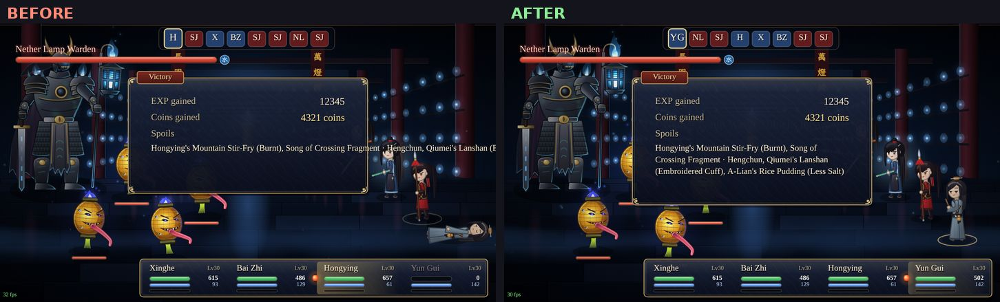
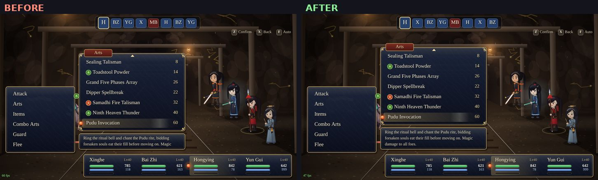
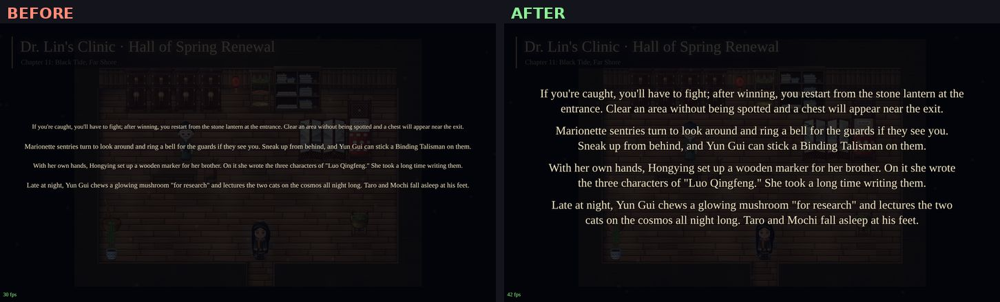
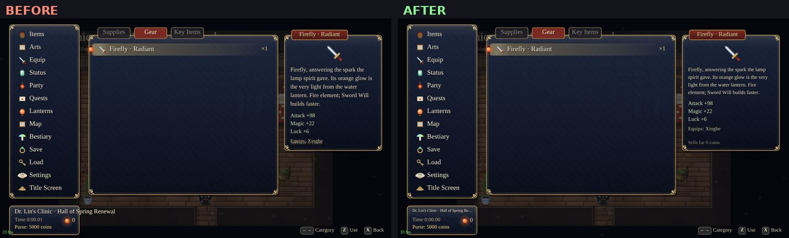
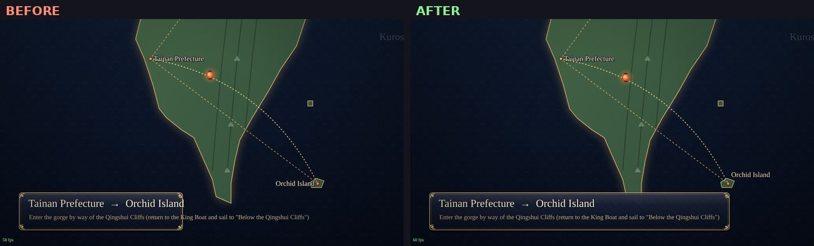
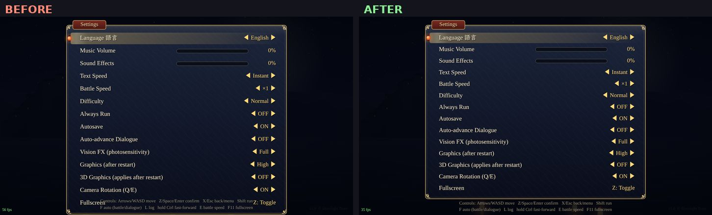

# English layout QA

QA pass over the UI with `settings.lang = 'en'` (3D off, 1280×720, headless Chromium). The English text
comes from the dictionaries in `js/i18n/en_*.js` and is looked up at draw time, so the Chinese layout constants
were all at risk. Every screen listed below was captured before and after the fixes. No dictionary string was
changed: each problem was fixed in the engine/UI code, so all strings get the fix.

Before/after examples: [`english_layout/`](english_layout/)

| | |
|---|---|
|  |  |
|  |  |
|  |  |

## New helpers (`js/core/render.js`)

- `G.Render.fit(ctx, str, maxW, {size, bold, minSize, ellipsis})`: translates the string, shrinks the font
  toward `minSize` (default 70 % of `size`, at least 12px), then cuts it with `…` if it still does not fit
  (unless `ellipsis: false`). Returns `{str, size, w}`.
- `G.Render.textClip(ctx, str, x, y, maxW, o)`: `R.text` that never exceeds `maxW` (uses `fit`).
- `G.Render.lineWidth(ctx, line)`: width of one wrapped line returned by `R.wrap`.

## Issues and fixes

| # | Screen | Problem in English | Fix |
|---|---|---|---|
| 1 | All list widgets (`G.UI.List`): items, equipment, skills, quests, bestiary, shop, battle lists, choices | Labels had no width limit. Long names such as "Hongying's Mountain Stir-Fry (Burnt)" in the 300px equip list ran under the `×3` count or past the panel | `List.draw` fits each label between its icon and the right-hand value (shrink, then `…`). Choices pass `ellipsis:false, minSize:15`, so an option is shrunk but never cut |
| 2 | Choice menu | Width grew with the longest option, with no cap (an 81-character option made a panel wider than the screen) | Width capped at `G.W - 120`. Longer options are shrunk by #1 |
| 3 | Toasts (quest / item / song-fragment / objective) | One line only: a 124-character toast made a 1200px-wide strip from edge to edge | Wraps at 1000px. The panel grows per line and stacked toasts are laid out by their real height |
| 4 | HUD objective tracker (top right) | One line only: 100+ character objectives made a strip that covered the map name banner | English wraps at 520px into a taller plate (Chinese layout unchanged) |
| 5 | Map name banner | "Temple of Eternal Light · Cavern of Ten Thousand Souls" (913px) ran past the 470px gradient backing | Backing gradient grows with the name. The name shrinks past 800px (min 30px). The subtitle is clipped at 800px |
| 6 | Narration / veil text (`S.narrate`) | Lines wider than the screen were shrunk until they fit: 150-character English lines came out at ~16px, so the size changed from line to line | English lines wrap into balanced rows at full size (no single orphan word), with extra spacing between paragraphs and the block centred on screen. If the block is too tall, the whole block steps down in size. Chinese keeps its original one-row, shrink-to-fit behaviour |
| 7 | Dialogue log (L) | Long speaker names ("Eldest of the Myriad-Form Children") ran from the 160px name column into the text | Names wrap inside the name column, and the entry height accounts for them |
| 8 | Battle skill / item / combo description | Box showed only 2 lines. 27 item and 6 skill descriptions are 3 lines in English, so the last words were cut ("…Magic" with "damage to all foes." missing) | Box grows to up to 4 lines and the list panel moves up to make room |
| 9 | Battle victory: Spoils | Item names joined into one line ran out of the 620px panel | Spoils wrap at 500px and are joined with ", ". The panel grows by the extra lines |
| 10 | Battle level-up | Stat line, "Learned: …" and name line could exceed the panel | Each line is fitted to the panel width |
| 11 | Battle skill banner / centre message | Fixed 420/520px backing band; long English skill names stuck out of it | Band width follows the text (fitted to the screen) |
| 12 | Battle ultimate cut-in | 64px skill name could run under the portraits | Fitted to `G.W - 520` (min 40px) |
| 13 | Battle target name | Clipped at the top of the screen for tall bosses, and no width limit | Label y is clamped to stay on screen. Name, element badge and "Weak:" line are fitted |
| 14 | Battle party HUD | A long party member name could overlap "Lv" | Fitted to the card |
| 15 | Items panel (menu) | Long description + stats + "Equips:" overlapped "Sells for N coins" (e.g. *Firefly · Radiant*) | Description steps down 19→17→16px until the block ends above the price line. "Equips:" is fitted |
| 16 | Shop item info | Descriptions longer than 5 lines were cut | Drops to 16px/23px line height for 6 lines. Comparison names fitted |
| 17 | Equipment panel | Item names in slots and slot labels had no limit | Fitted to their columns |
| 18 | Status panel | Name (40px) and title had no limit | Fitted (name min 28px) |
| 19 | Main menu info plate | Map names ("Dr. Lin's Clinic · Hall of Spring Renewal") ran out of the 230px plate | Fitted (shrink to 13px, then `…`) |
| 20 | Main menu objective panel | Fixed 130px tall: a long English objective ran out of the bottom | Panel height follows the wrapped text |
| 21 | Save / load slots | Long place names ran into the party column; the party line could run past the slot | Place, chapter and party lines fitted to their columns |
| 22 | Settings | 14 rows × 46px pushed the last row (Fullscreen) onto the two key-help lines. **This also happened in Chinese** | Rows are 42px, the panel ends above the help lines, and the help lines moved down slightly (the one fix that changes the Chinese layout, on purpose) |
| 23 | Chapter title card | Long chapter title / subtitle had no limit | Fitted to `G.W - 120` |
| 24 | Heart-lantern acquired card | Long lantern names had no limit | Fitted |
| 25 | Minigames | Hint text could run into the mash countdown ("9.1s"). Rival lane names ("Wushi Harbor Team") ran into each other. The song "X sings:" label had no limit | Hint fitted (560px in mash, 760px elsewhere). Lane names fitted to their lane. Song label fitted |
| 26 | World map | English place names drawn to the left of their dot ran across their own dot and their neighbours (Tamsui / Mt. Guanyin / Bangka / Pingxi / Xiangtian Lake / Alishan / Hengchun / Orchid Island) | English-only label placement table: labels left of the dot are right-aligned to end at the dot, and crowded ones move to the other side |
| 27 | Travel caption | "Tainan Prefecture → Orchid Island" and long route labels ran out of the 520px panel | Panel widens to fit (up to `G.W - 120`); text fitted |
| 28 | Ending credits | Very long cast / lantern lines could exceed the screen | Each line fitted to `G.W - 80` |
| 29 | Game over subtitle | Not limited | Fitted |

## Checked and fine (no change needed)

- Title screen and its menu, language toggle.
- Dialogue box with and without portraits: all 14,418 chapter strings wrap to ≤ 4 lines at 25px in the
  868px text area (10,702 one line, 3,516 two, 199 three, 1 four), so no line needs a second page. Speaker
  plates grow with the name ("Eldest of the Myriad-Form Children" fits).
- Inn choice, party order, heart-lantern list, bestiary text, quest text (all ≤ 12 lines in the 420px panel).
- Battle command menu, timeline chips (initials), status badges (PSN / SEAL / ATK…), damage pop-ups and
  labels (Weak spot!, Critical!, Resisted, Down!), boss bar (already used `textFit`).
- Timing / jiaobei minigames, game-over menu.

## Chinese regression check

Every scenario was captured in `zh` with the original code and with the fixed code, and the two sets were
diffed pixel by pixel. Static screens (menus, shop, dialogue, toasts, HUD, narration, quests, save, title
cards, world map, credits) are identical apart from animated elements. The only intended change is the
settings screen (fix #22). Battle and title screens differ only in animation and battle state.

## Not changed / notes

- No `js/i18n/en_ch*.js` string had to be shortened: every slot now shrinks, wraps or truncates.
- Untranslated strings seen during testing came from test-only strings I injected, not from game data.
- Truncation with `…` is a last resort. It only happens where a fixed column cannot grow (list rows, the
  save-slot place name, the menu info plate). The full text is always shown in the matching detail panel.
