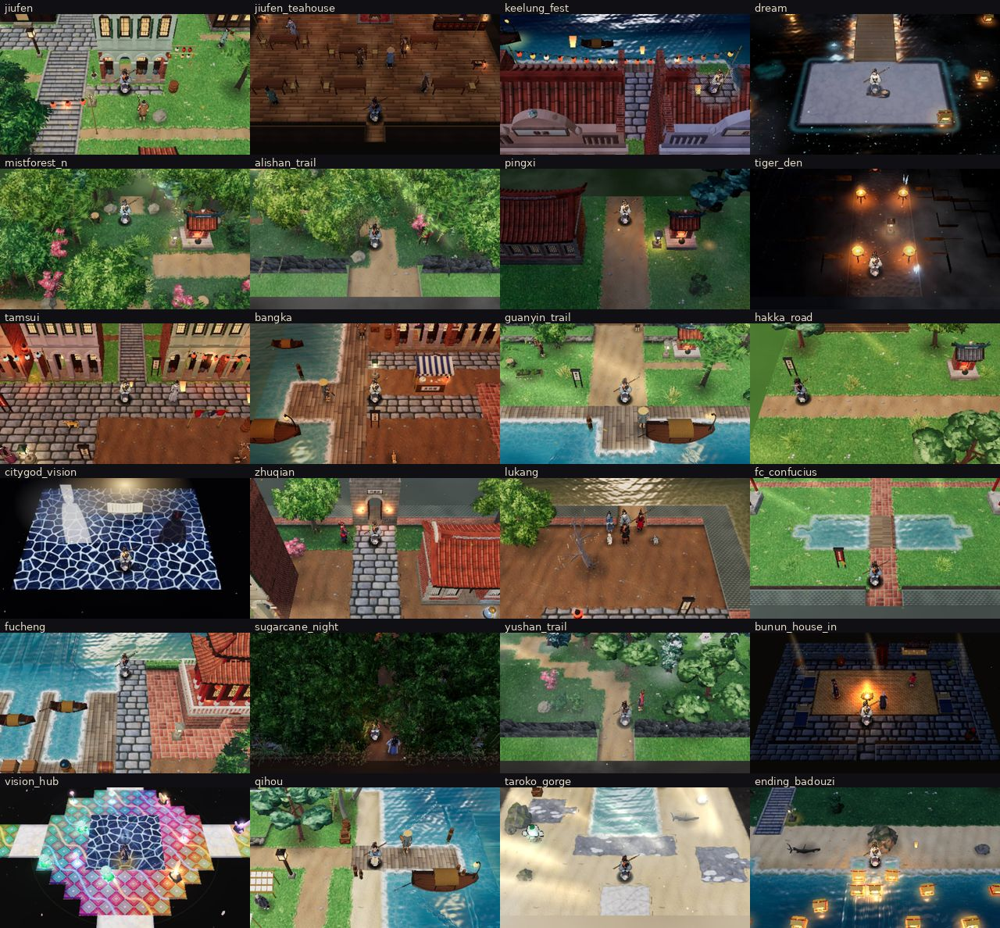

# 3D field-view sweep: every map with 3D on

**Scope.** Every map in `G.Maps` (175 ids from `js/maps/ch*_*.js` and `test.js`) was loaded with the 3D field view
on. All loads used one headless Chromium page (SwiftShader, 960×540) that navigates from map to map:

```
index.html?debug&r3lite&map=<id>&party=xinghe,baizhi,hongying,yungui&lv=30&flags=mochi_joined,yuyuan_joined
localStorage.shorelight_settings = {"render3d":true}
```

**Harness.** [`tools/r3d/sweep/sweep.js`](../../tools/r3d/sweep/sweep.js) supports `--resume` and `map:x,y` start
tiles. For each map it waits for `G.Map3D` to build, then lets it render 16 frames. It records:
- the `G.Map3D` constructor time, as "build ms";
- draw calls and triangles from `renderer.info`;
- console errors and warnings, page errors, failed requests and `G._warned` (`G.warnOnce`) keys;
- billboard fallbacks: object nodes that are 2D-art billboards, and actors that are `CharBillboard` or `MonBillboard`;
- NaN bounding spheres, black untextured lit materials, and placement outliers (floating, sunk, giant or tiny boxes).

**Screenshot.** The camera is reset to follow the player first, which undoes entry cutscenes. Only the 3D layer is
captured; the 2D UI canvas is hidden.

**Other tools:**
- [`summary.js`](../../tools/r3d/sweep/summary.js) prints the digest and this table.
- [`probe.js`](../../tools/r3d/sweep/probe.js) runs JS snippets in one map and takes a screenshot after each.
- [`contact.py`](../../tools/r3d/sweep/contact.py) builds the contact sheet.

## Result

**Process.**
1. Pass 1 covered all 175 maps.
2. Problems were fixed during and after pass 1.
3. Every fixed map was checked again, often at a start tile next to the problem, with `map:x,y`.
4. 46 maps were swept again after all fixes, including all chapter 0–2 maps. A full second pass would take about
   3 hours under SwiftShader, so it was stopped at the lead's request.

Rows marked ✓ come from that post-fix run. The other rows are pass-1 data. Those maps were unaffected except by the
global water/apron fixes (F3–F5), which were checked on 10 representative maps.

**Findings:**
- **Clean console:** 0 page errors, 0 console errors, 0 `G.warnOnce` keys, 0 failed requests, 0 NaN bounds on every
  map.
- **No billboard fallbacks after the fixes.** Before them, 4 chapter object types fell back, and 3 more had no model.
- **Model coverage is complete:** all 162 `G.Objects` types, 128 sprite ids and 61 monster arts have 3D builds.
- **Only console output:** `mon3d-b <id> body fixed N degenerate verts`, a `?debug`-only diagnostic from the
  monsters_b normal sanitiser (O6).
- **Medians across 175 maps:** build 5.9 s (SwiftShader), 79 draw calls, 187k triangles.



## Fixes

| # | problem (maps) | fix | file |
|---|---|---|---|
| F1 | **Dense forests closed the canopy over the player** (alishan_trail, mistforest_n/s, mist_loop, tiger_lair, tsou_hosa, cloud_forest …). The 1 m porthole cutout didn't open a 1×1-tree canopy. | Foliage materials (`userData.foliage`) get a 2.6× cutout radius. The core is clear and an outer ring is half-dissolved (canopy fade), instead of a 12 % leaf residue. | materials.js |
| F2 | **Tall models swallowed the player** (keelung_fest start: two-storey shophouse roofs 3–4 tiles south of him). | Every frame, Map3D raycasts camera → player chest against cached object AABBs. If a model taller than 2.6 m is in between, the cutout radius eases up to 2.1× and the foliage factor is rescaled so canopies keep their size. | mapview.js |
| F3 | **Inland water was invisible**: rivers, lakes and ponds were covered by a flat slab (fc_confucius 泮池 grey, mist_grove lake green, taroko_gorge river showing the night sky, …). The 400×400 land apron at y −0.03 also lay *inside* the map, above every sunk water bed (−0.12…−0.48) and the water plane (−0.07). | The apron is now a frame with a map-sized hole. | mapview.js |
| F4 | **A river touching the map edge flooded the world** (hakka_road, hakka_village: open sea west of the map). Any water cell on the border switched on the 400×400 sea and sank the apron. | Open sea needs > 12 % of the border to be water, or > 4 % to be sea-type water (a harbour mouth: fucheng 五條港). | mapview.js |
| F5 | **Hard lines in the sea** (orchid_reef, qihou). Per-tile terraced seabed (−0.2 / −0.48) showed through translucent water as blocky shelves (env.md issue 3). The water shader jumped to `sd = 4 + outd` beyond the map, a seam along the border. | `heightAt` makes a smooth bed: a weighted average of cell depths within 2.5 tiles, kept below the water. The shader continues the edge value (`max(sd,0) + outd`). | mapview.js, env.js |
| F6 | **Apron colour** came from the top-left 64 px only (fucheng: a maroon temple wall). | Average of the border floor tiles, read once per chunk and cached. This also avoids Chrome's repeated-readback warning. | mapview.js |
| F7 | **`o.alpha` ignored in 3D**: invisible blockers rendered (keelung_fest `paper_stack` ×6, alpha 0), and scripted object fades (ch6 Mover, ch8 palanquin/water lantern, ch2 wisps) popped. | alpha ≤ 0.01 hides the node and its lights. 0 < alpha < 1 fades per-node cloned materials, sharing the spirit path. | mapview.js |
| F8 | **Chapter object types without models**: `c2_redcloth` and `c2_tongue` (billboards in mistforest_n/s and mist_loop), `c2_indigo` (pingxi), `c2_cage` (tiger_den), `c2_wisp` (mist_grove cutscene), `c2_footprint` (standing billboard: maze prints, tiger paws, lost shoe), and `c4_saisiyat_house` (6× in wuzhi_trail). | New `js/r3d/props_chapter.js`, loaded by index.html and the viewer. It has cloth flutter, a cage door that follows its flag, a bobbing wisp, prints painted from the 2D art with a sequence pulse, and the Saisiyat house via arch_coast's Amis long-house builder. | props_chapter.js |
| F9 | **Upright 2D art flattened onto the ground decal**: citygod_vision 七爺/八爺 and the floating ledger lay on the floor; hakka_road and hakka_village persimmons were orange dots 2 tiles north of each tree. | Minimal map 3D hooks, as the contract prescribes: the 2D hook skips them when `ms.view3d`, and `update3d` mirrors them as upright cards and as instanced fruit on the camphor crowns. | ch4_hsinchu.js |
| F10 | **bunun_house_in rendered as outdoors** (sky, sea of clouds behind an interior). Slate floor isn't in Map3D's interior-floor set. | `interior: true`, the contract's 3D flag. | ch7_mountains.js |

Verified as already fixed: the env report's `G.FX.vision` buffer clear (fx.js), `PCFShadowMap`, `lights()` honouring
`rot3d`, spirit material cloning, and the `objSig` fields.

## Open issues

- **O1 Draw-call outliers.** These maps use one node per plant:
  - sugarcane_night: 153 bamboo + 109 silvergrass → ~490 calls, 6× the median.
  - tiger_lair, mistforest_n/s, alishan_trail, linto, wuzhi_trail: 230–360 calls.

  The CPU frame time stays low (9–30 ms in SwiftShader). On a real GPU this is fine, but it is the first thing to
  optimise. Suggested fix: auto-instance repeated static nature models in Map3D. Group by model cache key into
  `InstancedMesh` per 16×16 ground chunk (keeps culling), bake the `spin()` yaw into the instance matrix, and keep the
  holder nodes as invisible proxies for `objActive` / removal. `windify` already supports `instanceMatrix`.

  Not done here: it touches object lifecycle, so it is not an "easy" fix. **Addressed later by G.Batch3D: see
  [Batching](#batching).**
- **O2 Triangle outliers come from characters.** Each Char3D is ≈18k triangles, so interiors with 6–8 NPCs reach
  200–330k, and anping_tower (23 actors) reaches 461k. A field-context LOD (no outline hull and lower-segment hair
  for NPCs more than 10 m away) would halve this.
- **O3 Sea beyond the map corner.** On open-sea maps (qihou, orchid_reef) the water outside the map looks a little
  darker and glassier than inside: the sunk apron at −0.6 replaces the textured bed under translucent water. It is
  visible only at map corners.
- **O4 Map edges into the sea** (amis_village, taitung_coast). Land ends in a straight vertical edge with no shore
  skirt. A rock/sand skirt like env's sea-of-clouds cliff would sell it.
- **O5 Tile-art reads.** lukang_jiuqu's 3×6 `wall_plaster` block has a dark top texture that reads like a roofless
  room. Interior back walls are mostly cut to a low strip by the camera-side cutaway, which is fine. Halos for lights
  without a lamp (env.md issue 4) were not seen as a problem in this sweep.
- **O6 monsters_b sanitiser diagnostic.** `fixed N degenerate verts` is logged under `?debug` for 16 creatures, for
  example `tide_grudge` 42, `gorge_colossus` 60 and `fog_spirit` 14. The guard works, but the templates have
  zero-area triangles that the monsters-b team could remove at the source.
- **O7 Seen but not changed** (as designed or out of scope):
  - Some maps start inside a cutscene that hides or moves the player (palace_hall, palace_study, alishan_trail);
    the screenshots use the default camera anyway.
  - The 2D wind-chime labels (wind_cave_2) are ground-decal text, which is fine.

## All maps

✓ = swept again after all fixes. Status: FIXED = a problem on this map was fixed; WARN = open issue; OK = no
problem found. Build time is the `G.Map3D` constructor under SwiftShader (`r3lite`, half resolution); real
hardware is several times faster.

| map | size | kind | status | build ms | draw calls | triangles | notes |
|---|---|---|---|---:|---:|---:|---|
| alishan_forest | 44×40 | outdoor (night) | OK | 11549 | 166 | 210160 |  |
| alishan_trail | 48×44 | outdoor | FIXED | 12661 | 241 | 270686 | dense 1×1 camphor/fern canopy hid the player → foliage canopy fade |
| amis_village | 44×34 | outdoor | OK | 9756 | 52 | 153822 | land ends in a straight vertical edge into the open sea (no shore skirt) |
| anping | 44×34 | outdoor | OK | 11449 | 127 | 227551 |  |
| anping_fort | 40×44 | outdoor (night) | OK | 6519 | 67 | 171396 |  |
| anping_tower | 24×22 | outdoor (night) | OK | 4750 | 115 | 461290 | 23 actors on the map (characters ≈18k tris each); triangle outlier |
| badouzi ✓ | 48×36 | outdoor (night) | OK | 10821 | 71 | 184214 |  |
| bangka ✓ | 56×44 | outdoor | OK | 13991 | 184 | 387016 |  |
| bangka_alian | 12×9 | interior | OK | 1380 | 56 | 150866 |  |
| bangka_armory | 12×9 | interior | OK | 1004 | 60 | 165766 |  |
| bangka_bopiliao | 40×14 | outdoor | OK | 8109 | 125 | 239682 |  |
| bangka_herb | 12×9 | interior | OK | 1044 | 63 | 170744 |  |
| bangka_inn | 14×10 | interior | OK | 1137 | 76 | 200182 |  |
| bangka_longshan | 28×22 | interior | OK | 6470 | 65 | 168942 |  |
| bangka_riverbank | 36×20 | outdoor (night) | OK | 11800 | 97 | 177789 |  |
| bangka_theatre | 18×12 | interior | OK | 1353 | 99 | 242100 |  |
| bangka_xing | 12×9 | interior | OK | 1315 | 60 | 168254 |  |
| banping_cave | 40×40 | cave | OK | 5652 | 68 | 183754 |  |
| banping_foot | 40×30 | outdoor | OK | 13028 | 80 | 219490 |  |
| baosang | 40×30 | outdoor | OK | 14500 | 92 | 269343 |  |
| beigang | 56×44 | outdoor | OK | 11749 | 146 | 288938 |  |
| beigang_inn | 16×12 | interior | OK | 534 | 87 | 241024 |  |
| beigang_river | 48×40 | outdoor | OK | 13712 | 112 | 182529 |  |
| breath_realm | 40×40 | outdoor | OK | 4747 | 88 | 162063 | psychedelic realm: as designed |
| bunun_home | 30×24 | outdoor (night) | OK | 9255 | 128 | 172476 |  |
| bunun_house_in ✓ | 14×10 | interior | FIXED | 810 | 70 | 208472 | slate-floored interior was classified outdoor (sky, sea of clouds) → interior |
| c10_xuanwu_room | 14×10 | outdoor (night) | OK | 4533 | 141 | 157582 |  |
| citygod_vision ✓ | 16×12 | outdoor (night) | FIXED | 4003 | 38 | 138998 | 七爺/八爺 figures and the floating ledger were painted flat on the floor → upright cards (update3d) |
| cloud_forest | 40×44 | outdoor | OK | 11427 | 204 | 224584 |  |
| donggang | 56×42 | outdoor | OK | 13620 | 121 | 291463 |  |
| donglong_hall | 20×14 | interior | OK | 4473 | 82 | 204368 |  |
| dream ✓ | 21×46 | outdoor (night) | OK | 5368 | 67 | 121774 | black sea + stars: as designed |
| eluanbi | 40×32 | outdoor | OK | 10726 | 88 | 222244 |  |
| ending_badouzi | 24×14 | outdoor (night) | OK | 10465 | 114 | 150281 |  |
| ending_jiufen ✓ | 22×12 | outdoor (night) | OK | 7726 | 94 | 200290 |  |
| ending_jiufen_shop ✓ | 14×9 | interior | OK | 676 | 72 | 188540 |  |
| ending_lukang ✓ | 18×12 | outdoor | OK | 5087 | 81 | 278288 |  |
| farshore_field | 56×44 | outdoor (night) | OK | 10360 | 98 | 263202 |  |
| farshore_tower_1 | 24×24 | interior | OK | 811 | 51 | 153644 |  |
| farshore_tower_2 | 24×24 | interior | OK | 551 | 48 | 144470 |  |
| farshore_tower_3 | 24×24 | interior | OK | 724 | 61 | 149444 |  |
| farshore_tower_4 | 24×24 | interior | OK | 1968 | 57 | 156226 |  |
| farshore_tower_5 | 24×24 | interior | OK | 1018 | 48 | 144472 |  |
| farshore_tower_top | 16×14 | interior | OK | 1153 | 42 | 139412 |  |
| fc_chikan | 28×22 | outdoor | OK | 6403 | 96 | 205881 |  |
| fc_confucius ✓ | 28×22 | outdoor | FIXED | 7675 | 58 | 217840 | 泮池 pond was hidden under the land apron (flat grey slab) → visible water |
| fc_herb | 12×9 | interior | OK | 448 | 56 | 164312 |  |
| fc_inn | 14×10 | interior | OK | 550 | 59 | 191856 |  |
| fc_mazu | 24×18 | interior | OK | 4863 | 64 | 196962 |  |
| fc_qiniang | 16×12 | outdoor | OK | 5686 | 81 | 230398 |  |
| fc_shop | 12×9 | interior | OK | 468 | 57 | 163002 |  |
| fc_zheng | 14×10 | interior | OK | 7902 | 63 | 153696 |  |
| fucheng ✓ | 60×46 | outdoor | FIXED | 15912 | 92 | 222958 | 五條港 harbour hidden under a maroon apron slab → open sea at the harbour mouth, apron colour from border floor tiles |
| guanyin_trail ✓ | 40×56 | outdoor | OK | 10183 | 134 | 321019 |  |
| hakka_liu | 18×12 | interior | OK | 896 | 80 | 189172 |  |
| hakka_road ✓ | 44×40 | outdoor | FIXED | 10058 | 92 | 202101 | river leaving the map flooded the whole world outside with open sea → land apron; persimmons were painted flat on the ground → 3D fruit in the crowns |
| hakka_village | 52×40 | outdoor | FIXED | 11394 | 92 | 225722 | same open-sea flood as hakka_road; persimmons → 3D fruit in the crowns |
| hengchun | 50×42 | outdoor | OK | 8844 | 105 | 252870 |  |
| hengchun_wall | 24×9 | outdoor (night) | OK | 5379 | 40 | 140828 |  |
| huilan | 36×28 | outdoor (night) | OK | 14215 | 107 | 237793 |  |
| jiufen ✓ | 40×45 | outdoor | OK | 16293 | 155 | 270865 |  |
| jiufen_atu_house ✓ | 12×9 | interior | OK | 550 | 57 | 151064 |  |
| jiufen_clinic ✓ | 14×10 | interior | OK | 785 | 66 | 180786 |  |
| jiufen_shop ✓ | 16×12 | interior | OK | 888 | 92 | 201450 |  |
| jiufen_shop_2f ✓ | 12×9 | interior | OK | 985 | 72 | 161530 |  |
| jiufen_store ✓ | 14×10 | interior | OK | 733 | 69 | 175934 |  |
| jiufen_teahouse ✓ | 20×14 | interior | OK | 877 | 109 | 331444 |  |
| jiufen_yuyuan ✓ | 14×10 | interior | OK | 816 | 67 | 171730 |  |
| keelung_fest ✓ | 40×30 | outdoor (night) | FIXED | 13212 | 100 | 206077 | invisible blockers (paper_stack, alpha 0) rendered in 3D → hidden; two-storey shophouse roofs swallowed the player → wider cutout behind tall models |
| lamp_heart | 24×20 | outdoor | OK | 5917 | 51 | 172708 |  |
| lamp_shrine | 40×30 | interior | OK | 4428 | 84 | 190028 |  |
| lamp_shrine_core | 24×22 | interior | OK | 3887 | 70 | 184368 |  |
| lamp_shrine_lower | 40×30 | interior | OK | 4801 | 66 | 192306 |  |
| lighthouse_in | 14×12 | interior | OK | 787 | 63 | 162740 |  |
| lighthouse_top | 10×10 | outdoor (night) | OK | 4760 | 54 | 147518 |  |
| linto | 40×36 | outdoor (night) | OK | 9980 | 233 | 331172 |  |
| longkeng_caves | 44×44 | cave | OK | 13068 | 88 | 205736 |  |
| longpan | 48×44 | outdoor | OK | 8386 | 110 | 221150 |  |
| lukang ✓ | 56×42 | outdoor | OK | 13735 | 91 | 187386 |  |
| lukang_inn | 14×10 | interior | OK | 682 | 73 | 200694 |  |
| lukang_jiuqu | 40×32 | outdoor | OK | 8356 | 56 | 166246 | the 3×6 wall_plaster block's dark top texture reads like a roofless room (tile art) |
| lukang_lantern | 14×10 | interior | OK | 698 | 108 | 192682 |  |
| lukang_mazu | 24×18 | interior | OK | 6592 | 76 | 205278 |  |
| lukang_shop | 12×9 | interior | OK | 738 | 64 | 164450 |  |
| lukang_shore | 36×24 | outdoor (night) | OK | 7639 | 69 | 186065 |  |
| lukang_wang | 14×10 | interior | OK | 5356 | 62 | 176912 |  |
| luo_1f | 40×30 | interior | OK | 9647 | 82 | 209818 |  |
| luo_2f | 32×22 | interior | OK | 980 | 68 | 191758 |  |
| luo_gate | 20×14 | outdoor | OK | 6474 | 78 | 189304 |  |
| mine_1 ✓ | 40×40 | cave | OK | 8939 | 112 | 213844 |  |
| mine_2 ✓ | 30×30 | cave | OK | 8881 | 59 | 161644 |  |
| mist_grove ✓ | 30×24 | outdoor (night) | FIXED | 8361 | 208 | 189096 | lotus lake was hidden under the land apron (flat green slab) → visible water |
| mist_loop ✓ | 24×20 | outdoor (night) | FIXED | 6094 | 238 | 219522 | c2_redcloth + c2_tongue (靈視) were billboards → models |
| mistforest_n ✓ | 40×44 | outdoor | FIXED | 8964 | 259 | 278177 | c2_redcloth was a 2D billboard → model; dense canopy → canopy fade |
| mistforest_s ✓ | 40×44 | outdoor | FIXED | 7477 | 261 | 283436 | c2_redcloth was a 2D billboard → model; dense canopy → canopy fade |
| north_dunes | 24×14 | outdoor (night) | OK | 5459 | 60 | 162556 |  |
| orchid_reef ✓ | 36×30 | outdoor | FIXED | 8092 | 47 | 160704 | hard shallow/deep lines in the sea (terraced seabed + map-edge seam) → smooth seabed, continuous edge; faint tone change beyond the map corner remains |
| orchid_shore | 44×32 | outdoor | OK | 11930 | 102 | 256074 |  |
| palace_dock | 30×20 | interior | OK | 4499 | 57 | 77526 |  |
| palace_hall | 40×30 | interior | OK | 5389 | 55 | 109606 |  |
| palace_lanterns | 36×30 | interior | OK | 5144 | 190 | 166238 |  |
| palace_study | 24×18 | interior | OK | 902 | 36 | 85678 |  |
| penghu_atian | 12×9 | interior | OK | 7762 | 67 | 170768 |  |
| penghu_flats ✓ | 56×44 | outdoor (night) | OK | 15440 | 83 | 271484 |  |
| penghu_inn | 14×10 | interior | OK | 800 | 63 | 199448 |  |
| penghu_magong | 48×36 | outdoor (night) | OK | 10327 | 118 | 281906 |  |
| penghu_tianhou | 18×14 | interior | OK | 5050 | 99 | 278552 |  |
| pingxi ✓ | 48×40 | outdoor (night) | FIXED | 13986 | 79 | 180149 | c2_indigo (染坊 drying pole) was a billboard → model with fluttering cloth |
| pingxi_inn ✓ | 16×12 | interior | OK | 650 | 82 | 193004 |  |
| pingxi_oldhouse ✓ | 12×9 | interior | OK | 615 | 53 | 152390 |  |
| pingxi_store ✓ | 14×10 | interior | OK | 690 | 68 | 174978 |  |
| pingxi_tiandeng ✓ | 14×10 | interior | OK | 668 | 84 | 182236 |  |
| qihou ✓ | 48×36 | outdoor | FIXED | 16265 | 108 | 223164 | seam along the map border in the sea → continuous; faint tone change beyond the map corner remains |
| qihou_temple | 16×12 | interior | OK | 4343 | 90 | 200926 |  |
| qingshui_cliffs | 50×40 | outdoor | OK | 6052 | 76 | 203677 |  |
| rat_den | 20×16 | cave | OK | 4545 | 58 | 170336 |  |
| sandbox ✓ | 30×18 | outdoor | OK | 13334 | 95 | 227773 |  |
| shifen_falls ✓ | 32×28 | outdoor | OK | 9139 | 84 | 155758 |  |
| sugar_shrine | 24×18 | outdoor (night) | OK | 11188 | 188 | 236811 |  |
| sugarcane_night | 22×16 | outdoor (night) | WARN | 5673 | 494 | 375256 | 153 bamboo + 109 silvergrass, one node each → ~490 draw calls (6× median); see open issues; draw-call outlier |
| sunmoon | 50×38 | outdoor | OK | 9554 | 96 | 188510 |  |
| sunmoon_mist | 30×44 | outdoor (night) | OK | 5413 | 70 | 169308 |  |
| taitung_coast | 48×40 | outdoor (night) | OK | 10119 | 84 | 210580 |  |
| taixu ✓ | 28×22 | interior | OK | 11515 | 82 | 199270 |  |
| taixu_hall ✓ | 16×12 | interior | OK | 4467 | 84 | 166508 |  |
| taixu_room ✓ | 12×9 | interior | OK | 777 | 58 | 166998 |  |
| tamsui ✓ | 48×30 | outdoor | OK | 12240 | 104 | 155880 |  |
| tamsui_fort ✓ | 24×18 | outdoor | OK | 7609 | 68 | 165516 |  |
| tamsui_fort_in ✓ | 12×9 | interior | OK | 4573 | 61 | 147178 |  |
| tamsui_inn ✓ | 14×10 | interior | OK | 786 | 79 | 210220 |  |
| taroko_gorge ✓ | 44×56 | outdoor | FIXED | 6682 | 80 | 253455 | river was hidden under the apron (black slab showing the night sky) → visible water |
| tengpo_hut | 16×14 | outdoor (night) | OK | 12972 | 231 | 211014 |  |
| tengpo_hut_in | 12×10 | interior | OK | 697 | 64 | 158480 |  |
| tiger_den ✓ | 32×32 | cave | FIXED | 4232 | 92 | 209582 | c2_cage was a billboard → bamboo cage model, door swings with its flag |
| tiger_house ✓ | 14×10 | interior | OK | 7363 | 51 | 166956 |  |
| tiger_lair ✓ | 40×40 | outdoor | FIXED | 7765 | 313 | 331754 | c2_footprint paw prints / lost shoe stood upright as billboards → flat decals; draw calls high (bamboo forest); draw-call outlier |
| toucheng | 56×44 | outdoor | OK | 14455 | 91 | 188984 |  |
| truku_village | 40×32 | outdoor | OK | 9226 | 81 | 185064 |  |
| tsou_hosa | 48×36 | outdoor | OK | 11828 | 104 | 202270 |  |
| tsou_house | 14×10 | interior | OK | 760 | 64 | 173548 |  |
| vision_heart | 24×24 | outdoor (night) | OK | 3045 | 22 | 36326 |  |
| vision_hongying | 36×30 | outdoor | OK | 4806 | 65 | 76658 |  |
| vision_hub | 40×40 | outdoor | OK | 4996 | 94 | 100918 |  |
| vision_xinghe | 40×30 | outdoor | OK | 3674 | 53 | 124742 |  |
| vision_yungui | 32×32 | outdoor | OK | 5640 | 81 | 36097 |  |
| wangboat_blacktide | 28×16 | outdoor (night) | OK | 4607 | 53 | 138248 |  |
| wangboat_cabin11 | 14×9 | interior | OK | 574 | 59 | 149698 |  |
| wangboat_deck | 26×12 | outdoor | OK | 4644 | 79 | 173010 |  |
| wangboat_deck_east | 28×13 | outdoor | OK | 7908 | 79 | 174562 |  |
| wangchuan_yard | 44×32 | interior | OK | 9427 | 103 | 284300 |  |
| wind_cave_1 | 40×44 | cave | OK | 7493 | 73 | 185100 |  |
| wind_cave_2 | 44×40 | cave | OK | 7220 | 87 | 187186 |  |
| wind_cave_3 | 30×30 | cave | OK | 6974 | 48 | 151920 |  |
| wuzhi_trail | 40×52 | outdoor | FIXED | 11673 | 213 | 268860 | c4_saisiyat_house (6×) had no model → thatched long house |
| xiangtian | 46×38 | outdoor | OK | 11665 | 61 | 182168 |  |
| xiangtian_festival | 46×38 | outdoor | OK | 12199 | 91 | 236486 |  |
| xiangtian_house | 14×10 | interior | OK | 6065 | 58 | 150974 |  |
| xuanwu_1f | 44×40 | interior | OK | 7385 | 61 | 190992 |  |
| xuanwu_b1 | 44×40 | cave | OK | 4891 | 93 | 186066 |  |
| xuanwu_cell | 12×9 | interior | OK | 429 | 57 | 141746 |  |
| xuanwu_shore | 40×40 | outdoor (night) | OK | 5886 | 62 | 196666 |  |
| xuanwu_top | 24×20 | outdoor (night) | OK | 4117 | 42 | 144552 |  |
| yanshui | 44×34 | outdoor | OK | 11290 | 89 | 265172 |  |
| yanshui_inn | 14×10 | interior | OK | 630 | 66 | 195836 |  |
| yanshui_road | 24×16 | outdoor | OK | 6832 | 66 | 182375 |  |
| yanshui_temple | 16×12 | interior | OK | 4653 | 101 | 229470 |  |
| yimin_temple | 30×24 | outdoor | OK | 13356 | 64 | 172292 |  |
| yushan_trail | 44×52 | outdoor | OK | 10475 | 161 | 229760 |  |
| zhuqian | 56×44 | outdoor | OK | 17485 | 131 | 223894 |  |
| zhuqian_citygod | 20×14 | interior | OK | 5699 | 100 | 208196 |  |
| zhuqian_coast | 48×34 | outdoor | OK | 15104 | 78 | 196596 |  |
| zhuqian_inn | 14×10 | interior | OK | 797 | 66 | 184558 |  |
| zhuqian_mifen | 16×10 | interior | OK | 10586 | 64 | 152894 |  |
| zhuqian_pharmacy | 12×9 | interior | OK | 616 | 52 | 167396 |  |
| zhuqian_smith | 12×9 | interior | OK | 849 | 56 | 164860 |  |
