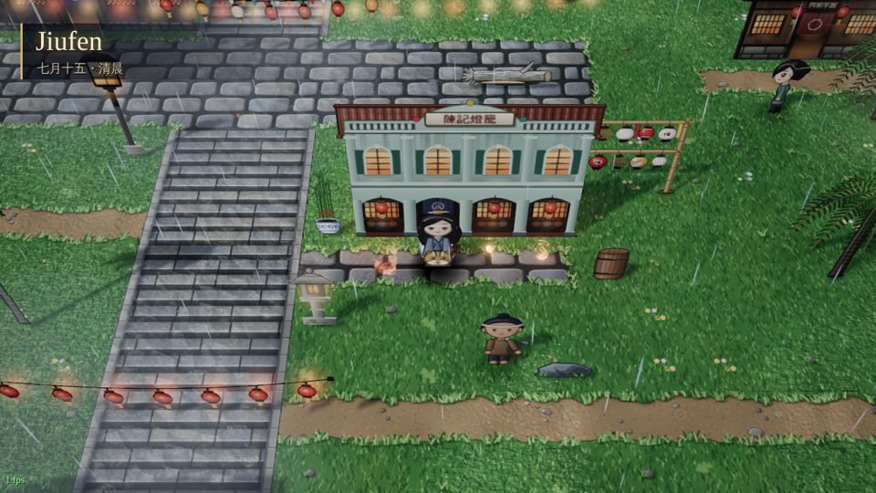
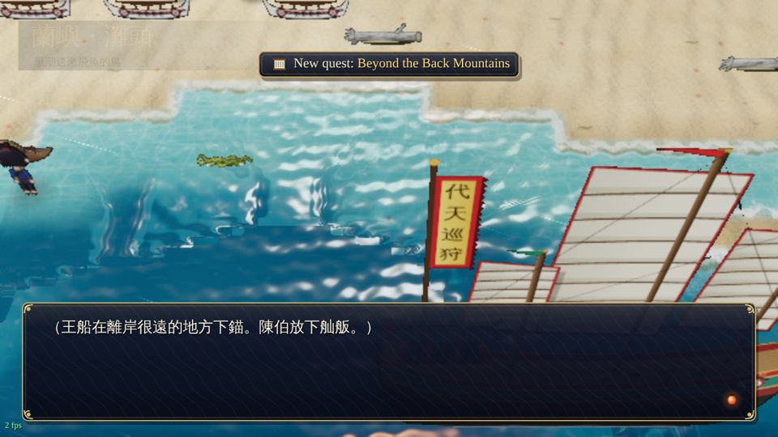
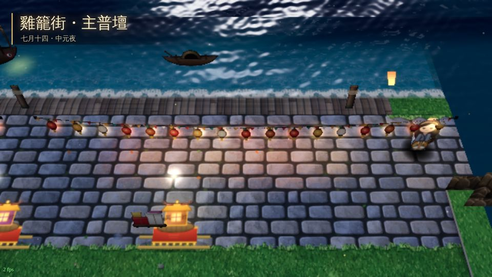
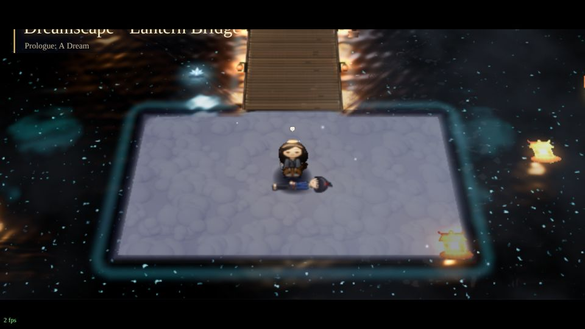
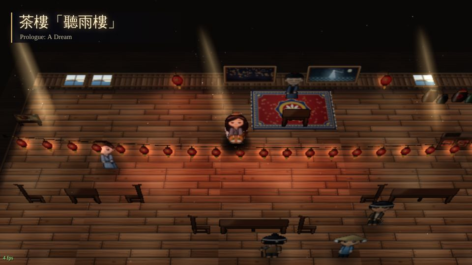
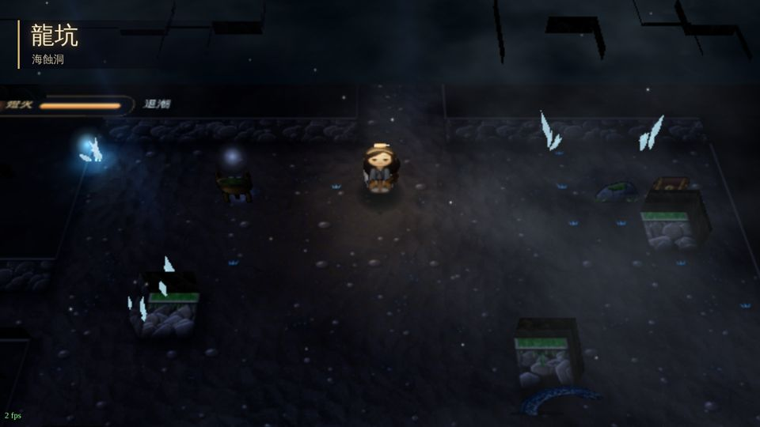
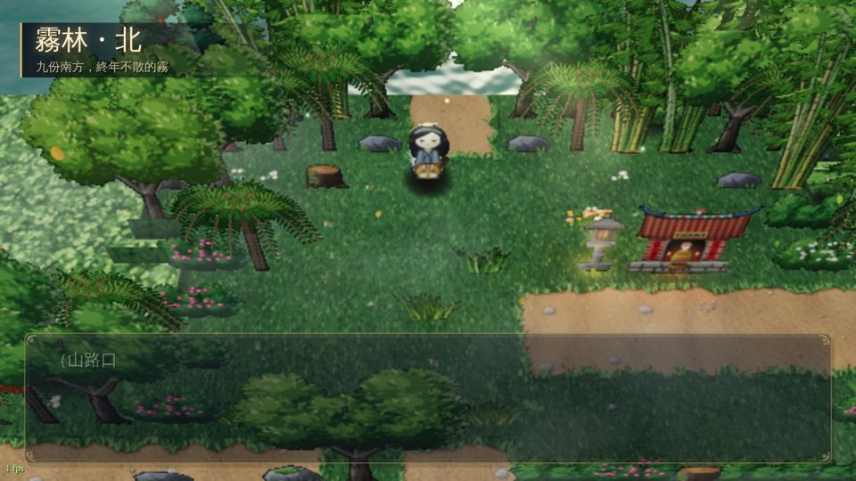

# Environment & atmosphere: `G.Env3D` (js/r3d/env.js)

All environment work is in `js/r3d/env.js`. It plugs into Map3D only through the two contract hooks:
`decorate(view)` after the build and `update(view, dt)` every frame. No lead files were edited.
Tests: `tools/r3d/env/capture.js`. Screenshots are in `docs/r3d_reports/env/` (half-res `r3lite` unless the name ends in `_full`).

```
node tools/r3d/env/capture.js set                     # 14-map regression set, r3lite; exits 1 on any console error / env warning
node tools/r3d/env/capture.js --full jiufen           # full post chain (slow under SwiftShader: ~70 s per map)
node tools/r3d/env/capture.js --quality=low|ultra --fx=0 --wait=6 --out=dir map[:x,y][@flag+flag][#var=v]
```
The last run of the full set (r3lite, quality high), plus extra runs at low/ultra quality, `--fx=0`, and `--full` on Jiufen, all had **zero console errors**. The only warning was the lead's pre-existing `PCFSoftShadowMap has been removed`, which the script filters out.

## What it does

### 1. Water 2.0
`view.water.material` is replaced by a custom `ShaderMaterial`. The plane and its height are unchanged.

**Baked from `view.ms.terrain` at decorate:**
- A 4-texel-per-tile **signed shore-distance field**: two chamfer passes, positive into the water and negative into the land.
- A smoothed **depth hint** for deep kinds.
- A per-tile **kind texture** (water / deepwater / shallow / lake / river / marsh / black_sea). It is dilated into the land so the banks know their water. The shader blends kinds bilinearly, so there are no tile seams.
- A **river flow field**. Each river component gets a PCA axis, refined by a local 7×7 PCA so bends work. Downstream is the end that touches the sea, a lake or the map edge.

**In the shader:**
- Shallow → deep tint per kind.
- Four analytic swell waves that roll *toward the shore*, using the gradient of the shore field.
- Flow-mapped ripples on rivers (two-phase, so there is no stretching); drifting ripples elsewhere.
- Shallow caustics and crest scatter.
- Fresnel reflection of the **same procedural sky** (clouds, sun/moon, stars).
- Sun/moon glints plus sparkle. The glint light is placed in front of the camera so highlights land on screen.
- Shore foam: lapping lines that move toward the beach, broken up with noise. Also river-bank streaks and wind whitecaps.
- Alpha that fades where the bank rises.

**Night lanterns:** the 12 pool lights are fed in as uniforms, giving rippling reflection streaks for every lit lantern near the water.

**black_sea:** inky body with drifting, slowly pulsing cyan/violet phosphorescent specks and a faint glowing surf line.

**Cave/interior water** gets no sky, sun or moon. It shows only lantern reflections.

### 2. Sky
- The lead's dome material is swapped for a painterly sky:
  - gradient, horizon glow and sun disc;
  - moon with crater mottling and halo;
  - twinkling stars and a Milky Way band with dust lanes;
  - two cloud layers lit from the sun side, with gentle brush banding and silver linings;
  - a slow 8-fold kaleidoscope when the realm is psychedelic.
- The default camera (pitch 52°, FOV 32) never actually sees the sky. That is why the same `skyColor()` GLSL is used in the water reflection, and why the sky also drives the IBL: `scene.environment` is rebuilt from the painted sky through PMREM. It is rebuilt once more about 2 s after a script changes `lightCfg`.
- **Sea of clouds:** on alishan/yushan maps (or maps with many `cloud` tiles), a lit, drifting cloud layer sits at y = −2.2. A rock skirt makes the map border read as cliffs dropping into it, and the apron is sunk below.

### 3. Colour script (time of day)
`moodFrom(view)` turns `lightCfg` into weights: `ambient` gives darkness, `color` gives hue, and the `tint` rgba gives warm/cool. Rain and heavy mist add to an overcast weight. Five keyframe palettes are blended from these weights: day, golden, dusk, night and overcast.

The palette drives:
- sky, clouds and fog colour/near/far;
- the hemisphere and sun colour and intensity;
- the **sun elevation**: lower at golden/dusk, for longer shadows;
- the ambient term for water and particles;
- cloud-shadow strength;
- the post grade.

Everything lerps over about 1 s. Scripts that swap `ms.lightCfg` at runtime (e.g. Jiufen's `phaseRefresh`, `S.light()`) are picked up automatically, and `view.dark` is kept in sync so the lead's pool-light night factor follows too.

### 4. Weather and ambient particles
- Every 2D preset is rebuilt in 3D as **GPU-animated instanced quads**. Motion is computed in the vertex shader from seeds and time, wrapped in a box around the camera target, so there is zero per-frame CPU cost. Each preset reads its `density`, plus `alpha`/`color` for mist.

| preset | 3D version |
|---|---|
| `rain` | velocity-aligned streaks, ground splash rings, wet ground (darker, glossy puddles via a roughness patch) |
| `snow`, `ash` | swaying flakes |
| `petals`, `leaves` | tumbling 3D-rotated shapes with fake lighting |
| `embers` | rising and flickering |
| `fireflies` | wander and slow blink, brighter at night |
| `motes`, `dust` | drifting specks |
| `sparkles` | 4-point stars with slow hue cycling |
| `lanterns` | 平溪 sky lanterns: tapered glowing paper bodies with halos, rising and swaying, not tone-mapped so they bloom |
| `mist` | ground-hugging noise fog cards |
| `wind` | fading streaks |

- **2D duplicates are hidden consistently** for every preset. The groups are replaced, and the lead's world-space `pGroups` points are hidden. When a script swaps `ms.particles`, the 3D systems are rebuilt.
- Counts scale with quality: low ×0.45, high ×1, ultra ×1.5.

### 5. Light and mood
- **Light shafts** are additive cone cards with drifting noise and slow breathing:
  - outdoors, slanting down the sun direction on forest or misty days;
  - in interiors, from the north wall's windows, each with dense dust motes inside;
  - in caves, a few cool beams (not in mines).
- **Cave crystals:** instanced emissive clusters at wall bases, slowly breathing. Mines get gold-ore glints instead. A few of them feed the point-light pool through a wrapped `view.collectLights`.
- **Night light pools:** soft additive ground glow decals under every light. They are not limited by the 12-light pool.
- **Cloud shadows** drift over the ground, walls and apron on clear days.
- **Post per mood:** bloom, threshold, vignette, saturation, exposure and tint per outdoor time of day, interior, cave and rain. The 2D `tint` overlay becomes a gentle grade.
- **Psychedelic** (`post.warp > 0`):
  - iridescent emissive drift on the ground;
  - a subtle breathing vertex wave;
  - kaleidoscope sky and reflections;
  - a kaleidoscope floor beyond the map edges;
  - slowly turning luminous rings.

  Everything is scaled by `G.settings.visualFx`, and all modulation is ≤ 0.6 Hz and smooth, so nothing strobes. With `visualFx = 0` it is all off (verified on `breath_realm`).

### 6. Terrain detail
Ground chunk materials are patched (all share one program):
- **contact AO** baked from walls and big solid objects; cliff bases are darkest;
- **detail bump** per terrain class (grass / stone cobbles / sand ripples / wood grain), using derivative bump mapping (off on low quality);
- cloud shadows;
- wet darkening and puddle gloss;
- **animated special tiles:**
  - `moss_glow`: breathing bioluminescent speckles, stronger at night;
  - `spirit_floor`: flowing light veins;
  - `vision`: iridescent flow;
  - `lantern_bridge`: warm pulses travelling along the planks;
  - `breath`: slow breathing glow;
  - `cloud`: drifting brightness.

Wall materials get base AO, weather staining, cloud shadows and wet darkening. They are re-patched automatically after `rotate()` rebuilds the walls. Terrain edits by scripts re-bake the data textures (checked every 45 frames).

### 7. Hooks for other teams
- `G.Env3D.windify(material, { strength, height })` is the shared height-weighted wind sway the contract mentions. It delegates to `G.Wind3D.windify` if the nature team provides one.
- `G.Wind3D.update(dt)` is called every frame and `G.Nature3D.scatterGrass(view)` once at decorate, when those exist.
- `view.env` holds the env state. `view.env.U` is the shared uniform set (time, wind, sun, palette…) for anyone who wants to match it.

## Performance notes (target: MacBook, 1280×720 at pixel ratio 2)
- Weather is a handful of instanced draw calls with no CPU work per particle.
  - High quality: rain is about 1,400 quads plus 260 splashes; everything else is ≤ 320.
  - Low quality: ×0.45, no detail bump, no caustics or sparkle in the water.
- Water is one full-screen-ish fragment shader. Its heaviest parts are the cloud lookups in the reflected sky and the 12-light loop.
- The bakes are O(map) in JS at load. The PMREM is rebuilt only on mood change.
- Shader programs added per map: +3 to +6 (water, sky, particles by mode/shape, shafts, glow).
- Draw calls added: roughly +5 to +12 depending on presets.
- SwiftShader timings say nothing about GPU speed. **The GPU frame cost has not been profiled on real hardware**; please profile once on a Mac.

## Issues found / wishes for the lead (not changed: lead files)
1. **`G.FX.vision` 2D overlay turns opaque in the 3D path when the 2D canvas is otherwise empty.** Its `buf` feedback canvas is never cleared (`b.drawImage(cv)` accumulates), and in Chrome this ends up as a fully opaque rainbow over the 3D view (reproduced on `breath_realm` as soon as the 2D particles were removed).
   - Workaround in env.js: one invisible 2D particle (black under `lighter`) is kept.
   - Proper fix: `b.clearRect(...)` before `b.drawImage(cv)` in `fx.js`, or skip the 2D vision overlay in `draw3d` now that Env3D handles psychedelia in 3D.
2. `core.js`: `PCFSoftShadowMap` is deprecated in r186. Use `PCFShadowMap` (or `VSMShadowMap`) to silence the warning.
3. Seabed: `heightAt` makes the bed terraced (−0.12 / −0.2 / −0.48 per tile mix). Through translucent shallows, the deep-tile step and its baked 2D water art show as a blocky shelf. Env3D hides most of it with depth-driven alpha. A smooth bed height from a distance field (env.js already bakes one) would remove it fully.
4. Mapview halos are sprites at light height. Some lights without a visible lamp (map `lights`, npc lights) show as floating warm blobs; worth reviewing per map.
5. `mapview.frame()` writes `this.sky.material.uniforms.time`. Env3D keeps a `time` alias in the new sky material for that. If the lead ever lets Env3D own the sky outright, that line can go.
6. Nice to have: a scene depth texture (e.g. a depth pre-pass in the composer) would allow real soft particles for the fog cards and screen-space refraction for the water.

## Screenshots
| | |
|---|---|
|  Jiufen morning rain, full chain: streaks, splashes, wet ground, overcast grade |  Orchid Island shore: swells toward the beach, foam, glints, sky reflection (ultra) |
|  Keelung festival night: moonlit water, lantern reflections, sky lanterns |  Dream: black sea phosphorescence and rising sky lanterns |
|  Teahouse: window shafts and dust motes |  Longkeng sea cave: crystals, dark water, cave mist |
|  Mist forest: cloud shadows, ground fog cards, fireflies | |
