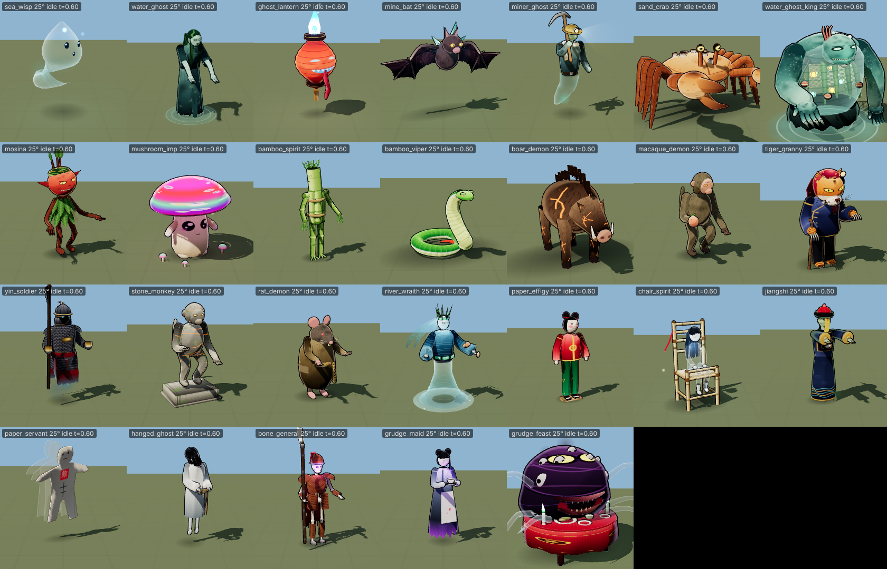

# Monster team A — 3D creatures (`js/r3d/monsters.js`)

All **26** team-A creature ids from `js/gfx/monsters.js` now have real-time 3D builds. Each one is a skinned rig
(THREE.SkinnedMesh with 9–39 bones), with painted textures, toon and rim shading, an outline, spring-bone secondary
motion, particles, and every battle clip. All 26 pass the automated check (`tools/r3d/monsters_a/check.js`):
**zero console errors, no NaN, ≤ 6 draw calls, triangle counts far under budget** (largest regular: 6.9k plus the outline;
largest boss: 10.4k plus the outline).



## Registry contract (shared with monster team B)
```js
G.Mon3D = G.Mon3D || { defs: {} }          // created robustly; only missing methods are added
G.Mon3D.define(id, builder)                 // defs[id] = builder
G.Mon3D.has(id)
G.Mon3D.create(id, { context, variant, phase }) -> instance | null   // errors → G.warnOnce, returns null
// builder: (opts, K) => instance   (K = G.Mon3D.kit; an object { build(opts, K) } is accepted too)
```
Team B can use the kit (below) or return any object that has the instance interface.

### Instance interface (same as `G.Char3D`)
`root`, `height`, `radius`, `isMon3D`, `setFacing(yaw)`, `setMove(speed)`, `play(name|null, {loop, fade, onDone})`,
`emote(k)`, `setExpression()`, `lookAt(v3|null)`, `setOpacity(a, ghost)`, **`setPhase(n)`** (boss phase visuals; also
`opts.phase`), `update(dt, camYaw, camera)`, `lights()` → `[{x,y,z,color,i,r,flicker}]` (world space), `bone(name)`
(hips/spine/chest/neck/head/handL/handR/footL/footR, with aliases for non-humanoids), `dispose()`.

- **Clips:** `idle`, `move` (locomotion blend driven by `setMove`), `attack`, `cast`, `hurt`, `die` (holds the last pose and
  dissolves away), `special`, `enter`.
- **Aliases** for the battle clip names: `attack2`/`skill` → special, `ko`/`dead` → die, `revive`/`ready` → enter,
  `victory`/`item` → cast, `guard`/`dodge` → hurt, `run`/`walk` → move.

### Kit (`G.Mon3D.kit`) — how the creatures are built
- **`kit.creature(spec)`** returns a builder. A spec is data:
  - `pal`/`vars`: the 2D palettes and hue-shift variants, copied from `js/gfx/monsters.js`, so `opts.variant` 0/1/2 matches 2D.
  - `slots`: Canvas-2D painters for a per-creature texture atlas (1024 px, growing to 2048 px when needed), with optional
    `emit` painters for the emissive map.
  - `build(B, p)`: the rig and geometry, written with the Builder.
  - `clips`, `springs`, `fx`, `lights`, `tick`, `phase`.
- **Builder:**
  - `bone(name, parent, [x,y,z])` takes model-space positions.
  - Geometry: `ell`, `tube` (Catmull-Rom sweep), `lathe`, `strip` (two-sided ribbon), `sheet` (membrane or cloth between
    two polylines), `eye`, and `geo(anyThreeGeometry)`.
  - Every primitive takes skin weights (`w`: a bone, a list of weights, or a function). Chains use joint blending where
    each segment owns its bone and the joints blend 50/50.
  - Layers:
    - `body`: toon, outlined.
    - `ghost`: translucent fresnel with drifting mist.
    - `glow`: additive, so it blooms.
  - All parts with the same layer merge into one SkinnedMesh per layer.
- **Materials:** `MeshToonMaterial` with the shared `G.R3M.ramp` and the same fresnel rim as `G.R3M.toon`. On top of that,
  per instance:
  - **dissolve**: noise plus height, with a glowing edge;
  - **hit flash**;
  - **ghost mode**;
  - emissive × vertex colour;
  - opacity.

  Outlines use `G.R3M.outline` on the skinned body; cards and strips are left out of the outline.
- **Pose layer:** clips are functions `(P, t, k, C)` that add bone rotations, offsets and scales, root motion (`P.rootM`)
  and channels (`P.ch('glow'|'dissolve'|'fade'|'flash'|'ghost'|'fx_<emitter>')`). Idle and move blend by speed;
  one-shots cross-fade over them. `atk(k)` gives a standard anticipation → strike → hold → recover envelope.
- **Spring bones:** a damped point mass per chain bone with a fixed 60 Hz substep, a rotation limit, gravity and wind.
  It is stable at 30, 60 and 144 fps and through 0.1 s spikes (checked). Used for hair, talismans, tails, flags, capes,
  rags, seaweed, tongues, ears and after-images.
- **Particles:** one `THREE.Points` per creature with premultiplied blending, so additive wisps and embers and alpha-blended
  ash, spores and drops share one draw call. Sprites: glow, paper/ash flake, droplet, sparkle. Emitters can follow a bone
  and are driven by clip channels.
- **Draw calls:** body + outline + (ghost) + (glow) + particles + blob shadow, at most 6.

## Creatures
Triangle counts are unique geometry, outline excluded. The outline mirrors the body geometry.

| id | tris | bones | design / motion highlights |
|---|---|---|---|
| sea_wisp | 2.2k | 9 | translucent teardrop of mist, curling spring tail, emissive core glow, faint face, orbiting motes; darting touch |
| water_ghost | 4.7k | 35 | hunched drowned man, 5 spring seaweed-hair strands over the face, webbed claws, rag panels, puddle with ripples and constant drips; grab-and-drag |
| ghost_lantern | 2.7k | 15 | ribbed red paper lantern with a face cut into it and lit from inside (emissive), flickering blue flame, spring tongue and tassel; swings back, then lashes with the tongue |
| mine_bat | 2.5k | 22 | membrane wings on arm and finger bones with a scalloped trailing edge, ore crystals on the back; hover-flap, swoop bite, screech |
| miner_ghost | 4.1k | 19 | brass helmet with a lamp and an additive beam, towel, pickaxe, legless ghost tail; overhead pick strike with sparks |
| sand_crab | 4.4k | 39 | barnacled shell, 8 three-segment legs, oversized crusher claw with a moving finger, spring eye stalks; sideways tetrapod scuttle, flips over on death |
| mosina | 6.2k | 26 | oversized grinning red head, leaf cape, spring sprigs, twig limbs; bouncy idle, pounce rake, giggling spin trick |
| mushroom_imp | 2.9k | 11 | psychedelic glowing cap (pulses), gills, cute stem face, baby glow-mushrooms, spores; waddle, bonk, spore pump |
| bamboo_spirit | 5.8k | 23 | bundle of culms lashed with rope, cut-culm head with carved glowing eyes, leaf-frond hands; cane whip with bamboo spikes erupting |
| bamboo_viper | 3.0k | 21 | 14-bone coil with scales, white lateral stripe and red tail, pit-viper wedge head, forked tongue; S-coil strike |
| boar_demon | 3.3k | 24 | hulking boar with an ember-crack hide (emissive), bristle crest cards, tusks; paws the ground, head-down charge, keels over |
| macaque_demon | 6.9k | 24 | pot-bellied macaque, pink face, stolen peach, talisman scrap and tail on springs; leaping swipe, throw, chest-slap taunt |
| stone_monkey | 5.9k | 23 | andesite statue with glowing magma cracks and moss on a carved plinth (the plinth stays planted); wakes, shatters on death |
| rat_demon | 6.9k | 29 | fat rat in a patched robe, string of cash, whiskers, long naked spring tail; sniffing idle, gnaw, squeak swarm |
| yin_soldier | 3.4k | 22 | faceless helmet over a void with glowing eyes, lamellar armour with a bronze mirror, red war-skirt fading into mist, spear with a spring 令 pennant; thrust |
| river_wraith | 4.2k | 30 | rising from a twisted whirlpool (ghost), water hair, reed crown, jade belt, weed beard, two orbiting fish; tide slap, wail |
| paper_effigy | 1.4k | 18 | faceted folded-paper funeral boy with a painted face and 壽 roundel; stop-motion head snaps, 180° stare, crumples and burns |
| paper_servant | 0.35k | 11 | flat cut-paper doll with a red 敕 seal and two lagging after-images on springs; flutters, edge-on slice |
| jiangshi | 6.2k | 28 | Qing court robe with 補子 badge, 海水江崖 hem, official's hat with tassel, finial and 花翎 plume, spring 符 talisman and queue; true hop locomotion (crouch, spring, land), plank fall |
| hanged_ghost | 5.6k | 35 | limp drifting figure, pendulum sway, lolled head, hair over the face, tongue, coiled rope in its hands (no rope at the neck, per the 2D brief); lasso, sigh |
| bone_general | 6.9k | 25 | skull with violet ghost-fire, ribcage, rusted lamellar, plumed helmet, tattered spring cape, extruded 偃月 halberd; cleave, guard, collapses into bones |
| grudge_maid | 3.4k | 16 | twin buns, red tears (emissive), servant jacket and apron, cracked blue-and-white teacup with steam, violet aura; tea fling, wail, bow |
| **chair_spirit** (boss) | 5.3k | 31 | bamboo ritual chair with a red cloth; the lonely girl is translucent with eyes closed and dangling feet; the chair rocks. Treated as a lost spirit, not evil: her death clip releases her into motes. **Phase 2:** the chair levitates, she looks up, tears and motes increase |
| **water_ghost_king** (boss) | 8.3k | 39 | hulking giant whose translucent belly shows the swallowed lantern-lights (glow layer, bobbing), net and floats, seaweed manes, coral and shell crown, giant claws, black pool. **Phase 2:** lanterns blaze plus an extra light, rising drowned spirits |
| **tiger_granny** (boss) | 7.3k | 31 | oversized tiger head in a flowered hood framing the face, 大襟衫 jacket with frog buttons and patches, cane, clawed paws, spring tail; claw swipe, pounce, lullaby. **Phase 2:** the hood slides back, ears up, the grin widens, fire aura plus light |
| **grudge_feast** (boss) | 10.4k | 36 | red banquet table with 冤 roundels, fish dish, rice bowls with upright chopsticks, green candle flames; behind it a grudge mass with two great eyes, a jawed maw with teeth, pale mask-faces on its surface and six translucent grasping arms. **Phase 2:** the maw gapes and glows red, the arms thrash, flames leap |

`bone_general` also gets the boss treatment (phase-2 ghost-fire flare), as the brief listed it.

## Testing
- `node tools/r3d/monsters_a/check.js [ids]` runs every id × variant 0–2 × phase 1–2 through every clip and alias. For
  each it checks for NaN, varies dt (30, 144 and 10 fps), exercises opacity, look-at, emote, lights and bones, and calls
  `dispose()`. It also checks the budgets and the console, and writes `check_result.json`. **Result: ALL OK, console clean.**
- `node tools/r3d/monsters_a/strip.js "<query>" out.png` renders frame strips: rows are ids × views, columns are time
  samples. Example: `ids=jiangshi&anim=attack&ts=0.1,0.3,0.45,0.55,0.8&views=60&fallback=1` (the `fallback=1` option adds
  the 2D art column). Every creature was reviewed this way: idle from four views, plus attack, cast and die strips,
  variants 1 and 2, and phase 2.
- The official `tools/r3d/viewer.html` / `shot.js` (`kind=mons`) renders all of them with 0 fallbacks.

## Notes and known limitations
- Everything is procedural (no asset files), so it runs from `file://`. Atlases are cached per id+variant; geometry is
  rebuilt per instance, which takes milliseconds, and skeletons are per instance.
- Faces are painted onto the head texture. Blinks scale the eye bones where a creature has modelled eyes; painted-eye
  creatures do not blink.
- **Possible future polish:**
  - the grudge_feast mask-faces read a little "googly";
  - the sand_crab legs are uniform;
  - the river_wraith weed-beard is subtle;
  - stone_monkey reuses the macaque silhouette.
- `setExpression` is stored but only bosses and phase states change their faces; most creatures express through pose.

## Requests for the lead (nothing blocking)
1. `tools/r3d/viewer.html` sets `PCFSoftShadowMap`, which r186 deprecates (it logs a warning on every run). Switching to
   `PCFShadowMap` would keep the console clean.
2. `G.R3M.outline` widths scale with distance, giving constant screen width. Monsters use `0.0026` (bosses `0.0035`).
   If the characters team settles on a different house width, the default lives in one place (`spec.outlineW` default
   in `Creature`).
3. The battle view should pass `phase` via `create(..., { phase })` or call `inst.setPhase(n)` when a boss changes phase
   (see the enemy data `phases`). `opts.enter: true` auto-plays the `enter` clip.
