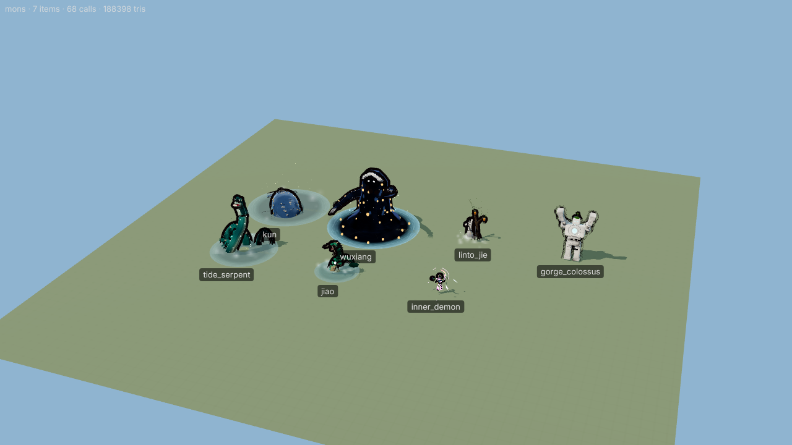

# Monster team B — report

**File:** `js/r3d/monsters_boss.js` (registers 35 creatures into `G.Mon3D`). **Tests/tools:** `tools/r3d/monsters_b/`.
**Branch:** `r3d-monsters-b`.

Team A's branch (`r3d-monsters-a`) did not exist while this was written, so the file creates the shared registry with the
exact shape given in the brief: `G.Mon3D = G.Mon3D || { defs, define(id, b), has(id), create(id, opts) }`, where the
builder is `(opts) => instance`. If team A's registry is loaded first, the file only calls its `define`. Nothing else is
shared, and every helper is private to the IIFE.

## Creatures (all 35 built, all tests passing)

| id | draw calls | tris (body, excl. outline) | |
|---|---|---|---|
| marionette | 5 | 9752 |  |
| lantern_golem | 5 | 7568 |  |
| linto_jie | 6 | 13992 | boss |
| nether_guardian | 6 | 9368 | boss |
| fog_spirit | 5 | 2960 |  |
| bear_spirit | 4 | 9422 |  |
| hundred_eye | 4 | 11362 |  |
| serpent_shade | 4 | 3588 |  |
| inner_demon | 7 | 7380 |  |
| jiao | 7 | 5282 |  |
| stone_guardian | 5 | 6042 |  |
| lamp_moth | 6 | 3230 |  |
| drowned_soldier | 5 | 6404 |  |
| tide_grudge | 6 | 5106 |  |
| drowned_swarm | 5 | 7360 |  |
| kun | 7 | 9852 | boss |
| lily_demon | 6 | 3520 |  |
| faceless | 6 | 6792 |  |
| tower_warden | 5 | 5182 |  |
| jewel_child | 5 | 1296 |  |
| baibu | 6 | 14010 |  |
| wuxiang | 8 | 19938 | boss |
| wind_sprite | 7 | 4938 |  |
| wind_demon | 7 | 12170 | boss |
| mountain_ghost | 4 | 5804 |  |
| plague_ghost | 5 | 6336 |  |
| greed_ghost | 4 | 5288 |  |
| hungry_ghost | 6 | 5140 |  |
| pirate_ghost | 5 | 7124 |  |
| moray | 6 | 3128 |  |
| sea_monster | 5 | 11656 |  |
| cliff_spirit | 5 | 5030 |  |
| fallwind | 8 | 11724 | boss |
| gorge_colossus | 7 | 11140 | boss |
| tide_serpent | 7 | 9316 | boss |

Budgets: ≤ 8 draw calls each (the outline hull and particle systems count). Regular creatures stay under 15k tris and
bosses under 60k. The largest regular creature is baibu (14.0k) and the largest boss is wuxiang (19.9k). The
inverted-hull outline draws the body geometry a second time, so on screen the body's tris are drawn twice.

## How a creature is made

* **Rig.** A `THREE.Bone` hierarchy is authored in model space, and everything is skinned to it. Rigid parts get weight 1
  on one bone. Swept tubes (serpents, limbs, tails, hair, tentacles) get smooth two-bone weights along their chain. Skirts
  and capes are lathes skinned to a ring of 2-bone spring chains.
* **Draw calls.** Each creature uses one `SkinnedMesh` per material class, all sharing one `Skeleton`:
  * `body`: `G.R3M.toon` with fresnel rim, plus the `G.R3M.outline` inverted hull
  * `cut`: alpha-tested, double-sided toon (fronds, petals, fins, rags, sails)
  * `glow`: HDR emissive with flicker; bloom picks it up
  * `ghost`: translucent fresnel spectre with drifting noise
  * `psy`: the 一息界 shader, a kaleidoscope-folded Kali fractal mapped to a cosine palette with a fresnel sheen
  * `water`: translucent scrolling water
  * `soft`: a soft alpha card
  * `add`: an additive card (flames, beams, mandalas)
  * up to two GPU particle systems, additive and normal. Particle motion (rise, fall, orbit, swirl, wander) runs in the
    vertex shader, so it costs no CPU.
* **Textures.** One painted 2048² atlas has 100 cells (scales, fur, lamellar, marble, sand, brocade, talisman 符, 勇
  roundel, opera red-face, faces, eyes, maw, mandala, lily, frond, and others). Parts tint it per vertex. A `fract` plus
  `textureGrad` shader tiles any cell, so a whole creature shares one texture and one material per class.
* **Shared shader features:**
  * object-space noise **dissolve** with an emissive edge, used for `die` and `enter`
  * **hit flash**
  * variant hue shift (`opts.variant` 1/2)
  * a thin-film **iridescence** term (`iri`) on the toon body, used by serpent_shade, inner_demon and wuxiang phase 3
  * clip-below-water (`clipY`) for creatures that rise out of the sea
* **Animation.** Animation is procedural and layered. The base layer is idle/move with blending. One-shot clips
  cross-fade over it and are timed as anticipation → action → follow-through → recovery (`pulse`/`keys` envelopes).
  Shared clip libraries exist for serpents, humanoids, ghosts, constructs and wind creatures, and every creature
  overrides clips where its anatomy calls for it. For example: the marionette hangs off its control bar (snappy string
  tugs, strings cut on death), kun breaches, tide_grudge crashes like a wave, and the moth flaps with a hard down-beat.
* **Spring bones.** VRM-style verlet springs with fixed 60 Hz sub-stepping. They cover hair, whiskers, sleeves, skirts,
  capes, flags, tassels, tails, antennae, tendrils and lantern chains. Springs reset when the root teleports.
* **Bosses.** Bosses have phase transformations. `inst.setPhase(n)` (also `opts.phase`, or `play('phase2')`) grows in
  phase-only parts on bones kept at scale 0, with an overshoot, and triggers a flash plus the `special` clip:
  * linto_jie: her hair rises into a dark halo and the pandanus fronds thrash
  * nether_guardian: soul-flames burst from the pauldrons
  * tide_serpent: black thorns split its spine
  * gorge_colossus: marble plates break off and orbit its core
  * wind_demon / fallwind: the storm widens
  * kun: a starfield wakes on its skin and its maw opens on a galaxy
  * jewel_child: a second lattice unfolds
  * wuxiang: phase 2 opens mouths and raises more arms; phase 3 brings the mirror skin, kaleidoscope face, mandala halo
    and wheeling shards
* **Interface.** The instance follows the contract: `root`, `height`, `setFacing`, `setMove`, `play(name, {loop, onDone})`,
  `emote`, `setExpression`, `lookAt` (head yaw/pitch, smoothed and limited), `setOpacity(a, ghost)`, `update(dt)`,
  `bone(name)`, `lights()`, `dispose()`.
  * Clips: `idle move attack cast hurt die special enter`.
  * Aliases: `ko→die`, `skill/victory→special`, `attack2→attack`, `guard/dodge→hurt`, `revive→enter`, `item→cast`, `run/walk→move`.
  * `context: 'map'` scales a creature to about 1.55 units (bosses about 2.4), and `inst.mapScale` exposes the factor.

## Design notes (culturally grounded, no real deities)

marionette (傀儡戲 red-face general on strings), drowned_soldier (Qing 勇 brave), linto_jie (林投姐 with the pandanus),
bear_spirit (Formosan black bear's white V), baibu (benevolent cloud serpent with the 百步蛇 diamond pattern),
hungry_ghost (孤魂 / 搶孤), plague_ghost (failed 符 talismans), greed_ghost (offering tower, 元寶), wind_sprite / wind_demon
(九降風; the cracked 長明燈 in its chest), fallwind (恆春 落山風), cliff_spirit / gorge_colossus (清水斷崖 / 太魯閣 marble),
kun (北冥有魚), jiao (unfinished dragon with a pearl). The 一息界 beings (hundred_eye, serpent_shade, inner_demon,
jewel_child, wuxiang phase 3) use the psychedelic shaders.

## Testing

* `node tools/r3d/monsters_b/test.js [ids]` builds battle and map instances of every creature. It plays every clip and
  alias, steps boss phases and renders, and checks:
  * no console or page errors
  * the full interface is present
  * the draw-call and triangle budgets
  * that `die` dissolves
  * finite bones, bounds and lights after animation
  * map scaling and `dispose()`

  **Current result: 35/35 pass, 0 console errors or warnings.**
* `tools/r3d/monsters_b/view.html` with `shot.js` is a harness. It supports `phase=`, frame strips (`frames=&dt=`), clip
  sheets (`set=attack:0.3,cast:0.5,…`), focus/zoom (`ly lx lz rad`) and optional bloom like the game.
* `tools/r3d/monsters_b/sheet.sh <id> <dir>` writes an 8-pose clip sheet. Every creature's sheet was rendered and checked by eye.
* `tools/r3d/monsters_b/art2d.html` / `art2d.js` is a 2D reference sheet of the original canvas art, used as the design source.
* The lead viewer works unchanged: `node tools/r3d/shot.js "kind=mons&ids=kun,wuxiang&views=4&anim=special&t=0.6" out.png`.

## Notes for the lead / other teams

* **Shadow map type.** r186 logs `PCFSoftShadowMap has been removed` for the viewer's shadow-map type. It comes from
  `viewer.html`, not from this file; my harness ignores that one warning.
* **NaN guard.** The template merger fixes degenerate normals before upload. One NaN pixel spreads over the whole frame
  through bloom. Other teams may want the same guard.
* **Shared clock.** Shader time comes from `G.time`, so all creatures share one clock and the viewer is deterministic.
* **Possible follow-ups:**
  * gorge_colossus still reads a little blocky up close; it could use more sculpted plates
  * fallwind's grass mane is thin at battle distance
