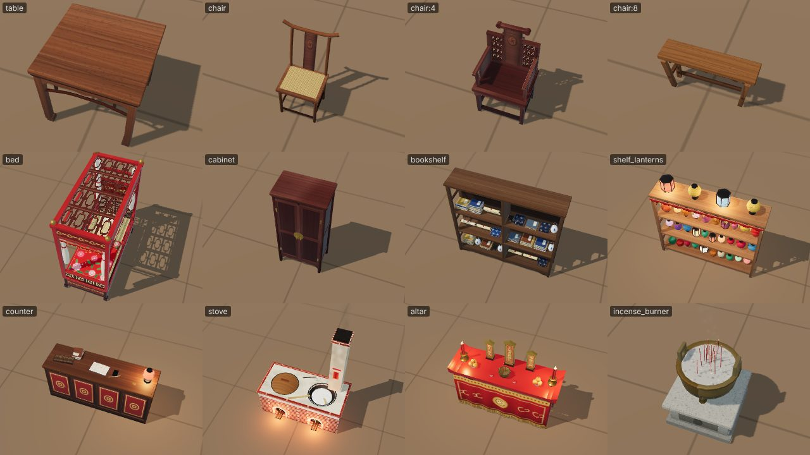
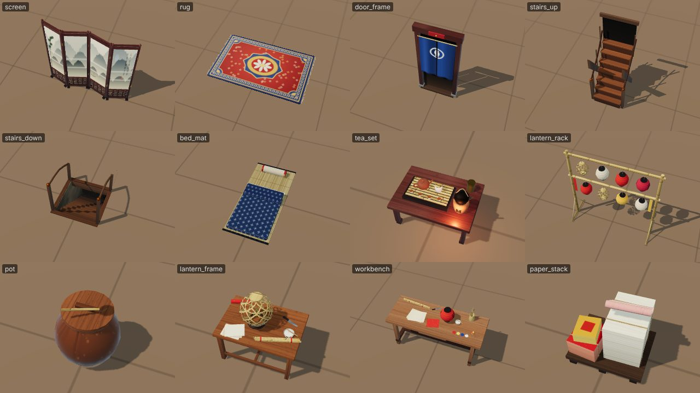
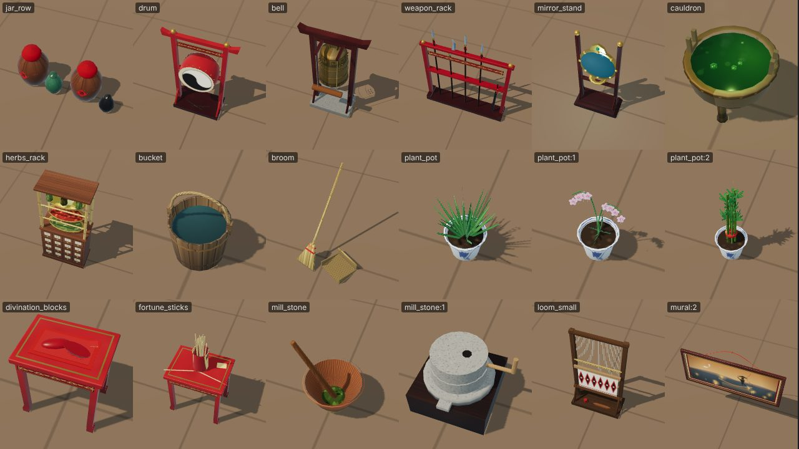
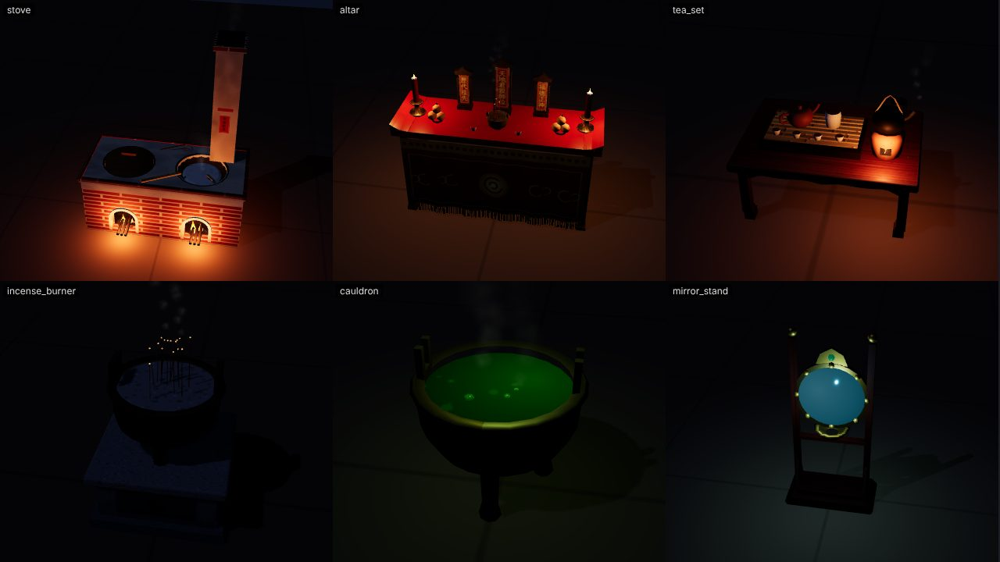
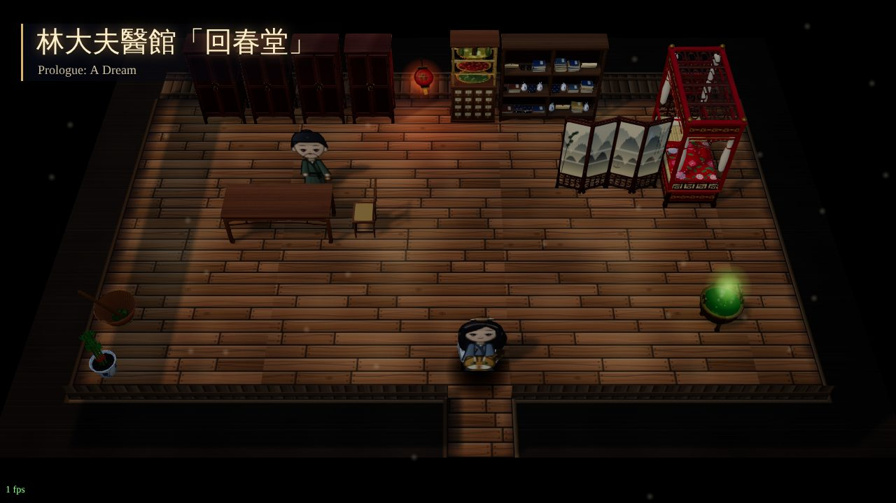
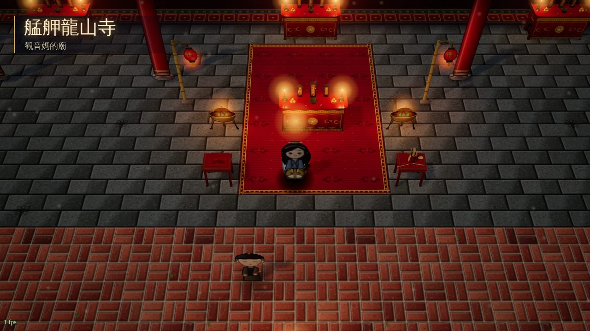
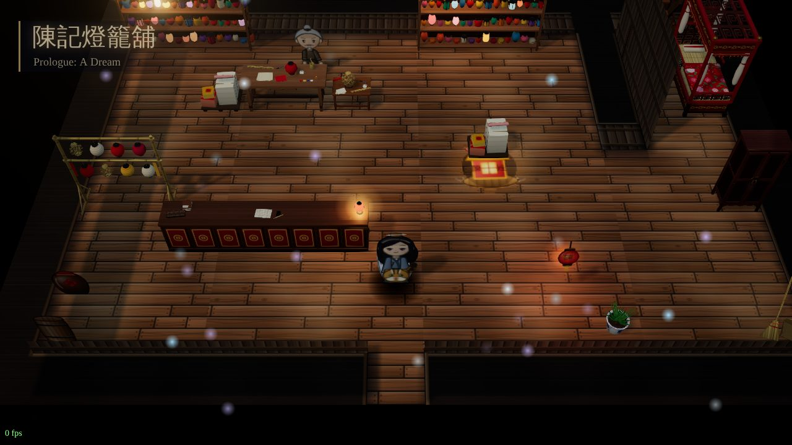

# Props team B — interior props (`js/r3d/props_interior.js`)

All 37 interior object types assigned to team B now have real 3D models, registered through `G.Models.define`.
Every model builds with zero console errors, has no NaN bounds, and stays within the triangle budget. They have
been checked in the asset viewer, on a contact sheet with each model's own point lights (day and night, from all
four 90° camera yaws), and in the game (`jiufen_teahouse`, `jiufen_shop`, `jiufen_clinic`, `bangka_longshan`,
`luo_1f`, both with `?r3lite` and at full quality).

Edits outside my file: one `<script>` line after `props.js` in `index.html` and in `tools/r3d/viewer.html`.

## How it is built
- **One painted atlas** (2048², about 90 regions, painted with Canvas 2D once in about 0.2 s) holds every generic
  surface: 紅木/teak/walnut/camphor/pine woods with flowing grain and knots, red/black lacquer, gold leaf, brass,
  bronze with verdigris in the relief bands, iron, granite, plaster, brick, blue-and-white porcelain (纏枝蓮),
  glazes, 客家花布, 藍染 indigo, rush mat, rattan, papers, thread-bound book covers, lantern papers, herbs, embers.
  Calligraphy uses the required font stack: 神主牌 tablets (天地君親師位 / 歷代祖先 / 福德正神), the 司命灶君
  paper, 中藥櫃 drawer labels (當歸, 黃耆 …), 籤 on the 籤筒, a 酒 diamond, the lantern 福/燈, and on the screen 蘇軾's
  「水光瀲灩晴方好…」 on the front with 辛棄疾's 「眾裡尋他千百度…燈火闌珊處」 on the back.
- A matching **ORM atlas** (G = roughness, B = metalness) lets brass, lacquer, cloth and wood share one
  `MeshStandardMaterial`. A whole piece of furniture is usually one draw call. There are three shared atlas
  materials: opaque, `cut` (alpha-tested and double-sided, for lattice, leaves, fringe, warp threads and tassels) and
  `lit` (emissive from the atlas × vertex colour, so tinted lantern paper glows in its own colour).
- **`bake()`** gives each part world-scale UVs inside its region, with the grain following the part's long axis,
  plus **vertex AO** (darker toward the floor and on undersides) and an optional tint. After that, `K.merge` runs.
- Big unique paintings get their own cached canvases. The **murals** (v0–4) and the **rug** are the 2D art redrawn
  at 6–7× resolution, so they match the 2D game exactly. The 4-panel **screen** landscape and the **門簾** curtain
  are painted separately.
- **Animated parts** are kept separate:
  - **GPU flames** and **smoke/steam cards** are camera-facing quads animated entirely in the shader by one shared
    time uniform and seeded by world position, so clones differ and there is no CPU cost per particle.
  - The door curtain, the hanging lanterns on `lantern_rack`, the bell's striker log and the cauldron's bubbles are
    posed in `update()`.
- `lights(o)` exists for the stove mouths, altar candles, counter lantern, the shelf's lit display lanterns, the
  tea brazier, the cauldron and the soul mirror. Positions are on the flame or lantern, because the map view puts a
  halo there.

## Models and variants
| type | notes |
|---|---|
| table | 八仙桌: waist, carved 壼門 aprons, horse-hoof legs, humpback stretchers with struts. `o.w` widens it into a long table. |
| chair | Direction comes from `o.dir` or `o.v % 4`. Style comes from `o.style` or `⌊o.v/4⌋ % 3`: 0 = 燈掛椅 yoke-back (as in the 2D art), 1 = 太師椅 with a 屏風 back, lattice and arms, 2 = 板凳 bench with splayed legs. `variants: 12`. |
| bed | 紅眠床: red lacquer canopy bed, gilt bat-and-cloud 床楣 friezes on all sides, 燈籠錦 lattice head and rails, open lattice canopy (so the camera sees the 客家花布 quilt), gathered gauze curtains, valances. |
| cabinet | 圓角櫃: framed and panelled doors, central stile, round brass 面葉 with pulls, hinges, carved apron. |
| bookshelf | `o.w` compartments; `o.v` arrangement (8). Thread-bound book stacks, scrolls, 書套 cases, porcelain vases, a lacquer box. |
| shelf_lanterns | `o.w`, `o.v` (8). Round, long, drum, palace and folded lanterns in many colours and motifs; a lit display row on top; red valance with gold fringe. |
| counter | `o.w`. Lacquer coin panels on the customer side; abacus, open ledger, inkstone and brush, coins, lit 福 lantern on top; drawer bank and ledgers on the shopkeeper side. |
| stove | 灶: brick body with arched fire mouths (fire, embers, firewood), plaster top with real wok holes, lidded wok and rice wok with steam, blow-tube, ladle, chimney with smoke and the 司命灶君 paper (text only). |
| altar | 翹頭案 with 桌裙 frontal, three 神主牌 tablets (no deity image anywhere), candles with flames, orange plates, a censer with smoking sticks, tea cups. |
| incense_burner | Bronze tripod 鼎 with cast loop ears on a granite pedestal; about 15 sticks with glowing tips; three smoke plumes. |
| screen | Zig-zag 4-panel 屏風: ink landscape on the front, poem on the back, lattice skirts, brass hinges. |
| rug | `o.w × o.h`; the 2D design at high resolution, slight lumps, fringe through alpha. |
| door_frame | Wall-mounted on the wall's south face (local z = +0.5). Dark doorway, stone post bases, lacquer plaque, threshold, and a swaying blue 門簾 with the lantern crest. |
| stairs_up | Seven treads rising north, stringers, handrails, newel posts, and a dark stairwell opening on the wall face. |
| stairs_down | **A real hole in the floor.** The pit (walls, 11 treads at about 40°, darkness by depth) renders with `renderOrder −3`, then a depth-only mask at floor level stops the map floor from painting over it. Frame and rails sit above. |
| mural | `o.v` 0–4 from the 2D art (燈母, girl of light on the sea, the ferryman, lantern sky, river serpent). Mounted on the wall's south face with a gilt-lined frame and a hanging cord. |
| bed_mat | 草蓆, rolled pillow, folded 藍染 quilt. |
| tea_set | 功夫茶 on a low table: Yixing pot, 公道杯, cups with tea, slatted tray, tin caddy, clay 風爐 with flame and a steaming kettle. |
| lantern_rack | Bamboo frame; 8 hanging lanterns (bamboo skeletons, white, red, gold, 福) swaying independently; drying paper strips. |
| pot | Brown-glazed 甕 with a wooden lid and a gourd dipper. |
| lantern_frame | Low bench, ring stand, half-pasted bamboo skeleton, strip bundle, knife, paste bowl, paper. |
| workbench | Camphor trestle bench with drawer; paper, red paper, a lantern on its stand, 筆筒 with brushes, paint dishes, paste, strips, knife, thread. |
| paper_stack | Pallet with tied cream stock, red paper, 金紙 and pink rolls. |
| jar_row | `o.w`, `o.v` (8). 紹興 wine jars with red-cloth mud seals and 酒 labels facing out, small green and black glazed jars. |
| drum | 堂鼓 in a red lacquer stand with gilt frieze, taiji heads, brass nails, sticks. |
| bell | 梵鐘 with relief bands, nipples and a 蒲牢 loop in a timber frame; a striker log on ropes that swings. |
| weapon_rack | Lacquer rack, spears with red tassels, a 關刀, a sheathed sword. |
| mirror_stand | 照魂鏡: brass rim with eight bosses, faintly glowing face, gold crest with a jade bead, cloud feet. Cool blue light. |
| cauldron | Bronze 鼎 with glowing green brew, bubbles that swell and pop, and steam. |
| herbs_rack | 中藥櫃: 16 labelled drawers below; drying sieves (green / goji / chrysanthemum) and hanging bundles above. Combines the brief (drawers) with the 2D art (sieves). |
| bucket | Coopered staves, bamboo hoops, water, rope handle. |
| broom | Bamboo broom leaning against the wall to the north, and a woven 畚箕 dustpan. |
| plant_pot | `o.v`: 0 sword-leaf plant, 1 pink orchid, 2 富貴竹 with a red ribbon. All in blue-and-white porcelain. |
| divination_blocks | Red lacquer table with gilt inlay, mat, and a 筊杯 pair showing 聖筊 (one flat side up, one round side up). |
| fortune_sticks | 籤筒 with 26 sticks and fallen sticks, plus a 籤詩 slip. |
| mill_stone | `o.v`: 0 = Hakka 擂茶 bowl with combed interior, paste and guava-wood pestle (what the 2D art and the maps show); 1 = 石磨 granite hand quern on a frame. See the decision note below. |
| loom_small | Upright loom with warp threads, a half-woven Atayal-style diamond band, heddle bars, beater, shuttle. |

Budgets: the largest is `shelf_lanterns` at about 7.8k triangles; the bed, bookshelf and altar are at 3–5k; small
props are at 0.2–2.5k. Draw calls after merge are 1–3 (plus FX meshes) for every type except two:
`lantern_rack` has 12, because each of its 8 lanterns sways separately, and `cauldron` has 6, because of its 4
bubbles. A full per-type table is printed by `tools/r3d/props_interior/check.js`.

## Decisions to confirm
- **mill_stone** default is the 擂茶 bowl, because the 2D art and every map that places one (clinic, 竹塹 米粉,
  客家劉家 …) show that. The 石磨 quern named in the brief is variant `v: 1`.
- **herbs_rack** combines both: 中藥櫃 drawers below and drying sieves above.
- **chair** defaults to the 2D yoke-back. Use `style: 'taishi'` / `'stool'` (or `v` 4–7 / 8–11) for 太師椅 / 板凳.

## Tests (`tools/r3d/props_interior/`)
- `check.js [atlas.png]` builds every type and variant in the viewer page; prints triangles, draw calls, materials,
  FX, NaN bounds, size vs footprint and console errors; dumps the atlas.
- `sheet.html` + `sheet.js "items=bed,mural:3,chair:4&yaw=25&pitch=52&night=1&t=2" out.png` is a contact sheet
  with one auto-framed tile per item, using the def's own point lights and running `update()` to time `t`.
- `game.js "map=jiufen_clinic[&r3lite]" out.png [sec]` opens the real game on a map, screenshots it, and lists
  console errors (it ignores the pre-existing missing `fontdata.js` / `i18n/en_*.js` 404s).
- `art2d.html` + `shot2d.js` render the 2D art large, as the reference.
- `tools/test/validate.js`: 0 errors, with the same 32 pre-existing warnings as before.

## Notes for the lead (outside my file; not changed)
1. **Spirit objects**: the per-frame loop in `mapview.js` (`if (o.spirit) node.traverse(…)`) writes `transparent/opacity` onto the node's materials.
   With shared `K.mat`/atlas materials that would fade every prop in the room. My `define()` wrapper adds the spirit
   flag to the cache key and clones the materials for spirit instances, so props_interior is safe. Other teams'
   `K.mat` users are probably affected.
2. `collectLights()` does not apply `o.rot3d` to model light offsets. That only matters if a map rotates a lit prop.
3. A halo sprite is added for every light. That is why I gave no light to props with only tiny embers (the
   incense burner): its halo read as a glowing disc.
4. `tools/r3d/viewer.html` calls `update(node, { t: id }, …)` without position or variant, and never adds the
   def's `lights()`. My `sheet.html` does both, if you want to fold that into the viewer.
5. In `G.Models.create`, `v` is forced to 0 unless the def declares `variants`. That is worth one line in
   CONTRACTS_3D (it caught me at first).
6. Your message named the report `props-interior.md`; the original brief said `props_interior.md`. I used the
   latter, which matches the file name.
