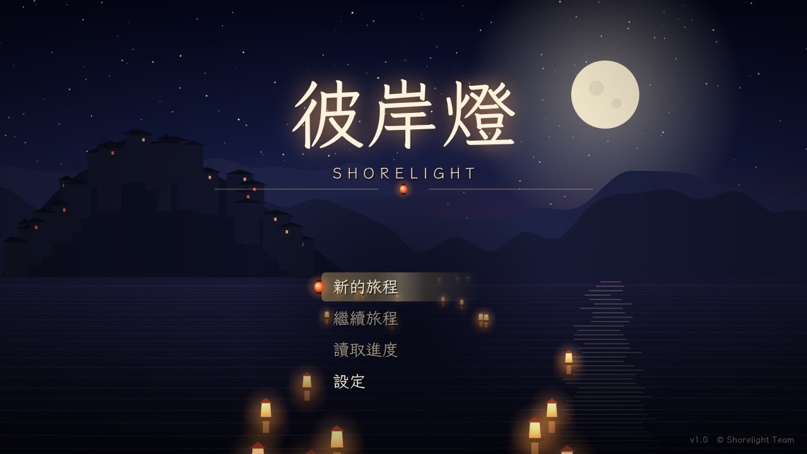
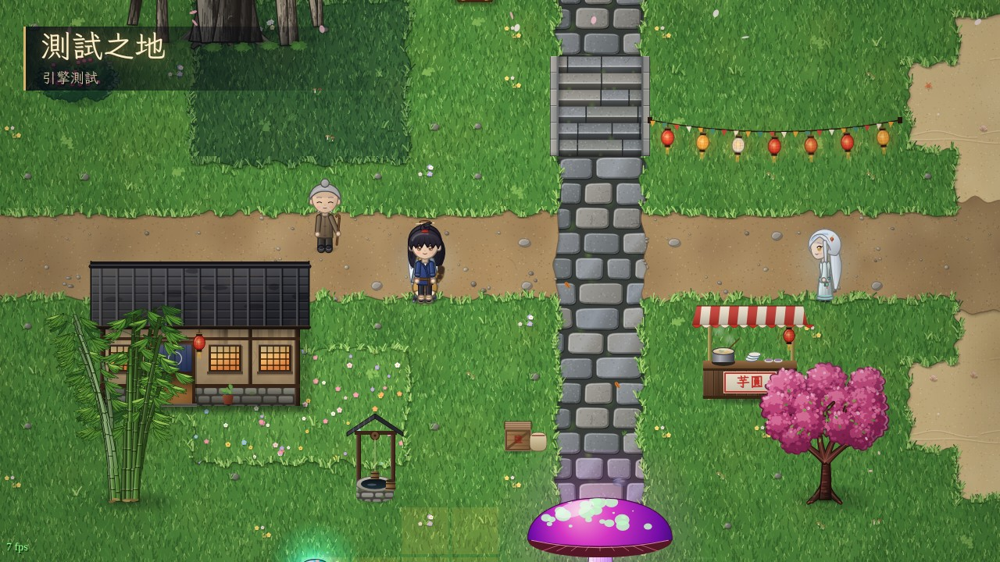
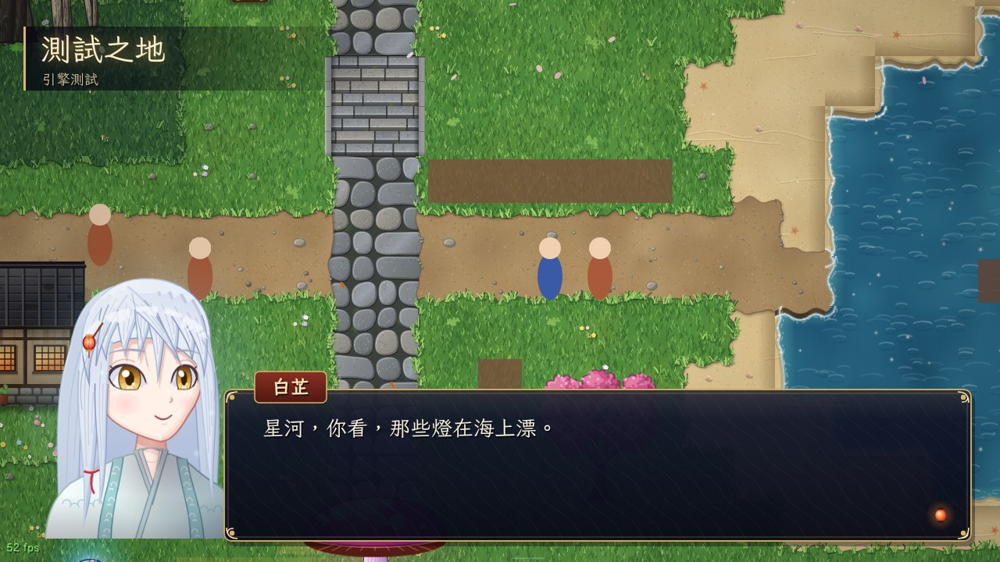
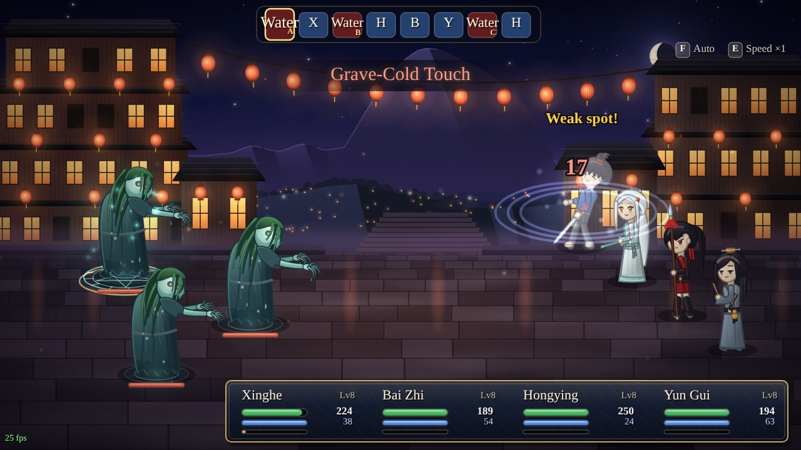
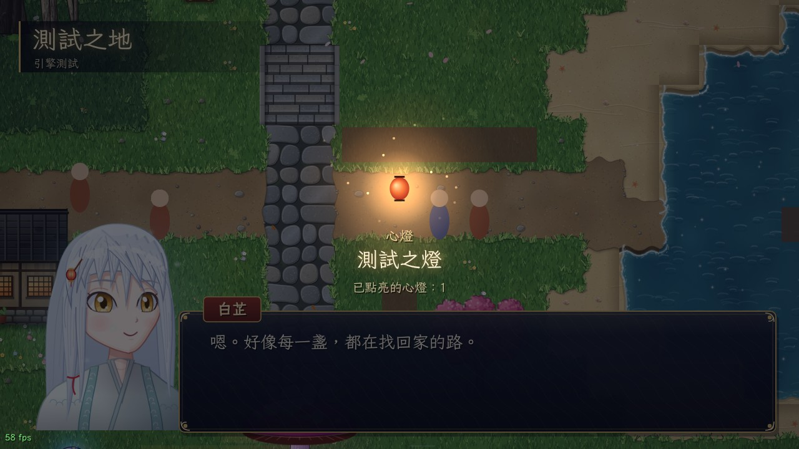
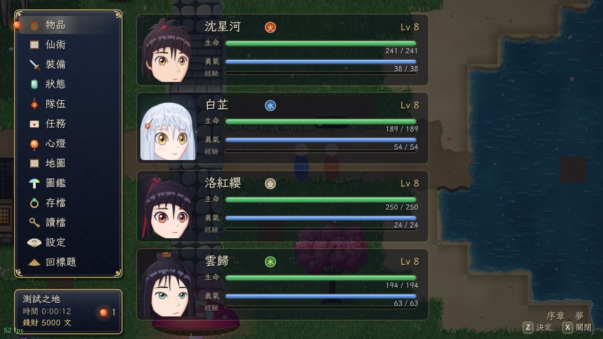
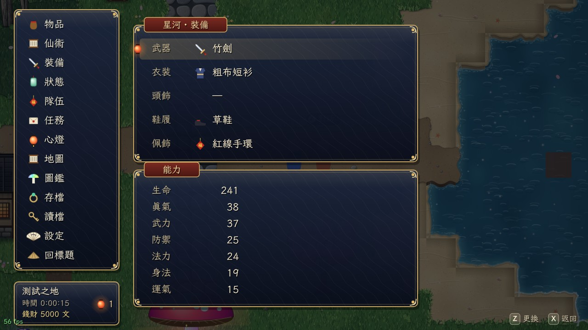
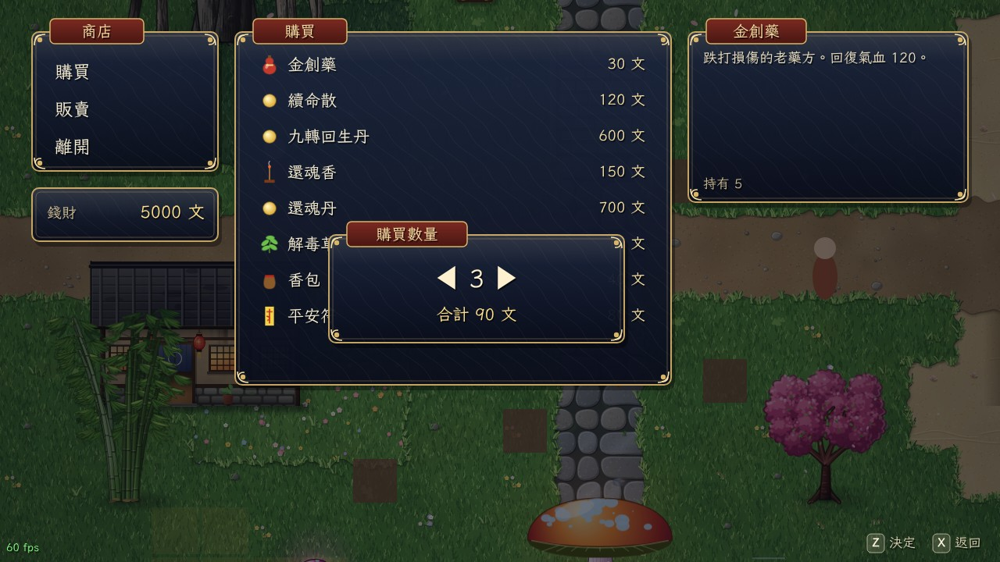
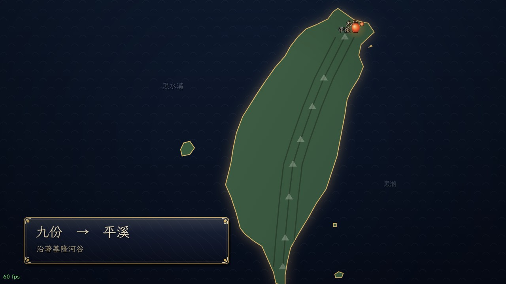
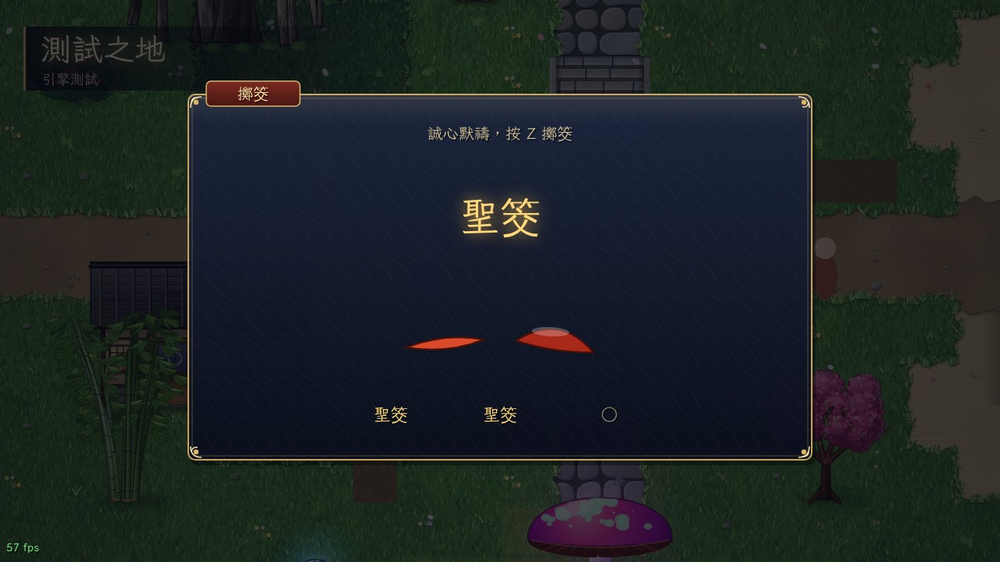

# Screenshots · 遊戲截圖

All images are captured from the real game running in Chromium (headless), at 1280×720.

## Gameplay
| | |
|---|---|
|  標題畫面 Title screen |  探索 Exploration (sandbox map) |
|  對話 Dialogue with portrait |  戰鬥 Battle (English mode) |
|  心燈 Heart-lantern acquired |  選單 Pause menu |
|  裝備 Equipment |  商店 Shop |
|  旅途地圖 World-map travel |  擲筊 Divination minigame |

## Art sheets (`art/`)
Character sprites, portraits, monsters (3 sheets), battle backdrops, terrain tiles, nature, buildings & street props,
regional architecture and interior props — each rendered from its preview page in `tools/preview_*.html`.

## Character design options
See [`../docs/design/CHARACTER_OPTIONS.md`](../docs/design/CHARACTER_OPTIONS.md) — 10 options for each lead.

*More screenshots are added as chapters are completed (`chapters/`).*
